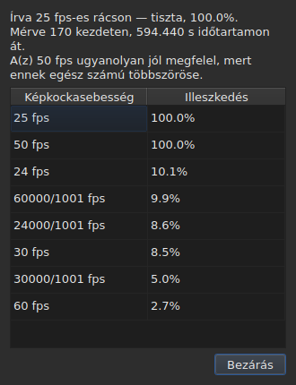

# A képkockarács

<!-- machine-translated -->
> Ez az oldal gépi fordítás, amelyet a nyelv egyik olvasója még nem nézett át.

Egy feliratfájl **nem deklarálja** azt a képkockasebességet, amelyhez képest
a pozícióit kiszámították: a SubRipnek nincs fejléce, a
WebVTT-é szabad szöveg. Az ablak maga **következteti ki** a pozíciókból,
megnyitáskor, és két helyen mutatja, amelyek nem ugyanarra
a kérdésre felelnek.

| Felület | Amit ad |
| :------ | :------ |
| az állapotsor | **a választ**, állandóan és kérdezés nélkül |
| `Eszközök ▸ Képkockasebesség-elemzés…` | **az indoklást**, ha látni akarják |

## Amit az állapotsor mutat

Jobb oldalon, a beolvasott fájl [kódolásáról](files.md#a-kódolás-az-állapotsorban) szóló közlés és a
[társított videóról](video.md#amit-az-állapotsor-mutat) szóló közlés között:

| Helyzet | Amit kiír |
| :------ | :-------- |
| a pozíciók rácson vannak | `Grid: 24 fps` |
| csak egy részük | `Grid: 29.97 fps (partial)` |
| egyetlen ismert rács sem illik | `No grid` |

**A `No grid` nem nevez meg képkockasebességet, és ez szándékos.** A jelöltek
halmaza zárt — az a nyolc, amelyet az átváltási párbeszédablak kínál —, és
közülük a legkevésbé téves megnevezése téves választ adna ott, ahol
a „nem tudom” a helyes.

**A `No grid` két okból állhat elő, és ezek nem ugyanazt a választ jelentik.** Vagy nincs
illeszkedő rács, vagy a fájlban túl kevés a feliratsor ahhoz, hogy bármit
lehessen mondani róla — két kezdet mindig tökéletesen igazodónak látszik, és ez
semmit sem bizonyít. Az állapotsor mindkettőről ugyanazt mondja;
**az elemzés megkülönbözteti őket**, és az első esetben megadja, mennyivel
marad le a legjobb jelölt.

A sor **minden művelet után frissül**. Egy fájl másik
képkockasebességre igazítása megváltoztatja a rácsot, és az állapotsor nem
hirdetheti tovább a régit.

### A képkockákban számolt dokumentumnak nincs rácsa, képkockasebessége van

**A MicroDVD az egyetlen a kilenc közül, amely képkockákban számol.** Minden sora
két képkockaszámot hordoz és semmi mást, és a fájl **nem mondja meg**, milyen
képkockasebességgel kell értelmezni őket. Az állapotsor ugyanazon a helyén ekkor ez áll:

| Helyzet | Amit kiír |
| :------ | :-------- |
| a dokumentum képkockákban van számolva | `Frames: 24000/1001 fps` |

**Ez nem a rács, és a rács itt körkörös volna.** Egy MicroDVD-dokumentum pozícióit
a képkockáiból számították ki, éppen ezzel a
képkockasebességgel; ha ebből rácsot következtetnének ki, ugyanezt a számot kapnák vissza, vagyis egy adatot,
amely mérésnek van öltöztetve.

**Hogy honnan származik, azt egyszer mondja ki** az olvasás, a
[diagnosztikák listájában](files.md#az-olvasás-diagnosztikája):
`counts in frames and states no rate; it was read at ("24000/1001")`. Az állapotsor
sora viszont azt mondja, ami van, állandóan.

**A képkockasebesség elvétése az egész fájlt elmozdítja**, és a
[`Convert Frame Rate…`](operations.md#convert-frame-rate) párbeszédablak az a hely, ahol kijavítható:
az olvasási képkockasebességgel nyílik meg, és kimondja, hogy ez az.

## Amit az elemzés mutat

Az `Eszközök ▸ Képkockasebesség-elemzés…` **nem módosít semmit.** Egy összefoglalóval és
a nyolc jelölt rangsorával nyílik meg, pontszámaikkal.




Az összefoglaló megadja a választ, majd azt, ami módosítja — minden mondat csak
akkor jelenik meg, ha van mondanivalója:

| Amit ott olvasni lehet | Mikor |
| :--------------------- | :---- |
| hány kezdetre, és mekkora időtartamra vonatkozik | mindig |
| mennyivel van eltolva a fájl a rácsától | a pozíciói egy állandó erejéig rajta vannak |
| hogy egy másik képkockasebesség ugyanolyan jól illik | az megtartott egész többszöröse |
| hogy az időtartam nem teszi lehetővé két képkockasebesség megkülönböztetését | a fájl túl rövid ahhoz, hogy szétválasszák őket |
| hány kezdet esik ki a rácsból, **és hány szakaszban** | a fájl részleges |

**A szakaszok száma az, ami megkülönböztet két történetet**, amelyeket a
százalék önmagában összekever. Sok egykezdetes szakasz a kézzel, egyenként
javított pozíció. Néhány hosszú szakasz egy újraidőzített
rész, vagy két másikból összeállított fájl.

**A teljes rangsor látszik, nem egyetlen válasz.** Egy fájl, amely
a 25-höz száz százalékban, az 50-hez száz százalékban illik, olyasmit mond, amit egy
önálló ítélet elrejtene.

## Ha az átváltás téves volt

Az a fájl, amely egyetlen rácsra sem esik, néha olyan fájl, amelyet **rossz
képkockasebességgel váltottak át**: ekkor nagyon is valódi rácson van, de egy olyan aránnyal eltolva, amely
a nyolc egyikéé sem. Ha a kikövetkeztetés `none` vagy `partial` eredményt ad, az elemzés **a nyolc szabványos
képkockasebesség ötvenhat rendezett párjában** keresi — ez a halmaz, zárt — azt,
amelynek az átváltása a pozíciókat visszahelyezi egy rácsra. Minden arány a pozíciókra van alkalmazva, és
**magát az eredményt a kikövetkeztetés ítéli meg**: a megbízhatóság az, amit ő mondana, sosem egy
kitalált szám. Két pár, amely ugyanazt az arányt adja, például 30-ról 25-re és 60-ról 50-re, egyetlen
átváltás.

A mondat az összefoglalóhoz kerül:

```text
converting from 24 to 25 fps puts the positions on a 24 fps grid: 99.9%, against 11.8% as they are and 14.9% for the next best conversion
```

Megadja az átváltást, azt a rácsot, amelyre a pozíciók esnének, és hogy mennyire jól esnek rá,
**majd az eltérést a pozíciók jelenlegi állapotához és a többi átváltás legjobbikához képest.** Egy `Convert Frame Rate…` gomb bezárja az elemzést, és megnyitja [az átváltási
párbeszédablakot](operations.md#convert-frame-rate) **a talált párral kitöltve** — semmi sem alkalmazódik,
amíg a párbeszédablakot el nem fogadják, és a megszakítás elég a visszalépéshez. A mellette megnyitott videó
lehetővé teszi, hogy a kép alapján ítéljék meg, helyes-e a válasz.

**Ha két pár egyformán jó, egyiket sem javasolja, és a mondat ezt kimondja:**

```text
converting from 30 to 25 fps and converting from 25 to 24 fps fit equally well (99.7% and 99.6%), so none is proposed
```

Ez inkább a szokásos eset, mint a kivétel: egy 28,8 képkocka/másodperces rács
ugyanúgy visszavezethető a 24-re, mint a 30-ra, és egy fájl, amelynek az idői mind megduplázódtak, a 25-ös rácson marad.
Az a mozdulat, amelynek egyetlen javítása van, egy **már** a célképkockasebességen lévő fájl átváltása. Döntetlen
esetén a videó dönt: a `Convert Frame Rate…` ablakot maguk nyitják meg a két pár egyikével.

**Semmit sem mond** egy már rácson lévő fájlról, egy olyan fájlról, amely túl rövid ahhoz, hogy
az ítélet bármit érjen, sem olyanról, amelyet a halmaz egyetlen átváltása sem helyez vissza rácsra — sodródás,
a nyolc képkockasebességen kívüli arány, szerkezet nélküli pozíciók.

## Amit a táblázat nem mutat

**A táblázat egyetlen sora sincs megjelölve a rács miatt**, soha.

Amint egy pozíciót kézzel kijavítanak, megszűnik igazodni. Egy
automatikus jelölés ezért a felhasználó munkáját jelentené
anomáliaként, egy olyan fájlon, amelyet éppen javít. A kikövetkeztetés
a **dokumentumról** szól, és az elemzés az egyetlen kivétel — mert
éppen ezért nyitották meg.

A táblázat jelölései viszont arra vonatkoznak, ami nem áll össze: egy vég
a kezdete előtt, egy átfedés, egy megtört sorrend. Lásd [A táblázat](table.md).
