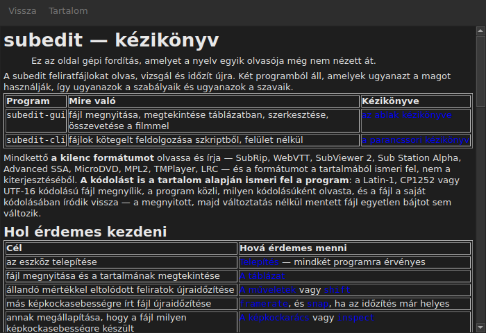

# A kézikönyv az ablakban

<!-- machine-translated -->
> Ez az oldal gépi fordítás, amelyet a nyelv egyik olvasója még nem nézett át.

A `Súgó ▸ Kézikönyv`, vagy az `F1`, **pontosan ezt a kézikönyvet** nyitja meg a saját ablakában.




## Mit nyit meg, és miért nem egy webcímet

**A program mellé telepített kézikönyvet**, nem az interneten lévő oldalt.

A webcím a fejlesztés alatt álló verziót írná le, nem a kézre állót.
Az a felhasználó, aki olyan verzió kézikönyvét olvassa, amilyene nincs, rosszabbul jár, mint
az, akinek egyáltalán nincs kézikönyve — ezért olvassa az ablak a telepítés által lerakott
fájlokat, a `<prefix>/share/subedit/manual` alatt. Lásd:
[Telepítés](../subedit-cli/installation.md).

A [kezdőlapon](../index.md) nyílik meg, amelyik megmondja, hol érdemes kezdeni.

## Milyen nyelven

**Az ablak nyelvén.** A kézikönyv azon a nyelven nyílik meg, amelyen a
felület szól: a `Szerkesztés ▸ Beállítások…` alatt választotton, vagy ennek híján a
környezeté — lásd:
[A felület nyelve](preferences.md#a-felület-nyelve).

| Az ablak ezen szól | A kézikönyv ezen nyílik meg |
| :---------------- | :------------------ |
| angolul | angolul |
| olyan nyelven, amelynek kézikönyve telepítve van — katalán, cseh, német, spanyol, finn, francia, galíciai, héber, magyar, interlingue, izlandi, olasz, holland, lengyel, portugál, brazil portugál | azon a nyelven |
| olyan nyelven, amelynek kézikönyve nincs telepítve | angolul |

**Oldalanként, nem mindent vagy semmit**: az az oldal, amellyel a fordítás nem rendelkezik,
angolul nyílik meg, és minden más oldal az ablak nyelvén marad. A
hivatkozás ugyanígy vezet az egyikből a másikba.

A fordítások az angol kézikönyv mellé települnek, mindegyik a nyelvéről
elnevezett könyvtárba: `<prefix>/share/subedit/manual/fr` a franciához. A
nyelv az, amelyen az ablak elindult, így a beállításokban választott nyelv a
kézikönyvre is a következő indításkor vonatkozik.

## Navigálás

| Mit tesz a felhasználó | Mi történik |
| :---------- | :----------- |
| rákattint a kézikönyv egy hivatkozására | az oldal ugyanabban az ablakban nyílik meg |
| rákattint egy szakaszra mutató hivatkozásra | az oldal megnyílik, és az ablak legörget a szakaszhoz |
| rákattint egy csak szakaszra mutató hivatkozásra | az ablak legörget hozzá, oldalváltás nélkül |
| `Back` | visszalép az előző oldalra; az elsőn le van tiltva |
| `Contents` | visszalép a kezdőlapra; le van tiltva, ha már ott van |

Az ablak **nem modális**: nyitva marad, miközben dolgoznak, és az egész
értelme az, hogy a kézikönyv kéznél legyen. A menüpont ismételt kiválasztása nem hoz létre
második ablakot, ezt hozza előtérbe.

## Amit nem tud megnyitni, és ezt kimondja

A kézikönyv időnként az **ütemtervre** vagy egy **architektúra-
döntésre** hivatkozik. Ezek a tároló dokumentumai, nem a csomagéi: nincsenek
telepítve, és az ablak ezt érthetően kimondja, ahelyett hogy a
kattintást hatás nélkül hagyná.

```
../../feuille-de-route.md is not part of the installed manual;
it lives in the project's repository.
```

A tárolóban olvashatók, amelynek címe a `Súgó ▸ A subedit névjegye` ablakban áll.

## Ha a menüpont le van tiltva

**A `Súgó ▸ Kézikönyv` le van tiltva, ha a program mellett nincs kézikönyv.** Két
eset, és egyik sem hiba:

| Eset | Miért |
| :--- | :-- |
| a binárist a fordítási könyvtárából futtatják | ott semmi sem lett telepítve, tehát nincs mit olvasni |
| a telepítés hiányos | a kézikönyvet eltávolították, vagy sosem másolták át |

A menüpont fölé húzott egér megmondja, melyik a kettő közül: „Nincs telepítve
kézikönyv e program mellé”.

A hiányzó oldal, miközben a kézikönyv megvan — kézzel törölt fájl — nem
zárja be az ablakot: megnevezi a fájlt, amelyet nem tudott olvasni, és a képernyőn tartja azt, amit
éppen mutatott.

## Hol keresi a program a kézikönyvet

**A futtatható fájl mellett**, a `../share/subedit/manual` helyen — az az elrendezés, amelyet minden
telepítés létrehoz, az előtagtól függetlenül. Ezáltal a `~/.local` alá telepített
változat éppúgy megtalálja a kézikönyvét, mint az `/usr` alá telepített csomag.
