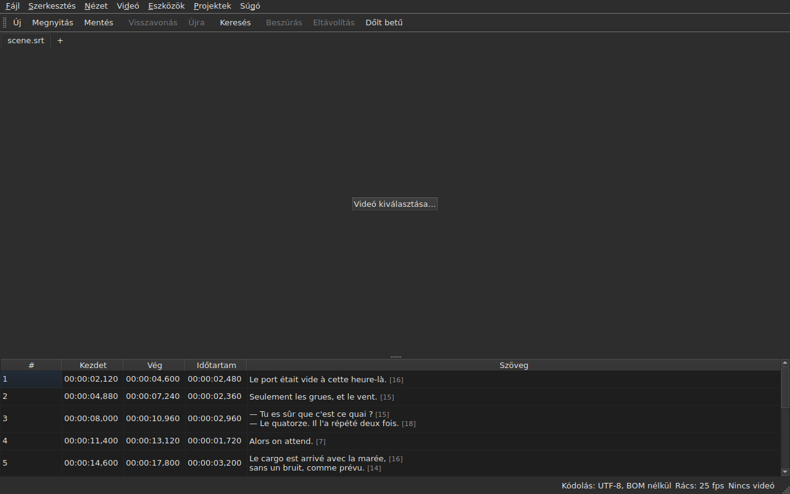

# subedit-gui — kézikönyv

<!-- machine-translated -->
> Ez az oldal gépi fordítás, amelyet a nyelv egyik olvasója még nem nézett át.

A subedit ablaka: feliratfájl megnyitása, és megtekintése táblázatban. A
másik programról és arról, hol érdemes kezdeni, lásd: [a kézikönyv](../index.md).

> **Jelenlegi állapot.** Az ablak **több fájlt nyit meg, mindegyiket külön lapon**, a
> kódolásuktól függetlenül — az `Open…` útján vagy az ablakra ejtve őket —, **megjeleníti őket**,
> **szerkeszti a celláikat**, **sorokat szúr be és távolít el**,
> **visszavon**, **ment — kiválasztva a kódolást, a sorvégeket és a
> bájtsorrend-jelölőt** —, és **megjelöli azokat a feliratokat, amelyek pozíciói
> nem állnak össze**. **Egyesíti és felosztja** a sorokat, **kivágja,
> másolja és beilleszti** a szövegeket, és **keres és cserél** a látható szövegben
> a címkék megsértése nélkül, egy projektben vagy az összesben. **Megnyit egy fordítást
> a főfájl mellett**, pozíció vagy sorszám szerint igazítva, egy további oszlopban,
> és külön menti. A `Tools` menü tizenhat műveletet és két helyesírási menüpontot hordoz —
> eltolás, átalakítás, a képkockasebesség átváltása, időtartamok módosítása,
> **fájl hozzáfűzése, a projekt kettéosztása**, dőlt betűbe
> tétel, párbeszéd-kötőjelek hozzáadása, a kis- és nagybetű négyféle módosítása,
> a hallássérülteknek szóló utalások eltávolítása, **szövegek javítása egy
> többoldalas segéddel**, **helyesírás-ellenőrzés szóról szóra**, igazítás egy képkockasebességre, visszahozás a
> rácsra — és a rácselemzés, amely semmit nem módosít. A `Projects` menü
> **egyetlen mozdulattal ment és zár be mindent**. **Videót társít
> a dokumentumhoz**, kiválasztva vagy kitalálva, és **lejátssza az ablakban**, az aktuális
> sort a képre rajzolva; **kezdetet, véget vagy
> feliratot állít be a film pozíciójából**, **képkockánként lép**, és **egy képkockával tolja el a szélét**. A lejátszósáv **teker, állítja a
> hangerőt és a pozíciót**, a táblázat **követi a lejátszást**, anélkül hogy a kézi görgetést visszavonná, a pozíciók
> **képkockákban** is megjeleníthetők, és a `Video` menü **kiválasztja a hangsávot**. Két észlelés
> **javasol, de sosem alkalmaz**: az állandó mértékkel eltolódott fordítás, amely **eltolva
> újranyitható**, és a képkockasebesség-átváltás, amely visszahoz egy fájlt egy rácsra. **Megjegyzi a geometriáját, az oszlopai sorrendjét, szélességét és jelenlétét,
> valamint a beállításait** egyik
> munkamenetről a másikra, és **világosan vagy sötéten** jelenik meg, ahogy választják. A `Súgó ▸ Kézikönyv`
> **ezt a kézikönyvet** nyitja meg egy ablakban. Ez a kézikönyv azt írja le, ami létezik, sosem
> azt, ami tervben van; ami következik, az az
> [ütemtervben](../../../../feuille-de-route.md) van.

> **A kézikönyv képei generáltak, a szöveg nem.** A `subedit-cli`
> példáit a parancs lefuttatásával állítják elő; a képernyőképeket úgy,
> hogy felépítik a valódi ablakot, és lefényképezik — a `make
> manual` mindkettőt elvégzi. A kép ezért nem írhat le olyan felületet, amely
> már nem létezik, és a megváltozó felület látszik a tároló
> különbségében. Biztonsági háló nélkül a körülöttük lévő szöveg marad, amelynek
> pontossága az átnézésen múlik.

**Minden képernyő kétszer látható, az alkalmazás által beállított két paletta alatt**
— `Light` és `Dark`, azok, amelyeket
[a beállítások](preferences.md#a-téma) kínálnak. Olyan asztalon, amelynek
témája mérvadó, a `System` az egyiket vagy a másikat adja, attól függően, mit választott az asztal.

## A menük

`File`, `Edit`, `View`, `Video`, `Tools`, `Projects`, `Help` — abban a sorrendben,
ahogy használják őket: a dokumentum, ami vele történik, hogyan nézik, mi
tartozik hozzá, mi vizsgálja, mi vonatkozik az összes megnyitott projektre, mi
magyarázza.

A `View` almenüt hordoz, a `Columns` menüt, oszloponként egy bejelölhető menüponttal, a `Text` kivételével
— lásd: [A táblázat](table.md#oszlopok-elrejtése-és-mozgatása) — és egy beállítást, a `Positions in Frames` pontot, amely a
`Start` és az `End` oszlopot képkockaszámként mutatja — lásd: [Pozíciók képkockákban](table.md#pozíciók-képkockákban).

A `Projects` két menüpontot hordoz, a `Save All` és a `Close All` pontot — lásd:
[A Projektek menü](files.md#a-projektek-menü).

Az `Edit` öt blokkot hordoz, mindegyik elválasztó alatt: a visszavonást; a
vágólapot — szövegek kivágása, másolása, beillesztése; a `Find and Replace…` pontot;
a sorok beszúrását, eltávolítását, egyesítését és felosztását; végül a
`Preferences…` pontot. A visszavonás az, amit egy szerkesztéssel *tesznek*, egy szöveg mozgatása
nem ad hozzá, és nem távolít el sort, a következő blokk négy pontja megváltoztatja a
sorok számát, a téma beállítása pedig egyáltalán nem szerkesztés.

**A billentyűket úgy nevezik meg, ahogy a menü kijelzi őket**, angolul, mint a felület
többi részét: `Ins`, `Del`, `Ctrl+Shift+Z`. Az a billentyű, amelyet lenyomnak, és
amelyet nem nevez meg menü, megtartja az angol nevét: `Enter`, `Esc`, `Shift`.

A `Help` két menüpontot hordoz, abban a sorrendben, ahogy a menü mutatja. A `Manual`, vagy az
`F1`, ezt a kézikönyvet nyitja meg egy ablakban — lásd:
[A kézikönyv az ablakban](help.md). Az `About subedit` megadja a verziót, a
licencet és a könyvtárakat, amelyekkel az ablak fut, a verziójukkal együtt — lásd:
[`--version`](invocation.md#--version).

## Az eszköztár

A menük alatt egy sáv hordozza **a leggyakoribb mozdulatokat**, csoportokban.
Minden gomb rövid szót visel; a menü megtartja a teljes menüpontot, és a
gyorsbillentyű ugyanaz.

| Gomb | Menüpont | Gyorsbillentyű |
| :----- | :--------- | :------- |
| Új | Fájl ▸ Új projekt | `Ctrl+N` |
| Megnyitás | Fájl ▸ Megnyitás… | `Ctrl+O` |
| Mentés | Fájl ▸ Mentés | `Ctrl+S` |
| Visszavonás | Szerkesztés ▸ Visszavonás | `Ctrl+Z` |
| Újra | Szerkesztés ▸ Újra | `Ctrl+Shift+Z` |
| Keresés | Szerkesztés ▸ Keresés és csere… | `Ctrl+F` |
| Beszúrás | Szerkesztés ▸ Feliratok beszúrása… | `Ins` |
| Eltávolítás | Szerkesztés ▸ Feliratok eltávolítása | `Del` |
| Dőlt betű | Eszközök ▸ Dőlt betű | `Ctrl+I` |

**A letiltott gomb ugyanazért le van tiltva, mint a menüpontja**: az `Undo`, ha
nincs mit visszavonni, a `Remove`, ha nincs sor kiválasztva. A fordítás menüpontjai
és a `Tools` menü műveletei, az `Italic` kivételével, a saját
menüikben maradnak: ritkábban használják őket, vagy nem mindenki.

## Szakaszok

| Szakasz | Tartalom |
| :------ | :------- |
| [Telepítés](../subedit-cli/installation.md) | fordítás és telepítés — az oldal mindkét programra érvényes |
| [Indítás](invocation.md) | az ablak indítása, argumentumok, kilépési kódok |
| [Megnyitás és mentés](files.md) | a parancsok, a lapok, a `Projects` menü, a fájlok ejtése, a fordítás és eltolt újranyitása, a diagnosztika, a kódolás az állapotsorban, az oda-vissza út, a bezárás |
| [A táblázat](table.md) | mit mutat az egyes oszlop, elrejtésük és mozgatásuk, pozíciók képkockákban, a fordítás oszlopa és a szöveg, amelyre a műveletek vonatkoznak |
| [Cella szerkesztése](editing.md) | mely cellák szerkeszthetők, és hogyan |
| [Szövegek kivágása, másolása és beillesztése](clipboard.md) | a három menüpont, mi utazik, a hozzáadott sorok, a lefordított címkék |
| [Keresés és csere](find-and-replace.md) | a párbeszédablak, a négy mozdulat, a két lehetőség, amire a keresés kiterjed, az összes megnyitott projektben |
| [Sorok beszúrása, eltávolítása, egyesítése és felosztása](lines.md) | a négy menüpont, a gyorsbillentyűik, hová kerülnek az új sorok |
| [Visszavonás és újra](undo.md) | az előzmények, a két művelet, a módosításjelző |
| [A képkockarács](frame-grid.md) | a pozíciókból kikövetkeztetett képkockasebesség, az elemzés, és az átváltás, amely visszahoz egy fájlt egy rácsra |
| [A műveletek](operations.md) | eltolás, átalakítás, átváltás, időtartamok módosítása, fájl hozzáfűzése, a projekt felosztása, dőlt betűbe tétel, a kis- és nagybetű, a kötőjelek, utalások eltávolítása, igazítás, visszahozás a rácsra, és ami a film vége mögé kerül |
| [Szövegek javítása…](correct-texts.md) | a javítási segéd: a cél és a feladatok, az egyes feladatok oldala, az előrehaladás, a megerősítés |
| [Helyesírás-ellenőrzés…](check-spelling.md) | a helyesírás-ellenőrzés: a beállításai, a végigjárás, a bezárás közben, a szótár hiánya |
| [A társított videó](video.md) | videó kiválasztása, az automatikus javaslat, a hangsáv, az állapotsor, az `ffmpeg` |
| [A lejátszó](player.md) | a videónézet, a lejátszósáv, lejátszás, mozgás, a hangerő, a követő táblázat, a rajzolt sor |
| [Időzítés a videóból](timing.md) | egy felirat kezdetének vagy végének beállítása, beszúrás, kijelölés a film pozíciójától, lépés képkockánként, egy szél eltolása |
| [A beállítások](preferences.md) | a téma, a beállításfájl, a beállításai, és mi lesz az olvashatatlan értékből |
| [A kézikönyv az ablakban](help.md) | a `Súgó ▸ Kézikönyv`, mit nyit meg, és hogyan lehet benne navigálni |
