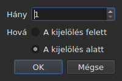

# Feliratsorok beszúrása, eltávolítása, egyesítése, felosztása, rendezése és átfedésmentessé tétele

<!-- machine-translated -->
> Ez az oldal gépi fordítás, amelyet a nyelv egyik olvasója még nem nézett át.

Az `Edit` menü nyolc menüpontja, egy elválasztóval elkülönítve a
`Find and Replace…` menüponttól. Négynek az a közös vonása, hogy megváltoztatja a sorok számát, míg
a fentebbi kivágás, másolás és beillesztés szövegeket mozgat; a `Sort Subtitles` csak
a sorok **sorrendjét** változtatja, a `Join Repeated Subtitles` ugyanannak a szövegnek
egymást követő darabjaiból ismét egyetlen feliratsort csinál, a `Make Ranges Disjoint…` pedig
újravágja őket ott, ahol átfedik egymást.

| Menüpont | Gyorsbillentyű | Mit csinál |
| :------- | :------------- | :--------- |
| Feliratok beszúrása… | `Ins` | párbeszédablakot nyit, majd üres sorokat ad hozzá |
| Feliratok eltávolítása | `Del` | eltávolítja a kijelölést, kérdezés nélkül |
| Feliratok összevonása | nincs | egyetlen sort csinál a szomszédos sorok egy blokkjából |
| Felirat felosztása | nincs | kettévág egy sort az időtartama felénél |
| Ismétlődő feliratok egyesítése | nincs | egyetlen feliratsort csinál ugyanannak a szövegnek az egymást követő darabjaiból |
| Feliratok rendezése | nincs | a sorokat a kezdetük szerinti sorrendbe teszi vissza, az egész projekten |
| Tartományok szétválasztása… | nincs | úgy vágja szét az átfedő sorokat, hogy egyetlen tartomány se fedjen át egy másikat |
| Feliratok helyreállítása… | nincs | láncba fűzi az előző három menüpontot — az ismétlődők egyesítését, a rendezést, a tartományok vágását — egy lépésben |

Mind a nyolc bekerül az előzményekbe: a `Ctrl+Z` a többihez hasonlóan visszavonja őket.

## Beszúrás

| Mező | Mit tartalmaz | Alapértelmezés |
| :--- | :------------ | :------------- |
| `How many` | 1 és 99 999 közötti egész szám | `1` |
| `Where` | `Above the selection` vagy `Below the selection` | az utolsó választás, első indításkor `Below` |

Az `OK` hozzáadja a sorokat, a `Cancel` nem ad hozzá semmit.

### Hová kerülnek

**Az utolsónak kijelölt sorhoz**, nem az elsőhöz. Ha az 1. és a 3. sort jelölik ki,
majd lefelé szúrnak be, az új sor a 4. helyre kerül — nem a
2.-ra. A Gaupol húsz éve így csinálja, és ezt várja a kéz,
miután felülről lefelé végigsöpört.

Az `Above the selection` ugyanazon sor elé teszi.

### Mennyi ideig tartanak

Az üres sornak nincs szövege, de van pozíciója. Ezeket a
rendelkezésre álló helyből vezeti le a program:

| Helyzet | Kezdet | Időtartam |
| :------ | :----- | :-------- |
| két feliratsor között | az előző vége | a következőig tartó hely, egyenlő részekre osztva |
| az utolsó után | az utolsó vége | egyenként három másodperc |
| a fájl elején | a kezdőpont | az elsőig tartó hely, felosztva |
| üres fájlban | a kezdőpont | egyenként három másodperc |

Ha a fájl a választott helyen átfedésben van, **nincs mit
elosztani**: a sorok nulla időtartamot kapnak, amelyet a táblázat mutat, ahelyett, hogy
kitalált időtartamot kapnának, amely átnyúlna a szomszéd fölé.

### Az üres dokumentum

**Kijelölés nem szükséges**, és ez az egyetlen módja az új fájl
elkezdésének: a sorok a nulladik indexre kerülnek. Az oldalválasztás ekkor le van tiltva
a párbeszédablakban — nincs kijelölés, amelyhez viszonyítva el lehetne helyezni őket.

Amint a dokumentumban van egy sor, az `Insert Subtitles…` menüpont **le van tiltva, amíg
semmi sincs kijelölve**: kijelölés nélkül az indexet találgatni kellene.

### Utána

A hozzáadott sorok **ki vannak jelölve**, és a táblázat odaugrik. Az
`Ins` ismételt megnyomása ezért utánuk szúr be, anélkül, hogy a kettő között
kattintani kellene.

### Az oldal megjegyződik

Az `Above` vagy a `Below` megjegyződik **egyik beszúrásról a másikra, és egyik munkamenetről a
másikra**: ez a [beállításfájl](preferences.md#a-fájl) `edit.insert-placement` kulcsa. Nem egyszer
szúrnak be, hanem tíz sort egymás után, mindig ugyanarra az oldalra.

## Eltávolítás

A `Remove Subtitles` vagy a `Del` eltávolítja a kijelölt sorokat — a
nem összefüggő kijelölést is, és visszavonáskor minden sor visszakerül a helyére.

**Megerősítést nem kér**, és ez nem mulasztás:
a művelet a `Ctrl+Z` billentyűvel visszavonható. A visszavonható mozdulat előtti modális ablak
minden alkalommal egy kattintásba kerülne, hogy időnként megspóroljon egy `Ctrl+Z` megnyomást.

**A menüpont le van tiltva, ha semmi sincs kijelölve.** Az ablak többi részén a
„semmi sincs kijelölve” azt jelenti: „az egész fájl” — ettől használható egy
eltolás anélkül, hogy négyezer sort kellene kijelölni. Itt ez az értelmezés
egy balszerencsés `Del` megnyomásával kiüríthetne egy dokumentumot, ezért nincs felkínálva.

Az eltávolítás után **az első eltávolított sor helyére lépő sor
ki van jelölve** — vagy az utolsó megmaradó, ha az eltávolítás elvitte a
fájl végét. A `Del` többszöri egymás utáni megnyomása ezért egyenként
távolítja el a sorokat.

Az egészen kiürített fájl az ablakot használhatóan hagyja: az `Insert Subtitles…`
ismét engedélyezett lesz, mert üres dokumentumba kijelölés nélkül lehet beszúrni.

## Egyesítés

A `Merge Subtitles` a kijelölt sorokból **egyetlen sort** csinál:

| Mit kap az egyesített sor | Honnan származik |
| :------------------------ | :--------------- |
| a kezdetét | az első kezdete |
| a végét | az utolsó vége |
| a szövegét | az összes szövege sorrendben, két szöveg között sortöréssel |
| a fordítását | a fordítások, ugyanígy összefűzve |
| amit a formátum még hordoz — stílus, réteg, koordináták | az elsőé |

**Az üres szöveg nem hagy üres sort**: az `Un.`, egy szöveg nélküli sor és a
`Trois.` egyesítése két szövegsort ad, nem hármat.

Az egyesített sorok eltűnnek, a helyettük álló sor pedig az első
helyére kerül.

**A menüpont le van tiltva**, amíg a kijelölés nem **legalább két
szomszédos sorból álló blokk**. Egyetlen sornak nincs mivel egyesülnie; az 1. és
a 3. sor a 2. nélkül sem, mert az eredmény átnyúlna a 2. fölé, és
eltakarná.

Az egyesítés után **az egyesített sor ki van jelölve**: a `Split Subtitle`
készen áll, hogy újra kettévágja.

## Felosztás

A `Split Subtitle` a kijelölt sort **az időtartama felénél** vágja ketté, ezredmásodperc
pontossággal:

| Fél | Kezdet | Vég | Szöveg |
| :-- | :----- | :-- | :----- |
| az első | az eredeti kezdet | a felező pont | **az egész** szöveg és a fordítás |
| a második | a felező pont | az eredeti vég | üres |

**A szöveget nem a sortörésénél vágja el.** Ez egy kétsoros
feliratsornál helyes volna, egysorosnál vagy háromsorosnál rossz;
az egész szöveg az első felében marad, és ami a másodikba kell,
azt a felhasználó mozgatja át.

Az első fél megtartja, amit a formátum a szövegen kívül még hordozott; a második
úgy születik, mint egy beszúrt sor, semmivel.

**A menüpont le van tiltva**, amíg a kijelölés nem **pontosan egy
sort** számlál. A semmi kijelölve itt nem azt jelenti: „az egész fájl”.

A felosztás után **mindkét fél ki van jelölve** — ezt csinálja a Gaupol
minden beszúrás után, és a `Merge Subtitles` ekkor készen áll, hogy
visszacsinálja a mozdulatot.

## Rendezés

A `Sort Subtitles` az **egész projektet** a kezdetek sorrendjébe teszi vissza. Sosem a
kijelölést: a sorrend a dokumentum tulajdonsága, és egy fájl felét rendezni
nem jelent semmit. A rendezés **stabil**: két feliratsor, amely
egyszerre kezdődik, megtartja a fájltól kapott sorrendet.

**A rendezés alatt egy sáv fut az állapotsorban, és a kurzor homokórává
változik**: hosszú fájlnál az ablak egy ideig nem reagál — a
táblázat soronként épül újra —, és enélkül nem lehet tudni, hogy folyik-e valami.
A sáv nem mutat törtrészt, a rendezés nem jelent ilyet,
és vele együtt tűnik el.

Az állapotsor megmondja, hány sor cserélt helyet — `3 subtitles moved`
— vagy ha minden sorrendben volt, `already in order`. **Az már rendezett projekt
nem kerül az előzményekbe**: a semmit sem változtató művelet nem
visszavonandó művelet. A menüpont egyetlen feliratsoros projektnél le van tiltva.

Az a fájl, **amelyben megnyitáskor van javítanivaló**, magától felkínálja azt,
[egyetlen ablakban](#megnyitáskor-egyetlen-mező): lásd lejjebb. A rossz helyen álló
feliratsorokat [az olvasás diagnosztikája is megszámolja](files.md#az-olvasás-diagnosztikája),
így a táblázat görgetése nélkül is megtalálhatók.

A parancssorban a [`sort`](../subedit-cli/sort.md) ugyanezt teszi a fájlokon, a `--sort` pedig
menet közben megteszi a
[`convert`](../subedit-cli/convert.md#rendezés-íráskor),
[`append`](../subedit-cli/append.md#az-eredmény-rendezése) és
[`split-file`](../subedit-cli/split-file.md#vágás-időrendben) esetében.

## Ismétlődő feliratsorok egyesítése

A `Join Repeated Subtitles` **egyetlen feliratsort** csinál az egymás után
ugyanazt mutató feliratsorokból: az egymást követő darabokra vágott szövegből, ahogy
egyes szegmentálóeszközök hagyják. **Az egész projekten** dolgozik.

Az **ismétlődő** feliratsornak ugyanaz a szövege, ugyanaz a fordítása és ugyanazok a formátumbeállításai
(stílus, pozíció, jelenetbeállítások), mint egy másiknak, **és legkésőbb akkor kezdődik, amikor az
a másik véget ér**. Az ismétlődők sorozatából az lesz, amelyik
először kezdődik, a sorozat legnagyobb végével; a többi eltűnik.
Az `Alpha [1, 2]`, az `Alpha [2, 4]` és az `Alpha [4, 6]` egyesítése `Alpha [1, 6]`.

- **A fájl sorrendje nem számít bele, és nem is változtatja meg**: a megmaradó feliratsor
  az, amelyik először kezdődik, bárhol is vannak a többiek.
- **Tévedésből semmi sem egyesül**: más szöveg, más beállítások, rés
  a két darab között, szöveg nélküli feliratsor, vagy olyan, amelynek a vége megelőzi a kezdetét,
  különálló marad.
- Az állapotsor megmondja, mi történt — `2 repeated subtitles joined`, vagy
  `no repeated subtitles`.

**A rendezés és a vágás előtt végzendő**, amelyek tisztább sorozatot olvasnak jobban: a
három darabra vágott szöveg meg egy másik szöveg a teljes tartományon, rendezetlenül megadva,
olyan sorokra rendeződik és vágódik, amelyek az egyik darabról a másikra váltanak; előbb egyesítve
rendbe esik, és tisztán összevonódik. Az alább leírt megnyitási ablak mindhármat
ebben a sorrendben végzi el.

## A tartományok átfedésmentessé tétele

A `Make Ranges Disjoint…` úgy vágja szét az átfedő feliratsorokat, hogy **egyetlen
`[start, end]` tartomány se fedjen át egy másikat**. **Az egész
projekten** dolgozik, sosem a kijelölésen: az átfedő feliratsorok egy csoportját
ott vágja, ahol átfedik egymást, és egy csoport fele nem jelent semmit.

**Semmi sem rövidül és semmi sem hosszabbodik.** Az ablak minden pillanatban
ugyanazokat a szövegeket mutatja, mint korábban. Az változik, hogyan van felvágva az idővonal:
a csoport minden kezdeténél és minden végénél vág; az az intervallum, amelyet
egyetlen feliratsor fed, ugyanaz a feliratsor marad; az az intervallum, amelyet több fed,
**egyetlen** feliratsor lesz, amelynek sorai az övéik, **a legkorábbi az 1. sorban**.
Az `A [0, 5]` és a `B [3, 8]` eredménye `[0, 3] A`, `[3, 5] A / B`, `[5, 8] B`.

A párbeszédablak három beállítást kér, amelyek egyik alkalomról a másikra megjegyződnek:

| Mező | Mit tartalmaz | Alapértelmezés |
| :--- | :------------ | :------------- |
| `Shortest interval kept` | 0 és 10 000 ms között: a rövidebb intervallumot átveszi egy szomszéd | `80 ms` (nagyjából két képkocka) |
| `Most lines in a subtitle` | 0 és 10 között; `No limit` a 0 értéknél | `2` |
| `Put a dash before each subtitle's text` | kötőjel mindannak elé, amivel egy feliratsor hozzájárul az egyesített feliratsorhoz | nincs bejelölve |

Az `OK` vág, a `Cancel` nem csinál semmit. **Az írt sorok ki vannak jelölve**
utána, és az állapotsor megmondja, mi történt: `2 subtitles split, 1 merged`.
A második menet nem változtat semmit, és ezt kimondja: `already disjoint`.

- **Sor sosem duplázódik.** Két azonos szövegű feliratsor egyetlen
  sort ad ott, ahol átfedik egymást, és két szomszédos darab, amely ugyanazt
  mutatja, csak egyetlen feliratsort alkot. A több darabra vágott feliratsor szövege egyébként
  mindegyikben megismétlődik: ez van a képernyőn abban a pillanatban.
- **A nagyon rövid intervallumot átveszi egy szomszéd**: az, amelynek sorai
  már tartalmazzák az övéit, különben a leghosszabb, kiterjeszti a tartományát, hogy lefedje.
  A küszöbnél rövidebb teljes feliratsort sosem veszi át senki.
- **A határnál több sor: ablakok.** A három másodpercen át tartó három sor
  két felet ad, az első két sort, majd az utolsó kettőt;
  négy sor három harmadot, és így tovább. Semmi sem csonkul.
- A fordítás ugyanezeket a vágásokat követi; az első fedő feliratsor
  stílusa és pozíciója megmarad.

**Ami nem volt teljesen elvégezhető, azt egy bezárandó ablak mondja el**, nem az
állapotsor: az ablakok, az átvett intervallumok, az egészben hagyott
túl rövid feliratsorok, az eltérő stílusok, azok a feliratsorok, amelyeknek a vége megelőzi a
kezdetét (a helyükön hagyva).

**A menüpontot indoklással együtt visszautasítja a program, ha a feliratsorok nem a
kezdetük sorrendjében vannak**: a csoportok a szomszédok sorozatai, és a mag sosem
rendez magától. Előbb a `Sort Subtitles` — vagy a megnyitási ablak, amely
mindkettőt ebben a sorrendben végzi el.

### Mindez egyszerre: `Repair Subtitles…`

A `Repair Subtitles…` az előző három menüpontot **egymás után** végzi el, az egyetlen működő sorrendben: az
ismétlődők egyesítése, a feliratsorok kezdetük szerinti sorba tétele, majd a tartományok átfedésmentessé tétele. Ez a menüpont
a rosszul szegmentált, rosszul rendezett és átfedő fájlhoz való, ha mindhármat kívánják. A párbeszédablak a vágási
beállításokat kéri (ugyanazokat, mint a `Make Ranges Disjoint…` esetében, egyik alkalomról a másikra megjegyezve), és kimondja, hogy előbb egyesít és rendez.
Az állapotsor — vagy a bezárandó ablak, ha valamit nem lehetett teljesen elvégezni — **egyetlen összesítést** ad
mindháromról: `2 repeated subtitles joined; already in order; 2 subtitles split, 1 merged`. Minden javítás külön
előzménybejegyzés: a `Ctrl+Z` egyenként vonja vissza őket. A parancssorban: [`repair`](../subedit-cli/repair.md).

### Megnyitáskor egyetlen mező

Az a fájl, amely úgy nyílik meg, hogy van benne valami, amit javítani lehet, **egyetlen
ablakban kínálja fel azt**, `Problems found in this file`, ahelyett, hogy problémánként
nyitna egyet. Minden talált probléma egy sor a saját jelölőnégyzetével, bejelölve:

- `Join the repeated subtitles` — feliratsorok ismétlik a velük
  érintkező másikat, a számukkal;
- `Sort the subtitles` — a feliratsorok nem a kezdetük sorrendjében vannak,
  a számukkal;
- `Make the ranges disjoint` — feliratsorok az előző vége előtt kezdődnek,
  megszámolva, **miután a fájl sorrendbe került**, mert ott javítják őket.

**Minden problémát ott számol meg a program, ahol javítják**, egy másolaton, amelyen
az előtte álló javításokat már elvégezték: a darabokra vágott szöveg
okozza a rendetlenség egy részét, és az előzetes egyesítés után egy sem maradhat — az ablak
ekkor nem kínálja a rendezést.

A nem talált problémának nincs sora. A rendezés jelölésének megszüntetése **szürkére
állítja és kikapcsolja** a másik jelölőnégyzetet: a tartományokat csak sorrendben teszi átfedésmentessé a program.
A `Fix` azt alkalmazza, ami be van jelölve — az egyesítést, majd a rendezést, majd a vágást, az
utolsó `Make Ranges Disjoint…` beállításaival — és erről **egyetlen összesítést** ad;
a `Keep as is` semmihez sem nyúl. **Igen nélkül semmi sem történik**, minden javítás
előzménybejegyzés, és az a fájl, amelyben nincs javítanivaló, semmilyen
kérdés tárgya sem lesz.

A parancssorban a [`disjoint`](../subedit-cli/disjoint.md) ugyanezt teszi a fájlokon, a `--disjoint` pedig
menet közben megteszi a [`convert`](../subedit-cli/convert.md#a-tartományok-átfedésmentessé-tétele),
[`append`](../subedit-cli/append.md#a-tartományok-átfedésmentessé-tétele) és
[`split-file`](../subedit-cli/split-file.md#a-tartományok-átfedésmentessé-tétele) esetében.

### Miért nem a Gaupol gyorsbillentyűi

A Gaupol az `M` billentyűvel egyesít és az `S` billentyűvel oszt fel. Az egyszerű betűt a
táblázat elfogná, mielőtt elérné a szerkesztett cellát, a `Ctrl+S`
pedig már a mentés: a két menüpont a menün keresztül érhető el.

## Amit a visszavonás művelete mond erről

**Mozdulatonként egy előzménybejegyzés.** Öt sor egyesítése egyetlen
`Ctrl+Z` billentyűvel visszavonható, és visszaadja az öt sort, ahogy voltak — a pozíciókkal, szövegekkel és
mindennel, amit a formátum hordozott.

| Művelet | Amit az `Undo` kiír |
| :------ | :------------------ |
| beszúrás | `Undo: inserting` |
| eltávolítás | `Undo: removing` |
| egyesítés | `Undo: merging` |
| felosztás | `Undo: splitting` |
| ismétlődők egyesítése | `Undo: joining repeated subtitles` |
| a tartományok vágása | `Undo: making the ranges disjoint` |

A megnyitáskor felkínált javítás javításonként egy előzménybejegyzés: az egyesítés, a rendezés, majd a vágás egymás után vonható vissza.

Lásd: [Visszavonás és újra](undo.md).

## Gyorsbillentyűk nyitott cella mellett

Az `Ins` és a `Del` a beviteli mezőhöz tartozik, amíg egy cellaszerkesztő
nyitva van: a törlőbillentyű ott egy karaktert töröl, nem egy
feliratsort. A szerkesztő bezárása — `Enter` vagy `Esc` — visszaadja nekik a jelentésüket. A menüből indítva
a `Remove Subtitles` előbb jóváhagyja a bevitelt, ahogy a [Cella szerkesztése](editing.md)
többi mozdulata.

Ez a kézikönyv a billentyűket úgy nevezi meg, ahogy a menü kiírja őket — lásd:
[A menük](index.md#a-menük).
