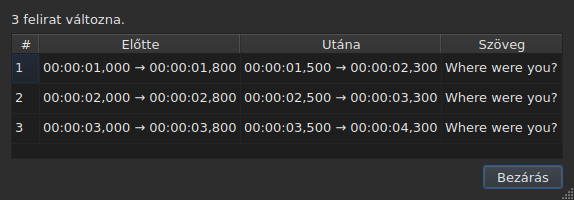
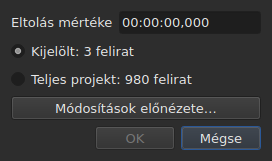
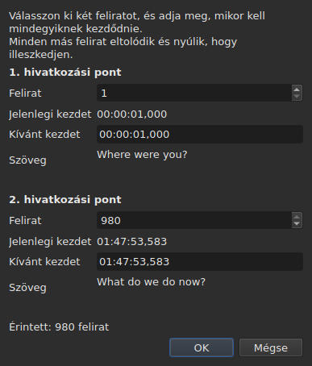
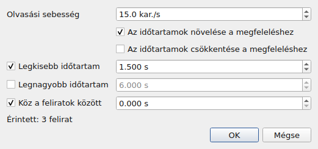
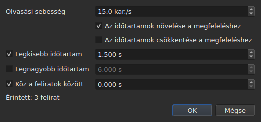
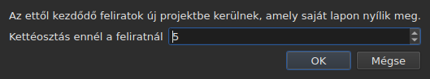

# A műveletek

<!-- machine-translated -->
> Ez az oldal gépi fordítás, amelyet a nyelv egyik olvasója még nem nézett át.

Az **Eszközök** menü tizenhat műveletet, egy elemzést és két helyesírási menüpontot tartalmaz. A
tizenhatot egy-egy `Ctrl+Z` vonja vissza; az elemzés semmit nem módosít. A `Check Spelling…` is visszavonható, a `Spell-Check Settings…` pedig nem nyúl szöveghez.

| Menüpont | Párbeszédablak | Mit csinál |
| :---- | :----- | :----------- |
| `Shift Positions…` | igen | a célt egy időtartammal eltolja |
| `Transform Positions…` | igen | a célt két jelzőpontból kiindulva javítja |
| `Convert Frame Rate…` | igen | a célt újraidőzíti az egyik képkockasebességről a másikra |
| `Adjust Durations…` | igen | a végeket úgy mozgatja, hogy tartsák az olvasási sebességet, az időtartamokat és a rést |
| `Append File…` | fájlválasztó | egy fájlt hozzáfűz a projekt végéhez |
| `Split Project…` | igen | a projektet kettévágja, a maradék új lapra kerül |
| `Italic` | **nem** | a célt dőlt betűbe teszi, vagy kiveszi belőle |
| `Dialogue` | **nem** | párbeszéd-kötőjelet tesz minden sor elejére, vagy eltávolítja |
| `Kis- és nagybetű ▸ Címszerű` | **nem** | minden szó nagybetűt kap |
| `Kis- és nagybetű ▸ Mondatszerű` | **nem** | a szöveg első betűje, és csak az |
| `Kis- és nagybetű ▸ NAGYBETŰS` | **nem** | minden nagybetű |
| `Kis- és nagybetű ▸ kisbetűs` | **nem** | minden kisbetű |
| `Remove Hearing-Impaired Mentions…` | igen, beállítások nélkül | eltávolítja a hallássérülteknek szóló utalásokat |
| `Correct Texts…` | igen, többoldalas segéd | javításokat javasol — utalások, szavak egyesítése és szétválasztása, gyakori hibák, nagybetűk, sortörés —, és az elfogadás után alkalmazza őket, lásd: [Szövegek javítása…](correct-texts.md) |
| `Check Spelling…` | igen, szóról szóra haladás | végigmegy a szótár által ismeretlen szavakon, és alkalmazza, amit kijavítottak, lásd: [Helyesírás-ellenőrzés…](check-spelling.md) |
| `Spell-Check Settings…` | igen | kiválasztja az ellenőrzés nyelvét, célját és dokumentumát, valamint az aláhúzást gépelés közben, lásd: [Helyesírás-ellenőrzés…](check-spelling.md#helyesírás-ellenőrzési-beállítások) |
| `Snap to Frame Rate…` | igen | minden időbélyeget a legközelebbi képkockára visz vissza |
| `Shift Whole File onto Grid (…)` | **nem** | az egész fájlt visszahozza a rácsára |
| `Frame Rate Analysis…` | igen, beállítások nélkül | **semmit nem módosít** — lásd: [A képkockarács](frame-grid.md) |

**Hogy mit csinált egy művelet, azt egy bezárandó információs
ablak közli, kivéve az `Italic`, a `Case` és a `Dialogue` esetében**: ez a három nem nyit
párbeszédablakot, és a jelentésük — a „nincs mit módosítani” is — az állapotsorban jelenik meg,
bezárandó semmivel. A `Split Project…` is az állapotsorban közli a sajátját:
az eredménye már ott van szem előtt, az új lapon. Az üzenetek idézve vannak az
egyes műveletek szakaszában.

A sorok beszúrása, eltávolítása, egyesítése és felosztása nem itt, hanem az
`Edit` menüben található, mert megváltoztatja a sorok számát. Lásd:
[Sorok beszúrása, eltávolítása, egyesítése és felosztása](lines.md).

## Amire hatnak

**A kijelölt sorokra, vagy az egész fájlra, ha nincs kijelölés.** Ez ugyanaz a
szabály mindegyiknél, és a párbeszédablakok, ha van ilyen, érthetően
emlékeztetnek rá:

```
Applies to: 4 subtitles
```

Az összes sor kijelölése ugyanaz, mintha egyet sem jelölnének ki.

**Ha a soroknak csak egy részét jelölték ki, a párbeszédablak megkérdezi,
mire hasson.** Két választás jelenik meg, a számukkal, és **a kijelölés
van bejelölve**:

```
(•) Selected: 2 subtitles
( ) Whole project: 4 subtitles
```

A `Whole project` bejelölése kiterjeszti a műveletet az egész fájlra, anélkül hogy előbb
módosítani kellene a kijelölést. Ha nincs mit választani — nincs semmi
kijelölve, vagy minden —, a fenti `Applies to:` sor marad egyedül.

A `Shift Positions…`, a `Transform Positions…`, a
`Convert Frame Rate…`, az `Adjust Durations…`, a `Snap to Frame Rate…` és a
`Remove Hearing-Impaired Mentions…` párbeszédablaka kínálja ezt a választást.

### Megnézés alkalmazás előtt

A `Shift Positions…`, a `Transform Positions…`, a `Convert Frame Rate…`,
az `Adjust Durations…` és a `Snap to Frame Rate…` **`Preview changes…`** gombot hordoz.
Kis ablakot nyit, amely megmondja, hány feliratot módosítana a művelet
**azzal, ami abban a pillanatban be van gépelve, a bejelölt célon**, és
felsorolja az első tizenkettőt: a sorszámukat, az előző pozíciójukat, a
későbbi pozíciójukat és a szövegük első sorát. **Semmi nem kerül alkalmazásra**: az
ablak bezárása visszavezet a párbeszédablakhoz, ahol módosítani lehet egy értéket, és újra
megnézni.




Elég nagyra nyílik ahhoz, hogy az összes oszlopot mutassa, és kézzel
átméretezhető.

Ha a művelet semmit nem változtatna, az ablak ezt mondja (`Nothing would change.`).
Amíg a beírt adat nem határoz meg műveletet — olvashatatlan időtartam, két
jelzőpont ugyanazon a feliraton —, az előnézet üres, ugyanazért, amiért az
`OK` gomb szürke. A `Remove Hearing-Impaired Mentions…` nem rendelkezik előnézettel: amit
módosít, az szöveg, és a jelentés, amelyet utána ad,
ezt közli.

**Fordítás esetén melyik szöveg?** A pozíció- és szerkezeti műveletek
az egész feliratra hatnak — a két szövege követi. Azok, amelyek
szöveget írnak át — az `Italic`, a `Case`, a `Dialogue`,
a `Remove Hearing-Impaired Mentions…` —, **az aktuális cella oszlopának szövegét** célozzák: a
fordítást a saját oszlopában, egyébként a főszöveget. A másik érintetlen marad, és az
állapotsor megmondja, melyiket célozták. Lásd: [A táblázat](table.md#a-szöveg-amelyre-a-műveletek-vonatkoznak).

**Egy kivétel, és a felirata hordozza**: a `Shift Whole File onto Grid`
figyelmen kívül hagyja a kijelölést. A rács a dokumentum tulajdonsága, és egy fél
dokumentumnak nincs saját rácsa; a menüpont ezért a nevében mondja ki, nem
csak ebben a kézikönyvben.

**Az `Append File…` is figyelmen kívül hagyja a kijelölést**, más okból: nem
célt ír át, hanem véget tol hátrébb. Lásd a
[saját szakaszát](#append-file). **A `Split Project…` is**: ott vág, ahol
mondják neki. Lásd: [a sajátját](#split-project).

**A `Correct Texts…` a célját a saját oldalán választja**, ahelyett hogy az
aktuális kijelölést követné: a kijelölést, az aktuális projektet vagy az összes megnyitott
projektet. Lásd: [Szövegek javítása…](correct-texts.md). **A `Check Spelling…` a
`Spell-Check Settings…` ablakban választja**, és megjegyzi: lásd: [Helyesírás-ellenőrzés…](check-spelling.md).

**A két rácsművelet nem ugyanarról beszél, mint a rács.**
A művelet a kijelölésre hat; az elemzés és az állapotsor a
**teljes dokumentumról** beszél. Száznyolcvanhat sorból öt igazítása módosítja ezt az
ötöt — a táblázat mutatja —, anélkül hogy a kettő bármelyike elmozdulna, ami
elmaradt frissítésnek tűnik. Nem az: nincs mit
mondaniuk. Lásd: [`Snap to Frame Rate…`](#snap-to-frame-rate) és
[A képkockarács](frame-grid.md).

### Mit jelent a „semmi nincs kijelölve”, menüpontonként

A szabály a `Tools` menüre és a keresésre vonatkozik. Az `Edit` menü azon menüpontjai, amelyek
sorokhoz nyúlnak vagy kiürítik őket, másként olvassák — különben egy
szerencsétlen `Del` vagy `Ctrl+X` kiürítené a dokumentumot.

| Menüpont | Kijelölés nélkül | Mit követel meg |
| :---- | :------------------ | :--------------- |
| a `Tools` menü műveletei | az egész fájl | nem üres dokumentum |
| `Shift Whole File onto Grid` | az egész fájl, **mindig** | megtalált rács |
| `Find and Replace…` | az egész fájl | nem üres dokumentum |
| `Cut Texts`, `Copy Texts`, `Paste Texts` | **letiltva** | legalább egy kijelölt sor |
| `Remove Subtitles` | **letiltva** | legalább egy kijelölt sor |
| `Merge Subtitles` | **letiltva** | legalább két szomszédos sorból álló blokk |
| `Split Subtitle` | **letiltva** | pontosan egy sor |
| `Insert Subtitles…` | letiltva, kivéve az üres dokumentumon | egy sor, amelyhez viszonyítva elhelyezi őket |

Mindegyik oldal megadja az okot: [a vágólap](clipboard.md#amire-hatnak),
[a sorok](lines.md), [a keresés](find-and-replace.md#amire-a-keresés-kiterjed).

A menüpontok **üres fájlon le vannak tiltva**: nem lenne mit
eltolni. Az `Italic` menüpontnak van egy második feltétele is, amelyet a szakasza ír le: a megnyitott
formátumnak tudnia kell stílust írni. A kis- és nagybetűnek és a kötőjeleknek nincs — a
szöveg szöveg mind a kilenc formátumban.

## `Shift Positions…`

A célt egy időtartammal mozgatja, előre vagy hátra. Az egyes feliratok mindkét határa
ugyanannyival mozdul: egyik sem marad hosszabban vagy rövidebben
a képernyőn, mint korábban.

Az időtartam **időbélyegként van megadva, az előjellel együtt** — a `00:00:02,500` előre mozdít,
a `-0:01,250` hátra. Az elfogadott alakok a pozíciócelláéi.




| Elutasítás | Miért |
| :------ | :-- |
| olvashatatlan időtartam | a gomb letiltva marad; semmi nem tolódik el találomra |
| nulla eltolás | nincs rögzítendő művelet |
| egy felirat a videó eleje elé kerülne | **egyetlen fájl sem hordozhat ilyen pozíciót** |

A harmadik eset megnevezi a bűnöst — „subtitle 1 would start before the origin” —,
és azt kell megnézni, hogy kiderüljön, mennyivel tévedtek. Semmi
nem kerül alkalmazásra.

## `Transform Positions…`

Egy másik vágáshoz időzített fájl javítása. Megmondják, hol kezdődik **két**
felirat valójában, és minden más arányosan követi.

A párbeszédablak kétszer kéri ugyanazt: egy feliratsorszámot és azt a
pozíciót, ahová a kezdete tartozik. Minden jelzőponthoz megmutatja, **mit jelöl ki ez a
szám** — a szövegét (`Text`) és az időpontot, amikor **most**
kezdődik (`Now starts`), egyszerű címkékként —, és ezek követik a számot,
ahogy az változik. A szövegnek **három sornyi helye van**, bármit is mond a
felirat: a hosszabb, vagy a hosszú cím, a belsejében görgethető, és
a párbeszédablak megtartja a méretét, ahogy a jelzőpont változik. **Jelzőpontonként egyetlen mezőt kell beírni:
`Should start`**, azt az időpontot, amikor ennek a feliratnak kezdődnie kell. Nem kell a táblázatban keresni, melyik sor a `980`.

A `Should start` **az aktuális értéken van felajánlva**: amíg nem
nyúlnak hozzá, a jelzőpont azt mondja: „ez a felirat már ott van, ahol lennie kell”. Csak azt
módosítják, amit módosítani akarnak. A második jelzőpont előre ki van töltve a fájl utolsó
feliratára — két távoli jelzőpont biztosabb javítást ad,
mint két szomszédos.




**Mindkét jelzőpont pontosan oda kerül, ahová kérték.** Ez nem
közelítés: a számítást úgy végzik, hogy igaz legyen.

| Elutasítás | Miért |
| :------ | :-- |
| két jelzőpont ugyanazon a feliraton | nem határoznak meg javítást |
| olvashatatlan pozíció | ugyanaz az ok, mint az eltolásnál |

A fájlon kívüli szám nem írható be: a mezőt a feliratok
száma korlátozza.

## `Convert Frame Rate…`

Újraidőzíti a célt, ha a pozíciókat egy képkockasebességhez viszonyítva számolták ki, és
egy másikhoz kell viszonyítani.

Mindkét lista a nyolc szabványos képkockasebességet kínálja.

> **A bemeneti képkockasebesség elrontása az egész fájlt eltolja, anélkül hogy
> bármit jelezne.** Ez a művelet legrosszabb hibamódja, és ezért
> mondja meg a párbeszédablak, honnan származnak az általa javasolt értékek, ahelyett hogy
> csendben beállítaná őket.

### A két forrás, és amit válaszolnak

A párbeszédablak legfeljebb két további sort hordoz, mindegyik akkor jelenik meg, ha van
mondanivalója:

| Sor | Mit mond | Mit tölt ki előre |
| :--- | :----------- | :---------------- |
| `The positions say` | a fájl pozícióiból kikövetkeztetett [képkockarács](frame-grid.md) | `Timed against` |
| `The video declares` | a képkockasebesség, amelyet a konténer hirdet, például `24000/1001` | `Should play at` |
| `The file was read at` | a képkockasebesség, amellyel a **képkockákban számolt** fájlt beolvasták | `Timed against` |

**Minden javaslat ahhoz a mezőhöz kerül, amelyre válaszol.** A rács azt mondja meg, mihez
*írták* a fájlt — ez a felső lista. Amit a konténer hirdet, az
az a képkockasebesség, amellyel a film *fut*, tehát amelyhez a feliratoknak
érkezniük kell — ez az alsó lista.

**Csak a tiszta rács tölti ki előre a bemenetet.** A részleges rács olyan
nyom, amelyet maga a kikövetkeztetés is részlegesnek minősít, ez a mező pedig egy
egész fájlra vonatkozó műveletről dönt. Az [állapotsor](frame-grid.md) és az elemzés
viszi ezt az esetet; ez nem.

**A képkockákban számolt fájl a rácsot felváltja, nem kiegészíti.**
A MicroDVD képkockaszámokat hordoz, és a dokumentum pozícióit
ezekből számolták ki az olvasási képkockasebességgel: az ezekből a pozíciókból kikövetkeztetett rács
csak ugyanazt a számot találhatja meg. A `The positions say` ezért eltűnik, és
a `The file was read at` veszi át a helyét — [az állapotsor](frame-grid.md#a-képkockákban-számolt-dokumentumnak-nincs-rácsa-képkockasebessége-van)
is ezt a választást teszi.

**Így lehet megváltoztatni a MicroDVD képkockasebességét.** Ha bemenetként az olvasáskor használt,
kimenetként pedig a valódi képkockasebességet adják meg, a program a fájl képkockáiból számolja újra
az összes pozíciót — bármit újra elolvasni nélkül, és a műveletet a többihez hasonlóan lehet
visszavonni.

### Az eltérés nem ellentmondás

Mindkét sor megjelenhet egyszerre, és különböző számokat hirdethet.
**Ez nem hiba, amelyet el kell dönteni**: a film egy képkockasebességgel fut, a
fájlt másik rácson írták. A 24-es fájl a 25-ös filmhez pontosan az az eset,
amelyre az igazítás — a parancssoron a `snap` — való.

A felhasználó helyett tehát semmit sem választ ki a program: mindkét lista
szerkeszthető marad, és ez szándékos. Az a forrás, amely rákényszeríti magát, megtiltja az ellenőrzést.

A sorok nem jelennek meg, ha nincs mit mondaniuk: nincs társított
videó, nincs `ffprobe`, vagy nincs tiszta rács. A párbeszédablak ilyenkor a fent
leírt, és **egyetlen művelet sem tagadja meg emiatt a működést** — a
képkockasebességet a felhasználó adja. Lásd:
[A társított videó](video.md#az-ffmpeg-nem-kötelező).

Az a képkockasebesség, amelyet a film hirdet, de nem tartozik a nyolc szabványos közé,
**megjelenik, de nincs kiválasztva**: az az információ, hogy a film szokatlan
képkockasebességgel fut, és itt nincs mire átváltani.

A képkockasebesség önmagára váltása nem változtat semmit: a gomb letiltva marad.

## `Adjust Durations…`

Meghosszabbítja vagy lerövidíti a cél feliratainak időtartamát, **a végüket
mozgatva, sosem a kezdetüket**. A kezdet mozgatása a feliratot mozgatná, ami a
[`Shift Positions…`](#shift-positions) dolga.





### A négy megkötés

| Mező | Mit kér | Értékek | Alapértelmezés |
| :---- | :--------------- | :----- | :------ |
| `Reading speed` | az olvasáshoz szükséges idő | 1-től 99 karakter/másodpercig, tizedre | 15 karakter/s |
| `Lengthen durations to match it` | meghosszabbítja, ami túl rövid az olvasáshoz | bejelölve vagy sem | bejelölve |
| `Shorten durations to match it` | lerövidíti, ami a szükségesnél tovább marad kint | bejelölve vagy sem | nincs bejelölve |
| `Minimum duration` | alsó időtartamhatár | 0-tól 99 s-ig, ezredmásodpercre | bejelölve, 1,5 s |
| `Maximum duration` | felső időtartamhatár | 0-tól 99 s-ig, ezredmásodpercre | nincs bejelölve, 6 s |
| `Gap between subtitles` | a rés, amelyet a következő felirat előtt hagyni kell | 0-tól 99 s-ig, ezredmásodpercre | bejelölve, 0 s |

Ezek a Gaupol alapértelmezett értékei.

**A be nem jelölt megkötés hiányzik**: a mezője szürke, és nem olvasódik. A nullán
bejelölt megkötés nullát ér — a 0 s rés megtiltja, hogy egy felirat átfedje a következőt. Az olvasási sebesség csak akkor
olvasódik, ha a `Lengthen` vagy a `Shorten` be van jelölve.

**Ha minden be van jelöletlenül, az `OK` le van tiltva**: nincs mit kérni.

A párbeszédablak az utolsó módosítás értékein nyílik újra, **és egyik munkamenettől a másikig megtartja őket** —
mint a két keresési beállítás. **A be nem jelölt jelölőnégyzet megtartja az értékét**: a `Minimum duration`
bejelölésének törlése 2 s beállítása után nem hozza vissza
az 1,5 s-ot, és újra bejelölve 2 s-ot talál. A kilenc beállítás a
[beállításfájlban](preferences.md#a-fájl) van, a `duration-adjust.` alatt.

**A parancssor osztozik rajtuk.** A [`subedit-cli adjust`](../subedit-cli/adjust.md) alapértelmezésben ugyanezt a
kilenc beállítást olvassa, így az itt beállított sebességet használja, hacsak a saját kapcsolói
mást nem mondanak; a [`subedit-cli config`](../subedit-cli/config.md) megmutatja és módosítja őket. Lásd:
[Két blokk, az egyik a parancssorral közös](preferences.md#két-blokk-az-egyik-a-parancssorral-közös).

### Milyen sorrendben, és melyik győz

A cél minden felirata **ebben a sorrendben** megy át a négy megkötésen, és
mindegyik sorban beállítja a véget:

| Rang | Megkötés | Mit állít be |
| ---: | :--------- | :----------- |
| 1 | olvasási sebesség | `end = start + length ÷ speed`, ha a felirat túl rövid (`Lengthen`) vagy túl hosszú (`Shorten`) |
| 2 | legkisebb időtartam | `end = start + minimum`, ha az időtartam rövidebb |
| 3 | legnagyobb időtartam | `end = start + maximum`, ha az időtartam hosszabb |
| 4 | rés | `end = next start − gap`, ha a vég túl közel van hozzá — sosem a kezdet elé |

**Az utolsónak alkalmazott győz.** A rés van utoljára, és az épp beállított
legkisebb időtartam alá hozhatja az időtartamot: a képernyőn egyidejűleg lévő két felirat olyan
hiba, amelyet a néző lát, a kissé rövid felirat pedig
nem.

**A szöveg hosszát címkék nélkül számolják**, karakterben, a sortöréseket
beleértve: az `<i>été</i>` három karakternek számít. Az olvasási sebesség
arról beszél, amit a néző olvas.

**A következő a fájl következő felirata**, akár a célban van, akár
nem. **A fájl utolsó feliratának nincs következője**: a rés nem
köti meg.

### Amit semelyik vég nem tud kielégíteni, azt kimondja

A módosítás elvégzése után az ablak közli, hány vég mozdult, és **mit
nem lehetett tartani** — egy megkötés csak akkor szerepel, ha legalább
egy feliratnál feláldozták:

```text
adjusted the durations of 12 subtitles; could not satisfy the reading speed in 9 subtitles, the minimum duration in 4 subtitles
```

A három lehetséges említés: `the reading speed`, `the minimum duration` és
`the gap`. **A legnagyobb időtartamot mindig tartják**: a sebesség és a
legkisebb után jön, és csak a rés követi, amely csak rövidíthet. A
legnagyobbnál nagyobb legkisebb enged neki, és a legkisebbet számolják. A rést
csak akkor áldozzák fel, ha a következő a felirat saját
kezdete előtt kezdődik.

A számolás a teljes célra kiterjed, **azokat a feliratokat is beleértve, amelyek vége nem
mozdult**: a már a következőjéhez igazított, de a legkisebbhez túl rövid felirat is
számít. Ha egyetlen vég sem mozdul, az ablak ezt közli —
`no duration to adjust` —, és semmi nem kerül az előzmények közé.

## `Append File…`

Egy fájlt fűz a megnyitott projekt végéhez. **Semmi nem kerül a kettő
közé**: a kiválasztott fájlt a projekt utolsó feliratának végével tolja el,
pontosan úgy, ahogy a Gaupol.

**Üres dokumentumon le van tiltva**: nem lenne vég, amelyből eltolni. Fájlválasztó
nyílik, kódolás kiválasztása nélkül — mint az `Open…` esetében.

**A hozzáfűzött fájl átalakításon megy át**, a `Save As…` és
[a más formátumból való beillesztés](clipboard.md#más-formátum-címkéit-átalakítja-a-program) szavaival:
a címkéit a projekt formátumára fordítja, és kimondja, amit az a formátum
nem tud kiírni:

```text
appended 12 subtitles; Advanced SSA into SubRip: 1 tag dropped
```

**Amit a hozzáfűzött fájl hordozott, az nem éli túl egészében.** A pozíciói
követik, a címkékkel együtt; a fejléce, a formátumspecifikus mezői — a stílus
neve, a margók — és az, amivé egy címke nem válhat a projekt formátumában, nem
követik, és ezt kimondják. **Nincs fordítása**: a fordítás a
fogadó dokumentumhoz kötött marad, és a hozzáfűzött fájl egyedül érkezik.

**Utólag kijelölve**, mint a beillesztés által a végén túlra írt sorok.
Ha semmi sem vész el, a számot az állapotsorban jelenítik meg, nem
bezárandó ablakban — ugyanaz a szabály, mint
[a fordítás megnyitásánál](files.md#fordítás-megnyitása).

**Egyetlen előzménybejegyzés**, bármennyi felirat is kerül
hozzáfűzésre: a `Ctrl+Z` mindet egyszerre eltávolítja.

**A már megnyitott fájl önmagához is hozzáfűzhető**: semmi nem tiltja, mint
a Gaupolban.

**A parancssoron** az [`append`](../subedit-cli/append.md) ugyanezt teszi több fájllal
egyszerre, egyetlen eredményben.

## `Split Project…`

Kettévágja a projektet: **az `Append File…` pontos fordítottja**. Egy ablak
megkérdezi, melyik felirattól vágjon — a másodiktól az utolsóig, ahogy a táblázatban
számozva vannak —, és az aktuális soron nyílik meg.

**A táblázat megmutatja, hol vágnak, mielőtt vágnának**: az ablak által
felvett minden szám kijelöli a sorát. A `Cancel` visszaadja az előző kijelölést.




**Két felirat alatt letiltva**: a vágáshoz mindkét oldalon kell egy felirat.

**A maradék új projektbe másolódik, új lapon nyílik meg, és
eltávolítódik az eredeti projektből.** Az új projekt **az utoljára maradt
felirat végével mínusz eltolva** van: felosztás, majd hozzáfűzés visszaadja a kiinduló projektet.
A két szövege, a fő és a fordítás, követi a feliratait, és
megtartja az eredeti formátumát és kódolását — **útvonal nélkül**: még nincs fájl,
amely tartaná. A lapja ezért születésétől `untitled*` felirattal jelenik meg, és
mentés nélküli bezárása azt a kérdést teszi fel, amelyet mindennél, ami nincs
kiírva.

**Az állapotsor megmondja, hány felirat távozott**, bezárandó ablak
nélkül — az új lap már mutatja az eredményt:

```text
split 12 subtitles into a new project
```

**Egyetlen előzménybejegyzés**, az eredeti projektben:
az `Undo: splitting the project` visszaadja neki a maradékát. Az új projektnek saját,
üres előzménye van; a visszavonás nem érinti, és nyitva marad.

**Elutasítva, ha semmilyen fájl nem tudná kiírni az eredményt.** Ha a két
fél a vágásnál átfedi egymást, az eltolás egy feliratot a videó
kezdete elé hozna — negatív pozíció, amelyet egyetlen formátum sem ír. Az elutasító
ablak **megnevezi a feliratot**, és más helyen való vágást javasol:

```text
Cannot split at subtitle 3: subtitle 3 would fall before the start of the video. Cut somewhere else.
```

A pontosan a kezdetre érkezés megengedett: a nulla pozíció.

**A parancssoron** a [`split-file`](../subedit-cli/split-file.md) ugyanígy vág egy fájlt, két
megnevezett fájlba.

## `Snap to Frame Rate…`

**Minden időbélyeget** — kezdetet és véget — a választott
képkockasebesség legközelebbi képkockájára teszi. Egyetlen lista, és ez a teljes különbség az
átváltáshoz képest: az átváltáshoz két képkockasebesség kell, mert a fájlt az
egyikről a másikra skálázza; az igazításhoz csak a rács kell,
amelyre rá kell tenni.

| | `Convert Frame Rate…` | `Snap to Frame Rate…` |
| :--- | :-------------------- | :-------------------- |
| mozgás | az idővel arányos — egy nagyfilmen **több másodperc** | legfeljebb fél képkocka, **mindenütt** |
| melyik fájlra | olyan fájlra, amelynek **időzítése hibás** | olyan fájlra, amelynek időzítése **helyes**, a rácsa pedig hibás |

**A felhasználási eset**, kibontva: egy film másodpercenként 25 képkockával,
24-es rácsra írt feliratok, a sorok már nagyjából a helyükön vannak
néhány ezredmásodpercen belül. Nincs mit újraidőzíteni — csak az időbélyegeket kell
a megfelelő képkockákra visszatenni.

A lista **azon nyílik meg, amit a videó hirdet**, és nem azon, amit a
pozíciók mondanak: a cél a film rácsához való csatlakozás, és a
kikövetkeztetés azt nevezi meg, amelyet elhagynak. Videó nélkül vagy `ffprobe` nélkül
a projekt képkockasebességén nyílik meg.

A fájl igazítása arra a rácsra, amelyen már áll, nem változtat rajta, és ez nem
hiba: a művelet érvényesül, semmit nem mozdít, és úgy vonható vissza, mint
bármelyik másik.

**A fájl egy részének igazítása ezt elvégzés után kimondja.** Közlemény
jelenik meg, ha a kijelölés nem fed le mindent, és a dokumentumot még mindig másik
rácson olvassák:

```
5 of 176 subtitles aligned to 25 fps; the document is still read on a 24 fps grid
```

Összeköti a gesztust a hatásával, és megmagyarázza, miért nem mozdult az állapotsor és
az elemzés: ezek a dokumentumról beszélnek, a művelet
öt sorra hatott. Semmi nem tiltott — a fájl egy részének igazítása
lehet szándékos.

**Szinte mindig nem szándékos, és ezt megmérték.** A tárolóban lévő nyolc rácsos
fájlon a teljes fájl igazítása a kikövetkeztetett képkockasebességet a
célra, a koncentrációját pedig 100 %-ra viszi; öt sor igazítása sosem mozdítja a
kikövetkeztetett képkockasebességet, és nyolc esetből hétben **csökkenti** a koncentrációt — az
igazított sorok elhagyták a rácsot, amelyen a fájl többi része él. A nyolcadik
az 50-ről 25-re igazítás, ahol a célrács osztja a fájlét, és a pozíciók már
rajta voltak.

A közlemény nem jelenik meg, ha a kijelölés az egész fájlt lefedi, ha
nem következtettek ki rácsot, vagy ha a dokumentumot most a
kért képkockasebességen olvassák — vagyis amikor az igazítás azt tette, amit kértek tőle.

## `Shift Whole File onto Grid`

**Az egész fájlt** azzal a mennyiséggel tolja el, amely pozícióit visszahozza arra a rácsra,
amelyet elhagytak. Az a fájl, amelynek pozíciói egy állandótól eltekintve
rácson vannak, el lett tolva, és ez az állandó megmérhető.

**A menüpont hordozza a mennyiséget és a hatókört** —
`Shift Whole File onto Grid (+0.001 s)`. Nincs párbeszédablak:
a művelet nem vesz fel beállítást, és az a menüpont, amely egy egész
fájlt fog elmozdítani, a kiválasztása előtt meg kell hogy mondja, mennyivel, és hogy teljes egészében teszi. Ez a menü egyetlen
művelete, amely figyelmen kívül hagyja a kijelölést.

**Le van tiltva, ha nem találtak rácsot.** Ilyenkor nincs mihez
csatlakozni, és a zajon mért fázis találomra mozdítaná el a fájlt.
A „nincs mihez csatlakozni” és a „nullával csatlakozni” nem ugyanazt mondja: a
második felajánlva marad, mert a már rácsán lévő fájl ennek
szokásos esete.

**Ez nem a `Snap to Frame Rate…`.** Ez a menüpont mindent ugyanannyival tol el,
és a relatív időzítést **pontosan** megőrzi; az igazítás minden pozíciót
külön mozgat, és útközben elnyeli azokat, amelyeket kézzel javítottak. Tiszta fájlon
mindkettő ugyanazt az eredményt adja; részleges
fájlon nem — és [az elemzés részletei](frame-grid.md) megmondják, a kettő közül melyik
van szemük előtt.

## `Italic`

A célt dőlt betűbe teszi a **megnyitott formátum** címkéinek kiírásával, vagy
eltávolítja őket, ha már dőlt. Nincs párbeszédablak: a műveletnek nincs beállítása, és
a többihez hasonlóan egy `Ctrl+Z` vonja vissza.

| Művelet | Gyorsbillentyű | Hol |
| :----- | :------- | :---- |
| Dőlt betű | `Ctrl+I` | **Eszközök** menü, eszköztár |

Ez a `Tools` menü egyetlen művelete, amelynek van gombja az
[eszköztárban](index.md#az-eszköztár).

### Mit ír ki, formátumonként

A felirat szövege a fájlé, a címkékkel együtt — lásd:
[Cella szerkesztése](editing.md). Minden formátumnak megvan a sajátja, és ezt
a menüpont spórolja meg a tudásból:

| Formátum | Mi íródik ki |
| :----- | :-------------- |
| SubRip, WebVTT, SubViewer 2 | `<i>text</i>` |
| Sub Station Alpha, Advanced SSA | `{\i1}text{\i0}` |
| MicroDVD | `{Y:i}text` — a címke a felirat végéig tart, nincs mit lezárni |
| MPL2 | `/` **minden** sor elején, a jelölő csak a saját sorára vonatkozik |
| TMPlayer, LRC | semmi: ez a két formátum nem ír stílust |

**A menüpont a TMPlayernél és az LRC-nél le van tiltva, nem elrejtve.** A hiányzó
menüpont semmire nem tanít; a szürke menüpont megválaszolja a „miért nem
lehet?” kérdést.

**Az olvasott formátum a célzott szövegé.** Fordítás esetén a főszöveg
lehet SubRip, a fordítás pedig Advanced SSA: az `Italic` az elsőben `<i>`, a
másodikban `{\i1}` címkét ír. A menüpont ugyanígy le van tiltva, ha a
célzott szöveg olyan formátumú, amely nem ír stílust, akkor is, ha a másik igen.

### Merre megy

Egyetlen menüpont mindkét irányra, és a cél dönt:

- **elég egyetlen dőlt betűn kívüli felirat** ahhoz, hogy az egész cél dőlt betűbe kerüljön;
- a cél csak akkor lép ki belőle, ha **teljes egészében** benne van.

Ez a Gaupol szabálya, és ez az egyetlen, amely egyetlen gombot
használhatóvá tesz: a vegyes kijelölés egy blokkként megy, ahelyett hogy soronként
megfordítanák, és a kétszeri megnyomás úgy adja vissza, ahogy volt.

A jelentés megmondja, mi történt, abban az irányban, ahogy történt:

```
2 subtitles put in italics
2 subtitles taken out of italics
```

**Az üres sor sosem kap címkét** — az üresség körüli `<i></i>` látszana
a táblázatban. Az a cél, amely csak ilyen sorokat tartalmaz, ezért nem változik, és
ezt közli: „nincs mit módosítani”. Ilyenkor semmi nem kerül az előzmények közé.

### Amihez nem nyúl

**A többi címke pontosan ott marad, ahol van**: a szín, a
betűtípus, az Advanced SSA `{\pos(x,y)}` mozdulatlanul megy át a műveleten.
Csak a dőlt betű címkéit állítják be és távolítják el.

Az a címke, amely több dolgot mond egyszerre, nem kerül el egészében:
a `{\b1\i1}` `{\b1}` lesz, a `{Y:bi}` pedig `{Y:b}`. A félkövér marad, és a
szöveg valóban kilép a dőlt betűből.

## `Case` és `Dialogue`

A **látható szöveg** két átalakítása, és a címkékhez nem nyúl: a
kisbetűssé tett felirat megtartja az `<I>` címkéjét úgy, ahogy van, a kötőjelet pedig a szöveg elé teszi,
nem a nyitó címke elé. **Egyetlen címke sem változtat
helyet**: a `<i>bon</i>jour` nagybetűsítve `<i>BON</i>JOUR` lesz, ahol
[a csere](find-and-replace.md#a-keresett-szöveg-a-látható-szöveg) a dőlt betűt
az egész szóra kiterjesztette volna.

| Menüpont | Gyorsbillentyű | Mit csinál |
| :---- | :------- | :----------- |
| Kis- és nagybetű ▸ Címszerű | — | a `bonjour marie` `Bonjour Marie` lesz |
| Kis- és nagybetű ▸ Mondatszerű | — | a `BONJOUR MARIE` `Bonjour marie` lesz |
| Kis- és nagybetű ▸ NAGYBETŰS | — | minden nagybetű |
| Kis- és nagybetű ▸ kisbetűs | — | minden kisbetű |
| Párbeszéd | — | kötőjeleket tesz hozzá vagy távolít el |

### Amihez a kis- és nagybetű nem nyúl

**Ami az első betű vagy az első számjegy előtt áll, az úgy marad, ahogy van.**
A párbeszéd-kötőjel, a nyitó idézőjel, a zárójel megmarad:
a `- bonjour` mondatszerűvé téve `- Bonjour` lesz, és nem `- bonjour` a
nagybetűs kötőjellel, aminek nem lenne értelme.

**A mondatszerű írás a többit kisbetűre állítja vissza.** A `BONJOUR MARIE`
`Bonjour marie` lesz: ezt teszi a Gaupol, és ettől lehet lehalkítani a
nagybetűkkel begépelt feliratot.

**Az ékezeteket és a nem latin ábécéket helyesen kezeli.** Az `éléonore`
`ÉLÉONORE` lesz, és az aposztróf nem vág el szót: az `l'été` címszerűvé téve `L'été`,
nem `L'Été`. Az a betű, amely hosszat változtat, megtartja körülötte a
címkéit: a `fi <i>x</i>` nagybetűsítve `FI <i>X</i>`.

**A kis- és nagybetű nem függ a rendszer nyelvétől.** Az összes nyelv közös
szabályait követi: az `istanbul` nagybetűsítve `ISTANBUL`, akár franciára, akár
törökre van állítva a gép.

### Merre megy a `Dialogue`

Egyetlen menüpont mindkét irányra, és a cél dönt:

- **elég egyetlen kötőjel nélküli sor** ahhoz, hogy az egész cél kapjon;
- a cél csak akkor veszíti el őket, ha **minden** sorában van.

A kétszeri megnyomás úgy adja vissza a célt, ahogy volt. Ez az
[`Italic`](#italic) szabálya, és az egyetlen, amely egyetlen gombot használhatóvá tesz.

**Három kötőjelet ismer fel** — a billentyűzet kötőjelét és a tipográfus két
gondolatjelét, az `–` és az `—` jelet —, és a kötőjelet írja ki.
A kötőjel utáni felesleges szóközök eltűnnek. Az üres sor nem kap
semmit.

### Mit mondanak

```
2 subtitles recased
2 subtitles dashed
2 subtitles undashed
```

És amikor semmi nem változik — a cél már a kért kis- és nagybetűs alakban van — „nincs mit
módosítani”, anélkül hogy bármit az előzmények közé tennének.

## `Remove Hearing-Impaired Mentions…`

Eltávolítja a siket vagy nagyothalló nézőknek szánt utalásokat — a
hangok szögletes zárójelben álló leírásait. **A zárójelek maradnak**: suttogott
soroknál is használatosak, és a `Correct Texts…` távolítja el őket, a `Sound in parentheses` jelölőnégyzetén keresztül.
**Semmi más**: a kettős kereszt jelek közé
tett dalszövegeket és a kettőspont előtti beszélőnevet csak a
[`Correct Texts…`](correct-texts.md) távolítja el, a `Mentions` oldalon.

A párbeszédablak semmit nem kér: a műveletnek nincs beállítása, és a párbeszédablak csak arra szolgál,
hogy megerősítse és emlékeztessen, mire hat.

**Ez a `Tools` menü egyetlen művelete, amely sorokat tüntet el**, és az egész programban az
egyetlen, amely úgy tünteti el őket, hogy nem kérték rá. Az a
felirat, amely *csak* utalás volt, a tisztítás után nem tartalmaz szöveget, és a
szöveg nélküli feliratnak nincs oka léteznie: eltávolítja a fájlból. A többit
az utalásuk nélkül írja át.

**A formátum címkéi nem számítanak szövegnek**: egy SubRip `<i>[SOUPIR]</i>` és egy Advanced SSA
`{\i1}[SOUPIR]{\i0}` egyformán el lesz távolítva.
A TMPlayerben vagy az LRC-ben álló `<i>`, amely nem ír címkét, szöveg.

**A fordításra célozva nem távolít el egyetlen sort sem.** Az a fordítás, amelyet a
szabály kiürít — az a szöveg, amely csak utalás volt — **kiürül**, a felirat
pedig marad: van főszövege, amelyet a művelet nem célzott, és eltávolítása
megsemmisítené. A jelentés megtisztítottnak számolja:

```text
1 subtitle cleaned, 0 removed
```

Az olvasott címkék a fordítás formátumáé, amely lehet, hogy nem a főfájlé.

A jelentés mindkettőt közli:

```
1 subtitle cleaned, 1 removed
```

**Ha semmi sem fog, semmi sem történik** — és a párbeszédablak ezt mondja: „nincs
eltávolítandó utalás”. Semmi nem kerül az előzmények közé, mert a semmit
nem módosító művelet nem visszavonásra való művelet.

**A visszavonás mindent visszatesz**, az eltávolított feliratokat és az átírt
szövegeket is, mindegyiket a szövegével, amelyet addig hordott. A szabály által kiürített felirat
sosem íródik át eltávolítás előtt, éppen azért, hogy
egészben térjen vissza.

> **A kijelölés ez alkalommal elvész**: a sorok eltávolítása megváltoztatja a
> táblázat szerkezetét, amelyet újraépítenek. A `Tools` menü összes többi művelete
> megtartja, az `Italic`, a `Case` és a `Dialogue` is. Az `Edit` menü négy
> szerkezeti menüpontja — beszúrás, eltávolítás, egyesítés, felosztás —
> szintén megváltoztatja a szerkezetet, és az elvett kijelölés helyett újat
> ad vissza — lásd:
> [Sorok beszúrása, eltávolítása, egyesítése és felosztása](lines.md).

A tisztán numerikus hivatkozás — „See [1] the note” — nem utalás,
és úgy marad, ahogy van.

## A film vége után

Ha videó van megnyitva, az a művelet, amely **feliratokat tol a film
vége mögé**, ezt jelzi, miután elkészült:

```
shifting leaves 3 subtitles past the end of the video, by 4.200 s at most
```

A mondat megnevezi a műveletet — `shifting`, `transforming`,
`converting the frame rate`, `adjusting durations`,
`aligning on the frame rate` —, hogy hány felirat megy túl, és hogy
a legtávolabbi mennyivel. A `Shift Whole File onto Grid` eltolás, és
`shifting` néven szerepel.

| Mit számol | Mit nem |
| :-------------- | :---------- |
| amit a művelet éppen érintett, vagyis a célt | a felirat, amelyet senki sem mozgatott |
| a felirat, amely a vége **után** ér véget | a felirat, amely pontosan vele ér véget |

**Ez figyelmeztetés, és semmi más.** Semmit nem utasít el, semmit nem
javít: a stáblista után eső felirat éppen az lehet,
amit akartak, a téves elutasítás pedig többe kerül, mint a
figyelmen kívül hagyott figyelmeztetés. A művelet az előzményekben van, és az `Undo`
ugyanúgy visszavonja, mint bármelyik másikat.

**Műveletenként egyetlen ablak.** Az `Adjust Durations…` és az `Align` már rendelkezik
mondanivalóval — amit egy módosítás nem tudott tartani, amit egy részleges
igazítás félretett. Ha még feliratot is tolnak a vég mögé,
az ablak mindkét mondatot hordozza, egymás alatt, a művelet mondatával
elöl:

```
adjusted the durations of 2 subtitles
adjusting durations leaves 1 subtitle past the end of the video, by 1.000 s at most
```

Az üzenet nem jelenik meg, ha nincs videó megnyitva: az időtartam a
lejátszótól jön, és film nélkül nincs vég, amelyen túl lehetne menni. Csak a fent
említett öt művelet érintett — az `Adjust Durations…` is, amely
a végét a filmen túlra hosszabbíthatja. Az összes többi nem: az
`Tools` menü szöveget átíró műveletei, és az `Edit` menüben a beszúrás,
egyesítés, felosztás, beillesztés, csere és a szerkesztett cellák — a
kézzel a filmen túlra gépelt véget nem jelzik.
