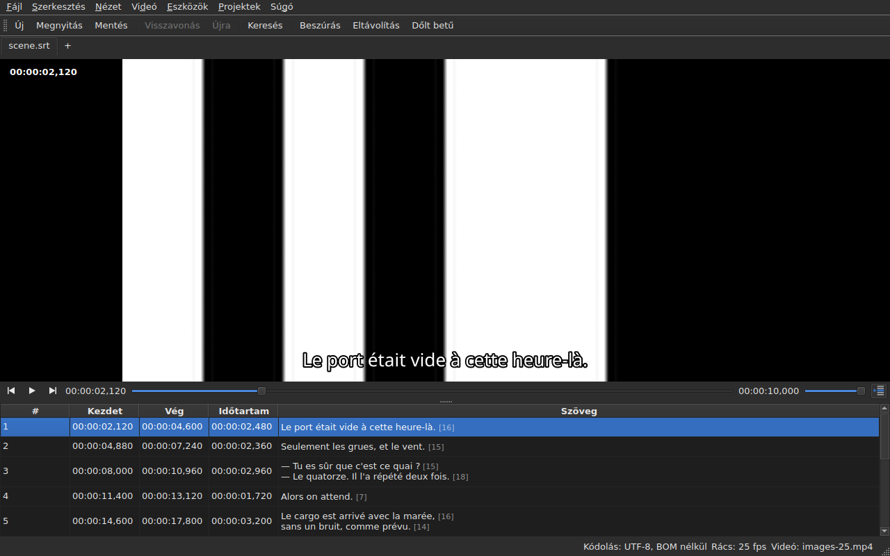

# A lejátszó

<!-- machine-translated -->
> Ez az oldal gépi fordítás, amelyet a nyelv egyik olvasója még nem nézett át.

A társított videó **az ablakban** nézhető, rárajzolva az aktuális
sorral. Ettől lehet a filmen ellenőrizni egy eltolás, egy átalakítás vagy egy
képkockasebesség-átváltás eredményét.

A film társításáról lásd: [A társított videó](video.md); ez az
oldal azt írja le, mi történik, miután megtörtént.

## A videónézet

| Helyzet | Mit mutat az ablak |
| :------ | :----------------- |
| van társított videó, és megnyílik | a kép foglalja el a felső részt, alatta a táblázat |
| nincs társított videó | nincs kép, a táblázat tölti ki az egész ablakot |
| a videó nem nyílik meg | nincs kép, üzenet jelenik meg, és az ablak használható marad |

A kép és a táblázat közötti elválasztó **az egérrel mozgatható**. A kép
nem megy 180 képpont magasság alá. Az ablak nagyobbra húzásakor a nyert hely
a táblázatnak jut, nem a képnek: szerkesztéskor a sorokból van kevés.

A kép alatt **egy lejátszósáv** áll: hol tart a film, mennyi ideig tart,
lejátszás és szünet, valamint a hangerő. Lásd: [A lejátszósáv](#a-lejátszósáv).

## Lejátszás és megállítás

| Parancs | Gyorsbillentyű | Mit csinál |
| :------ | :------------- | :--------- |
| Videó ▸ Lejátszás / Szünet | `Ctrl+P` | lejátssza, ha a lejátszás áll, különben megállítja |

A parancs **le van tiltva, amíg nincs megnyitott videó**. Az a videó, amelyet
az imént társítottak, **megállított** állapotban nyílik meg: egy film megnyitása nem
a megnézése.

`Ctrl+P` ott, ahol a Gaupolban egyszerű `P` van: az ablak hatókörű, egybetűs
gyorsbillentyűt elfogja az ablak, mielőtt a fókuszban lévő elem látná,
így a `P` elnyelődne a cellaszerkesztő felé vezető úton. Itt semmi sem
nyomtat, a kombináció szabad.

## A lejátszósáv

A kép alatt, balról jobbra — a három gomb **ikon**: az asztali téma ikonjai, ha van ilyen, különben a Qt stílusáé:

| Elem | Mit csinál |
| :--- | :--------- |
| a két léptetőgomb | hátra, előre mozgatja a filmet **egy képkockalépésnyit** — lásd: [Képkockánként](timing.md#képkockánként) |
| lejátszás / szünet | lejátszik vagy megállít, mint a `Ctrl+P` — a gomb azt mutatja, **mit fog tenni**: háromszög, ha áll, két sáv, ha játszik; az eszköztipp egyszerű szavakkal kimondja |
| a pozíció | `HH:MM:SS,mmm`, ahogy a táblázat a pozíciót írja — **képkockaszámként**, ha a [`Nézet ▸ Pozíciók képkockában`](table.md#pozíciók-képkockákban) be van jelölve |
| a csúszka | **olvas és mozgat**: a fogantyút húzni, a vájatba kattintani, a nyilakat használni lehet |
| az időtartam | az, amelyet a videó megad, a pozícióhoz hasonlóan írva |
| a hangerő | 0-tól 100-ig, lásd: [A hangerő](#a-hangerő) |
| a táblázat követése | lenyomva marad, amíg a táblázat követi a lejátszást, és lenyomáskor visszaviszi a most játszott sorra — lásd: [A táblázat követi a lejátszást](#a-táblázat-követi-a-lejátszást) |

**A csúszka nem ad át minden képpontnál.** A fogantyú húzása másodpercenként
tucatnyi pozíciót kér, és mindegyik egy dekódolt képkockába kerül: az első pozíció azonnal
kimegy, a következők huszadmásodpercet várnak, és **az utoljára kért pozíció
mindig az, amelyet elérnek** — legkésőbb a fogantyú elengedésekor. A kép ezért nem
késik a kéz mögött, és nem kezd el rajzolni olyan utat, amelyet senki sem néz.

**A csúszka lejátszás közben magától mozog**, és ez nem számít műveletnek:
csak az mozdítja a filmet, amit a felhasználó tesz. Amíg a fogantyút tartják, a lejátszás nem veszi vissza.

## Az időkód

**A pozíció a képre van írva**, bal felül, áttetsző háttéren, amely
bármely jeleneten olvashatóvá teszi. Az ablak rajzolja, a saját betűtípusával, és
a lejátszótól semmi mást nem kér, csak a pozíciót, amelyet az már megad; minden mozdulattal frissül,
a követés következő köréig nem várva.

## Mozgás a filmben

A **Videó** menüben **a Gaupol mozdulatai**, a nevükön. Mind **le van tiltva videó nélkül**, mint
a lejátszás; a három, amely a kijelölésen dolgozik, akkor is le van tiltva, ha semmi sincs kijelölve.

| Parancs | Gyorsbillentyű | Mit csinál |
| :------ | :------------- | :--------- |
| Videó ▸ Kijelölt lejátszása | `Ctrl+Shift+P` | **kicsivel a kijelölés kezdete előtt** kezdve **az utolsó feliratsor végéig** játszik, és a képen megáll |
| Videó ▸ Ugrás az előzőre | `Ctrl+Left` | a lejátszást a pozíció előtt **véget ért** utolsó feliratsor kezdetére teszi |
| Videó ▸ Ugrás a következőre | `Ctrl+Right` | a lejátszást a pozíció után **kezdődő** első feliratsor kezdetére teszi |
| Videó ▸ Visszatekerés | `Ctrl+Shift+Left` | egy ugrásnyit hátra megy — alapértelmezés szerint harminc másodpercet |
| Videó ▸ Előretekerés | `Ctrl+Shift+Right` | egy ugrásnyit előre megy |
| Videó ▸ Ugrás a kijelölés elejére | `Ctrl+Up` | a lejátszást a kijelölés kezdetére teszi, **az előfutásnyival előtte** |
| Videó ▸ Ugrás a kijelölés végére | `Ctrl+Down` | a lejátszást a kijelölés végére teszi, **az előfutásnyival előtte** |

**A gyorsbillentyűk a Gaupoléi**, egy kivételével: a `Play Selection` ott `O`, az
egyszerű betűt pedig az ablak elfogja, mielőtt a szerkesztett cella látná — egy
`o` beírása egy szövegbe elindítaná a filmet. A `Ctrl+P` a lejátszás válasza, a `Ctrl+Shift+P` a
kijelölésé. A billentyűzet nyilai a cellaszerkesztőnél maradnak, ha az
nyitva van: a `Ctrl+Left` ott a kurzort mozgatja egy szóval, nem a lejátszást.

- **Az ugrás** 30 másodperc, és 1 másodperctől egy óráig állítható — lásd:
  [A beállítások](preferences.md#a-lejátszó). Sem a film kezdetén, sem a végén nem megy túl.
- **Az előfutás** egy másodperc: egy kicsit a feliratsor **előtt** néznek, hogy lássák közeledni.
  0-tól 60 másodpercig állítható, és a lejátszás nem megy nulla alá.
- **A nem létező szomszéd** — az első feliratsor előtt semmi, az utolsó után semmi —
  nem csinál semmit, és nem mond semmit: a lejátszás ott marad, ahol van.
- **Minden mozdulat azonnal látszik**: a sáv, az időkód és a rajzolt vonal
  naprakész, amikor véget ér, a következő körre várakozás nélkül.

## A hangerő

A hangerő a **lejátszóé**, 0-tól 100-ig, és nem a rendszeré. A sáv csúszkájával állítható,
vagy két mozdulattal, a `Videó ▸ Audió` almenüben, ötös lépésekben:

| Parancs | Gyorsbillentyű | Mit csinál |
| :------ | :------------- | :--------- |
| Videó ▸ Audió ▸ Hangerő le | `Ctrl+-` | öttel csökkenti a hangerőt |
| Videó ▸ Audió ▸ Hangerő fel | `Ctrl++` vagy `Ctrl+=` | öttel növeli — a második azokra a billentyűzetekre való, ahol a plusz a váltóbillentyűt igényli |

**Megmarad egyik munkamenetről a másikra**, és minden megnyitott videó megkapja. A beállításfájlban a
0–100 tartományon kívüli érték nem töri meg a megnyitást: figyelmen kívül marad, és az ablak ezt jelzi.
**A hangsáv ezzel szemben nem marad meg** — a sáv száma a fájljáé; lásd:
[A hangsáv](video.md#a-hangsáv).

## Kijelölés és lejátszás

Mindkettő kétirányú.

| Amit a felhasználó tesz | Ami történik |
| :---------------------- | :----------- |
| kijelöl egy sort | a lejátszás **ugrik annak a feliratsornak a kezdetére** |
| lefelé kiterjeszti a kijelölést | semmi több: a kijelölés első sora számít |
| a lejátszás halad | az **aktuális sor** követi a képernyőn lévő feliratsort, **színezve**, és a táblázat **középre teszi** — lásd: [A táblázat követi a lejátszást](#a-táblázat-követi-a-lejátszást) |

Az aktuális sor és a kijelölés két különböző dolog. A lejátszás
az elsőt mozgatja, és **a másodikhoz sosem nyúl**: a kijelölés az, amire
egy művelet vonatkozik, és a sarokban futó filmnek semmi dolga sincs azzal, hogy
sorról sorra átírja a felhasználó célját.

A színezés ugyanezt a szabályt követi: jelölő, nem kijelölés. **Az
anomália erősebb nála** — az a sor, amelyik mindkettőt hordozza, a hibájának
színét tartja meg, mert a hibát javítani kell, míg a látható sor csak
egy párbeszédsor idejéig az. Lásd: [A táblázat](table.md).

### A táblázat követi a lejátszást

**A táblázat középre teszi a játszott sort** — a látottak közepére, nem a szélére, ahol elég volna a
láthatóvá tételhez. Ezt **a sor változásakor** teszi, nem a követés minden ütemében: egy párbeszédsor
másodpercekig tart, és tizedmásodpercenként újra középre tenni céltalan görgetés volna.

**A kézi görgetés felfüggeszti a követést.** Az egérgörgő, a gördítősáv és a táblázatba kattintás
felfüggeszti: a táblázat ott marad, ahová tették, míg az aktuális sor, a rajzolt vonal és a sáv
tovább követi a filmet. A követés gombja — **egy táblázat soraiból álló ikon, az egyik nyíllal jelölve**, a lejátszósáv jobb
oldalán; az eszköztippje így szól: „Follow playback” — **lenyomva marad, amíg a táblázat követ**, utána felugrik.

**A követés lejátszómozdulatra folytatódik**: elindított lejátszás, ugrás, lépés, beállított jelölő,
beszúrás a pozíciónál vagy a sáv mozgatása — a táblázat ekkor azonnal a játszott sorra
középez, akkor is, ha az már ugyanaz volt. **Vagy kérésre**: a gomb lenyomása visszaállítja, az
elengedése felfüggeszti. Időzítő nincs: a követést mindig egy mozdulat folytatja.

Másik lapra váltáskor a követés annak a lapnak a filmjén folytatódik.

**A folyamatban lévő szerkesztést nem szakítja meg.** Amíg egy cellaszerkesztő
nyitva van, az aktuális sor ott marad, ahol van; a képre
rajzolt vonal ezzel szemben tovább követ, mert senkit sem zavar.

## A rajzolt vonal

A képen megjelenő szöveg a **megnyitott dokumentumból** származik, sosem fájlból:
**amit a képen látni, az az, amit az imént begépeltek**, a lemezen való
átmenet nélkül. A szöveg középre igazítva jelenik meg, a kép alján, és két
feliratsor között eltűnik.

**Fordítás esetén a vonal a megcélzott szövegé**: a fordításé, ha az
aktuális cella a `Translation` oszlopban van, máshol a főszövegé. Ez az
összes szövegművelet szabálya — lásd: [A szöveg, amelyre a műveletek
vonatkoznak](table.md#a-szöveg-amelyre-a-műveletek-vonatkoznak) —,
és **nincs hozzá beállítás**: az egyik oszlopról a másikra lépés megváltoztatja, mit
mutat a kép, legfeljebb tizedmásodperccel később. Fordítás nélkül, vagy
eltávolított oszlop mellett semmi sem változik: a főszöveg látszik.

Az a feliratsor, amelyhez a fordítás még nem ért el, **semmit** sem mutat, amíg
az aktuális oszlop a fordítás: nem a főszöveg
lép a helyére.

**A formátum címkéit érti, de sosem rajzolja ki úgy, ahogy vannak.** A modell úgy
hordozza a szöveget, ahogy a fájl írja, és a címkék pivotja — a
formátumátalakításé — az, amely beolvassa, mielőtt átadná a képnek:

| A fájlban | A képen |
| :-------- | :------ |
| félkövér, dőlt, aláhúzott | alkalmazva: a `<i>no</i>` *no* alakban jelenik meg, a címkéi nélkül |
| szín | alkalmazva |
| betűtípus, méret | eltávolítva, a szöveg marad |
| pozíció, igazítás, beszélő, bármi, aminek nincs képernyőn megfelelője | eltávolítva, a szöveg marad |
| `{` és `}` a szövegben | kirajzolva: a „{laughs}” „{laughs}” alakban jelenik meg |

Az Advanced SSA fájlt ugyanígy olvassa a program: a `{\i1}` érvényesül, az
`{\an8}` pedig el van távolítva — a sor a kép alján marad. Mindegyik szöveget **a saját
fájljának formátuma szerint** olvassa, a fordítást éppúgy, mint a főszöveget.

**A szomszédos feliratfájlt a lejátszó nem tölti be**, még ha a film nevét is viseli. Az
az lenne, amelyet szerkesztenek, és a kép ekkor a lemez állapotát mutatná,
míg a táblázat mást.

## Egy módosítás előnézete

**Semmi különöset nem kell tenni**: a műveletet alkalmazzák, megnézik a
filmet, és ha az eredmény nem megfelelő, az `Undo: shifting` — vagy az érintett
művelet — mellett döntenek. Lásd: [Visszavonás és újra](undo.md).

Külön előnézeti mód nincs, és ez szándékos: amit nézni lehet, az a dokumentum, ahogy van,
nem egy láthatatlan ideiglenes állapot.

## Ha a kép nem jelenik meg

Két lehetséges üzenet, mindkettő a fájl elérési útjával kezdődik:

| Üzenet | Mi történt |
| :----- | :--------- |
| `<file>: <reason>` | a lejátszó visszautasította a fájlt — ismeretlen formátum, hiányzó fájl, könyvtár |
| `<file>: no video player is available` | egyetlen lejátszót sem sikerült felépíteni |

Mindkét esetben **a videó társítva marad** — látni kell, melyik
fájl az, hogy másikat lehessen választani — és **az ablak használható marad**:
a dokumentum nyitva van, a műveletek működnek, és a mentés is.

**A képet maga az ablak rajzolja**: a `libmpv` a nézet méretében, valódi
képpontokban tölt meg egy puffert, és az ablak megfesti. Semmi sem függ a
grafikus platformtól — ugyanaz a kép X11 alatt, Wayland alatt és kijelző nélkül —, és
követi az átméretezést: a film képaránya megmarad, a nézet többi része
fekete.

A második üzenet ezért csak akkor jelenik meg, ha a `libmpv` könyvtár megtagadja az indulást,
pedig a fordításkor kötelező.

A megjelenítés a processzoron megy, de **a dekódolás végezhető a videokártyán**: az
dekódol, a képet visszamásolják a memóriába, majd a program a korábbiak szerint kirajzolja. A használható kártya
nélküli gép a processzoron dekódol, üzenet nélkül. Egy 1080p H.264 filmnél a lejátszás bőven lépést tart a
valós idővel. **Egy nehéz HEVC-s 4K film lehet, hogy nem tart lépést**: két
magon mérve kártya nélkül 0,6-szeres valós idővel dekódol, és ott egy képkockányi léptetés több
másodpercig tart, ha a kulcskép messze van. A kártya csökkenti ezt az időt — filmtől függően
harmadával-kétharmadával — anélkül, hogy megszüntetné. **A megjelenített képet nem változtatja meg**: a léptetés vagy az ugrás
ugyanarra a képkockára érkezik vele és nélküle. A kikapcsoláshoz a `Decode on the graphics card` jelölését kell
megszüntetni a [`Preferences…`](preferences.md#a-lejátszó) ablakban.

## Ami nincs

**A jelölő beállítása, a képkockánkénti léptetés és egy él eltolása egy képkockával** a
[Időzítés a videóból](timing.md) oldalon található, nem itt. Ami nem létezik, és kár keresni:

- hullámforma;
- automatikus lejátszás egy film megnyitásakor;
- a rajzolt vonal stílusa (betűtípus, szín, pozíció, háttér): az ablakét tartja meg;
- másolás nélküli hardveres dekódolás: lásd fent: „Ha a kép nem jelenik meg”.

Ez a kézikönyv azt írja le, ami létezik: hogy mi fog jönni, és milyen sorrendben, az az
[ütemtervben](../../../../feuille-de-route.md) áll.
