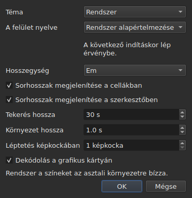

# A beállítások

<!-- machine-translated -->
> Ez az oldal gépi fordítás, amelyet a nyelv egyik olvasója még nem nézett át.

Az ablak megjegyzi, amit egérrel állítanak be — **hol volt**, **maximalizált volt-e**,
**az oszlopai szélessége**, **az elválasztó helyzete** a film és a táblázat
között — és **hol dolgoznak**, hogy az `Open…` a megfelelő helyen nyíljon meg. Ezek
egyike sem párbeszédablakban állítható: az ablakot mozgatják, az elválasztót húzzák, és ez megjegyződik.

**Hat beállításnak van saját párbeszédablaka**, a `Szerkesztés ▸ Beállítások…`, és ez a
mérce: az a beállítás, amelynek már van gesztusa, nem igényel mezőt. A
témának nincs, a sorhosszak mértékegységének sincs, sem a két jelölőnégyzetnek, amely
megjeleníti őket, sem a lejátszó ugrásának és előzményhosszának. Lásd: [A téma](#a-téma),
[Sorhosszak](#sorhosszak) és [A lejátszó](#a-lejátszó).

**A felület nyelve ugyanebben a párbeszédablakban van, és ez az, amelyik vár**: a következő
indításkor lép életbe, nem azonnal. Lásd: [A felület nyelve](#a-felület-nyelve).

**A hangerőnek nincs**: a kép alatti sáv és két gesztus állítja, és megjegyződik.

**Egy másik ott állítható be, ahol használják**: az oldal, amelyre az `Insert Subtitles…` a
sorokat teszi, ennek a párbeszédablaknak a mezője, és az utolsó választás megjegyződik. Lásd:
[Sorok beszúrása, eltávolítása, egyesítése és felosztása](lines.md#az-oldal-megjegyződik).

**Ugyanígy a két keresési beállítás**: a `Regular expression` és az
`Ignore case` bejelölve vagy bejelöletlenül marad a párbeszédablak egyik megnyitásától a
következőig, és egyik munkamenettől a másikig. Lásd:
[Keresés és csere](find-and-replace.md#a-két-lehetőség).

**Ugyanígy az `Adjust Durations…` beállításai**: az olvasási sebesség, a két
iránya, és a három időtartam a jelölőnégyzeteikkel — mindegyik megtartja az értékét, bejelölve
vagy sem. Lásd: [`Adjust Durations…`](operations.md#adjust-durations).

**És a `Save As…` legutóbb választott kódolása**, a bájtsorrend-jelölővel
együtt. Lásd: [a fájl](#a-fájl).

**És amit a `Correct Texts…` segéd és a `Spell-Check Settings…` beállít**: a
bejelölt feladatok és a kódjuk, a minták jelölőnégyzetei, a sortörés beállításai, a nyelv,
az ellenőrzés célja és az aláhúzás gépelés közben. Lásd: [Szövegek javítása…](correct-texts.md) és
[Helyesírás-ellenőrzés…](check-spelling.md#helyesírás-ellenőrzési-beállítások). **A `Correct Texts…` célja és
dokumentuma nem jegyződik meg.**

**Ami nem jegyződik meg:** az utoljára megnyitott fájl — lásd:
[A megjegyzett könyvtár](#a-megjegyzett-könyvtár).

## A lejátszó

Négy mező. A **Seek length** és a **Context length** a Gaupolé, és annak az értékeit hordozza; a **Frame step** és a **Decode on the graphics card** a subedit sajátja:

| Mező | Mit állít be | Alapértelmezés | Határok |
| :---- | :----------- | ------: | :----- |
| `Seek length` | a `Seek Backward` és a `Seek Forward` ugrása | 30 s | 1 s-tól egy óráig |
| `Context length` | az előzmény a kijelölés előtt, a `Seek Selection Start`, a `Seek Selection End` és a `Play Selection` számára | 1 s | 0-tól 60 s-ig, tizedre |
| `Frame step` | a `Step Backward` és a `Step Forward` lépése **képkockában**, valamint egy szél tolásáé | 1 képkocka | 1-től 1000 képkockáig |
| `Decode on the graphics card` | engedi, hogy a videokártya dekódolja a filmet, ha a gépben van ilyen; kártya nélkül nem változik semmi | bejelölve | bejelölve vagy sem |

**Azonnal** érvénybe lépnek, újraindításra várás nélkül, és egyik munkamenettől a másikig megjegyződnek
a `video.seek-length` (másodpercben), a `video.context-length-ms` (ezredmásodpercben) `video.step-frames` (képkockában) és a `video.hardware-decoding` (`true` vagy `false`) kulcs alatt.
**A határon kívüli érték, vagy amely nem szám**, nem akadályozza az ablak megnyílását: figyelmen kívül marad,
az alapértelmezés érvényes marad, és az ablak ezt induláskor közli. **A képkockalépés sosem ezredmásodpercben van**: az N képkockás lépés mindig N képkocka, a film képkockasebességétől függetlenül — lásd: [Időzítés a videóból](timing.md#képkockánként). A hangerő a `video.volume` kulcsban jegyződik meg,
0-tól 100-ig, ugyanezzel a toleranciával.

## A fájl

```
~/.config/subedit/settings.conf
```

Pontosabban `$XDG_CONFIG_HOME/subedit/settings.conf`, ha ez a változó
be van állítva. **Az ablak bezárásakor** íródik, és megnyitásakor olvasódik.
A megszakadt program — kilőtt vagy összeomlás miatt leállt — nem ír semmit, és a
következő munkamenet azt találja, amit az előző hagyott.

A fájl szöveg, és kézzel szerkeszthető. Ez tulajdonság, nem
mellékhatás: ettől javítható a beállítás akkor is, ha az a felület,
amely beállítja, éppen az, amelyik elromlott.

### Két blokk, az egyik a parancssorral közös

A fájl **két blokkban** íródik, mindegyik egy fejléc-megjegyzés alatt:

| Blokk | Kulcsok | Ki olvassa |
| :---- | :--- | :------ |
| `# Operation settings: shared by the window and the command line` | a `duration-adjust.*` és a `correction.*` kulcsok | az ablak **és** a `subedit-cli` |
| `# Display preferences: the window's own` | minden más kulcs — geometria, oszlopok, téma, a felület nyelve, keresés, helyesírás-ellenőrzés, szerkesztő, videó, utolsó könyvtár, kiírási kódolás | csak az ablak |

**A `subedit-cli` alapértelmezésben a műveleti blokkot olvassa**: amit az `Adjust Durations…` és a
`Correct Texts…` itt megjegyez, abból indul ki a [`subedit-cli adjust`](../subedit-cli/adjust.md)
és a [`subedit-cli correct`](../subedit-cli/correct.md) egy része is, hacsak a
parancssor egy kapcsolója mást nem mond. **A megjelenítési beállításokat sosem olvassa.** A
[`config`](../subedit-cli/config.md) parancsa felsorolja a műveleti kulcsokat, megmutatja az értéküket, és
módosítja őket — `subedit-cli config set duration-adjust.speed 12` —, az ablak pedig a változást
a következő megnyitásakor látja. **Az ablak nyitva létekor végzett módosítás nem éli túl a bezárását**: az
ablak az egész fájlt újraírja azzal, amit tart. A `--no-config` kapcsoló a parancssort a
fájl figyelmen kívül hagyására készteti. Lásd:
[A beállításfájl](../subedit-cli/invocation.md#a-beállításfájl).

Az olvasó a kulcsokat bármilyen sorrendben, fejlécekkel vagy azok nélkül elfogadja: a
két blokk létezése előtt írt fájl változtatás nélkül olvasható, és a következő bezáráskor két blokkban íródik újra.

| Beállítás | Mit tárol | Alapértelmezés |
| :----- | :------------ | :------ |
| `window.geometry` | `x,y,width,height`, képpontban; a szélesség és a magasság nem nulla | az ablak maga méreteződik |
| `window.maximised` | `true` vagy `false` | `false` |
| `table.columns` | négy szélesség képpontban, vesszővel elválasztva — `#`, `Start`, `End`, `Duration`, elrejtve is | a táblázat maga méreteződik |
| `table.order` | a hat oszlop, **mindegyik egyszer**, abban a sorrendben, ahogy a táblázat mutatja: `number`, `start`, `end`, `duration`, `text`, `translation` | `number,start,end,duration,text,translation` |
| `table.hidden` | az eltávolított oszlopok a `number`, `start`, `end` és `duration` közül; üres: egy sem | egy sem |
| `window.table-share` | a magasságból a táblázatnak jutó arány százalékban, 1-től 99-ig | az ablak úgy osztja fel, ahogy mindig is |
| `file.directory` | **abszolút** könyvtárútvonal | nincs: az `Open…` ott nyílik meg, ahol a programot indították |
| `general.theme` | `system`, `light` vagy `dark` | `system` |
| `interface.language` | `system`, vagy egy nyelv neve úgy, ahogy a katalógusát nevezik: két vagy három kisbetű, majd opcionálisan `_` és két nagybetű — `fr`, `pt_BR`; az angolhoz `en` | `system` |
| `edit.insert-placement` | `above` vagy `below` | `below` |
| `file.write-encoding` | egy olyan kódolás neve, amelyet az ICU ki tud írni, és amelynek átalakítója nem ír saját jelölőt | nincs |
| `file.write-bom` | `true` vagy `false` | `false` |
| `search.regex` | `true` vagy `false` — a minta reguláris kifejezés | `false` |
| `search.ignore-case` | `true` vagy `false` — a kis- és nagybetű különbsége figyelmen kívül marad | `true` |
| `duration-adjust.speed` | az olvasási sebesség karakter/másodpercben, szigorúan pozitív; a tizedes szám a lehető legrövidebben íródik (`15`, `12.5`) | `15` |
| `duration-adjust.lengthen` | `true` vagy `false` — meghosszabbítja, ami túl rövid az olvasáshoz | `true` |
| `duration-adjust.shorten` | `true` vagy `false` — lerövidíti, ami a szükségesnél tovább marad kint | `false` |
| `duration-adjust.minimum-enabled` | `true` vagy `false` — a legkisebb időtartam kérve van | `true` |
| `duration-adjust.minimum-ms` | a legkisebb időtartam ezredmásodpercben, egész és nemnegatív | `1500` |
| `duration-adjust.maximum-enabled` | `true` vagy `false` — a legnagyobb időtartam kérve van | `false` |
| `duration-adjust.maximum-ms` | a legnagyobb időtartam ezredmásodpercben, egész és nemnegatív | `6000` |
| `duration-adjust.gap-enabled` | `true` vagy `false` — a következő felirathoz tartozó rés kérve van | `true` |
| `duration-adjust.gap-ms` | a rés ezredmásodpercben, egész és nemnegatív | `0` |
| `correction.mentions.enabled`, `correction.common-errors.enabled`, `correction.capitalization.enabled`, `correction.line-break.enabled` | `true` vagy `false` — a feladat be van jelölve a `Correct Texts…` első oldalán | `false`, `true`, `true`, `false` |
| `correction.mentions.code`, `correction.common-errors.code`, `correction.capitalization.code`, `correction.line-break.code` | a feladat mintáinak kódja: `Zyyy`, vagy `Script[-language[-COUNTRY]]` — `Latn-en-US`; nem üres | `Zyyy` |
| `correction.human`, `correction.ocr` | `true` vagy `false` — a gyakori hibák osztályai | `true`, `true` |
| `correction.sound-in-brackets`, `correction.sound-in-parentheses` | `true` vagy `false` — a `Mentions` oldal két jelölőnégyzete | `false`, `false` |
| `correction.line-break.max-length` | a sor legnagyobb hossza, tizedes; a párbeszédablak 1-től 1000-ig korlátozza | `24` |
| `correction.line-break.max-lines` | a sorok legnagyobb száma, egész; a párbeszédablak 1-től 100-ig korlátozza | `3` |
| `correction.line-break.in-ems` | `true`: a hosszt *em*-ben mérik; `false`: karakterben | `true` |
| `correction.line-break.skip-on-length`, `correction.line-break.skip-on-lines` | `true` vagy `false` — a két kihagyási feltétel kérve van | `true`, `true` |
| `correction.line-break.skip-max-length`, `correction.line-break.skip-max-lines` | a két kihagyási küszöb a választott mértékegységben | `24`, `3` |
| `correction.join-split.enabled` | `true` vagy `false` — a `Join or Split Words` feladat be van jelölve | `false` |
| `correction.join-split.join`, `correction.join-split.split` | `true` vagy `false` — egyesítés, szétválasztás | `true`, `false` |
| `correction.join-split.language` | területi kód — `fr`, `en_US`, `sr@Latn` —; üres: a rendszer nyelve | üres |
| `correction.remove-blank` | `true` vagy `false` — `Remove all blank subtitles` | `true` |
| `transcription.engine` | a motor neve: kisbetűk, számjegyek, `.`, `-` és `_` | `whisper.cpp` |
| `transcription.executable`, `transcription.model` | abszolút elérési út; üres: a motort a `PATH`-ban keresi, és nincs beállított modell | üres |
| `transcription.language` | két kisbetű, egy ISO 639-1 kód; üres: a nyelvet felismeri | üres |
| `transcription.merge-gap-ms` | egy mondat ennél közelebbi darabjai egyesülnek, ezredmásodpercben, nemnegatív egész | `400` |
| `transcription.max-duration-ms` | a leghosszabb idő, amíg egy leiratozott felirat a képernyőn marad, ezredmásodpercben, 1-től 3600000-ig | `7000` |
| `transcription.max-characters` | egy leiratozott felirat legtöbb karaktere, 1-től 1000-ig | `84` |
| `correction.activations` | a minták jelölőnégyzetei, amelyeket a felhasználó módosított, `<type>:<code>:<name>:<0\|1>`, vesszővel elválasztva; **a névben lévő vessző vagy fordított perjel elé fordított perjel kerül** (`\,` és `\\`), és az olvashatatlan bejegyzés csak a saját beállítását veszíti el — jelzik, a többit megtartják | üres |
| `spell-check.language` | területi kód, például `fr_FR`; üres: a rendszer nyelve | üres |
| `spell-check.target` | `selection`, `current-project` vagy `all-projects` | `current-project` |
| `spell-check.document` | `main` vagy `translation` | `main` |
| `spell-check.inline` | `true` vagy `false` — az ismeretlen szavak aláhúzása a cella szerkesztőjében való gépelés közben | `false` |
| `editor.length-unit` | `em` vagy `characters` — a táblázat és a szerkesztő által mutatott sorhosszak mértékegysége | `em` |
| `editor.show-lengths-cell` | `true` vagy `false` — a szövegcella minden sorát követi a hossza | `true` |
| `editor.show-lengths-edit` | `true` vagy `false` — a cella szerkesztője egy margón mutatja az egyes sorok hosszát | `true` |

**A fájl többet fogad el, mint a párbeszédablak.** Az olvasó bármely szigorúan
pozitív sebességet és bármely nemnegatív időtartamot elfogad; az `Adjust
Durations…` párbeszédablak ezzel szemben a sebességet 1-től 99 karakter/másodpercig, az egyes
időtartamokat pedig 0-tól 99 s-ig korlátozza. A fájl ezeken a határokon kívüli értékét a program a
határra hozza vissza, amikor a párbeszédablak megnyílik, és a fájl úgy is tartja, miután a
párbeszédablakot elfogadták és az ablakot bezárták. A megszakított párbeszédablak semmit nem módosít abban, ami
megjegyződik.

**A `file.write-encoding` a `Save As…` legutóbb választott kódolását jegyzi meg, és
sosem kényszeríti rá magát egy fájlra.** A megnyitott dokumentum a saját kódolását hordozza,
és az ablak azt javasolja: egy másikban újraírni azért, mert egy
három hete beállított érték így mondja, elveszítené azt, amit az olvasás megőrzött.
Amit ez a beállítás megjegyez, az a fájl nélküli dokumentumot szolgálja — az
imént létrehozottat.

**Ez szándékos „nem”, nem figyelmetlenség.** Aki mindig ugyanabban a
kódolásban szállít, és örökölt fájlokat nyit meg másikban, az minden
fájlnál újra kiválasztja; az ablak javasolja neki, és az oda-vissza garancia mindenkinek
megáll.

**A `file.write-bom` ugyanannak a kódolásnak a jelölőjét hordozza**, és két
sorra valóban szükség van: egy kódolás neve nem mondja meg, hogy jelölő előzi-e meg, ahogy az
`--encoding` sem mondja meg, amit a `--bom`. A kettőt együtt olvassa a program,
bármilyen sorrendben, a megjegyzett kódolás nélküli `file.write-bom` pedig nem állít be semmit.

**Arány, nem magasságok az elválasztóhoz**, és ettől hasznos: három, képpontban megadott
magasság semmit nem jelent, amint az ablak más méretben nyílik meg, és az ablak gyakran más méretben nyílik meg.
Az arány bárhol visszajátszható. **Visszahozza arra, amit az ablak elfogad**, ha
túl kicsi — a film sávjának van legkisebb magassága.

**Négy szélesség hat oszlophoz**, és ez nem figyelmetlenség: ezek a
`#`, `Start`, `End` és `Duration` szélességei, ebben a sorrendben, a
táblázat sorrendjétől függetlenül, és **az elrejtett oszlop megtartja a sajátját** — megtalálja, amikor újra
megjelenik. Az utolsó megjelenített oszlop azt kapja, amit a többi meghagy, és
szélességet adni neki semmit nem tenne; a szöveg és a fordítás szélessége ezért
nem jegyződik meg.

## Mi történik, ha a fájl nem azt mondja, amit várnak tőle

A konfiguráció kényelem. **A hibája a kényelembe kerül, és másba
nem**: az ablak minden esetben megnyílik.

| Eset | Mi történik |
| :--- | :----------- |
| a fájl nem létezik | minden alapértelmezés, és nem szól semmit — ez az első indítás |
| a fájl létezik, de nem olvasható | minden alapértelmezés, és az okot a hibakimenetre írja |
| egy beállítás hiányzik | az alapértelmezése |
| egy kulcs ismeretlen | szó nélkül figyelmen kívül marad, és hiányzik az újraírt fájlból |
| egy érték nem olvasható | az alapértelmezése marad, és a beállítást megnevezi a hibakimeneten |

```console
$ subedit-gui film.srt
subedit-gui: /home/vous/.config/subedit/settings.conf: window.geometry: "plus tard" cannot be read, keeping the default
```

**Az üzenet a hibakimenetre megy, és sehová máshová.** Az indításkor megjelenő
modális ablak egy olvashatatlan beállítás miatt megállítaná a felhasználót
egy hiba miatt, amely nem akadályoz semmiben, és még mielőtt bármit kért volna.

## A kommentált beállítások

Az újraírt fájl **az összes** ismert beállítást tartalmazza, és azokat, amelyek az
alapértelmezésen maradtak, megjegyzésként írja ki:

```
#window.geometry = 0,0,1280,800
#window.maximised = false
#table.columns = 60,110,110,110
#table.order = number,start,end,duration,text,translation
#table.hidden = start,end
```

Ez nem hóbort. Enélkül a soha nem érintett beállítás megfagyna
az írása napján érvényes értéken, és **a javított alapértelmezés
soha nem érne el senkit**. Ezzel az alapértelmezés módosítása megváltoztatja
mindenki viselkedését, aki nem írta felül — és pontosan
ezt kell tennie az alapértelmezésnek.

Egy beállítás felülírásához: el kell távolítani a `#` jelet, és módosítani az értéket. Hogy
visszatérjenek az alapértelmezéshez: törölni kell a sort, vagy újra megjegyzésbe tenni.

A geometria, a szélességek és az eltávolított oszlopok **alakot** mutatnak, nem
érvényben lévő értéket: a geometria és a szélességek alapértelmezése
„amit az ablak választ”, ami nem írható számokkal, a `table.hidden` alapértelmezése
pedig „egy sem”, ami nem olvasható. A fájl fejléce is ezt mondja.
A `table.order` ezzel szemben az alapértelmezett sorrendet mutatja.

## A megjegyzett könyvtár

Az `Open…` **az utoljára megnyitott vagy mentett fájl** könyvtárában nyílik meg,
nem abban, amelyik egy megszakított ablaké volt: az számít, hol
dolgoznak, nem az, hol nézelődtek.

**Az utolsó fájl viszont nem jegyződik meg.** Megjegyzése azt jelentené, hogy
induláskor újra megnyílik egy dokumentum, amelyet senki sem kért. A könyvtár megjegyzése
egy párbeszédablakot *irányít*; a fájl megjegyzése megnyitna egyet.

## A téma

A `Szerkesztés ▸ Beállítások…` a témával nyílik, amelynek nincs gesztusa, a
[sorhosszak](#sorhosszak) fölött.

| Érték | Mit csinál |
| :---- | :----------- |
| `System` | **semmit** — a színek az asztaléi maradnak |
| `Light` | világos palettát állít be |
| `Dark` | sötét palettát állít be |

A választott téma **azonnal** érvénybe lép, újraindítás nélkül.

**A „System” nem csinál semmit, és ez nem hiányosság.** A Qt verziója, amelyre a
subedit épül, nem tudja megkérdezni az asztaltól, hogy világosat vagy sötétet kíván-e,
és azt sem, hogy értesítsék, amikor meggondolja magát. Ahelyett hogy olyan olvasást találna ki, amelyet nem tud elvégezni, az eszköz a két
kérhető témát szállítja, a harmadikról pedig az eszközkészletre bízza a döntést —
ahogy a Gaupol is teszi ugyanezen feltételek mellett.

A már sötét témájú asztalon a `System` ezért sötét
ablakot ad; világos asztalon világosat. A `Light` és a `Dark` felülírja,
az asztaltól függetlenül.

**Az anomáliák színezése mindkét palettán olvasható marad** — lásd:
[A táblázat](table.md#az-anomáliák). Ez nem feltevés: a szöveg
kontrasztját minden színezésen egy teszt ellenőrzi, mindkét háttéren.

## A felület nyelve

A `Szerkesztés ▸ Beállítások…` a téma alatt választja ki az ablak nyelvét.

| Mező | Értékek | Alapértelmezés |
| :---- | :----- | :------ |
| `Interface language` | `System default`; `English`; majd a programmal telepített minden nyelv a saját nevén — `Français` | `System default` |

**A következő indításkor lép életbe**, és a párbeszédablak ezt a mező alatt közli: az ablak
építésekor fordítódik, és a futó ablak megtartja azt a nyelvet, amelyen elindult. A választás
a beállításfájlban jegyződik meg, az `interface.language` kulcs alatt, és az ablak következő megnyitásakor olvasódik.

| Választás | Az ablak ezen indul |
| :----- | :------------------- |
| `System default` | a környezet nyelvén, mint bármely választás előtt — `LANGUAGE`, `LC_ALL`, `LC_MESSAGES`, `LANG`; lásd: [Nyelv](invocation.md#nyelv) |
| `English` | angolul, a környezettől függetlenül |
| telepített nyelv | azon a nyelven, **a környezettől függetlenül**, az `LC_ALL=C` esetét is beleértve: az itt tett választás kifejezett |

A lista azokat a nyelveket tartalmazza, amelyek katalógusa a `<prefix>/share/subedit/locale` alá van telepítve;
az angol mindig ott van, hiszen az a nyelv, amelyen a program íródott. A nyelv
a saját nevén jelenik meg, amelyet egyetlen katalógus sem fordít, hogy az olvasó megtalálja azt, amelyet olvas.

**Az az érték, amelyet a program nem tud teljesíteni, csak a választásába kerül:**

| Mit mond a fájl | Mi történik |
| :----------------- | :----------- |
| olyan nyelv neve, amelynek nincs telepített katalógusa — másik gépről hozott fájl | az ablak követi a környezetet, szó nélkül; a `Preferences…` mutatja azt a nyelvet, a nevével vagy a kódjával, és megtartja, hacsak nem választanak másikat |
| valami, ami nem nyelv neve — `French`, `fr_FR.UTF-8` | `system`, az alapértelmezés, és a beállítást megnevezi a hibakimeneten, mint minden olvashatatlan értéket |

```console
$ subedit-gui film.srt
subedit-gui: /home/vous/.config/subedit/settings.conf: interface.language: "French" cannot be read, keeping the default
```

**A parancssor ezt sosem olvassa**: a `subedit-cli` a nyelvét egyedül a környezetből választja,
és a `subedit-cli config set interface.language fr` parancsot megjelenítési beállításként elutasítja.

## Sorhosszak




A `Szerkesztés ▸ Beállítások…` azt is beállítja, **mit mutat a táblázat és a szerkesztő a
sorok hosszából** — a Gaupol vonalzója és margója.

| Mező | Mit csinál | Alapértelmezés |
| :---- | :----------- | :------ |
| `Length unit` | a hosszak mértékegysége: `Ems` vagy `Characters` | `Ems` |
| `Show line lengths in cells` | a szövegcella minden sorát követi a hossza | bejelölve |
| `Show line lengths in the editor` | a cella szerkesztője a jobb oldali margón mutatja az egyes sorok hosszát | bejelölve |

**A `Length unit` szürke, ha egyik jelölőnégyzet sincs bejelölve**: ha nincs
mutatandó hossz, a mértékegység nem állít be semmit. A választás **azonnal** érvényes a
táblázatra, és a később megnyíló szerkesztők követik. A három érték
egyik munkamenettől a másikig megjegyződik: `editor.length-unit`, `editor.show-lengths-cell`
és `editor.show-lengths-edit`, a [fájl](#a-fájl) táblázatában. Lásd:
[A sorok hossza](table.md#a-sorok-hossza) és
[a szerkesztőben](editing.md#a-sorok-hossza).

**Ez nem a segéd korlátja.** A `Correct Texts…` mértékegysége — az a
hossz, amelynél a sorokat tördeli — külön beállítás, a
segédben: a táblázatban lehet emet olvasni, és karakterben tördelni.

## Ami nem állítható be

**Kilenc megjegyzett beállítás választható párbeszédablakban** — nem számítva a
javítási segédét és a helyesírás-ellenőrzését, amelyeknek mindkettőnek
saját van —, és mindegyik abban, ahol használják: a téma és a három sorhossz-beállítás itt; a beszúrás oldala a beszúrás
párbeszédablakában; a két keresési beállítás a keresés párbeszédablakában; a kódolás és
a bájtsorrend-jelölő a `Save As…` ablakban; az olvasási sebesség, az időtartamok
és az időtartam-módosítás rése a saját párbeszédablakában. Más nincs: a diagnosztikához, a lejátszó
hangerejéhez, sem az alapértelmezett mentési formátumhoz nem állítható be semmi — az utóbbi
a megnyitott fájlból jön.

És **dokumentumhoz tartozó szám egyik munkamenetből a másikba nem marad meg**:
az eltolás mértéke, az átalakítás két jelzőpontja egy fájlra igaz,
a következőre hamis. A párbeszédablakok minden indításkor újra kérik őket,
szándékosan. Az `Adjust Durations…` beállításai ugyanígy kivételek, mint
a két keresési beállítás: az olvasási sebesség, a legkisebb időtartam vagy
a rés módszerbeli választás, nem egy fájl mérése, és
ezért maradnak meg egyik munkamenettől a másikig.

Ez a kézikönyv azt írja le, ami létezik: ami jönni fog, az az
[ütemtervben](../../../../feuille-de-route.md) van.
