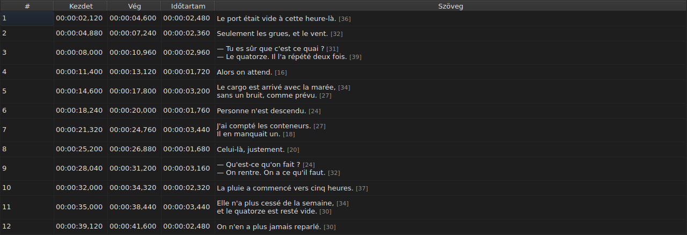
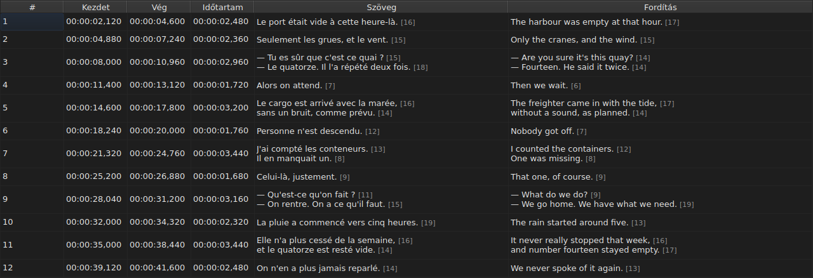
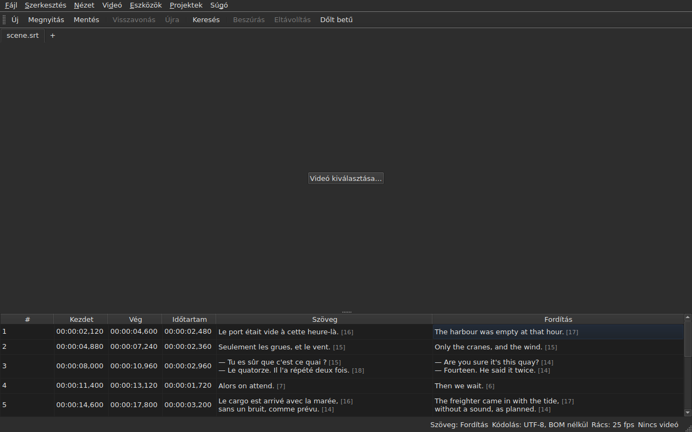

# A táblázat

<!-- machine-translated -->
> Ez az oldal gépi fordítás, amelyet a nyelv egyik olvasója még nem nézett át.

Az ablak a megnyitott fájl feliratsorait mutatja, soronként egyet, öt
oszlopban — hatban, ha a projektnek van fordítása.

**Ez a kézikönyv az ablak fejléceit úgy idézi, ahogy az angol ablak
megjeleníti őket**, ahogy a parancssornál is teszi; a magyar ablak és a képernyőképei
magyarul mutatják őket.

| Oszlop | Mit mutat |
| :----- | :-------- |
| `#` | a feliratsor sorszámát, 1-től |
| `Start` | azt a pozíciót, ahol megjelenik, `HH:MM:SS,mmm` |
| `End` | azt a pozíciót, ahol eltűnik |
| `Duration` | `End − Start` |
| `Text` | a feliratsor szövegét |
| `Translation` | a feliratsor fordítását — **hiányzik, amíg a projektnek nincs fordítása** |


## A sorok hossza




**A szövegcella minden sora után ott áll a hossza**, `[N]`, kisebb
és halványabb betűvel — a `Text` oszlopban éppúgy, mint a `Translation` oszlopban.
A Gaupol is ezt teszi.

| Mi számít | Mit tesz a táblázat |
| :-------- | :------------------ |
| **címkék** | nem számítanak: a `<i>Bonjour</i>` `[7]`, mint a `Bonjour` |
| **kerekítés** | lefelé: a 12,9 em hosszú sor `[12]` alakban jelenik meg |
| **üres sor** | nincs hossza; az üres szövegnek sincs |
| **mértékegység** | alapértelmezés szerint *em*, vagy karakter — `Szerkesztés ▸ Beállítások…` |
| **az oszlopnál hosszabb sor** | `…` vágja el a szám **előtt**, amely látható marad |

**Az *em* a Gaupolé, nem a tipográfiáé**: a kisbetűs ábécé
betűnként 0,55 emet ér a táblázat betűtípusával. Az *emben* mért hossz tehát
a betűtípustól függ; a karakterben mért hossz kódpontokat számol, egy
ékezetes betűt egynek.

**A táblázat nem jelöli a túl hosszú sort.** A számot mutatja, és a szemre van bízva, hogy
összevesse a saját maga által megadott határral — mint a Gaupolban. Ez nem
a `Correct Texts…` segéd határa, amelynek saját beállítása van.

**Hogy ne lássák őket:** a `Show line lengths in cells` jelölését kell megszüntetni a
`Szerkesztés ▸ Beállítások…` ablakban. Lásd: [Sorhosszak](preferences.md#sorhosszak).

## Oszlopok elrejtése és mozgatása

A **`Nézet ▸ Oszlopok`** oszloponként egy bejelölhető menüpontot tartalmaz, **a `Text` kivételével**:
főszöveg nélkül nem maradna mit szerkeszteni.

| Menüpont | Oszlop |
| :------- | :----- |
| `Nézet ▸ Oszlopok ▸ Sorszám` | `#` |
| `Nézet ▸ Oszlopok ▸ Kezdet` | `Start` |
| `Nézet ▸ Oszlopok ▸ Vég` | `End` |
| `Nézet ▸ Oszlopok ▸ Időtartam` | `Duration` |
| `Nézet ▸ Oszlopok ▸ Fordítás` | `Translation` — lásd: [A fordítás oszlopa](#a-fordítás-oszlopa) |

A menüpont jelölésének megszüntetése eltávolítja az oszlopát, az újbóli bejelölés visszateszi, a
korábbi szélességével. **A beállítás az egész ablakra érvényes**, az összes lapra
is: egyetlen táblázat van, amelynek projektje a lappal változik.

**Az aktuális cella elhagyja az eltávolított oszlopot**: a `Text` oszlopba
költözik, ugyanabban a sorban, a kijelölés pedig nem mozdul. A senki által nem látott oszlopban álló
aktuális cella olyan cella volna, amelyet egy billentyűleütés
vakon szerkesztene.

**Az oszlopokat a fejlécük húzásával lehet mozgatni**, bármelyiket, a `Text`
oszlopot is. Az utolsó megjelenített oszlop foglalja el a többi által meghagyott helyet.

**A sorrend és az eltávolított oszlopok megmaradnak egyik munkamenetről a másikra**, a
szélességekkel együtt, a [beállításfájlban](preferences.md) — `table.order`
és `table.hidden`. A fordítás oszlopa nincs köztük: saját
szabálya van, és minden megnyitott fordítással visszatér.

**A sorszám nem a fájl adata**, hanem a sor rangja. Egy
beszúrás vagy eltávolítás ezért újraszámozza az összes utána következőt, anélkül, hogy bármi
újra íródna.

**A tizedeselválasztó a fájl formátumát követi**: vessző SubRipnél,
pont a másik nyolcnál. A kilenc közül csak a SubRip ír vesszőt.

**Az elválasztó követi a formátumot, nem a teljes írásmódot.** A táblázat mindig kiírja
az órákat, és mindig három tizedesjegyet; egy WebVTT fájl egy óra alatt elhagyja az
órákat, a SubViewer 2 és a két Sub Station Alpha századmásodpercben számol,
az MPL2 tizedmásodpercben, a TMPlayer másodpercben, a MicroDVD képkockában. Az az
oszlop, amelynek szélessége a formátumot követné, fárasztóbban volna olvasható, mint az az
oszlop, amely egyszerűen nem a fájl pontos írásmódja.

A táblázat tehát **az értéket és az elválasztót** garantálja, nem a tizedesjegyek
számát. Hogy mit kerekítene egy célformátum, azt a mentés pillanatában
mondja meg a program — lásd:
[Amit egy formátum nem őriz meg, írás előtt kimondva](files.md#amit-egy-formátum-nem-őriz-meg-írás-előtt-kimondva).

**Az időtartam (`Duration`) számított**, sosem tárolt: beírása a végét
mozgatja. Az a feliratsor, amelynek a vége megelőzi a
kezdetét, nulla helyett negatív időtartamot mutat: ez a fájl anomáliája,
és elrejtése lehetetlenné tenné a megtalálását.

**A kezdet, a vég, az időtartam, a szöveg és a fordítás helyben szerkeszthető**; a
sorszám nem. Lásd: [Cella szerkesztése](editing.md).

**A kijelölés azt jelöli ki, amire egy művelet hat** — lásd:
[A műveletek](operations.md).

**A sor magassága a benne lévő feliratsorhoz igazodik**: a kétsoros
feliratsor két sornyi helyet foglal, a háromsoros hármat. A szöveg
teljes egészében látszik, ahogy ki fog íródni.

**Levágva az a sor marad, amely az oszlopához képest túl hosszú**, és
ilyenkor három ponttal végződik. A `Text` oszlop vagy az ablak szélesítése teljes
egészében megmutatja; a cella megnyitása is. A szöveg sorai sosem
törnek: csak a valódi sortörés csinál sort, így a
táblázatsor magassága nem változik, amikor az oszlop szélét húzzák.

## Pozíciók képkockákban

A **`Nézet ▸ Pozíciók képkockában`** — bejelölhető menüpont, az ablak egyetlen beállítása — a
`Start` és az `End` oszlopot **képkockaszámként** mutatja időbélyegek helyett, és **képkockaszámot fogad el bemenetként**. A
fejlécek ezt jelzik: `Start (frames)` és `End (frames)`.

| Ami változik | Ami nem változik |
| :----------- | :--------------- |
| amit a `Start` és az `End` kiír, és amit elfogad | a `Duration` oszlop, amely idő marad |
| a két oszlop fejléce | a dokumentum: semmi sem módosul, az előzményeknek nincs új bejegyzése, és **amit a fájl ír, az ugyanaz marad, mint volt** |

**A képkockákat számláló képkockasebesség** ebben a sorrendben:

1. **a fájlé**, ha képkockában számolt — a MicroDVD, amely számokat hordoz, képkockasebességet nem:
   **az ablak ekkor a fájlja számait mutatja**, bármi is a videó;
2. **az, amelyet a társított videó megad**;
3. **a rács, amelyet a pozíciók kirajzolnak**, ha kirajzolnak egyet.

A menüpont eszköztippje megmondja, melyiket tartotta meg: *Positions are frame numbers, counted at 25 fps, the rate the
video declares*. **A háromból egyik sem esetén a menüpont le van tiltva, és az eszköztipp megmondja az okát**: a fájl
nem képkockában számolt, a videó nem ad meg képkockasebességet, és a pozíciók nem esnek rácsra.

- **A szám annak a képkockának a száma, amelybe a pozíció esik**, a legközelebbi képkockára kerekítve. **Beírva
  azt a pillanatot adja, amikor az a képkocka kezdődik**, **csak egyszer** kerekítve a pontos
  arányból
  ([ADR 0013](../../../../adr/0013-mise-a-l-echelle-exacte-des-positions.md)): a 37. képkocka 23,976 képkocka/másodperc mellett
  1543,04 ms-nál kezdődik, azaz `00:00:01,543`.
- **Csak egész számot fogad el a program** — mínuszjellel, hiszen a kezdet megelőzheti a filmet. A
  képkockamódban beírt időbélyeg vagy a nem szám érték a cellát úgy hagyja, ahogy volt.
- **A lejátszósáv ugyanezt a beállítást követi**: a csúszka két oldalán álló pozíció és időtartam
  képkockaszámként íródik, mint a `Start` és az `End`, ugyanabban a pillanatban — lásd:
  [A lejátszósáv](player.md#a-lejátszósáv). A kép tetején rajzolt óra
  időbélyeg marad.
- **Ez a beállítás nem marad meg** egyik munkamenetről a másikra: az ablak beállítása, nem egy
  dokumentumé, és egyetlen mozdulattal újra bekapcsolható.

## Az anomáliák

Az a feliratsor, amelynek pozíciói nem állnak össze, **az időoszlopain
színezett**, és ha fölé visznek, megmondja, mi a baj.

| Szín | Mit jelez | Mit kell tenni |
| :--- | :-------- | :------------- |
| piros | `ends before it starts` | javítani a végét vagy a kezdetét |
| kék | `starts before the previous one starts` | visszatenni a sorrendbeli helyére |
| borostyánsárga | `starts before the previous one ends` | módosítani az időzítését |


Csak a `Start`, az `End` és a `Duration` oszlop színezett: az anomália
csak az időről szól, és a szöveg színezése azt sugallná, hogy köze
van hozzá.

**Egy feliratsornak több is lehet**, és az eszköztipp mindet megnevezi. A
szín az elsőként javítandóé: az önmagában
hibás feliratsor hibás, bármit csináljanak a szomszédai; a rossz helyen álló feliratsort
visszateszik a helyére, és az átfedése vele együtt megszűnik.

> Nem véletlen, hogy a rendetlenség szinte mindig legyőzi az
> átfedést: az előző kezdete előtt kezdődni annyi, mint az előző
> vége előtt kezdődni — hacsak maga az előző nem hibás.

**A jelölés minden pozícióváltozás után újraszámolódik**, akár szerkesztett cellából,
akár műveletből, akár visszavonásból származik. Azt mondja meg, milyen
a fájl most, nem azt, milyen volt megnyitáskor.

Nem támaszkodik képkockarácsra: amint egy pozíciót kézzel kijavítanak,
elhagyja a rácsot, és az arra épülő jelölés a felhasználó
munkáját jelentené.

## A fordítás oszlopa

Egy feliratsor **két szöveget és egyetlen pozíciópárt** hordoz: a
fordításnak nincs saját időzítése, a feliratsoréhoz kapcsolódik.
A táblázat egy hatodik oszlopban mutatja, `Translation`, a `Text` jobb oldalán.




**Az oszlop csak akkor van ott, ha a projektnek van fordítása.** Nélküle a táblázat
megtartja az öt oszlopát, és az ablak úgy viselkedik, mintha a fordítás
nem létezne — semmi sem szürkül el, és semmi sem kerül hozzá. A `Fájl ▸ Fordítás megnyitása…` megnyitja
egyet: lásd: [Fordítás megnyitása](files.md#fordítás-megnyitása).

**A `View` menü egy menüpontja mutatja vagy távolítja el**:

| Menüpont | Mit csinál |
| :------- | :--------- |
| `Nézet ▸ Oszlopok ▸ Fordítás` | bejelölve: az oszlop látszik; jelölés nélkül: el van távolítva |

A menüpont **le van tiltva, ha a projektnek nincs fordítása** — nincs mit
mutatni —, és induláskor be van jelölve. **Az eltávolítás döntése a
felhasználóé**: egyik fájlról a másikra megmarad, amíg újra be nem jelölik.
Az oszlop eltávolítása nem távolítja el a fordítást: a
projektben marad, és a menüponttal visszatér. Az olyan fájl megnyitása, amelynek nincs, eltávolítja az
oszlopot.

**A fordítás celláiba ugyanúgy lehet gépelni, mint a szövegéibe** — lásd:
[Cella szerkesztése](editing.md).

### A szöveg, amelyre a műveletek vonatkoznak

Ha egy sorban két szöveg van, a szövegműveleteknek tudniuk kell, melyiket
írják át. **Az, amelyik az aktuális cella oszlopáé**: a
fordítás, ha az aktuális cella a `Translation` oszlopban van, máshol a főszöveg
— időoszlopban éppúgy, mint a `Text` oszlopban.

| Művelet | Mire vonatkozik |
| :------ | :-------------- |
| `Italic`, `Case`, `Dialogue`, `Remove Hearing-Impaired Mentions…` | az aktuális oszlop szövegére |
| `Cut Texts`, `Copy Texts`, `Paste Texts` | az aktuális oszlop szövegére |
| `Find and Replace…` | az aktuális oszlop szövegére — lásd: [Keresés és csere](find-and-replace.md#melyik-szövegben) |
| a pozícióműveletek, a beszúrás, az eltávolítás, az egyesítés, a felosztás | **mindkét szövegre**: a feliratsor egy egész |

**Az állapotsor kimondja, ha két szöveg van**, a többi jelzéstől
balra:

```text
Text: Translation
```

vagy `Text: Main` a főszövegnél. Hallgat, ha az oszlop nem
látszik: ekkor csak egy szöveg van, és nincs értelme kimondani.




**A képre rajzolt sor ugyanezt a szabályt követi**: az aktuális
oszlop szövege. Lásd: [A lejátszó](player.md#a-rajzolt-vonal).

**Semmi sem szürkül el.** A szövegműveletek elérhetők maradnak, bármi is
az aktuális oszlop, és fordításoszlop nélkül a főszövegre
vonatkoznak, mint korábban.

## Sorok hozzáadása és eltávolítása

A `Szerkesztés ▸ Feliratok beszúrása…` és a `Szerkesztés ▸ Feliratok eltávolítása` sorokat ad hozzá és
távolít el, a `Szerkesztés ▸ Feliratok összevonása` és a `Szerkesztés ▸ Felirat felosztása`
egyesíti, illetve felosztja őket; a táblázat magától újraszámozza magát. Lásd:
[Feliratsorok beszúrása, eltávolítása, egyesítése és felosztása](lines.md).

## Amit a táblázat nem csinál

**Oszlop szerinti rendezés nem létezik.** A megjelenített sorrend a fájlé, és
ez az egyetlen, amelynek értelme van a feliratsoroknál: egy sor rangja *a*
helye az időben.
