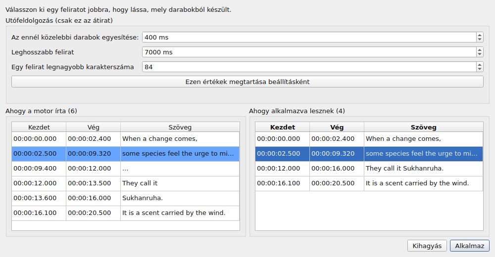
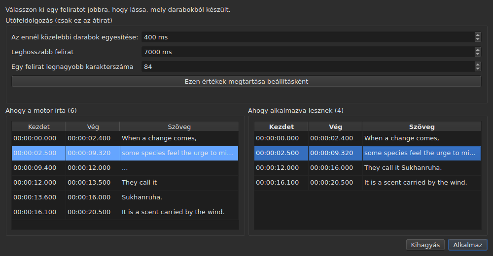

# A társított videó

<!-- machine-translated -->
> Ez az oldal gépi fordítás, amelyet a nyelv egyik olvasója még nem nézett át.

A **Videó** menü először három parancsot hordoz, majd a filmet vezérlő mozdulatokat
— lásd [A lejátszó](player.md#mozgás-a-filmben).

| Parancs | Gyorsbillentyű | Mit csinál |
| :------ | :------------- | :--------- |
| Videó kiválasztása… | nincs | kiválasztja a videófájlt, amelyhez a dokumentum tartozik |
| Hang leiratozása… | nincs | a film hangját a projekt feliratait felváltó feliratokká iratozza le — lásd [A hang leiratozása](#a-hang-leiratozása) |
| Szinkronizálás a hanggal… | nincs | a projekt feliratait oda helyezi, ahol a szavaik elhangzanak a film hangjában — lásd [A hanggal való szinkronizálás](#a-hanggal-való-szinkronizálás) |
| Lejátszás / Szünet | `Ctrl+P` | lejátssza vagy megállítja a videót — lásd [A lejátszó](player.md#lejátszás-és-megállítás) |

A társított videó **a megnyitott dokumentum tulajdonsága**, nem az alkalmazás
beállítása: egy másik feliratfájl megnyitása elölről kezdi. Egyetlen fájlba
sem íródik ki, és az ablakkal együtt eltűnik.

## A hangsáv

Egy film több hangsávot is hordozhat — az eredeti változatot, egy szinkront, egy kommentárt. A
**`Videó ▸ Audió ▸ Nyelv`** almenü felsorolja őket, **sávonként egy elemmel**, és **megjelöli a lejátszottat**:

| Amit a fájl megad | Amit az elem kiír |
| :---------------- | :---------------- |
| egy nyelv és egy cím | `1: fra — Original` |
| csak egy nyelv | `2: eng` |
| csak egy cím | `3: Commentary` |
| egyik sem | `1` |

A szám **a sáv helye a filmben**, egyenként számolva, a fájl sorrendjében: két sáv
is kiírhatja, hogy `eng`, és egy fájlnak, amely hallgat a felirataikról, is van első és második sávja.

**Egy elem kiválasztása azt a sávot játssza le.** A jelölés a lejátszó válasza, nem a kattintás: azt a
sávot mutatja, amely éppen szól.

- **Az almenü le van tiltva**, ha nincs videó vagy nincs hangsáv. Egyetlen sáv esetén engedélyezve marad, és
  bejelölve mutatja azt: a film nyelvét közli. A két hangerő-mozdulat, amelyek mellette vannak, minden esetben
  engedélyezve marad: lásd [A hangerő](player.md#a-hangerő).
- **A sávot nem jegyzi meg a program** egyik videóról a másikra, sem egyik munkamenetről a másikra: a sávszám
  a fájlé, és ha átvinnék a következő filmre, ott azt választaná, ami ezt a számot viseli.
  Egy laphoz visszatérve a film azon a sávon nyílik újra, amelyet a lejátszó maga választ.
- Nincs gyorsbillentyű: a nyelvet ritkán váltják, és a menü elég.

## Videó kiválasztása

A párbeszédablak a feliratfájl könyvtárában nyílik meg, és a felismert
videókiterjesztésekre szűr:

    .avi .flv .m2ts .mkv .mov .mp4 .ogg .ogv .vob .webm

Azt is felkínálja, hogy az összes fájl látsszon. A párbeszédablak megszakítása
semmit sem változtat.

A kiválasztott fájl **azonnal megnyílik**: a kép megjelenik az ablakban,
az első pillanatán szüneteltetve. Lásd [A lejátszó](player.md).

**Egy videófájl ejtése az ablakra ugyanezt teszi** — lásd
[Fájlok ejtése az ablakra](files.md#fájlok-ejtése-az-ablakra).

**A videó az aktuális lap projektjéé.** Minden lap a sajátját őrzi;
a lapváltás filmet vált. **Egy laphoz visszatérve a film ott folytatódik, ahol
hagyták**, szüneteltetve, mint minden megnyitás. Egy másik film, amelyet
időközben választottak ehhez a projekthez, ezzel szemben az elejéről indul.

## Az automatikus javaslat

Egy feliratfájl megnyitásakor, **ha nincs videó kiválasztva**,
az ablak keres egyet ugyanabban a könyvtárban: olyan videófájlt, amelynek kiterjesztés
nélküli neve a miénk előtagja, pontig bezárólag.

| Feliratfájl | Talált videó | Miért |
| :---------- | :----------- | :---- |
| `film.fr.srt` | `film.mkv` | a `film` előtagja a `film.fr` névnek |
| `film.en.forced.srt` | `film.mkv` | ugyanígy, a szakaszok számától függetlenül |
| `film.fr.srt` | `film.fr.mkv` a `film.mkv` helyett | a leghosszabb név nyer |
| `film.fr.srt` | egy sem, ha a `film.mkv` **és** a `film.mp4` is ott van | két jelölt nem különböztethető meg |
| `film.fr.srt` | egy sem, ha csak a `fil.mkv` van ott | a `fil` nem pontnál ér véget |

**A javaslat nem választás.** Hagyja magát egy másik
javaslattal felváltani — másik fájl megnyitásával, másik néven történő mentéssel. Egy kifejezett
választást ezzel szemben soha nem írnak felül: a `Select Video…` használata után az
automatikus javaslat többé nem tér vissza mögötte.

Ettől elfogadható a találgatás: kijavítható, és a javítása megmarad.

## Amit az állapotsor mutat

Az állapotsor jobb oldalán egy sor közli, mihez tartozik a dokumentum. Ez
a három közül az utolsó: először a beolvasott fájl [kódolása](files.md#a-kódolás-az-állapotsorban)
áll, utána a pozíciókból kikövetkeztetett [képkockarács](frame-grid.md).

| Helyzet | Amit kiír |
| :------ | :-------- |
| társítva van egy videó | `Video: film.mkv` |
| … és az `ffprobe` megadja a képkockasebességét | `Video: film.mkv, 24000/1001 fps` |
| nincs | `No video` |

**A képkockasebesség a filmmel együtt jár, nem mellette.** Egyetlen tény — amihez
ez a dokumentum tartozik —, és egy harmadik említés egy rangra tenné
[a pozíciókból kikövetkeztetett ráccsal](frame-grid.md), amely egy másik tény.

## A hang leiratozása

A **`Transcribe Audio…`** a film beszédét írja ki feliratként. Addig nem elérhető, amíg nincs megnyitva film: ez
a **projekt filmjének** hangja, és soha nem egy fájl, amelyet kiválasztana — egy hangfájl leiratozásához
használja a [`transcribe`](../subedit-cli/transcribe.md) parancsot a parancssorban.

A párbeszédablak négy dolgot kér, és megmondja, el tud-e indulni:

- **a hangsávot**, úgy felsorolva, ahogy az [`Audio`](#a-hangsáv) menü felsorolja, a fájl által
  megadott nyelvvel és címmel;
- **a nyelvet**, egy **listából** választva: először egy bejegyzés, amely felismeri, „Észlelés az első 30 másodpercnyi hangból”, majd a
  motor által a modellhez kínált nyelvek, a nevük az ablak nyelvén, és utánuk a kódjuk — „Francia (fr)”. A lista a motoré: körülbelül száz
  egy többnyelvű modellnél; egy csak angolra való modellnél egyetlen bejegyzése van, az angol, és nem módosítható,
  egy sor pedig azt mondja, hogy a film angolul fog kijönni, bármilyen nyelven szól. A lista a kiválasztott hangsáv nyelvével indul, ha a fájl
  megadja és a motor kínálja, követi a hangsávot, amíg Ön nem választott egyet, és
  **az alatta lévő sor megmondja, honnan származik**. Ha a fájl nem ad meg nyelvet a hangsávhoz, a sor ezt mondja, és figyelmeztet:
  a modell ekkor az első harminc másodpercnyi hangból fogja felismerni, és **egy zenével vagy csenddel kezdődő filmet másik nyelvűnek nézhet, és a beszédét arra fordítja**.
  Ha ismeri a nyelvet, válassza ki;
- **a megjegyzésként kiírt hangok**: egy jelölőnégyzet, a „Ne írja ki a hangokat megjegyzésként”, alapértelmezés szerint bejelölve. A motor ekkor megkapja az utasítást, hogy ne írja ki a hangokat
  megjegyzésként, például `(phone ringing)` vagy `[MUSIC PLAYING]`; ahol nincs beszéd, amit kiírhatna, `...`-ot ír, és azokat a darabokat, amelyekben nincs betű és nincs számjegy,
  az utófeldolgozás eldobja. Szüntesse meg a jelölést a megjegyzések megtartásához, halláskárosultaknak szóló feliratokhoz. A négyzet szürke, az okkal együtt,
  olyan motornál, amelynek ez nem mondható meg. Ez a `transcription.suppress-notes` beállítás, amelyet a [beállítások](preferences.md#leiratozás)
  is tartalmaznak;
- **a film egy része**, egyik időponttól a másikig — lásd: [Előbb egy rész kipróbálása](#előbb-egy-rész-kipróbálása). Ha mindkét mező
  üres, az a teljes film.

**Azt is megmondja, mi hiányzik.** Három sor megmondja, megvan-e a motor, az `ffmpeg` és a modell, és
hol; ha valamelyik nincs meg, az `OK` kikapcsolva marad, és az ablak ezt a következőre mutató hivatkozással mondja meg:
[A leiratozó eszközök telepítése](../subedit-cli/install-transcription.md). A `Preferences…` gomb megnyitja
a [beállításokat](preferences.md#leiratozás), ahol a program és a modell megadható — ezek a gépre
vonatkozó tények, nem olyan választások, amelyeket minden leiratozásnál újra meg kell tenni — és az ablak újra megnézi, amikor bezárulnak.

A nyelv megmarad a következő alkalomra. Maga a motor és a feliratok korlátai
[beállítások](preferences.md) (`transcription.*`).

**Ha a projekt már tartalmaz feliratokat, az ablak a lecserélésük előtt rákérdez**, és megmondja,
hányat érint. A munka előtt kérdez, hogy az elutasítás semmibe se kerüljön. Ha a projekt üres, nincs
mit kérdezni.

A munka **a háttérben** fut, egy ablakkal és egy `Cancel` gombbal; az ablak körülötte használható marad. **Az ablak
megmutatja, hol tart a munka**, hogy tudja, él, és mennyi ideig fog tartani:

- **a lépés**: először „A hang kinyerése…” — az ablak ilyenkor foglalt, szám nélkül, mert a kinyerés semmit sem mond arról, meddig jutott —,
  majd „A hang leiratozása…”, egy sávval;
- **a hátralévő idő**, „körülbelül 38 perc van hátra”: eleinte hiányzik, és akkor jelenik meg, amikor a motor elég előrehaladást jelentett az extrapoláláshoz, és a motor sebességéből számolódik az indulástól az utolsó percig; néhány perces pontosság, nem ígéret;
- **az eltelt idő**, „eltelt: 0:05:12”, amely akkor is halad, ha semmi más nem mozdul;
- **a pozíció**, „0:12:30 / 0:50:00”: hogy a motor meddig jutott a filmben, amint előállította az első szövegét; **közvetlenül az utolsó szöveg fölött** látszik, amelyhez tartozik;
- **az utolsó szöveg**, amelyet megkapott, hogy lássa, a munkának van értelme.

Egy hosszú filmnél, nagy modellel, processzoron az első percek hosszúak lehetnek: a motor betölt, és az első harmincmásodperces
ablakain dolgozik. A pozíció és az utolsó szöveg előbb mozdul, mint a motor saját százaléka, amely csak a film 5 %-os
lépéseiben érkezik.

### Az előnézet

**A projekt feliratait semmi sem váltja fel, amíg meg nem nézte őket.** Amikor a munka véget ér — és akkor is, ha megszakítja, vagy ha valamit előállítva
meghiúsul — egy ablak két, egymás melletti táblázatban mutatja az eredményt, mindkettőnek **saját kezdete és vége** van:

- **balra, „Ahogy a motor írta”**: minden, amit a motor visszaadott, ahogy felvágta, utófeldolgozás nélkül — amit a
  [`--raw`](../subedit-cli/transcribe.md) írna —, a helyőrzőkkel (`...`) együtt;
- **jobbra, „Ahogy alkalmazva lesznek”**: a feliratok az utófeldolgozás után, pontosan az, ami a projektbe kerül. Három lépésben megy, mindegyik az egész átiraton, mielőtt a következő elkezdődik: a betű és számjegy nélküli darabokat eldobja (`...`); egy mondat közeli darabjait összevonja; a túl hosszúakat felvágja — **először mondatvégnél (`. ? ! …`), aztán vesszőnél, pontosvesszőnél vagy kettőspontnál, és mondat közepén csak akkor, ha nincs írásjel, ahol vágni lehetne**. Azt a vágást, amely olvashatatlanul kicsi feliratot hagyna (néhány karakter, egy másodperc törtrésze), elkerüli, ha van másik. Az a felirat, amely egy darabot kezd, megtartja a kezdetét, az, amelyik lezárja, megtartja a végét: a szavak időpontjait csak a darabon belüli vágásokhoz használja.

A táblázatok fölött **„Utófeldolgozás (csak ez az átirat)”** az utófeldolgozás három korlátját tartalmazza: „Az ennél közelebbi darabok egyesítése:”, „Leghosszabb felirat” és „Egy felirat legnagyobb karakterszáma” — a `transcription.merge-gap-ms`, `transcription.max-duration-ms` és `transcription.max-characters` beállításokat. **Ha egyet megváltoztat, a jobb oldali táblázat azonnal újraképződik**, a motor bevonása nélkül, és a kijelölt felirat kijelölve marad. A megadott értékek csak **erre az átiratra** érvényesek: akár alkalmazza, akár elveti, az alkalmazás beállításai olyanok maradnak, amilyenek voltak. **„Ezen értékek megtartása beállításként”** átadja a három értéket az alkalmazás beállításainak — a [beállítások](preferences.md#leiratozás) részének, azokkal együtt mentve —, és az ablak ezt közli; az ablak bezárása ezt magától nem teszi meg.

A kettő nem sorról sorra illeszkedik, ezért mindkettőnek saját időpontjai vannak. **Ha jobbra kijelöl egy feliratot, balra kiemelődnek azok a darabok, amelyekből
készült**, és a bal oldal odagörög; egyszerre egy felirat, és csak ebben az irányban. Egyik táblázat sem szerkeszthető: amit egyetlen beállítás sem hoz helyre, azt utólag a projekt táblázatában szerkesztheti, mint bármely feliratot.

Két gomb zárja be. Az **„Alkalmaz”** a projekt feliratait **egyetlen műveletként** váltja fel: egy `Undo` visszaadja, ami volt, a fordítási
szövegekkel együtt. A **„Kihagyás”** eldobja az eredményt, és az elvész. Az „Alkalmaz” kikapcsolt, ha
nincs mit alkalmazni.

**Ha a futást leállították**, az ablak ezt mondja — „Részleges eredmény: a munka itt állt le: …” — és felkínálja, ami addig elkészült, alkalmazásra
vagy kihagyásra, hogy egy későn leállított hosszú futás ne veszítse el a munkáját kérés nélkül. Ezeknek a daraboknak nincsenek időzített szavai (a motor a végén írja őket), és az
utófeldolgozás a darabok saját határainál vág. A hibát előbb egy ablak mondja, mint bármely hibát; a megszakítás ilyet nem mond.

### Előbb egy rész kipróbálása

Egy tartomány lehetővé teszi, hogy **egy modellt vagy nyelvet kétperces szakaszon ítéljen meg, mielőtt kétórásra vállalkozna**. A „A film egy része” mezők egy kezdetet és egy véget kapnak, mindegyiket `HH:MM:SS` alakban írva, és számjegyenként felülírva, ahogy [az eltolás párbeszédablakában](operations.md#shift-positions) (a `2:00` alakban beillesztett idő formára igazodik); elég az egyik (onnantól a végéig, vagy az elejétől odáig). Az `OK` kikapcsolt marad, amíg egy mező
nem időpont, vagy a vég nem a kezdet után van, és a mezők alatti sor megmondja, melyik.

- **A feliratok megtartják a film idejét**: ami 2:10-nél hangzik el, az az eredményben `0:02:10`-nél áll.
- **Az előnézeten megy át, mint bármely leiratozás**, és az alkalmazás után váltja fel a projekt feliratait; egy `Undo` visszaadja őket.
  Ha úgy akar tartományt kipróbálni, hogy ne nyúljon a munkájához, hagyja ki az előnézetet, vagy előbb mentsen.

**Amire szüksége van, azt nem szállítja a program**: egy motor (whisper.cpp), egy modell, és az `ffmpeg` a hang kinyeréséhez.
Lásd: [A leiratozó eszközök telepítése](../subedit-cli/install-transcription.md).

## A hanggal való szinkronizálás

A **`Synchronize with Audio…`** a projekt feliratait újraidőzíti a film hangjára. Ez az eset az online letöltött `.srt`-é, amely az elején és a végén
eltolt, és amelyet egyetlen eltolás nem hoz helyre: minden feliratot megkeres abban, ami elhangzik, és arra a helyre kerül, ahol elhangzik. **Csak a kezdetek és a végek változnak** — soha
nem a szöveg, a stílus, a feliratok száma vagy sorrendjük. A `Transcribe Audio…` parancshoz hasonlóan addig nem elérhető, amíg nincs megnyitva film, és **a projekt filmjének** hangjáról van szó; ugyanez
a parancssorban a [`sync`](../subedit-cli/sync.md).

A feliratoknak a beszélt nyelven kell lenniük: semmi sem kerül lefordításra. A munkát a leiratozó motor végzi — a
[beállításokban](preferences.md#leiratozás) megadott, ugyanazzal a programmal, `ffmpeg`-gel és modellel — és **az ablak megmondja, mi hiányzik**, pontosan úgy,
mint a leiratozásé, a [A leiratozó eszközök telepítése](../subedit-cli/install-transcription.md) oldalra mutató hivatkozással és egy
`Preferences…` gombbal.

A párbeszédablak a következőket kéri:

- **a hangsávot** és **a nyelvet**, mint a leiratozásnál;
- **a film egy részét**, egyik időponttól a másikig, mindkettő üresen a teljes film: csak azokat a feliratokat keresi meg és helyezi át, amelyek a tartományban **kezdődnek**;
- **„Csak a kijelölt feliratok”**: egy jelölőnégyzet, kikapcsolva, ha nincs kijelölés. Csak a kijelölt feliratokat keresi, a film azon részében,
  amely az első kijelölt előtt egy perccel kezdődik és az utolsó után egy perccel ér véget, hogy a késő vagy korai fájl is
  a meghallgatott részen belül legyen;
- **„Hallandó szavak”**, százalékban: egy felirat szavainak az a hányada, amelyet hallani kell ahhoz, hogy a feliratot megtalálja, alapértelmezés szerint 50 % — a
  `alignment.min-match` beállítás;
- **„Ellenőrzendő eltolás”**, ezredmásodpercben: mennyire térhet el egy felirat a szomszédai eltolásától, mielőtt megjelöli, alapértelmezés szerint 2000 ms —
  a `alignment.doubt-gap` beállítás.

Az utolsó hármat megjegyzi a következő alkalomra. A munka **a háttérben** fut, ugyanazzal az ablakkal és `Cancel` gombbal, mint a leiratozás;
a sikertelen vagy az Ön által leállított futás semmit sem változtat.

### Az eredmény

**Semmi sem mozdul, amíg nem látta, hová kerülnének a feliratok.** Amikor a munka véget ér, egy ablak minden megkeresett feliratnál megmutatja
a sorszámát, a szövegét, **a kezdetét, ami volt, a kezdetét, ami lesz, a kettő közti eltolást**, és azt, hogy mit kell **ellenőrizni**, szavakkal:

- **„nem található a hangban, úgy hagyva, ahogy volt”**: kevesebb szót hallott, mint amennyit a mező kér. A felirat megtartja az időpontjait — **soha nem talál ki helyzetet, és nem
  találgat a szomszédokból**;
- **„csak részben hallható”**: megtalálta, de a szavainak kevesebb mint 80 %-át hallotta;
- **„a szomszédaitól eltérően mozdult”**: megtalálta, de az eltolása a két-két szomszédos felirat középső eltolásától jobban eltér, mint az
  „Ellenőrzendő eltolás”;
- **„visszavágva a következő felirat kezdetéig”** és **„még mindig átfedi a következő feliratot”**: a következőbe nyúló feliratot visszavágja
  addig, ahol a következő kezdődik; azt, amely még mindig átfedi, és amelyet a vágás nem orvosol, meghagyja, és jelzi.

A táblázat fölötti sor megmondja, mi lett belőle — hány feliratot helyezett el, hányat kell ellenőrizni, a medián eltolást és az elcsúszást —, és
**a „Csak az ellenőrizendő feliratok”** csak azokat mutatja. A táblázat nem szerkeszthető.

Két gomb zárja be. Az **„Alkalmaz”** a kezdeteket és a végeket **egyetlen műveletként** mozgatja: egy `Undo` visszaadja a korábbi időpontokat. A „Mégse”
a projektet úgy hagyja, ahogy van. Az „Alkalmaz” kikapcsolt, ha semmi sem mozdulna. Ha egyetlen feliratot sem sikerült megtalálni, az ablak ezt egy üzenetben mondja meg,
és nem mutat alkalmazandó semmit: szinte biztosan rossz a hang vagy rossz a nyelv.

## Ha nincs film

Az ablak a kép helyén egy **`Select Video…`** gombot mutat, ahelyett hogy
semmit sem mutatna. Ez ugyanaz a parancs, mint a `Video` menüé, az egér
közelébe hozva: egy olyan hiányt, amelyre nem lehet hatni, nehéz megkülönböztetni
a hibától.

A gomb eltűnik, amint egy film megnyílik, és a kép **a teljes** helyét
elfoglalja: azt a magasságot, amelyet a táblázat fölötte meghagy — amelyet a
[`window.table-share`](preferences.md) jegyzett meg egyik munkamenetről a másikra —, és
sosem kisebbet a kép legkisebb magasságánál, amelyből a táblázat szükség esetén enged.
Amikor a film elmegy, a gomb visszaveszi ugyanezt a helyet.

**A fájl neve, sosem az útvonala.** Egy kétszáz karakteres útvonal
kitolna mindent a sávból; a teljes útvonal az, amelyet a
párbeszédablak mutatott.

## Az `ffmpeg` nem kötelező

A `subedit-gui` az `ffprobe`-ot — amely az `ffmpeg` részeként érkezik — egyetlen dologról
kérdezi: **a konténer által megadott képkockasebességről**. Filmenként egyszer
olvassa be, a társításkor.

| `ffprobe` mellett | Nélküle |
| :---------------- | :------ |
| az állapotsor a film neve mellé írja a képkockasebességet | csak a nevet írja |
| az átváltási párbeszédablak az alsó mezőben felkínálja a film képkockasebességét | semmit sem kínál fel, és a korábbiak szerint nyílik meg |
| az igazítási párbeszédablak ezzel nyílik meg | a projekt képkockasebességével nyílik meg |

**Semmi más nem függ tőle, és egyetlen művelet sem tagad meg semmit.** A lejátszónak
viszont egyáltalán nincs szüksége az `ffprobe`-ra: a `libmpv`-re támaszkodik, amely
fordítási függőség. A film időtartama, amellyel a végén túlnyúlót jelzik,
a lejátszótól származik, nem az `ffprobe`-tól.

**A leiratozás az az egyetlen dolog, amelynek valóban szüksége van az `ffmpeg`-re**: ezzel nyeri ki a film hangját. Lásd
[A leiratozó eszközök telepítése](../subedit-cli/install-transcription.md).

Ez tehát nem csökkentett üzemmód, hanem **a normál működés** egy olyan gépen,
amelyre sosem telepítették az `ffmpeg`-et: az adat a felhasználótól jön, és az `ffprobe`
felkínálja, ha ott van.

A beolvasott képkockasebesség **pontos tört** — `24000/1001`, nem `23.976`.
Ezért tartják meg az `ffprobe`-ot erre a válaszra: a
lejátszó ugyanezt lebegőpontos számként ismeri, és egy közelítő képkockasebesség
az egész fájlt kissé mellé időzítené újra.
