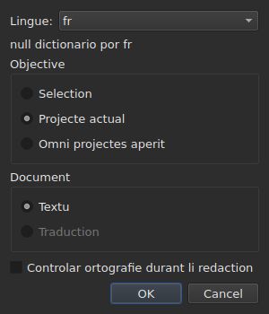
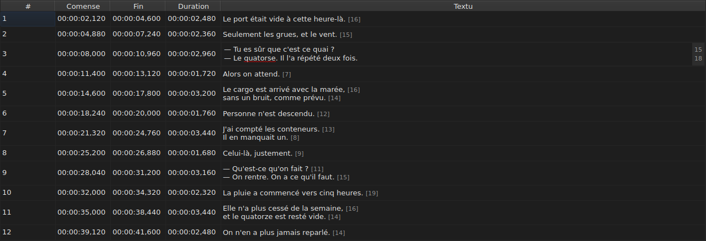
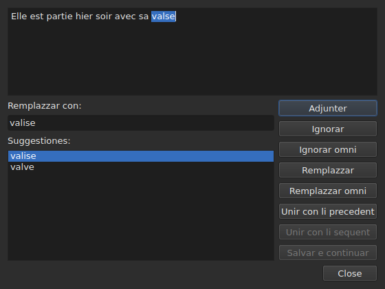

# Controlar ortografie…

<!-- machine-translated -->
> Ca págine es un traduction machinal e it ancor ne ha esset revidet de un lector del lingue.

`Instrumentarium ▸ Controlar ortografie…` percurre li paroles quel li dictionarium ne conosse,
un a un, secun li modelle del controlator de ortografie de Gaupol. It have un companion,
`Instrumentarium ▸ Parametres de controle ortografic…`, quel fixa li lingue, li objective e li document, e anc li suslineation durant li tipation.
Ambi se basa sur li dictionaria del sistema, per Enchant.

Li nómine del prim es scrit `Chec&k Spelling…`: `C` es ja
li accelerator de `Correct Texts…`, e `k` es libere in li menu `Tools`.
Null del du have un via rapid.

**Ambi es desactivat sur un document sin subtitul**, quam
[`Correct Texts…`](correct-texts.md): il ne have nequo a controlar. `Check Spelling…`
es anc desactivat sin dictionarium por li lingue fixat, vide
[Sin un dictionarium](#sin-un-dictionarium).

## Parametres de ortografie…




| Grup | Eliges | Predefinit |
| :---- | :------ | :------ |
| `Language` | li codes de lingue que li sistema ofre, e li ja eliget | li lingue del sistema, si it es inter les |
| `Target` | `Selection`, `Current Project`, `All Open Projects` | `Current Project` |
| `Document` | `Text`, `Translation` | `Text` |
| `Check spelling while editing` | un casse a marcar, vide [Suslinear durant li tipation](#suslinear-durant-li-tipation) | ne marcat |

`Selection` es desactivat sin linea selectet in li tab monstrat; `Translation`
es desactivat til que null projecte aperit porta un traduction. Un parametre
memorat que ne es plu disponibil — un selection vacui, un traduction absent —
aperte sur `Current Project` o `Text`. `OK` conserva li parametres, `Cancel` ne changea
nullcos.

**Ca fenestre ne depende del dictionarium**: it resta activat tam long quam li
document have subtitules, mem sin dictionarium por li lingue fixat, e it es
li fenestre quel permete lassar un lingue sin dictionarium. Li lingue por quel null
dictionarium existe resta redactibil e apare in li liste, con, sub it, li frase
`no dictionary for` sequet de su code.

**Li quar parametres es memorat** de un session al altri, in li file de
parametres de `subedit` — vide [Li preferenties](preferences.md) por su
location:

| Clave | Valores | Predefinit |
| :-- | :----- | :------ |
| `spell-check.language` | un code de lingue, quam `fr_FR`; vacui: li lingue del sistema | vacui |
| `spell-check.target` | `selection`, `current-project`, `all-projects` | `current-project` |
| `spell-check.document` | `main`, `translation` | `main` |
| `spell-check.inline` | `true` o `false` — suslinear li paroles ínconosset in li redactor de un cellule | `false` |

Un valore que li clave ne accepta es ignorat, li valore predefinit aplica, e li option
es nominat sur li flu de error quande li fenestre aperte — vide
[Li preferenties](preferences.md#quo-evenit-quande-li-file-ne-di-quo-es-expectat).

## Suslinear durant li tipation




Li casse `Check spelling while editing` de `Spell-Check Settings…` suslinea,
**con un linea ondulat rubi e durant que on tipa**, chascun parol ínconosset in li redactor de un
cellule de textu — ti del columne `Text` talmen quam ti del columne
`Translation`. Li suslineation seque li tipation: it apare, move se e
desapare con li parol. **It es ne marcat per predefinit**, quam in Gaupol: sin
it, nullcos changea in li redactor.

**Li lingue es ti de `Language:`**, in li sam fenestre, e li paroles ínconosset
es ti quel `Check Spelling…` trovaret: mem casus de anglesi familiari
(`goin'`, `we'd`, `1st`), mem division in paroles. Un parol suslineat ne es corectet
per un menu: li casse solmen it monstra.

**Sin dictionarium por li lingue fixat, li redactor resta silentiosi**: nullcos es
suslineat e nullcos falie, e li frase `no dictionary for` del fenestre dice
pro quo. Li casse aplica a redactores aperit pos it; un redactor ja
aperit conserva quo it havet.

## Li promenada




Li fenestre monstra li textu del subtitul u it ha haltat, con li parol ínconosset
selectet in it. **A chascun parol ínconosset, li tab del projecte reveni e
li linea del subtitul es selectet in li tabelle.** Li promenada va subtitul
pos subtitul, poy projecte pos projecte quande li objective designa plu de un.

Sub li textu: li casse `Replace with:`, plenat con li prim suggestion, e li
liste `Suggestions:`. Eliger un suggestion copia it in li casse; tipar in li
casse renova li liste.

| Buton | Quo it fa |
| :----- | :----------- |
| `Add` | adjunte li parol al dictionarium personal del usator e passa al sequent |
| `Ignore` | lassa ca parol e passa al sequent |
| `Ignore All` | lassa ca parol, e omni su altri occurentias durant ca promenada |
| `Replace` | remplazza li parol per li contenete de `Replace with:`; desactivat til que li casse es vacui |
| `Replace All` | fa li sam por su altri occurentias; desactivat til que li casse es vacui |
| `Join with Previous` | unir li parol con li parol ante it; desactivat si il ne have un, o si ili ne es separat per un spacie |
| `Join with Next` | unir li parol con li parol pos it, sub li sam condictiones |
| `Save and Resume` | conserva li textu quam li area de textu it porta, e reprende li lectura de **ca textu desde su comense** |
| `Close` | clude li fenestre |

**Li area de textu es redactibil.** Tam rapid quam on tipa in it, solmen `Save and Resume`
resta activat: li altri gestes actua sur li parol eliget, quel ne es plu
ti del textu.

**Li promenada fini per se self** quande null parol ínconosset resta: li
butones es desactivat, li textu se vacua. Un objective sin null parol ínconosset
ne monstra null fenestre.

### Clúder in li medie

`Close`, o li crux del fenestre, **aplica quo esset fat**, quam li fin
del promenada: li textus ja lassat, **e** li gestes — remplazzar,
remplazzar omni, unir — ja fat sur li textu actual. It es un diferentie
de Gaupol, quel perde li textu actual. Ne conta quo resta del promenada, ni
li retoches tipat in li area de textu que `Save and Resume` ne ha
validat.

**Un sol entrata de historie per projecte tangit**, quelcunque li númere de
remplazzamentes: `Undo` desfa omni li corrections de ti projecte in un vez.
Li menu it nomina `Undo: correcting texts`. Li barre de statu da poy li
cuntage:

```text
Edited 2 and removed 0 subtitles
```

**Li liste de remplazzamentes** — quo li usator ha remplazzat, e con quo —
es scrit al clusion in `spell-check/<language>.repl`, sub li directoria de configuration
de `subedit`, e ne in ti de Gaupol, quel nequande es leet.
It conta poy inter li suggestiones del controlator de ortografie, ci quam in
[`Correct Texts…`](correct-texts.md#unir-o-separar-paroles--reunir-e-separar-per-li-controlator-de-ortografie).
Si it ne posse esser scrit, un casse de error it dice, `Could not save the
replacements for` sequet de li lingue e li rason, sin anullar li
corrections.

## Sin un dictionarium

Quande li lingue fixat — ti del sistema, si null ha esset eliget — have null
dictionarium, **`Check Spelling…` es desactivat**, e su tooltip talmen quam li barre
de statu, quande li entrata es survolat, dice pro quo:

```text
no dictionary for fr
```

`Spell-Check Settings…` resta, por eliger un lingue quel have un. Un fenestre
construet sin null provisor de dictionarium dice li sam cose e controla
nullcos.

## Li missages

| Missage | U | Quo it causa |
| :------ | :---- | :--------------- |
| `no dictionary for fr` | tooltip e barre de statu | null dictionarium por li lingue fixat |
| `Nothing to check.` | barre de statu | li objective designa null textu — un selection vacui, por exemple |
| `Edited N and removed M subtitles` | barre de statu | al fin o al clusion; `M` resta a `0` |
| `Could not save the replacements for fr: …` | casse de error | li liste de remplazzamentes ne esset scrit |

## Un exemple

Un file aperit porta `Elle est partie hier soir avec sa valse`. Li dictionarium
francesi es presente: `Instrumentarium ▸ Controlar ortografie…` halta sur `valse`, selecte li
linea in li tabelle, e proposi `valise`, ja in `Replace with:`. `Replace`
poy `Close`: li linea deveni `Elle est partie hier soir avec sa valise`, e li
barre de statu dice:

```text
Edited 1 and removed 0 subtitles
```
