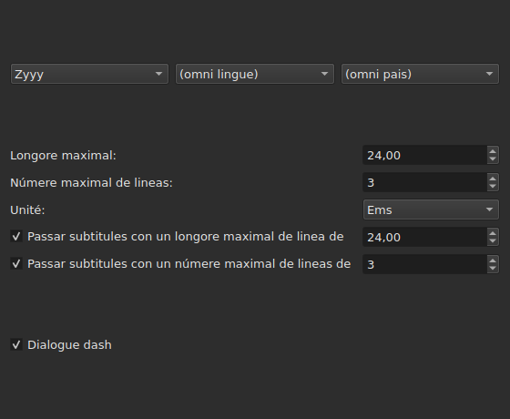
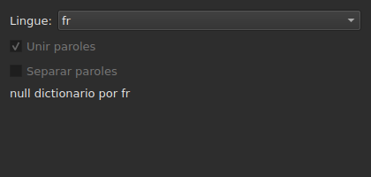
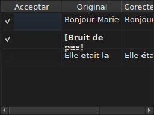

# Corecter textus…

<!-- machine-translated -->
> Ca págine es un traduction machinal e it ancor ne ha esset revidet de un lector del lingue.

`Instrumentarium ▸ Corecter textus…` aperte un assistente de plu págines, secun li
modelle de Gaupol: un págine de objective e taches, un págine per tache marcat,
un págine de progresse, e un págine de confirmation quel propone li
changes sin nequande impóner les.

**Desactivat sur un document vacui**: il ne have nullcos a corecter.

**Li linea de comande fa li sam cose** por omni li taches: [`subedit-cli correct`](../subedit-cli/correct.md), con li
sam modelles e li sam cuntages — e in characteres u li fenestre mesura in ems.
**It lee quar parametres memorat de ca assistente** per predefinit — li du classes de
errores comun (`Human`, `OCR`), `Remove all blank subtitles` e li númere maximal de lineas de
`Line Break` — e prende omnicos altri (li taches, lor code, li long de linea, li lingue,
li cassas de modelles) de su propri linea. Vide
[Du blocs, un partit con li linea de comande](preferences.md#du-blocs-un-partit-con-li-linea-de-comande)
e [`subedit-cli config`](../subedit-cli/config.md).

## Taches e objective — li prim págine

| Grup | Eliges | Predefinit |
| :---- | :------ | :------ |
| `Target` | `Selection`, `Current Project`, `All Open Projects` | `Current Project` |
| `Document` | `Text`, `Translation` | `Text` |
| `Tasks` | `Mentions`, `Join or Split Words`, `Common Errors`, `Capitalization`, `Line Break` — a marcar, un o plu | `Common Errors` e `Capitalization` marcat, li tri altris ne |

`Selection` es desactivat sin linea eliget in li tab monstrat; `Translation`
es desactivat til que null projecte aperit porta un traduction.

**Li objective e li document ne es memorat**: li assistente reaperte sempre
sur `Current Project` e `Text`. Li taches marcat, in contrari, es memorat.

**Quo chascun objective designa**:

| Objective | Actua sur |
| :----- | :------ |
| `Selection` | li lineas eliget in li tab monstrat |
| `Current Project` | li file integral del tab monstrat |
| `All Open Projects` | li file integral de chascun tab aperit |

**`All Open Projects` sur `Translation` passa li projectes sin traduction**:
un projecte quel porta null have nullcos a proponer in un columne vacui, e
li assistente ne it conta.

**Li págines de taches seque, in li órdine de Gaupol — `Mentions`,
`Join or Split Words`, `Common Errors`, `Capitalization`, `Line Break` — nequande ti in quel li cassas
esset marcat.** Un tache ne marcat have null págine; su parametres
memorat ne changea pro to. **Null págine de tache porta su propri casse
«active»**: it es ti de ca prim págine, e solmen it, quel
decide si li tache curre.

## Li págines de taches

Chascun del quar págines de modelles — omni except `Join or Split Words`, quel have null — porta li sam base: tri
menus descendent in cascada — scrit, lingue, pais — por eliger li code del modelles a
aplicar, poy li liste del modelles de ti code, un a marcar per nómine. **Li
tri menus ofre solmen quo li catalog de modelles
porta realmen** — ti livrat con li programma e ti quel un usator ha
depositat ibi (vide [Modelles depositet](#modelles-depositet)) — nequande un liste
de linguas o paises leet altrubi. `Zyyy` («omni scrit») es li code de comense
de `Common Errors`, quel dona li modelles valid in omni locs. **Li tri altri
tipes have modelles solmen sub un scrit**: lor págine aperte sur li
prim quel li catalog ofre, `Latn` con li modelles livrat, e ne sur `Zyyy`.

**Li descrition de chascun modelle es li tooltip de su casse.** Nómines e descritiones seque li
lingue del fenestre por li modelles livrat con li programma; un modelle proprie es monstrat quam
su file it scri ([Lingue](invocation.md#lingue)).

**Un modelle ne marcat resta ne marcat til que it es marcat denov**, inclusiv quande on
changea de code poy reveni a it, e ti election es memorat de un apertion
del assistente al altri. Marcat denov, it trova simplicmen su parametre
original, e li election memorat desapare.

| Págine | Quo it adjunte al base |
| :--- | :----------------------- |
| `Mentions` | du cassas a marcar, `Sound in brackets` e `Sound in parentheses`, ne marcat per predefinit |
| `Common Errors` | du cassas a marcar, `Human` e `OCR`, marcat per predefinit |
| `Capitalization` | nullcos plu |
| `Line Break` | un long maximal (`24`, per predefinit), un númere maximal de lineas (`3`), un unité — `Characters` o `Ems`, `Ems` per predefinit —, e du condictiones de omission, descrit infra |

**Li du cassas de `Mentions` nomina null modelle compilat**: ili
dirige un scan del textu in li nucleo, ti que
[`Remove Hearing-Impaired Mentions…`](operations.md#remove-hearing-impaired-mentions)
fa ja in un geste direct. Un **o** li altri marcat basta por lansar it. **Li liste de modelles del págine ne les repete**: ti du nómines apare ibi solmen un vez, quam cassas a marcar.

**`Common Errors` filtra per classe**: un modelle quel porta ambi classes
aplica tam rapid quam un del du cassas es marcat; li tri altri págines ne
conosse ca distinction.

### Rupt de linea — li unité e li omission




| Parametre | Quo it fa | Predefinit |
| :------ | :----------- | :------ |
| `Maximum length` | li long de un linea, in li unité eliget; de `1` a `1000` | `24` |
| `Maximum lines` | li númere de lineas visat; de `1` a `100` | `3` |
| `Unit` | `Characters` conta characteres; `Ems` mesura li largore con li tipo de littres del fenestre, u un littre minuscul mez valet `0.55` — li unité de Gaupol | `Ems` |
| `Skip subtitles with maximum line length of` | lassa quam it es un subtitul queles max long linea tene in ti long, in li unité eliget | marcat, `24` |
| `Skip subtitles with maximum line amount of` | lassa quam it es un subtitul queles númere de lineas tene in ti númere | marcat, `3` |

**Li omission have su propri límites**, distinct del limites visat: to es li
regul de Gaupol. Un subtitul es lassat quam it es si it tene in **omni li
límites queles casse es marcat**; altrimen it es rupet, e li rupter es
conservat solmen si it apropia li subtitul a un límite quel it excedet — min
long, o min lineas. Null casse marcat: chascun subtitul es rupet,
que it tene ja o ne.

**Changear li unité changea quo es proposit**: li long de chascun linea es
mesurat a chascun calculation, in li unité del págine a ti moment, e nullcos
resta de un mesura precedent. Un textu de vint e nov characteres, li mitá
de queles es littres strett, excede `24` in `Characters` e tene facilmen
in `Ems`.

**Li sett parametres es memorat** de un session al altri, li unité inclusiv.

### Unir o separar paroles — reunir e separar per li controlator de ortografie




Un págine separat, inter `Mentions` e `Common Errors`, por reparar quo
li software de reconossentie de textu fa a spacies. It have null liste de
modelles: it se basa sur li dictionaria del sistema, per Enchant.

| Parametre | Quo it fa | Predefinit |
| :------ | :----------- | :------ |
| `Language` | li lingue del dictionarium; li codes quel li sistema ofre, e li ja eliget | li lingue del sistema, si it es inter les |
| `Join words` | unisse un parol mal scrit al parol vicin | marcat |
| `Split words` | talia un parol mal scrit in du | ne marcat |

**Unir**: un parol mal scrit es unit al parol ante it o a ti pos it
**si, e solmen si, solmen un del du direction dona un parol correctmen
scrit**. Quande ambi un dona, o null, nullcos es fat.
`bon jour` deveni `bonjour`; du spacies in successión es prim reductet a
un, ma un textu u nullcos es unit es retornat quam it esset, spacies
inclusiv.

**Separar**: un parol mal scrit es talliat si, inter li suggestiones del
controlator de ortografie, **solmen un** es ti parol con un spacie in it — li sam
littres, in li sam órdine. Du suggestiones de ti sort, o null: nullcos
es fat. Un parol queles solmen initial es majuscul (`Bonjourtous`) ne es
nequande separat: it es sovente un nómine, e dictionaria ne les have.

**Li liste de remplazzamentes del usator** (`spell-check/<language>.repl`,
in li directoria de configuration del programma) conta inter li suggestiones
del controlator de ortografie; li assistente it lee e ne it scri.

**Sin dictionarium por li lingue eliget, li págine resta e es grisat**: li
du cassas es desactivat e li págine dice `no dictionary for` sequet de li code del
lingue. Li lingue resta redactibil — un dictionarium por un altri posse esser
ibi — e li tache, marcat o ne in li prim págine, fa alor nullcos e
reporta null error.

**Li lingue, li du cassas e li casse del prim págine es memorat** de un
apertion del assistente al altri.

### Modelles depositet

Un modelle quel un usator ha depositat in su propri directoria de modelles
es adjuntet a ti livrat con li programma, in li sam catalog e sub li
sam menus — nullcos les distinte un vez cargat.

| Modelles | U |
| :------- | :---- |
| livrat | `<prefix>/share/subedit/patterns`, juxta `<prefix>/bin` |
| ti del usator | `$XDG_DATA_HOME/subedit/patterns`, o `~/.local/share/subedit/patterns` si li variabile ne es definit o ne es un via absolut |

**Li formate es ti de Gaupol, leet quam it es**: un file `<Code>.<type>` per scrit,
lingue e pais — `Latn-en.common-error` —, su activation `.conf` juxta it. Li tipes
es `common-error`, `capitalization`, `hearing-impaired` e `line-break`. Li files
livrat serve quam modelle. **Li modelles es leet un vez, al lancement**: un file
depositat durant que li fenestre es aperit es videt solmen al lancement sequent.

## Progresse

Un vez `Next` pressat del ultim págine de tache marcat (o del
prim págine si null tache es marcat), li assistente calcula li
corrections proposit sur un fil de fond, un barre de progresse
indeterminat sur ecran. Un vez li calculation finit, li págine de confirmation aperte per se self.

**`Cancel` a ti passu abandona li calculation sin interrupter it**: nullcos
es aplicat, ma li assistente atende, ante clúder, que li calculation in
cursu fini — un atende limitat per li límite de tempore quel li motor de
modelles impone a chascun sercha.

**`Back` a ti passu retorna al págine precedent sin atender**: li calculation
fini in li fond e su resultate es rejectet — li assistente ne salta
per se self a li confirmation. `Next` comensa un nov calculation.

## Confirmation — li ultim págine




Un linea per textu quel li assistente changearet — nequande un linea por un
textu quel un tache lassat quam it es.

| Columne | Quo it monstra |
| :----- | :------------ |
| `Accept` | un casse a marcar, marcat per predefinit: li correction va esser aplicat o ne |
| `Original` | li textu quam it es, li parte quel changearet **in grassi** |
| `Corrected Text` | li textu proposit, li parte changeat in grassi, **redactibil** — retochar it changea quo va esser scrit, sin changear li casse `Accept` |

**Li change es marcat in grassi, nequande in colore**: li sam diferentie es leet
in ambi paletta sin depender de null tinte.

**Un linea queles proposition es un remotion** — li subtitul havet plu null
textu — monstra li columne `Corrected Text` vacui, e su `Original` integral in
grassi.

| Buton | Quo it fa |
| :----- | :----------- |
| `Mark All` | marca `Accept` sur omni lineas |
| `Unmark All` | desmarca `Accept` sur omni lineas |
| `Preview` | pone li reproductor integrat sur li subtitul del linea eliget, si li projecte have un film — nullcos si it have null |
| `Finish` | aplica li lineas marcat e clude li assistente |

`Remove all blank subtitles`, marcat per predefinit, remove li subtitules
quel un correction lassaret sin null textu in vice de conservar les vacui.

**Un modelle quel li calculation ne posset aplicar es nominat sub li tabelle**, con
li rason:

```text
Not applied: some pattern (will not compile)
```

Un modelle nominat talmen es nominat **un vez per rason**, quelcunque li númere de
textus o projectes sur queles it falit: li ecran ne dice qual.

| Rason | Quo it causa |
| :----- | :--------------- |
| `cannot be translated` | li expression usa quo li traduction del syntaxe de Python refusa |
| `will not compile` | li motor refusa li expression |
| `has an invalid replacement` | li remplazzament ne es leet quam Python it lee |
| `timed out` | un sercha excedet li tempore quel li motor it concede sur un textu |
| `never settled` | `Repeat` changeat ancor li textu pos cent passages |
| `grew the text too long` | li textu excedet 16 384 bytes durant que li modelle laborat sur it |

**Un modelle quel falie sur un textu lassa it quam it esset ante it**: un remplazzament
fat a mitá valet min que null remplazzament. Li altri modelles aplica.

**Un linea de un file de modelle quel ne posse esser leet es nominat in li sam
loc**, per su file, su linea e li rason — a chascun apertion del
assistente, pro que li modelles es leet solmen un vez, al lancement:

```text
Could not be read: Zyyy.common-error, line 8 (malformed line)
```

| Rason | Quo it causa |
| :----- | :--------------- |
| `directory cannot be read` | li directoria del modelles livrat ne posset esser percurrit |
| `file cannot be read` | un file de modelles ne posset esser leet |
| `malformed line` | un linea quel ne es un capite, ni un comentario, ni `Key=Value` |
| `field outside any pattern` | un `Key=Value` ante li prim capite de modelle |
| `unknown field` | un clave quel ti tipe de modelle ne usa — li modelle es conservat |
| `missing field` | un clave sin quel ti tipe de modelle posse far nullcos — li modelle es rejectet |
| `invalid value` | un valore quel li clave ne accepta — li modelle es rejectet |
| `malformed activation` | un element `<pattern>` de un `.conf` quel nomina nullcos |

Li altri modelles, ti queles esset leet e aplicat correctmen, ne es
concernet.

## Quo li anullation dice, e quo `Cancel` nequande fa

**`Finish` fa un entrata de historie per projecte tangit**, nequande un per
correction: `Undo` anulla ad un vez omni li corrections acceptat sur ti
projecte, chascun con li textu quel it havet. Li menu it nomina
`Undo: correcting texts`.

Li barre de statu dona li cuntage, li textus changeat prim, li subtitules
removet pos:

```text
Edited 3 and removed 1 subtitles
```

**`Cancel`, sur quelcunque págine, aplica nullcos e memora nullcos** — ni
li parametres eliget durant ca apertion, ni li min correction. Li
apertion sequent del assistente recomensa de parametres de ante.

## Un exemple

Un file aperit porta du spacies inter du paroles de un linea e un
mention inter crampones sin altri textu. `Instrumentarium ▸ Corecter textus…`,
`Common Errors` ja marcat, `Next` til li confirmation: li linea con li du spacies
monstra `Bonjour  Marie` a sinistre, `Bonjour Marie` a dextre, li correction in
grassi e ja acceptat. `Finish` it aplica, e li barre de statu dice:

```text
Edited 1 and removed 0 subtitles
```
