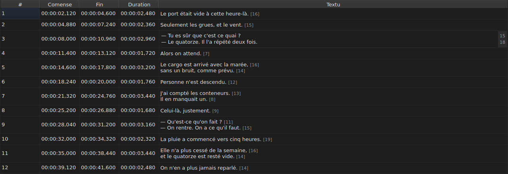
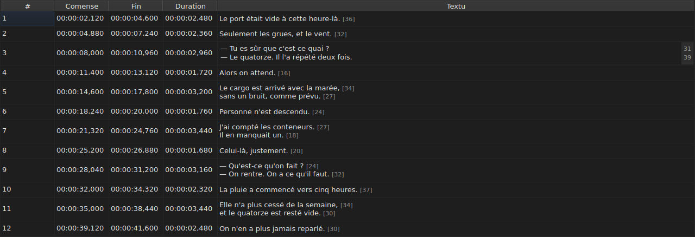

# Redacter un cellule

<!-- machine-translated -->
> Ca págine es un traduction machinal e it ancor ne ha esset revidet de un lector del lingue.

Quar columnes es redactet sur li loc: `Start`, `End`, `Duration` e `Text` — cin
con li columne `Translation`, quande li projecte have un traduction. `#` ne posse
esser redactet — li númere es li rang del linea, ne un data del file.

**Aperter li redactor de un cellule:** clicar duplicmen sur it, o selecter it
e pressar `F2`.

## Li textu

**Li traduction es redactet quam li textu**, con li sam campe multilinea e
li sam regules; solmen li cellule changea, e li textu principal resta quam
it esset. Un validation quel changea nullcos fa nullcos, por li un quam por li
altri — vide [infra](#un-validation-quel-changea-nullcos-fa-nullcos).

Li redactor es un campe **multilinea**, e it aperte al altore del subtitul:
un subtitul de du lineas es tipat in it quam it va esser scrit, su du lineas
leibil e sin barre de desfilation. Un `Shift+Enter` quel adjunte un linea agrandi
li redactor; li rangea del tabelle se adjusta al validation.

| Clave | Efecte |
| :-- | :----- |
| `Enter` | valida e clude li redactor |
| `Shift+Enter` | insere un ruptura de linea in li textu |
| `Esc` | clude li redactor; li cellule conserva quo it hat |
| `Tab` | valida e passa al cellule sequent |

Clicar altra loc valida anc: perder li focus vale un `Enter`.

**Onze gestes sin casse de dialog valida egalmen** ante calcular lor cielo:
`Italic`, `Case ▸ …`, `Dialogue`, `Merge Subtitles`, `Split Subtitle`,
`Cut Texts`, `Paste Texts`, `Copy Texts`, `Remove Subtitles`, `Undo` e `Redo`.
Lansat ex li menu, li barre de instrumentes o un via rapid del fenestre, les
prende li textu quam li redactor just ha validat it, quam pos un clic
altra loc. `Ctrl+X`, `Ctrl+C` e `Ctrl+V` resta tamen con li redactor durant que
it es aperit — vide [Decuper, copiar e collar](clipboard.md): alor es li
menu quel lansa `Cut Texts`, `Copy Texts` e `Paste Texts`.

`Undo` e `Redo` lee li historie e ne li document: vide
[Anullar e refar](undo.md). Un geste quel aperte un casse de dialog ne besona
ca regule, pro que li casse prende li focus quande it aperte, quo
ja valida li input.

### Li etiquettes es ti del file

Li textu monstrat e tipat es **ti del file, etiquettes includet**: un
`<i>…</i>` de un SubRip es scrit talmen, e un `{\i1}…{\i0}` de un Advanced SSA
anc. Nullcos es traductet por li monstration — li tabelle de
[`Italic`](operations.md#italic) dice quo chascun formate scri.

Pri li italic, il ne ha dunc nullcos a saver: `Ctrl+I` pone li ver etiquette
por li document aperit, e un formate quel ne porta null — TMPlayer, LRC —
desactiva li entrata vice lassar on sercar. Grasse e suslinie es
tipat, quam in Gaupol.

**E li etiquettes ne seque li operationes sur li textu**: metter un subtitul
in minusculas ne muta su `<I>` in `<i>`, e un strec de dialog es
pósit ante li textu e ne ante un etiquette aperient. Vide
[`Case` e `Dialogue`](operations.md#case-e-dialogue).

## Li long de lineas

**Li redactor de textu monstra, in un margine a dextre, li long de chascun
linea**, alliniat con li prim rangea de ti linea. Li margine es large
quam li max grand númere, se actualisa **durant que on tipa**, e seque li
desfilation. Un textu vacui monstra nullcos. Li longes es ti del tabelle — sin li
etiquettes, arrotundat in infra, in li unité definit — e es removet per li
casse a marcar `Show line lengths in the editor` de `Redacter ▸ Preferenties…`. Vide
[Longes de linea](preferences.md#longes-de-linea).

## Li comense e li fin

Li redactor es un campe de un linea, **restrictet al forme de un marca de
tempore**: it refusa durant li tipation ti quo ne posse nequande esser un.

Li formes acceptat es ti quel li lectura de un file ja accepta:

| Element | Quo passa |
| :------ | :---------- |
| campes | `MM:SS` o `HH:MM:SS`, un o du cifres chascun |
| decimales | un til tri, pos un comma o un punctu, o null |
| signe | un `-` initial, por un position ante li comense del video |
| limites | minutes e secondes infra 60 |

`00:01:02,500`, `1:02.5` e `-0:01,000` es dunc tri inputs valid.

**Un input quel li lectura refusa lassa li cellule ne changeat.** To es li
cas de `00:70:00,000`, quel have li ver forme ma queles minutes es foris
limites: li redactor clude se e nullcos ha movet. Null position es inventat
— errar un position es silentiosi, nullcos sur li ecran distingue un
subtitul mal temporisat de un ben temporisat.

Changear un comense o un fin actualisa li `Duration` strax.

## Li duration

**Tipar un duration move li fin, e nequande li comense**: li fin deveni
`Start + Duration`. Mover li comense mova li tot subtitul, quo es li labor de
[`Shift Positions…`](operations.md), e li columne `Start` ja posse
esser tipat.

Li duration es tipat **in li forme de un marca de tempore**, ti quel li columne
monstra, e li formes del tabelle supra aplica se — con un diferentie:

| Element | Comense, fin | Duration |
| :------ | :--------- | :------- |
| forme | ti de un marca de tempore | li sam |
| signe `-` initial | acceptat | **refusat durant li tipation** |

`0:02.5` e `00:00:02,500` es dunc du inputs valid de un duration de du
secondes e demí; `-0:01,000` ne posse esser tipat. Un duration zero es acceptat:
li subtitul desapare alor in li instante u it apare.

**Un fin quel passa li subtitul sequent es permisset.** Li
superposition es tintat in li tabelle, con su information-bulla — vide
[Li tabelle](table.md#li-anomalies) — un avise, ne un refusa: it posse esser quo
on vole. Li [liste de diagnoses](files.md#li-diagnoses-de-un-lectura)
porta it anc, e remove it quande on ha corecte it.

**Un fin tipat ultra li fin del film ne es reportat**, contrarimen a
un operation del menu `Tools` quel pussa it ta — vide [Li operationes](operations.md#ultra-li-fin-del-film). Un cellule monstra ja
li valore quel on just ha tipat.

Un input ne leibil lassa li cellule ne changeat, quam por un position, e
un duration identic a ti monstrat ne intra in li historie.

## Un validation quel changea nullcos fa nullcos

Aperter un cellule, tipar nullcos, pressar `Enter`: nullcos evenit.
Null modification es registrat, e li file resta considerat identic a
ti sur li disco.

Li comparation es sur li **position**, ne sur li catene: tipar `0:01.0`
in un cellule quel monstra `00:00:01,000` designa li sam instante, e
changea dunc nullcos anc.

## Quo deveni de un cellule redactet

It **posse esser anullat** — un cellule, un entrata. Vide
[Anullar e refar](undo.md).

It **es salvat**, e clúder li fenestre sin haver fat to demanda un
confirmation. Vide [Aperter e salvar](files.md).
