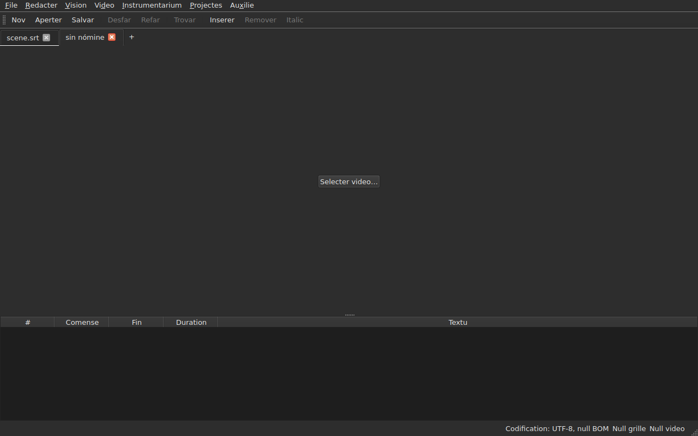
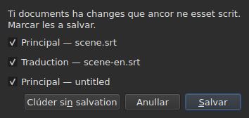
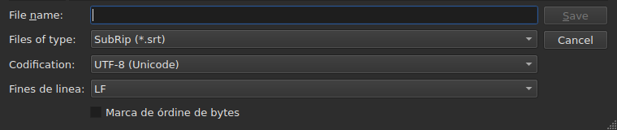
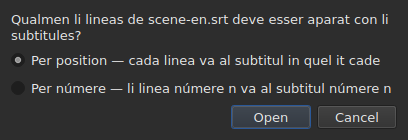
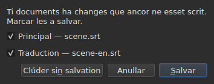

# Aperter e salvar

<!-- machine-translated -->
> Ca págine es un traduction machinal e it ancor ne ha esset revidet de un lector del lingue.

Li menu **File** have li tri comandes, du por li linguetas, e tri
plu por li traduction; li menu **Projects** actua sur omni linguetas simultanmen.

| Comande | Via rapid | Quo it fa |
| :------ | :------- | :----------- |
| Nov projecte | `Ctrl+N` | un projecte vacui, in un nov lingueta — anc li button `+` pos li ultim lingueta |
| Aperter… | `Ctrl+O` | elige un file e aperte it in un nov lingueta — o vice un projecte vacui |
| Aperter un traduction… | — | elige un file de traduction e alinia it sur li file principal del lingueta actual |
| Salvar | `Ctrl+S` | rescri li file aperit |
| Salvar quam… | `Ctrl+Shift+S` | elige un via e un formate, tande scri |
| Salvar li traduction | — | rescri li file del traduction |
| Salvar li traduction quam… | — | elige un via e un formate por li traduction, tande scri |
| Clúder | `Ctrl+W` | clúde li lingueta actual — desactivat si existe solmen un |

`New Project`, `Open…` e `Save` es anc in li
[barre de instrumentes](index.md#li-barre-de-instrumentes), sub li paroles `New`, `Open` e
`Save`. **Li tri entratas del
traduction ne es in li barre**: ili serve solmen a quel have un
traduction, e li barre es ti de omnes.

## Plurmen projectes, in linguetas

**Chascun projecte aperit have su lingueta**, supra li image e li tabelle:
su etiquette es li nómine del file, o `untitled` por un projecte quel ne have
ancor un. Clicar un lingueta mena a it; `Ctrl+PageDown` e `Ctrl+PageUp` fa
li sam, sin mus, e retorna al prim lingueta pos li ultim.
**Li button `+`, just pos li ultim lingueta**, aperte un projecte vacui in un
nov lingueta, quam `New Project`.




**`Open…` nequande les tange.** Aperter un file ne remplazza plu quo li
fenestre monstrava: it arriva in un nov lingueta, juxta it, e li lingueta quel on
regardava ante conserva omnicos quo it havet — su historie, su selection, su
video assocancellat. To es anc pro quo aperter ne demanda plu nullcos: il
ne existe nullcos a perder, pro que il ne existe nullcos a remplazzar.

**Un exception: li projecte vacui cede su loc.** Lansat sin file, o
pos `New Project`, li fenestre monstra un projecte `untitled` sin nullcos in it.
Un file aperit — per `Open…` quam per un depositione — **prende tande su lingueta,
al sam loc in li barre**, vice aperter un altri juxta un projecte
inutil. Un projecte es vacui quande it have **null file, null subtitul,
nullcos a anullar o refar, null film, e nequande ha esset modificat**: un
sol de ti cosas basta por que it conserva su lingueta. Un projecte vacui quel ne es
li lingueta actual ne es tanget.

**Un file ja aperit ne es aperit un duesim vez.** `Open…` sur un
file quel un altri lingueta have ja redona li focus a ti lingueta, e dice it
in li barre de statu:

```text
premier.srt: already open
```

**Chascun lingueta es un projecte integral, independent del altris**: su
historie, su selection, su video associat e quo su ultim lectura
ha incontrat es monstrat solmen quande ti lingueta es li actual, e ne
changea durante que un altri lo es. **Un exception, e it es in ADR
0033**: li reproductor de video es unic por li fenestre integral — un sol
processu mpv — e su film changea con li lingueta; **chascun lingueta memora u su film
esset**, e reprende it ta, in pausa, quande on retorna a it. Li porta-papere, por su part, apartene al fenestre: copiar
in un lingueta e collar in un altri es por quo on aperte du.

**`Close` clúde li lingueta actual**, demandante si besonat
[li question de changes ne salvat](#changes-ne-salvat) —
ti de ca lingueta sol, li altris ne esset concernit. **Desactivat quande il ne
existe que un lingueta**: li fenestre conserva sempre minimum un, e clúder it
vell esser clúder li fenestre — quo li button del sistema fa ja.

**Chascun lingueta have anc un crux**, quel clúde **su** projecte, con li sam
question. Li crux de un lingueta quel ne es li actual clúde ti, e li lingueta
quel on regarda resta monstrat; si ti projecte have changes, su
lingueta veni avan durante li question. **Null crux quande solmen un
lingueta resta**, pro li sam rason que `Close` es desactivat.

**Un lingueta dice que it es modificat**: un stelle seque su nómine, `premier.srt*`,
durante que un de su documentes differe de su file — quam li titul del fenestre
dice it pri li projecte quel on regarda. It desapare pos salvar.

## Li menu Projectes

Du comandes actua sur omni projectes simultanmen.

| Comande | Via rapid | Quo it fa |
| :------ | :------- | :----------- |
| Salvar omni | `Ctrl+Shift+L` | scri chascun document modificat, lingueta per lingueta |
| Clúder omni | `Ctrl+Shift+W` | clúde omni projectes — to es, li fenestre |

**`Save All` va secun li órdine del linguetas**, li document principal ante li traduction.
Un document quel have un file es rescrit ta **sin que su lingueta veni avan**;
**un document quel ne have un aperte `Save As…`, un a un**, sur su lingueta —
li sol casu u `Save All` changea lingueta, por que li casse monstra pri qual
projecte it tracta. **Anullar un `Save As…`, o un
salvation quel falie, halta li resta**: li projectes sequent ne es
tanget, e un casse dice quo esset scrit.

```text
Save All stopped: 1 of 3 documents saved
```

Quande omnicos es scrit, li barre de statu dice it — `2 documents saved`, o
`Nothing to save` quande nullcos esset modificat. Si un `Save As…` ha portat
un lingueta avan, li fenestre retorna tande a ti u li comande esset
lansat.

**`Close All` e li crux del fenestre es un e li sam cose**: li fenestre
conserva sempre un projecte, e clúder les omni es clúder it. Dunc ili demanda
**un sol question por omni projectes**, li sam quam con
[du documentes modificat](#clúder-con-du-documentes-modificat), con un casse a marcar
per document modificat de chascun lingueta:




**`Cancel` clúde nullcos**, e lassa nullcos scrit. `Save` scri li
documentes marcat quam `Save All`: detra lor lingueta, except un document sin
nómine, de quel li lingueta veni avan por su `Save As…`. Con un sol document
modificat tra omni projectes, it es li simplic question quel nos ha
sempre havet, demandat sur su lingueta. `Save All As…` ne existe: it es un sequentie de
`Save As…`, quel `Save All` ja demanda, un a un, por li documentes sin nómine.

## Aperter

Li casse de dialog filtra **li nin formates leet**, un entrata chascun, e un prim
entrata quel les monstra omni. Li formate es tande recognoscet **per li contenete, ne per
li extension**: un `.txt` quel contene SubRip aperte se, e li filtre ne decide
nullcos — it solmen celar files.

| Entrata de filtre | Extension |
| :----------- | :-------- |
| `SubRip` | `.srt` |
| `WebVTT` | `.vtt` |
| `SubViewer 2` | `.sub` |
| `Sub Station Alpha` | `.ssa` |
| `Advanced SSA` | `.ass` |
| `MicroDVD` | `.sub` |
| `MPL2` | `.txt` |
| `TMPlayer` | `.txt` |
| `LRC` | `.lrc` |

**Du extensiones designa du formates chascun** — `.sub` es SubViewer 2 e
MicroDVD, `.txt` es MPL2 e TMPlayer. To ne have consequentie al apertion,
pro que li contenete decide; al salvation, es li **nómine** del
entrata eliget quel dona li formate, nequande su modelle.

**Un file ineleibil aperte nullcos.** Mancant, refusat per li sistema, scrit
in un codification sub quel su bytes ne decode, o de null formate
conosset: un casse modal **nomina li causa**, null lingueta es apertet, e ti quel
esset ne move se.

| Missage | Quo evenit |
| :------ | :------------ |
| `does not exist` | li via designa null file |
| `cannot be opened: permission denied` | li sistema refusa aperter it |
| `cannot be read` | li sistema refusat por un altri rason |
| `cannot be decoded in the chosen encoding` | li bytes ne leet se in li codification retenet |
| `is in no format this tool knows` | null formate recognosce li contenete |
| `holds nothing recognisable as a subtitle` | li formate es recognoscet, ma nullcos in it es un subtitul |

Li missage es precedet per li via: `notes.txt: is in no format this tool knows`.
Ti es li paroles del linea de comande, e it ne es un accident — ambi
surfaces leer un file per li sam recepte.

### Lassar cader files sur li fenestre

**Lassar cader files ubicunque sur li fenestre les aperte**, ex li
gerente de files: li tabelle, li barre de linguetas, li
button `Select Video…`, e **li image self del film**, in reproduction quam halt.
Li image es un fenestre separat designat per li reproductor, de quel nullcos garantiva
que it va transmitter un depositione; to esset verificat per manu sur un table de labor real,
in un session Wayland. `subedit-gui` es lansat ta sub X11 por posser monstrar
li film, dunc li depositione passa per li protocol X11 — ti de un
session X11, u it ne esset provat separatmen.

- **Chascun file de subtitules aperte su lingueta**, in li órdine in quel ili esset
  lassat cader — exactmen quam `Open…`. Un file **ja aperit** ne es
  leet denov: su lingueta veni avan, e li barre de statu dice it
  (`premier.srt: already open`).
- **Un video lassat cader es associat al lingueta actual**, quam per
  `Select Video…`. Lassat con subtitules, it va al ultim lingueta
  quel ili ha apertet, quelcunque li órdine del depositione. Un video es recognoscet per
  su extension — li sam liste quam ti quel propone un film juxta li
  file.
- **Du videos o plu simultanmen ne es apertet**: un projecte gardea
  un sol film. Li subtitules del sam depositione, por su part, aperte se.
- **Un file quel ne aperte se ne halta li altris.** Un sol casse dice
  tande quo ne posse esser fat, un linea per file, con li paroles
  de `Open…`:

  ```text
  /films/notes.txt: is in no format this tool knows
  /films/absent.srt: does not exist
  ```

Solmen files local es prendet: un ligament trainat ex un navigator
designa nullcos quel li fenestre posse leer.

Aperter ex li linea de comande sempre funge: `subedit-gui film.srt`.
Ta, li sam rason es scrit sur li canal de errores, e li fenestre aperte
vacui — vide [Invocation](invocation.md#quande-li-apertion-falie).

## Li diagnoses de un lectura

Un file real es rarmen perfect, e li lectura recovre vice
abandonar: un númere mancant, un linea quel va a null loc, fines de
linea miscat. **Quo it ha incontrat se tene in un button del barre de statu**
— `2 diagnostics`, a sinistre de quo li barre dice ja pri li document —, e **li liste aperte se per un clic
in un fenestre flottant** supra li button. Null linea del fenestre es prendet por it:
li tabelle conserva su altore integral, que li lectura havet alquo a dir o ne. Li liste
se clúde per un clic altrubi o per `Esc`.

```
a SubRip block without its number, settled by the reader: 5
```

**Chascun linea conta**: quo esset incontrat, quo esset fat pri it, e
quant vezes. Un file mal fat incontra centenes, e saver
quant de chascun specie es quo permisse ager; li númere de linea de chascun occurrentie in li
file, por su part, es leet sur li linea de comande, al nivelle de verbosité `-vvv`. Li
button conta ti lineas — un per specie —, ne li occurrentias.

**Li codification supposit apare anc ta**, un vez: it esset proposit per pesar li
bytes, ante que un sol linea del file existeva.

```
an encoding nothing declared, settled by the reader: 1
```

It es monstrat solmen quande li codification esset **supposit e ne es
UTF-8** — un file UTF-8 leet quam tal ne es un eveniment, e dir it a
chascun apertion mettet un button in li barre de statu de chascun document
ordinari. Un file con un marca de órdine de bytes ne lo declancha
anc: it ha declarat su codification, nullcos esset supposit.

**Li sam liste conta anc quo es mal in li subtitules self**: un
subtitul quel comensa ante que li precedent ha finit, un fin ante su
comense, un comense ante ti del subtitul supra. Li tabelle les tinge, ma
un tinte es trovat per scrollar, e in un file de du mil lineas
on perde it facilmen; hic li specie es omni junt, **un per
linea e con lor númere**, con li paroles del raporte de `inspect`:

```
subtitle starts before the previous one ends: 12
subtitle starts before the previous one starts: 3
```

**Un clic sur un mena al prim subtitul concernit**, selectet in li
tabelle. Ti lineas **seque li correctiones** — ordinar o corecter un duration
remove alcunes, o diminue lor númere —, sin clúder li liste quel on
leer. Un subtitul posse esser contat du vezes: comensar ante li fin del
precedent e ante su comense es du constatationes, corectet in du
manieres. Por nominar les un a un, `subedit-cli inspect --detail`.

Li button **ne apare** quande il ne ha nullcos a raportar, ni in li lectura ni
in li subtitules, e **it seque li lingueta**: chascun projecte conserva li
diagnoses de su propri lectura, e li button monstra ti del projecte monstrat.

## Li codification in li barre de statu

**Li barre de statu dona sempre li codification del document aperit**, a sinistre de quo
it dice pri li [grille de fotogrammas](frame-grid.md) e li
[video associat](video.md):

| Situation | Quo es scrit |
| :-------- | :-------------- |
| li file esset leet quam UTF-8, sin marca | `Encoding: UTF-8, no BOM` |
| … con un marca | `Encoding: UTF-8, BOM` |
| un file in Latin-1 | `Encoding: ISO-8859-1, no BOM` |

**Li diagnose e ti linea ne responde al sam question**, e to es
pro quo ambi existe. Li diagnose dice quo li lectura **ha fat** — it ha
supposit, e on posse voler controlar; it es dunc monstrat solmen quande il
ha esset un supposition. Li barre de statu dice quo li document **es**,
permanentmen, includente por un file quel declara su codification self e pri
quel li lectura ha nullcos a dir.

**U li response veni ne apare ta.** `inspect` dona it — `detected`,
`from its byte order mark`, `as asked for` — pro que un raporte have spacie por
dir it; un linea del barre de statu ne have, e li liste de diagnoses ja porta it quande
it importa.

## Salvar

`Save` rescri li file aperit **in su forme original**: su formate, su
codification, su fines de linea, su marca de órdine de bytes e su capite. Un
file aperit e tande salvat sin modification ne move se per un byte — vide
li garantie exact infra.

Li scrition es **atomic**: it passa per un file temporari renominat
sur li file. Un salvation interrupet a quelcunque moment lassa li version precedent
intacte.

Salvar un document quel nequande ha esset sur li disc equivale a `Save As…`.

**Un scrition quel falie dice it e perde nullcos**: un disc plen, un
file in lectura sol, un directoria mancant — o **un caracter quel li codification
del file ne posse scrir**, un `ł` in un file Latin-1. Li missage es
tande `holds a character the chosen encoding cannot write`, e nullcos es
scrit: remplazzar li caracter per un `?` vell perder textu davant li ocules de qui
ha just tipat it. Li missage nomina li file e li rason, li fenestre conserva
su modificationes, e li marca del titul resta.

## Salvar quam

`Save As…` demanda un via, un formate, **e li forme del bytes scrit**:
li codification, li fines de linea, li marca de órdine de bytes. Li document **tande vive
ta**: li titul changea, `Save` ciela li nov file e scri in li
forme eliget, e li file original resta quam it esset.

**Li nin formates es offerit**, e li entrata selectet quande li casse
aperte se es **ti del document**. Salvar sub un altri nómine sin tanger li
filtre dunc ne changea li formate.




**Li images monstra solmen li fund del casse**, ne li liste de files
supra: to depende del machine — su directorias, su dates, su
vias rapid laterali —, dunc su photographie nequande vell esser li sam du vezes.
Ti bande es, e it es u omnicos evenit.

| Campe | Quo it offere | Predefinit |
| :---- | :------------- | :------ |
| `Encoding` | quatuordec codificationes quel un file de subtitules porta in practica, plu `Other…` | **ti del file leet** |
| `Other…` | un campe por tipar quelcunque codification quel ICU posse scrir, **con completion** — `cp1257`, `EUC-KR` | — |
| `Line endings` | `LF`, `CRLF` o `CR` | ti del file leet |
| `Byte order mark` | li marca, **desactivat por un codification quel ne porta un** | ti del file leet |

**Li predefinitiones es ti del file leet, e to es un garantie plu quam un
comodité**: un file aperit e tande salvat denov sin tanger ti tri
campes dona li sam bytes.

**Li liste es curt, e it ne es un limite.** ICU conosse ducent
vinti-un; quo li menu offere es quo un file de subtitules porta
in practica, pro que un menu de ducent entratas auxilia nequi. `Other…`
aperte li resta.

**Li campe completa tra li ducent vinti-un**, dunc il ne es besonat saver li
nómine exact: tipar `1252` propone `windows-1252`, tipar `koi`
propone `KOI8-R` e `KOI8-U`. Li completion es sur quo li nómine **contene**
e ne sur quo it comensa con — li nómine canonic de Windows occidental es
`windows-1252`, e `cp1252` es ti quel li gente have in mente. Ambi posse anc
esser scrit integralmen sin completion: ICU accepta su propri aliases.

**Un nómine quel nequi conosse scri nullcos.** Tipar `klingon-1` ne
retorna a UTF-8: nullcos es scrit, e li missage dice it.

**Ni un nómine quel ne declara su órdine de bytes.** `UTF-16` e `UTF-32` es
nómines que ICU conosse, de quel li convertor scri **su propri marca**: li
casse a marcar `Byte order mark` vell tande cessar decider nullcos. Ambi
es refusat, e li missage indica `UTF-16LE` o `UTF-16BE`, quel scri
li sam bytes sub li control del casse a marcar. It es li sam refusa, con li
sam paroles, quam ti del linea de comande.

**Un caracter quel li codification eliget ne posse scrir halta li salvation**
— un `ł` in Latin-1. Li missage es
`holds a character the chosen encoding cannot write`, li fenestre conserva su
modificationes, e li file ciel ne es tanget.

**Li document ne move se anc**: it resta sur su file, in su
formate e su codification, e li sequent `Save` rescri ti quel esset aperit.
Un salvation quel ne ha avenit changea nullcos del tot — ni sur li disc,
ni in li fenestre.

Changear formate changea quo li tabelle monstra — li separator decimal seque li
formate, un comma por SubRip, un punctu por WebVTT, e **li tags es rescrit
in li vocabulario del formate ciel**: un `<i>` deveni `{\i1}` in Sub
Station Alpha, `{Y:i}` in MicroDVD, `/` in li cap de un linea in MPL2. Li document
**ha devenit** ti file, dunc li tabelle monstra quo li file porta.

**It ne es un comande, e `Ctrl+Z` ne anulla it.** Un document de quel li
formate dit LRC e de quel li textus dit ancor `<i>` vell esser un document
incoherent; il ne existe mediete a anullar.

## Quo un formate ne va conservar, dit ante scrir

**Un casse modal avisa, e on posse ancor responder no.** It lista quo li
formate ciel ne va tener, item per item, con li paroles quel li linea
de comande scri pos:

```
ends are not carried by LRC, line breaks were joined in 2 subtitles, 1 tag dropped
```

| Button | Efecte |
| :----- | :----- |
| `Save` | scri nonobstant, li perdita acceptat |
| `Cancel` | scri nullcos; li document ne move se, ni file ni formate |

`Cancel` es li button predefinit: un tasta Enter pressat sin leer conserva li
file quam it es.

**Nullcos es demandat quande nullcos es perdit.** Un casse quel anunciava «nullcos
va esser perdit» vell instructer a rejecter ti quel importa.

Quo posse esser anunciat:

| Item | Quande |
| :--- | :--- |
| li fines | li formate ciel porta null — TMPlayer, LRC |
| li ruptiones de linea | li formate ciel porta null — LRC |
| li tags | un tag del fonte have null equivalente in li ciel, o li pivot ne conosse it |
| li capite | li file leet portava un, e it ne passa |
| li campes declarat | li órdine del columnes SSA, li forme del tempore TMPlayer |
| li precision | li formate ciel conta plu grossmen — li decim de MPL2, li second de TMPlayer |

**Quo apartene al altri formate resta a part.** Un file WebVTT
porta identificatores de cue e parametres de plazzament; SubRip porta
coordinates de monstration. Scrir in li altri formate ignora les vice
traducter les a hasard — ili ne es perdit pro to, ili solmen ne es
scrit.

## Li garantie de ear e reveni

It have du mediates, e ambi es besonat:

- **fidel byte per byte** sur un file ja in li disposition quel
  `subedit` scri — ti de Gaupol, li ultim linea vacui includet —, e **quelcunque
  su codification**: un file in CP1252 o in UTF-16 es rescrit in
  su propri, marca includet;
- **idempotent** altrimen: li prim salvation normalisa li disposition,
  null pos it tange plu nullcos.

Concretmen, un file de quel li ultim bloc ne es sequet per un linea vacui
ganea un, un vez. It es li sol change quel un salvation sin
modification posse produer.

## Aperter un traduction

`File ▸ Aperter un traduction…` pone un **duesim file** juxta li principal.
Li entrata es desactivat durante que il ne ha subtitul a quel dar li lineas del
traduction.

**Du questiones, un pos li altri.** Li selector de file, ti de
`Open…` — li sam filtre, li sam directoria de comense, li codification recognoscet quam por li
file principal — tande **li metode de alliniation**:




| Metode | Quo it fa |
| :----- | :----------- |
| `By position` (predefinit) | chascun linea va al subtitul u su medie cade |
| `By number` | li linea númere n va al subtitul númere n, sin regardar li positiones |

**Li position es li predefinit**, pro que un sol linea mancant in li medie fa
glissar *omni* li sequent per númere, durante que per position un sol
subtitul resta sin traduction.

**Quo es fat, quo es scrit:**

- li textus del lineas atachat intra in li columne `Translation`, quel
  apare;
- **un linea quel trova null subtitul da nascentie a un**, con **li
  positiones de ti linea** — per ambi metodes;
- **nullcos es ordinat**, ni li file ni li document: li lineas es percurset
  in órdine de tempore, e li cuntage de ti que ne esset in it es dat;
- **un traduction ja aperit es remplazzat**, omni su textus prim cancellat.

**Quo evenit es dit.** Quande chascun linea ha trovat su subtitul e
null resta sol, li barre de statu scri it; altrimen **un casse a clúder**,
quam por quelcunque gesto quel have alquo a dir:

```text
translation: 3 lines attached
translation: 2 lines attached; 1 subtitle left without a translation
translation: 3 lines attached; 1 subtitle born of a line; 2 lines out of order
```

Li items es scrit solmen si ili ne es zero: li lineas atachat, li
subtitules nascet de un linea, ti que null linea ha atinget, li lineas
foris de órdine. Un file sin null linea dice it
(`translation: the file holds no line`) vice acusar li
subtitules.

**Un traduction displaciat es recognoscet, e reaperit displacancellat.** Un traduction temporisat du
secundes tro tard alinia se sur li mal subtitules sin que nullcos lo distingue de un
atachament correct. Quande aperter **per position** ne es nett, li fenestre serchea
**un displaciament constant**: li differentias inter li comense de chascun linea e ti del subtitules
circum it dona candidates, gruppat al dece de millisecundes, e **chascun
es judicat per li atachament self del apertion**. Si un sol displaciament fa li apertion
nett, li casse dice it pos su cuntage e **propone reaperter displaciat**:

```text
translation: 4 subtitles born of a line; 4 subtitles left without a translation
the lines sit 2.000 s later than the subtitles; moved back, 4 lines would attach instead of 0
```

`Yes` anulla li apertion e refa it con li lineas remenat per ti displaciament; `No`, li
response predefinit, lassa li apertion quam it es. **Li resultate es un sol entrata
de historie**: anullar it redona omnicos, quam por quelcunque apertion.

**Nullcos es proposit quande li displaciament ne es constant** — un deriva, un displaciament quel
tange solmen un parte del file —, quande du displaciamentes fa li apertion egalmen
nett, o quande null fa it nett: li frase tande ne dice que un existe. Ni
per númere, u li positiones ne es regardat. Il ne ha **null linea de comande** por
it.

**Aperter un traduction es un sol entrata de historie**, `Undo: opening a translation`,
e anullar it redona omnicos: li textus, li subtitules nascet removet,
li file del traduction detachat — li columne desapare con it. Por aperter it per
li altri metode, on anulla prim.

**Li traduction just aperit ne es modificat**: nullcos esset tipat, e
clúder it ne propone salvar it. Si subtitules esset nascet, es li
document principal quel es modificat.

**Un traduction modificat es proposit por salvar ante esser
remplazzat**, con li tri resultates del section pri
[changes ne salvat](#changes-ne-salvat).

| Missage | Quo evenit |
| :------ | :------------ |
| `the file is already open as the main document` | li file eliget es li document principal self, quelcunque qualmen su via es scrit |
| `does not exist`, `cannot be decoded in the chosen encoding`, … | li sam causas quam por `Open…` |

Li missage es precedet per li via, e **nullcos changea**: li fenestre conserva su
historie e su modificationes.

**Li problemas quel li lectura ha incontrat**, si existe — un linea reparat,
un campe ignorat —, va in li liste de diagnoses, ti del
[ultim lectura](#li-diagnoses-de-un-lectura).

**Quo li traduction ne conserva**: li parametres **per subtitul** de su
file — un stil SSA, li position de un subtitul WebVTT. Un subtitul
porta solmen un jocu, ti del document principal; ili ne es ni leet denov ni rescrit.

## Salvar li traduction

**Chascun document es salvat separatmen**, in su file, su formate, su
codification e su fines de linea: un traduction in `.ass` sub un file principal in
`.srt`, in Windows-1252 sub un principal in UTF-8, retorna quam it es.

| Entrata | Quo it fa |
| :---- | :----------- |
| `Save Translation` | rescri li file del traduction — ti de quel it veni |
| `Save Translation As…` | li selector de `Save As…`, aperit sur li file **del traduction**, con su formate e su codification |

Ambi es **desactivat durante que li projecte have null traduction**.
`Save Translation As…` es `Save As…` sur li altri document: li sam campes, li sam
[avise de perdita](#quo-un-formate-ne-va-conservar-dit-ante-scrir), quel
conta **quo li file scrit vell perder** — li tags del textu principal
ne es ti del traduction, e un formate quel scri null italic
se plange solmen si li traduction have alcun.

**Chascun document have su propri statu modificat.** Salvar li document principal lassa li
traduction modificat, e inversmen; **li titul del fenestre es modificat si un del
du lo es**, e it have solmen un asterisco.

**Nullcos de un tange li altri**: salvar li traduction ne scri li
document principal, e ne changea ni su file, ni su formate, ni su textus.

## Clúder con du documentes modificat

Clúder li lingueta actual, o li fenestre, durante que **du documentes** o plu
differe de lor files demanda **un sol question**, un casse a marcar per
document:




| Button | Quo evenit |
| :----- | :----------- |
| `Save` | scri li documentes de quel li casse es marcat, tande continua — desactivat quande null lo es |
| `Close Without Saving` | perde ambi, quelcunque li casses a marcar |
| `Cancel` | nullcos evenit; li fenestre resta quam it esset |

**Desmarcar un document significa perder it**: `Save` scri li altris e
continua. **Si un salvation falie, li action ne continua.** Clúder li
casse sin responder vale `Cancel`.

**Con un sol document modificat, li question es ti quel nos ha sempre havet**,
descrit infra, e li frase dice qual: `The translation has changes that were never written.`
o `The document has …`.

**Un file desaparit del disc conta quam modificat**, e li liste dice it —
`(file is gone from the disk)`: quo li fenestre tene es tande **li sol
copie**, e clúder sin scrir vell destruer it. Con un sol document in ti casu,
li frase es `The document is no longer where it was read from.`

## Changes ne salvat

Clúder li fenestre, li lingueta actual, o aperter un traduction quel remplazzarea
ti ja ta, durante que li document differe de ti del disc **demanda
confirmation**, con tri resultates:

| Response | Quo evenit |
| :----- | :----------- |
| `Save` | li document es scrit, tande li action continua |
| `Discard` | li modificationes es perdit, e li action continua |
| `Cancel` | nullcos evenit; li fenestre resta quam it esset |

Clúder li casse sin responder vale `Cancel`.

**Si li salvation falie**, li action ne continua: li labor ne es ni
scrit ni perdit.
