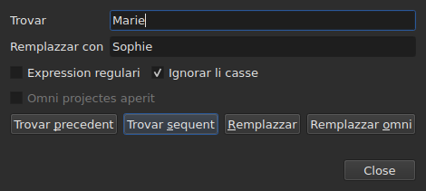
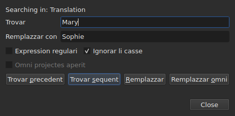

# Trovar e substituer

<!-- machine-translated -->
> Ca págine es un traduction machinal e it ancor ne ha esset revidet de un lector del lingue.

`Redacter ▸ Trovar e remplazzar…`, o `Ctrl+F`, aperte li casse de dialog de sercha.




**Li casse de dialog ne es modal**: it resta aperit durant que on regarda li tabelle,
redacte un cellule, serca denov. `Close` it clude; reaperter it
retorna it quam on lassat it, con li modelle e li remplazzament.

| Campe | Quo it porta |
| :---- | :-------------- |
| `Find` | li modelle serchat |
| `Replace with` | quo it remplazza |
| `Regular expression` | li modelle es un expression regulari plu tost que textu simplic |
| `Ignore case` | «marie» trova «Marie» |
| `All open projects` | li sercha percurre omni li tabs — [vide infra](#in-omni-projectes-aperit) |

Li entrata es desactivat sur un document vacui: il ne have nequo a serchar.

## Li quar gestes

| Buton | Quo it fa |
| :----- | :----------- |
| `Find Previous` | trova li concordantie precedent, e li tabelle ea a it |
| `Find Next` | trova li sequent — it es li buton quel `Enter` pressa |
| `Replace` | remplazza li concordantie trovat, poy trova li sequent |
| `Replace All` | remplazza omni ti del objective |

Omni quar es desactivat tam long quam `Find` es vacui.

**Li tabelle ea a li concordantie** per selecter su linea. Pos haver atinget li
ultim, `Find Next` recomensa del prim; `Find Previous` fa li sam in
li altri direction.

**`Replace` sin concordantie trovat serca prim**: li prim pression
monstra quo va esser remplazzat, li sequent it remplazza. To es quo
Gaupol fa.

## Quo li sercha covre

**Li selection, o li document integral si nullcos es selectet** — li regul del
menu `Tools`. Vide [Li operationes](operations.md#sur-quo-les-actua).

**Li objective es prendet al prim geste e conservat** tam long quam li sercha
continua: `Find Next` selecte li linea de un concordantie, e ti
selection ne diminue li objective. **Selecter vos self altri lineas
changea li objective** por li geste sequent.

Li sercha covre li textu del subtitules; ni li positiones ni li númere
es serchat.

### In omni projectes aperit

Li casse **`All open projects`** extende li portata a omni tabs. **Desactivat con
un sol projecte aperit** — il ne have nequo a extender —, it deveni activat tam rapid quam un
secund tab aperte, e se desmarca self quande solmen un resta.

**Marcat, li selection ne conta plu**: chascun projecte es serchat integralmen,
in **li document ciellat** — ti del columne actual, li principal o li
traduction, quam por un sol projecte.

- **`Find Next` e `Find Previous` va de tab a tab, secun li órdine del
  tabs.** Li projecte monstrat prim; quande it have null altri concordantie, li
  sequent, queles tab li fenestre monstra e queles linea it selecte.
- **Li circul fini u it comensat**: quande li sercha passa li ultim
  tab por reveni al prim — o li contrari in montant —, li linea del casse de dialog
  it dice, in loc de recomensar sin un parol:

  ```text
  Search wrapped around
  ```

  Li passu pos es un passu ordinari, e li linea se vacua.
- **`Replace` remplazza u li sercha es**, poy move se al sequent
  concordantie, quel posse esser in un altri tab.
- **`Replace All` percurre omni li projectes**, e **crea un entrata de historie
  per projecte tangit**: anullar in un tab anulla solmen quo ti tab
  ha recipit. Li cuntage dice quant projectes ha changeat, ne solmen quant
  remplazzamentes:

  ```text
  replaced 4 matches in 3 projects
  ```

  Un projecte u li modelle es absent ne es tangit, e ha nullcos a anullar.
  **Null tab veni avan**: chascun projecte recipe su remplazzamentes
  detra su tab, quel prende su asterisc, e li tab de u li geste
  comensat resta monstrat, con su film.

### In qual textu

**Con un traduction, li sercha covre solmen un del du textus: ti del
columne del cellule actual** — li traduction si li cellule actual es
in li columne `Translation`, li textu principal in omni altri locs. It es li
regul de omni operationes sur textu, e il ne have parametre extra:
vide [Li textu quel li operationes ciela](table.md#li-textu-quel-li-operationes-ciela).

**Li casse de dialog dice in qual textu it serca**, sur un linea supra
`Find`, e it changea quande li columne actual changea — mem durant que it es aperit:




| Li cellule actual es in | Li linea dice |
| :--------------------- | :------------ |
| li columne `Translation` | `Searching in: Translation` |
| quelcunque altri columne | `Searching in: Main` |
| — li projecte have null traduction, o li columne es removet | nullcos: li linea ne es ibi |

**Remplazzar scri in ti textu, e solmen in it.** `Replace` e `Replace
All` sur li traduction lassa li textu principal quam it esset, e
li contrari; `Undo` retorna quo ili scrit. **Li etiquettes es ti del formate
del file de ti textu**: un traduction in Advanced SSA es leet con su
`{\i1}`, mem si li textu principal es un SubRip. `Replace with` es scrit ibi
in li sam etiquettes.

**Li tabelle resta in li columne u it esset.** `Find Next` selecte li linea
de un concordantie sin mover li cellule actual de un columne al altri:
un sercha comensat in li traduction continua in li traduction.

**Serchar ambi textus ad un vez ne existe**: chascun concordantie
vell esser un par (subtitul, textu), e li tabelle ear a it ne havet
null loc clar u ear. On serca in un, poy on changea columne.

**Quo recomensa del comense**:

| Geste | Quo es oblidat |
| :------ | :---------------- |
| changear `Find`, `Replace with` o un option | li concordantie actual, e li linea de statu |
| selecter vos self altri lineas | li objective e li concordantie |
| mover li cellule actual de un textu al altri — de `Text` a `Translation`, o li contrari | li concordantie: it es un loc in un textu |
| aperter un altri file | li objective e li concordantie; li casse de dialog resta aperit, con li modelle |

## Li textu serchat es li textu visibil

**Li etiquettes ne es textu.** Serchar `<i>` trova nullcos, e serchar
`Bonjour` trova un `<i>Bon</i>jour` separat per un etiquette.

**Li remplazzament es fat in li textu del file, sin rupter li etiquettes**:

| Textu | Serchat → metet in su loc | Quo es scrit |
| :--- | :-------------------------- | :-------------- |
| `<i>Bonjour</i>` | `Bonjour` → `Salut` | `<i>Salut</i>` |
| `<i>Bon</i>jour` | `Bonjour` → `Salut` | `<i>Salut</i>` |
| `<i>Bonjour</i> Marie` | `Bonjour Marie` → `Salut Sophie` | `<i>Salut Sophie</i>` |

Un etiquette quel separa un parol inclúde li parol integral, e quelcunque stil quel tange li
concordantie covre li remplazzament. **Li etiquettes quel li concordantie ne
tange resta u ili es**, mem un quel separa un altri parol del sam
subtitul: remplazzar `Marie` in `<i>Bon</i>jour Marie` dona
`<i>Bon</i>jour Sophie`. Un parol es fat de littres e cifres — un spacie
ínrupibil o un signe de citation ne es parte de it. **`Replace with` es leet in li etiquettes del
textu ciellat**: tipar ibi `<b>Salut</b>` in un SubRip fa li parol grassi.

## Li du optiones

| Option | Predefinit | Quo it changea |
| :----- | :------ | :-------------- |
| `Regular expression` | ne marcat | `.` ne serca plu un punctu ma quelcunque caractere |
| `Ignore case` | marcat | li casu de littere ne conta, mem li littres accentuat: `élise` trova `Élise` |

Ci es li valores predefinit de Gaupol. **Ambi es memorat** de un apertion al
altri e de un session al altri, in li optiones `search.regex` e
`search.ignore-case` del [file de preferenties](preferences.md#li-file).

### Un expression regulari

Li modelle es leet per ICU. Quam in Gaupol, `.` travresa un ruptura de linea, e `^`
e `$` aplica al comense e al fin **de chascun linea** de un subtitul:
remplazzar `^` per `- ` pone un strec ante chascun linea.

In `Replace with`, e solmen por un expression regulari:

| Scrit | Quo it pone |
| :------ | :----------- |
| `$1` til `$9` | li gruppe de ti númere; un gruppe absent pone nullcos |
| `$0` | li concordantie integral |
| `\n` | un ruptura de linea |
| `\$`, `\\` | un `$`, un contrabarra |
| `\` sequet de quelcunque altri caractere | ti caractere: `\t` pone un `t` |

**`\1` ne es un gruppe**, e pone un `1`. To es li syntaxe de Gaupol, quel lee
su expressiones in Python; ti de ci es ti de ICU, quel lee li modelle.

## Quo li casse de dialog dice

Sub li butones, un linea dice quo li sercha ne posset far, o quo un
`Replace All` fat:

| Situation | Quo es monstrat |
| :-------- | :------------ |
| null concordantie in li objective | `"Sophie" not found` |
| un expression regulari quel ne es leibil | `not a regular expression (U_REGEX_MISMATCHED_PAREN)` |
| `Replace All` ha remplazzat | `replaced 3 matches` |
| `Replace All` trovat li modelle, ma li remplazzament changea null textu | `nothing to change` |

**Un sercha quel trova nullcos tange nullcos**: li selection resta u
it esset, e nullcos intra in li historie.

**`not found` e `nothing to change` ne dice li sam cose.** `not found`
dice que li modelle es nullu in li objective. `nothing to change` dice que it
es ibi, ma que li remplazzament lassa chascun textu quam it esset — remplazzar
`Marie` per `Marie`, por exemple. In ambi casus nullcos intra in
li historie. Li númere de `replaced N matches` conta li concordanties del
subtitules queles textu ha changeat.

## Quo li action de anullation dice pri it

| Geste | Quo `Undo` lee |
| :------ | :---------------- |
| `Replace` | `Undo: replacing` — un per remplazzament |
| `Replace All` | `Undo: replacing all` — **un sol entrata**, quelcunque li númere de concordanties |

Vide [Anullar e refar](undo.md).
