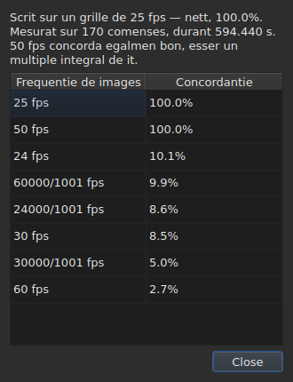

# Li grille de fotogrammas

<!-- machine-translated -->
> Ca págine es un traduction machinal e it ancor ne ha esset revidet de un lector del lingue.

Un file de subtitules **ne declara pas** li frequentie de fotogrammas segun
quel su positiones esset calculat: SubRip have null capite, ti de
WebVTT es textu libri. Li fenestre **deduce** it ex li positiones self,
al apertion, e monstra it in du locs queles ne responde al sam
question.

| Loc | Quo it dona |
| :------ | :------------ |
| li barre de statu | **li response**, permanentmen e sin esser demandat |
| `Instrumentarium ▸ Analise de frequentie de images…` | **li ration**, quande on vole vider it |

## Quo li barre de statu monstra

A dextre, inter quo it dice pri li
[codification](files.md#li-codification-in-li-barre-de-statu) del file leet e quo
it dice pri li [video associat](video.md#quo-li-barre-de-statu-monstra):

| Situation | Quo es scrit |
| :-------- | :-------------- |
| li positiones es sur un grille | `Grid: 24 fps` |
| solmen alcunes de ili | `Grid: 29.97 fps (partial)` |
| null grille conosset convene | `No grid` |

**`No grid` nómina null frequentie de fotogrammas, e to es voluntari.** Li ensemble
de candidatos es clusi — li ott quel li dialog de conversion propone — e
reportar li max poc erronee de ili vell esser dar un response fals u
«yo ne save» es li response just.

**`No grid` have du causas, e les ne es li sam response.** O null
grille convene, o li file have tro poc subtitules por que alquo posse esser dit
pri it — du comenses sempre sembla perfectmen alliniat, e to proba
nullcos. Li barre de statu dice li sam cose pri ambi;
**li analyse les distingue**, e dona in li prim cas de quant li
max bon candidato falie.

Li linea **se actualisa pos chascun operation**. Alliniar un file sur un altri
frequentie de fotogrammas changea li grille, e li barre de statu ne deve
continuar anunciar li old.

### Un document contat in fotogrammas ha null grille, it ha un frequentie de fotogrammas

**MicroDVD es li sol de li nin quel conta in fotogrammas.** Chascun de su lineas
porta du númeres de fotogramma e nullcos plu, e li file **ne dice** a
qual frequentie de fotogrammas leer les. Li sam loc del barre de statu scri alor:

| Situation | Quo es scrit |
| :-------- | :-------------- |
| li document es contat in fotogrammas | `Frames: 24000/1001 fps` |

**To ne es li grille, e li grille vell esser circulari ci.** Li positiones
de un document MicroDVD esset calculat *ex* su fotogrammas a ta frequentie de
fotogrammas mem; deducter un grille ex ili vell redonar ta númere, to es, un data
vestit quam mesuration.

**U it vene es dit un vez**, per li lectura, in li
[liste de diagnoses](files.md#li-diagnoses-de-un-lectura):
`counts in frames and states no rate; it was read at ("24000/1001")`. Li linea del barre de
statu, de su parte, dice quo es, permanentmen.

**Errar li frequentie de fotogrammas move li tot file**, e li dialog
[`Convert Frame Rate…`](operations.md#convert-frame-rate) es u on corecter it:
it aperte sur li frequentie de fotogrammas de lectura e dice que it es ta.

## Quo li analyse monstra

`Instrumentarium ▸ Analise de frequentie de images…` **modifica nullcos.** It aperte sur un resumé e
li classification del ott candidatos con lor score.




Li resumé dona li response, poy quo it qualifica — chascun frase apare
solmen si it have alquo a dir:

| Quo on posse leer ta | Quande |
| :--------------------- | :--- |
| sur quant de comenses, e sur qual extension total | sempre |
| de quant li file es displaciat de su grille | su positiones es sur it til un constant |
| que un altri frequentie de fotogrammas convene egalmen bon | it es un multiplo integral de ti retenet |
| que li extension ne permisse distinguer du frequenties de fotogrammas | li file es tro curt por separar les |
| quant de comenses lassa li grille, **e in quant de sequenties** | li file es partial |

**Li númere de sequenties es quo distinge du histories** quel li
percentage sol confunde. Mult sequenties de un sol comense es positiones
corecte a manu, un per un. Poc long sequenties es un seccion
retemporisat, o un file assemblat ex du altres.

**Li classification complet es monstrat vice un sol response.** Un file quel
convene a 25 a cent per cent e a 50 a cent per cent dice alquo quel un
verdict sol vell celar.

## Quande li conversion esset erronee

Un file quel cade sur null grille es qualvez un file **convertit a un frequentie de
fotogrammas erronee**: it es alor sur un grille tre real, ma displaciat per un ration quel es ti de
null de ti ott. Quande li deduction retorna `none` o `partial`, li analyse sercha **inter li
cinquant-sex pares ordinat de ti ott frequenties de fotogrammas standard** — to es li ensemble, clusi — ti
queles conversion remette li positiones sur un grille. Chascun ration es aplicat al positiones, e
**li deduction self judica li resultate**: li confidentie es ti quel it vell dir, nequande un
númere inventat. Du pares queles fa li sam ration, quam 30 a 25 e 60 a 50, es un sol
conversion.

Li frase es adjuntet al resumé:

```text
converting from 24 to 25 fps puts the positions on a 24 fps grid: 99.9%, against 11.8% as they are and 14.9% for the next best conversion
```

It dona li conversion, li grille sur quel li positiones vell cader e quant ben ili cade sur it,
**poy li diferentie con li positiones quam ili es e con li max bon de
altri conversiones.** Un buton `Convert Frame Rate…` clude li analyse e aperte [li dialog de
conversion](operations.md#convert-frame-rate) **emplenat con li par trovat** — nullcos es aplicat
tam long quam li dialog ne es acceptat, e anullar basta por retornar. Li video, aperit apu,
permisse judicar sur li image si li response es li just.

**Quande du pares es egalmen bon, null es proponet, e li frase dice it:**

```text
converting from 30 to 25 fps and converting from 25 to 24 fps fit equally well (99.7% and 99.6%), so none is proposed
```

To es li cas ordinari plu tosc quam li excepcion: un grille a 28,8 fotogrammas per second retorna
sur 24 egalmen ben quam sur 30, e un file queles tempores es omni duplicat resta sur li grille 25.
Li geste quel have un sol reparation es converter un file **ja** a li frequentie de fotogrammas de cielo. Por
un egalitá, li video decide: on aperte `Convert Frame Rate…` se self sur un de li du pares.

**Nullcos es dit** pri un file ja sur un grille, un file tro curt por que un verdict
valu alquo, ni pri un file quel null conversion del ensemble remette sur un grille — un deriva, un
ration foris li ott frequenties de fotogrammas, positiones sin structura.

## Quo li tabelle ne monstra

**Null linea del tabelle es marcat pro li grille**, nequande.

Tam rapid quam on corecte un position a manu, it cessa esser alliniat. Un
marca automatic vell dunc reportar li labor del usator quam un
anomalie, sur un file quel on precismen corecte. Li deduction
parla del **document**, e li analyse es li sol excepcion — pro que on
aperit it por to.

Li marcas del tabelle, de su parte, concerne quo ne tene ensemble: un fin
ante su comense, un superposition, un órdine rupt. Vide [Li tabelle](table.md).
