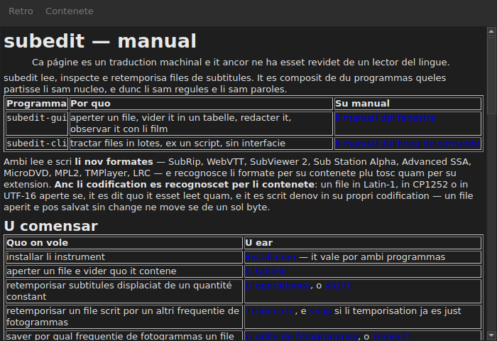

# Li manual in li fenestre

<!-- machine-translated -->
> Ca págine es un traduction machinal e it ancor ne ha esset revidet de un lector del lingue.

`Auxilie ▸ Manual`, o `F1`, aperte **ti manual self** in un fenestre propri.




## Quo it aperte, e pro quo ne un adresse

**Li manual installat juxta li programma**, ne un págine in Internet.

Un adresse vell descrir li version in developpament, ne ti quel on have. Un
usator quel leer li manual de un version quel il ne have es pejor servit
que un usator sin null manual — pro to li fenestre lee li files pozit
per li installation, sub `<prefix>/share/subedit/manual`. Vide
[Installation](../subedit-cli/installation.md).

It aperte sur li [págine principal](../index.md), ti quel di u comensar.

## In qual lingue

**In li lingue del fenestre.** Li manual aperte se in li lingue quel li
interfacie parla: ti eliget in `Redacter ▸ Preferenties…`, o altrimen ti del
ambiente — vide
[li lingue del interfacie](preferences.md#li-lingue-del-interfacie).

| Li fenestre parla | Li manual aperte se in |
| :---------------- | :------------------ |
| anglesi | anglesi |
| un lingue de quel li manual es installat — catalan, cec, german, hispan, finnesi, francesi, galician, hebraic, hungarian, interlingue, islandesi, italian, hollandesi, polonesi, portugalesi, portugalesi brasilian, russ, serb, turc, chinesi simplificat | ti lingue |
| un lingue de quel li manual ne es installat | anglesi |

**Págine por págine, ne omni o nullcos**: un págine quel li traduction ne have
aperte se in anglesi, e chascun altri págine resta in li lingue del fenestre. Un
ligament mena de un al altri del sam maniere.

Li traductiones es installat juxta li manual anglesi, chascun in un directoria
nominat secun su lingue: `<prefix>/share/subedit/manual/fr` por francesi. Li
lingue es ti in quel li fenestre ha comensat, dunc un lingue eliget in li
preferenties aplica se anc al manual, al sequent lancement.

## Navigar

| Quo on fa | Quo evenit |
| :---------- | :----------- |
| clicar un ligament del manual | li págine aperte se in li sam fenestre |
| clicar un ligament quel ciela un section | li págine aperte se, e li fenestre scrolla til it |
| clicar un ligament quel ciela solmen un section | li fenestre scrolla til it, sin changear págine |
| `Back` | retorna al págine precedent; desactivat sur li prim |
| `Contents` | retorna al págine principal; desactivat quande on es ta |

Li fenestre **ne es modal**: it resta aperit durant que on labora, quo es li tot
puncte de haver li manual a manu. Eliger li entrata denov ne crea un
duesim fenestre, it mene ti-ci avan.

## Quo it ne posse aperter, e it dice it

Li manual refere se a vezes al **plan de via** o a un **decision de
architectura**. Ti es documentes del depositorio, ne del paccage: ili ne es
installat, e li fenestre dice it in paroles clar vice lassar li clic
sin efecte.

```
../../feuille-de-route.md is not part of the installed manual;
it lives in the project's repository.
```

On posse leer les in li depositorio, quel adresse es in `Auxilie ▸ Pri subedit`.

## Quande li entrata es desactivat

**`Auxilie ▸ Manual` es desactivat quande null manual es juxta li programma.** Du
casus, e null es un defecte:

| Casu | Pro quo |
| :--- | :-- |
| li binarie es executet ex su arbore de compilation | nullcos esset installat ta, dunc nullcos es a leer |
| li installation es partial | li manual esset removet, o nequande copiat |

Passar li mus sur li entrata dice qual del du: «Null manual es installat juxta ti programma».

Un págine mancant durante que li manual es ta — un file removet per manu — ne
clúde li fenestre: it nomina li file quel it ne ha posset leer e conserva sur ecran quo
it monstrava.

## U li manual es serchat

**Juxta li executibile**, in `../share/subedit/manual` — li disposition quel chascun
installation produe, quelcunque li prefix. To permisse que un installation
sub `~/.local` trova su manual tam bon quam un paccage installat sub `/usr`.
