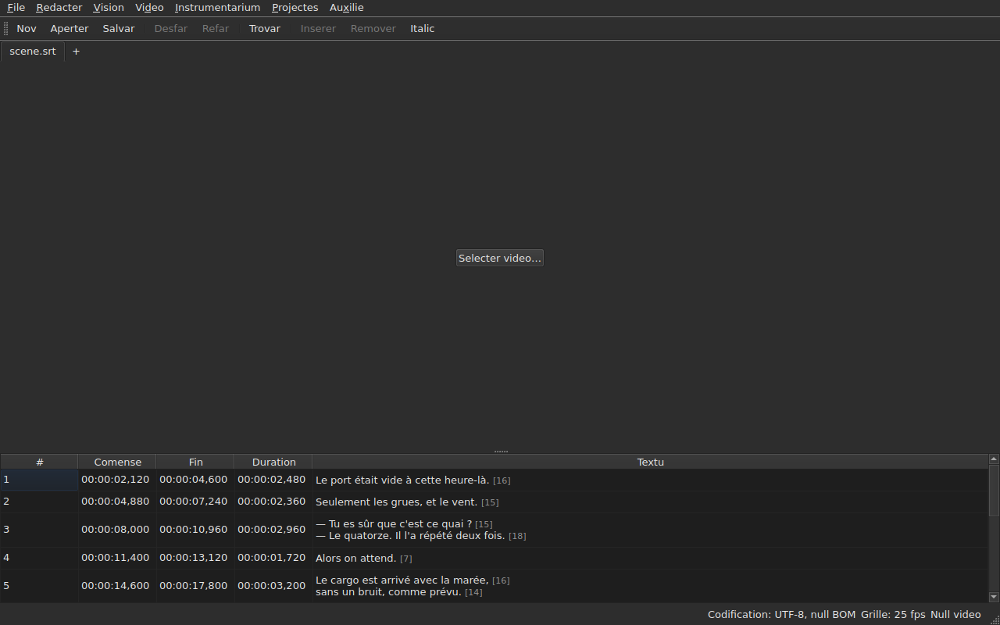

# subedit-gui — manual

<!-- machine-translated -->
> Ca págine es un traduction machinal e it ancor ne ha esset revidet de un lector del lingue.

Li fenestre de subedit: aperter un file de subtitules e vider it in un tabelle. Por li
altri programma e por saver u comensar, vide [li manual](../index.md).

> **Statu actual.** Li fenestre **aperte plurmen files, un lingueta chascun**, quelcunque
> lor codification — per `Open…` o per lassar les cader sur it —, **monstra**,
> **redacte su cellules**, **insere e remove lineas**,
> **anulla**, **salva — eligente li codification, li fines de linea e li
> marca de órdine de bytes** —, e **marca li subtitules queles positiones
> ne tene junt**. It **coalesce e separa** lineas, **decupe,
> copia e colla** textus, e **trova e remplazza** in li textu visibil
> sin rupter li tags, in un projecte o in omni. It **aperte un traduction
> juxta li file principal**, alliniat per position o per númere, in un columne
> additional, e salva it separatmen. Li menu `Tools` have sedecim operationes e du entratas de ortografie —
> mover, transformar, converter li frequentie de fotogrammas, ajustar durationes,
> **apender un file, separar li projecte in du**, metter in
> italic, adjunter tirés de dialog, changear li casu de líttere in quar manieres,
> remover mentiones por surdes, **corecter textus per un assistent a
> plurmen págines**, **controlar li ortografie parole per parole**, alliniar a un frequentie de fotogrammas, remetter sur
> li grille — e li analyse del grille, quel modifica nullcos. Li menu `Projects`
> **salva e clúde omnicos** in un sol gesto. It **associa un video
> al document**, eliget o supposit, e **reproducte it in li fenestre**, li linea
> actual designat sur li image; it **fixa un comense, un fin o un
> subtitul ex li position del film**, **avansa fotogramma per fotogramma** e **mover un bordo per un fotogramma**. Li barre de reproduction **saltea, regla li
> volúmine e li position**, li tabelle **seque li reproduction** sin anullar un scrollation manual, li positiones
> posse esser monstrat **in fotogrammas**, e li menu `Video` **elige li pista audio**. Du detectiones
> **propone sin nequande aplicar**: un traduction displaciat de un quantité constant, quel posse esser **reaperit
> displaciat**, e li conversion de frequentie de fotogrammas quel remette un file sur un grille. It **memora su geometrie, li órdine, li largore e li presentie de su
> columnes, e su parametres** de un
> session al altri, e veni **clar o obscur** secun vor election. `Auxilie ▸ Manual`
> aperte **ti manual** in un fenestre. Ca manual descri quo existe, nequande
> quo es planat; quo veni pos es in li
> [plan de via](../../../../feuille-de-route.md).

> **Li images de ca manual es generat, ne li prose.** Li exemples de
> `subedit-cli` es generat per executer li comande; li capturas de ecran
> es generat per construer li fenestre real e fotografar it — `make
> manual` fa ambi. Un image dunc ne posse descrir un interfacie quel
> ne existe plu, e un interfacie quel changea se monstra in li diff del
> depositorio. Quo resta sin rete de securité es li textu circum les, de quel li
> acuratesse repose sur li revision.

**Chascun ecran es monstrat du vezes, sub li du palettas quel li application
fixa** — `Light` e `Dark`, ti quel
[li preferenties](preferences.md#li-tema) offere. Sub un table de labor de quel li
tema regente, `System` da li un o li altri secun quo li table de labor ha eliget.

## Li menus

`File`, `Edit`, `View`, `Video`, `Tools`, `Projects`, `Help` — in li órdine in
quel on les usa: li document, quo on fa con it, qualmen on regarda it, quo
va con it, quo it examina, quo aplica se a omni projectes aperit, quo
it explica.

`View` have un submenu, `Columns`, con un entrata marcabil per columne except `Text`
— vide [Li tabelle](table.md#celar-e-mover-columnes) — e un parametre, `Positions in Frames`, quel monstra
`Start` e `End` quam númeres de fotogrammas — vide [Positiones in fotogrammas](table.md#positiones-in-fotogrammas).

`Projects` have du entratas, `Save All` e `Close All` — vide
[Li menu Projectes](files.md#li-menu-projectes).

`Edit` have cinc blocs, chascun sub un separator: anullar; li
porta-papere — decuper, copiar, collar textus; `Find and Replace…`;
inserter, remover, coalescer e separar lineas; fine
`Preferences…`. Anullar es quo on fa *a* un redaction, mover un textu
ne adjunte ni remove un linea, li quar del bloc sequent changea li númere de
lineas, e fixar li tema ne es null redaction.

**Li claves es nominat quam li menu monstra les**, in anglesi quam li resta
del interfacie: `Ins`, `Del`, `Ctrl+Shift+Z`. Un clave quel on pressa e
quel null menu nomina conserva su nómine anglesi: `Enter`, `Esc`, `Shift`.

`Help` have du entratas, in li órdine quel li menu monstra les. `Manual`, o
`F1`, aperte ti manual in un fenestre — vide
[Li manual in li fenestre](help.md). `About subedit` dona li version, li
licentie e li bibliotecas con queles li fenestre funge, con lor versiones — vide
[`--version`](invocation.md#--version).

## Li barre de instrumentes

Sub li menus, un barre have **li gestos plu frequent**, in gruppes.
Chascun button lee un curt parole; li menu conserva li entrata integral, e li
via rapid es li sam.

| Button | Entrata del menu | Via rapid |
| :----- | :--------- | :------- |
| Nov | File ▸ Nov projecte | `Ctrl+N` |
| Aperter | File ▸ Aperter… | `Ctrl+O` |
| Salvar | File ▸ Salvar | `Ctrl+S` |
| Desfar | Redacter ▸ Desfar | `Ctrl+Z` |
| Refar | Redacter ▸ Refar | `Ctrl+Shift+Z` |
| Trovar | Redacter ▸ Trovar e remplazzar… | `Ctrl+F` |
| Inserer | Redacter ▸ Inserer subtitules… | `Ins` |
| Remover | Redacter ▸ Remover subtitules | `Del` |
| Italic | Instrumentarium ▸ Italic | `Ctrl+I` |

**Un button desactivat es desactivat por li sam rason quam su entrata**: `Undo` sin
null cose a anullar, `Remove` sin null linea eliget. Li entratas del traduction
e li operationes del menu `Tools`, except `Italic`, resta in lor
menus: ili es usat minus sovente, o ne per omnes.

## Sectiones

| Section | Contenete |
| :------ | :------- |
| [Installation](../subedit-cli/installation.md) | compilar e installar — li págine aplica se a ambi programmas |
| [Invocation](invocation.md) | lansar li fenestre, argumentes, codes de exeunte |
| [Aperter e salvar](files.md) | li comandes, li linguetas, li menu `Projects`, lassar cader files, li traduction e su reapertion displaciat, li diagnoses, li codification in li barre de statu, li ear e reveni, clúder |
| [Li tabelle](table.md) | quo chascun columne monstra, celar e mover les, positiones in fotogrammas, li columne del traduction e li textu quel li operationes ciela |
| [Redacter un cellule](editing.md) | queles cellules posse esser redactet, e qualmen |
| [Decuper, copiar e collar textus](clipboard.md) | li tri entratas, quo viaja, li lineas adjuntet, li tags traductet |
| [Trovar e substituer](find-and-replace.md) | li casse de dialog, li quar gestos, li du optiones, quo li sercha covre, in omni projectes aperit |
| [Inserter, remover, coalescer e separar lineas](lines.md) | li quar entratas, lor vias rapid, u li nov lineas va |
| [Anullar e refar](undo.md) | li historie, li du actiones, li marca de modification |
| [Li grille de fotogrammas](frame-grid.md) | li frequentie de fotogrammas deducet del positiones, li analyse, e li conversion quel remette un file sur un grille |
| [Li operationes](operations.md) | mover, transformar, converter, ajustar durationes, apender un file, separar li projecte, metter in italic, li casu de líttere, li tirés, remover mentiones, alliniar, remetter sur li grille, e quo passa ultra li fin del film |
| [Corecter textus…](correct-texts.md) | li assistent de correction: li campe e li taches, li págine de chascun tache, li progresse, li confirmation |
| [Controlar ortografie…](check-spelling.md) | li controle de ortografie: su parametres, li percurse, clúder in li medie, li absentie de un dictionarium |
| [Li video associat](video.md) | eliger un video, li proposition automatic, li pista audio, li barre de statu, `ffmpeg` |
| [Li reproductor](player.md) | li vise del video, li barre de reproduction, reproducter, mover se, li volúmine, li tabelle quel seque, li linea tracet |
| [Temporisar secun li video](timing.md) | fixar li comense o li fin de un subtitul, inserter, selecter ex li position del film, avansar fotogramma per fotogramma, mover un bordo |
| [Li preferenties](preferences.md) | li tema, li file de preferenties, su optiones, e quo evenit con un valore ineleibil |
| [Li manual in li fenestre](help.md) | `Auxilie ▸ Manual`, quo it aperte e qualmen navigar in it |
