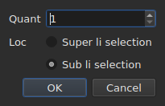

# Inserter, remover, coalescer, separar, ordinar e far disjuncte li lineas

<!-- machine-translated -->
> Ca págine es un traduction machinal e it ancor ne ha esset revidet de un lector del lingue.

Oct entratas del menu `Edit`, sub un separator quel les distinte de
`Find and Replace…`. Quar de les have in comun que ili changea li númere de lineas, u
decuper, copiar e collar, supra, move textus; `Sort Subtitles` changea
solmen **li órdine** del lineas, `Join Repeated Subtitles` fa denov un sol
subtitul del pezzes consecutiv de un sam textu, e `Make Ranges Disjoint…`
les retalia u ili se superpone.

| Entrata | Via rapid | Quo it fa |
| :---- | :------- | :----------- |
| Inserer subtitules… | `Ins` | aperte un casse de dialog, poy adjunte lineas vacui |
| Remover subtitules | `Del` | remove li selection, sin demandar nullcos |
| Coalescer li subtitules | null | fa un sol linea de un bloc de lineas vicin |
| Separar li subtitul | null | talia un linea in du in li medie de su duration |
| Unir subtitules repetet | null | fa un sol subtitul del pezzes consecutiv de un sam textu |
| Ordinar subtitules | null | repone li lineas in li órdine de lor comense, sur li projecte integral |
| Far intervalles disjunt… | null | talia li lineas superponent talmen que null intervalle se superpone plu a un altri |
| Reparar subtitules… | null | encatena li tri entratas precedent — unir li repetitiones, ordinar, taliar li intervalles — in un vez |

Omni oct intra in li historie: `Ctrl+Z` les anulla quam li resta.

## Inserter

| Campe | Quo it contene | Predefinit |
| :---- | :------------ | :------ |
| `How many` | un númere integral de 1 a 99 999 | `1` |
| `Where` | `Above the selection` o `Below the selection` | li ultim election, `Below` al prim lancement |

`OK` adjunte li lineas, `Cancel` ne adjunte nullcos.

### U ili va

**Pos li ultim selectet**, ne li prim. Selecter li lineas 1 e 3
poy inserter infra pone li nov linea in position 4 — ne in
position 2. To es quo Gaupol fa desde vinte annus, e quo li manu
expecta pos haver percurrit de supra til infra.

`Above the selection` it pone just ante ti sam linea.

### Lor duration

Un linea vacui ha null textu, ma it ha positiones. Les es deducet
del spacie disponibil:

| Situation | Comense | Duration |
| :-------- | :---- | :------- |
| inter du subtitules | li fin del precedent | li spacie til li sequent, partit in partes egal |
| pos li ultim | li fin del ultim | tri secundas chascun |
| al cap de un file | li origine | li spacie til li prim, partit |
| in un file vacui | li origine | tri secundas chascun |

Quande li file se superpone al loc eliget, il ne have **spacie a
partir**: li lineas recipe un duration zero, quel li tabelle monstra, in loc de
un duration inventet quel passaret li vicin.

### Li document vacui

**Null selection es besonat**, e to es li sol manere de comensar un
nov file: li lineas va al index zero. Li election del latere es alor desactivat
in li casse de dialog — il ne have selection contra quel les placear.

Tam rapid quam li document porta un linea, li entrata `Insert Subtitles…` **es desactivat tam long
quam nullcos es selectet**: sin selection, li index esset divinat.

### Pos to

Li lineas adjuntet es **selectet**, e li tabelle ea a les. Pressar
`Ins` un secund vez dunc insere pos les, sin devoir clicar inter li
du.

### Li latere es memorat

`Above` o `Below` es memorat **de un insertion al altri, e de un session al
altri**: it es li option `edit.insert-placement` del
[file de preferenties](preferences.md#li-file). On ne insere un sol vez,
on insere dec lineas in successión, sempre sur li sam latere.

## Remover

`Remove Subtitles`, o `Del`, remove li lineas selectet — inclusiv un
selection discontinu, chascun linea revenent a su loc si on anulla.

**Null confirmation es demandat**, e to ne es un omission:
li operation es anullat con `Ctrl+Z`. Un modal ante un geste anullabil
costaret un clic chascun vez por evitar un `Ctrl+Z` de tempore a tempore.

**Li entrata es desactivat quande nullcos es selectet.** Altrubi in li fenestre,
«nullcos selectet» significa «li file integral» — to es quo fa un
displaciament usabil sin selecter quar mil lineas. Ci, ti lectura
vacuaret un document per un `Del` malfortunat, dunc it ne es ofrit.

Pos li remotion, **li linea quel prendet li loc del prim removet es
selectet** — o li ultim restant, si li remotion portat li fin del
file. Pressar `Del` plu vices in successión dunc remove li lineas un
per un.

Un file vacuat integralmen lassa li fenestre usabil: `Insert Subtitles…`
deveni activat denov, pro que on insere in un document vacui sin selection.

## Coalescer

`Merge Subtitles` fa **un sol linea** del lineas selectet:

| Quo li linea coalescet recipe | U it veni |
| :---------------------------- | :------------------ |
| su comense | li comense del prim |
| su fin | li fin del ultim |
| su textu | li textus de omni, in órdine, un ruptura de linea inter du |
| su traduction | li traductiones, unit li sam manere |
| quo li formate porta in plu — un stil, un strate, coordinates | li prim |

**Un textu vacui ne lassa null linea vacui**: coalescer `Un.`, un linea sin
textu e `Trois.` dona du lineas de textu, ne tri.

Li lineas coalescet desapare, e li linea quel les remplazza prende li loc
del prim.

**Li entrata es desactivat** tam long quam li selection ne es **un bloc de minimum
du lineas vicin**. Un sol linea have nullcos con quo coalescer; li lineas
1 e 3 sin 2 ne plu, pro que li resultate passaret 2 e
covraret it.

Pos li coalescentie, **li linea coalescet es selectet**: `Split Subtitle` es
pret por taliar it denov.

## Separar

`Split Subtitle` talia li linea selectet **in li medie de su duration**, al
millisecunda:

| Mitá | Comense | Fin | Textu |
| :--- | :---- | :-- | :--- |
| li prim | li comense original | li medie | **omni** li textu, e li traduction |
| li secund | li medie | li fin original | vacui |

**Li textu ne es talliat a su ruptura de linea.** To esset ver por un
subtitul de du lineas e fals por un subtitul de un linea o de tri;
omni li textu resta in li prim mitá, e on move se self quo deve
ear al secund.

Li prim mitá conserva quo li formate portat in plu del textu; li secund
nasce quam un linea inserit, sin nullcos.

**Li entrata es desactivat** tam long quam li selection ne conta **exactmen un
linea**. Nullcos selectet ne significa «li file integral» ci.

Pos li separation, **ambi mitás es selectet** — to es quo Gaupol
fa pos quelcunque insertion, e `Merge Subtitles` es alor pret por anullar li
geste.

## Ordinar

`Sort Subtitles` repone **li projecte integral** in li órdine del comenses. Nequande li
selection: un órdine es un propriété del document, e ordinar li mitá de un
file ne significa nullcos. Li ordination es **stabil**: du subtitules quel
comensa ensemble conserva li órdine quel li file les dat.

**Un barre curre in li barre de statu durant li ordination, e li cursor deveni un
clepsydre**: sur un file long, li fenestre resta sin response durant un tempore — li
tabelle se reconstrue linea pos linea —, e sin to on ne save si alquo es
in cursu. Li barre monstra null fraction, li ordination ne reporta un,
e it desapare con it.

Li barre de statu dice quant lineas ha changeat de loc — `3 subtitles moved`
— o, quande omnicos esset in órdine, `already in order`. **Un projecte ja in órdine
ne intra in li historie**: un operation quel changea nullcos ne es
un operation a anullar. Li entrata es desactivat por un projecte de un subtitul.

Un file **con alquo a corecter al apertion** it ofre per se self,
[in un sol casse](#al-apertion-un-sol-casse): vide infra. Subtitules mal plazzat
es anc [contat con li diagnoses](files.md#li-diagnoses-de-un-lectura),
talmen que on les trova sin defilar li tabelle.

Sur li linea de comande, [`sort`](../subedit-cli/sort.md) fa li sam sur
files, e `--sort` it fa in passante sur
[`convert`](../subedit-cli/convert.md#ordinar-durant-li-scrition),
[`append`](../subedit-cli/append.md#ordinar-li-resultate) e
[`split-file`](../subedit-cli/split-file.md#separar-secun-li-órdine-de-tempore).

## Unir li subtitules repetit

`Join Repeated Subtitles` fa **un sol subtitul** del subtitules quel monstra li
sam cose in successión: un textu talliat in pezzes consecutiv, quam
alcun utensiles de segmentation les lassa. It actua sur **li projecte integral**.

**Un repetition** have li sam textu, li sam traduction e li sam parametres de formate
(un stil, un position, parametres de cue) quam un altri, **e comensa al
plu tard quande ti fini**. Un seria de repetitiones deveni ti quel comensa
prim, con li fin max grand del seria; li altris desapare.
`Alpha [1, 2]`, `Alpha [2, 4]` e `Alpha [4, 6]` dona `Alpha [1, 6]`.

- **Li órdine del file ne changea nullcos a to, e it ne it changea**: li subtitul conservat
  es ti quel comensa prim, u que li altris es.
- **Nullcos es unit per erra**: altri textu, altri parametres, un interstice
  inter du pezzes, un subtitul sin textu o queles fin precede su comense
  resta separat.
- Li barre de statu dice quo esset fat — `2 repeated subtitles joined`, o
  `no repeated subtitles`.

**A far ante ordinar e taliar**, queles leetura un seria net melior: un
textu in tri pezzes, plu un altri textu sur li intervalle integral, dat
foris de órdine, ordina e talia se in lineas quel passa de un pezz al altri; unit
prim, it cade in órdine e coalesce se nettmen. Li casse de apertion, infra, fa
li tri in ti órdine.

## Far disjuncte li intervalles

`Make Ranges Disjoint…` talia li subtitules superponent talmen que **null
intervalle `[start, end]` se superpone plu a un altri**. It actua sur **li projecte
integral**, nequande sur li selection: un gruppe de subtitules superponent
es talliat u ili se superpone, e li mitá de un gruppe ne significa nullcos.

**Nullcos es accurtat o prolongat.** A chascun instant, li fenestre monstra li
sam textus quam ante. Quo changea es qualmen li chronologie es talliat:
it es talliat a chascun comense e chascun fin de un gruppe; un intervalle covrit
per un sol subtitul resta ti subtitul; un intervalle covrit per plu
deveni **un** subtitul queles lineas es les lor, **li max anterior sur linea 1**.
`A [0, 5]` e `B [3, 8]` dona `[0, 3] A`, `[3, 5] A / B`, `[5, 8] B`.

Li casse de dialog demanda tri parametres, memorat de un vez al altri:

| Campe | Quo it contene | Predefinit |
| :---- | :------------ | :------ |
| `Shortest interval kept` | de 0 a 10 000 ms: un intervalle plu curt es reprendet per un vicin | `80 ms` (circa du fotogrammas) |
| `Most lines in a subtitle` | de 0 a 10; `No limit` a 0 | `2` |
| `Put a dash before each subtitle's text` | un strec ante quo chascun subtitul contribue a un subtitul coalescet | ne marcat |

`OK` talia, `Cancel` ne fa nullcos. **Li lineas scrit es selectet**
pos to, e li barre de statu dice quo esset fat: `2 subtitles split, 1 merged`.
Un secund passage ne changea nullcos e it dice: `already disjoint`.

- **Un linea nequande es duplicat.** Du subtitules con li sam textu dona un
  sol linea u ili se superpone, e du pezzes vicin quel monstra li
  sam cose fa solmen un subtitul. Li textu de un subtitul talliat in plu
  pezzes es altrimen repetit in chascun: it es quo es sur ecran a ti instant.
- **Un intervalle tre curt es reprendet per un vicin**: ti queles lineas
  contene ja les su propri, altrimen li max long, extende su intervalle por covrir it.
  Un subtitul integral plu curt que li límite nequande es reprendet.
- **Plu lineas que li límite: fenestres.** Tri lineas sur tri secundas
  deveni du mitás, li du prim lineas poy li du ultim;
  quar lineas, tri tertie, e talmen. Nullcos es truncat.
- Li traduction seque li sam talliationes; li stil e li position del prim
  subtitul covrent es conservat.

**Quo ne posset esser fat integralmen es dit in un casse a clúder**, ne in
li barre de statu: fenestres, intervalles reprendet, subtitules tro curt
lassat integral, stiles quel diferte, subtitules queles fin precede lor
comense (lassat u ili es).

**Li entrata es refusat, con li rason, quande li subtitules ne es in
li órdine de lor comense**: li gruppes es seria de vicins, e li nucleo nequande
ordina per se self. `Sort Subtitles` prim — o li casse de apertion, quel
fa ambi in ti órdine.

### Omnicos ad un vez: `Repair Subtitles…`

`Repair Subtitles…` fa li tri entratas precedent **un pos li altri**, in li sol órdine quel functiona: li
repetitiones es unit, li subtitules metet in li órdine de lor comense, poy li intervalles fat disjunt. It es li entrata
por un file mal segmentat, mal ordinat e superponent, quande on save que on vole li tri. Li casse de dialog demanda li
parametres de talliation (li sam quam `Make Ranges Disjoint…`, memorat de un vez al altri) e dice que it unisse e ordina
prim. Li barre de statu — o li casse a clúder, quande alquo ne posset esser fat integralmen — dona **un sol raport**
del tri: `2 repeated subtitles joined; already in order; 2 subtitles split, 1 merged`. Chascun correction es su propri
entrata de historie: `Ctrl+Z` les anulla un per un. Sur li linea de comande: [`repair`](../subedit-cli/repair.md).

### Al apertion, un sol casse

Un file quel aperte con alquo quel on save corecter **it ofre in
un sol casse**, `Problems found in this file`, in loc de aperter un per
problema. Chascun problema trovat es un linea con su casse a marcar, marcat:

- `Join the repeated subtitles` — subtitules repete un altri quel ili
  tange, con lor númere;
- `Sort the subtitles` — li subtitules ne es in li órdine de lor comense,
  con lor númere;
- `Make the ranges disjoint` — subtitules comensa ante li fin del precedent,
  contat **un vez li file in órdine**, pro que ibi on les corecte.

**Chascun problema es contat u it es corectet**, sur un copie a quel li
corrections quel it precede ha ja esset fat: un textu talliat in pezzes es li
causa de alcun desórdine, e unir it prim posse lassar null — li casse
alor ne ofre li ordination.

Un problema quel ne esset trovat have null linea. Desmarcar li ordination **grisa e
desmarca** li altri casse: li intervalles es fat disjunt solmen in órdine.
`Fix` aplica quo es marcat — li union, poy li ordination, poy li talliation, con li
parametres del ultim `Make Ranges Disjoint…` — e dona **un sol raport** de it;
`Keep as is` ne tange nullcos. **Nullcos es fat sin un yes**, chascun correction
es un entrata de historie, e un file sin nullcos a corecter es li subjecte
de null question.

Sur li linea de comande, [`disjoint`](../subedit-cli/disjoint.md) fa li sam sur files, e `--disjoint`
it fa in passante sur [`convert`](../subedit-cli/convert.md#far-disjuncte-li-intervalles),
[`append`](../subedit-cli/append.md#far-disjuncte-li-intervalles) e
[`split-file`](../subedit-cli/split-file.md#far-disjuncte-li-intervalles).

### Pro quo ne li vias rapid de Gaupol

Gaupol coalesce con `M` e separa con `S`. Un littre sol esset prendet per li
tabelle ante que it atinge un cellule in redaction, e `Ctrl+S`
salva ja: li du entratas es atinget per li menu.

## Quo li action de anullation dice pri it

**Un entrata de historie per geste.** Coalescer cin lineas es anullat con un sol
`Ctrl+Z`, e it dona retro li cin lineas quam ili esset — positiones, textus e
omnicos quo li formate portat.

| Operation | Quo `Undo` lee |
| :-------- | :---------------- |
| un insertion | `Undo: inserting` |
| un remotion | `Undo: removing` |
| un coalescentie | `Undo: merging` |
| un separation | `Undo: splitting` |
| un union de repetitiones | `Undo: joining repeated subtitles` |
| un talliation del intervalles | `Undo: making the ranges disjoint` |

Un correction ofrit al apertion es un entrata de historie per correction: li union, li ordination, poy li talliation, es anullat un pos li altri.

Vide [Anullar e refar](undo.md).

## Vias rapid durant que un cellule es aperit

`Ins` e `Del` apartene al campe de input tam long quam un redactor de cellule
es aperit: li clave de suppression ibi efface un caractere, ne un
subtitul. Clúder li redactor — `Enter` o `Esc` — les retorna lor signification. Lanceat
del menu, `Remove Subtitles` valida prim li input, quam li altri
gestes de [Redacter un cellule](editing.md).

Ca manual nomina li claves quam li menu les monstra — vide
[Li menus](index.md#li-menus).
