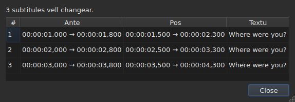
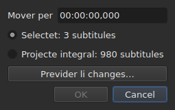
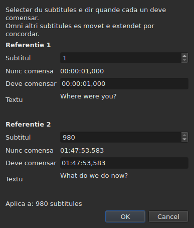
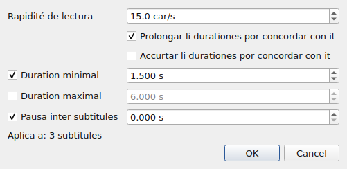
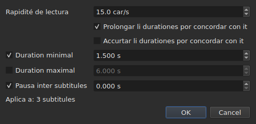
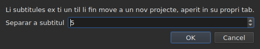

# Li operationes

<!-- machine-translated -->
> Ca págine es un traduction machinal e it ancor ne ha esset revidet de un lector del lingue.

Li menu **Tools** have sedecim operationes, un analyse e du entratas de ortografie. Chascun del
sedecim es anullat per un `Ctrl+Z`; li analyse modifica nullcos. `Check Spelling…` es anullat anc, e `Spell-Check Settings…` tange null textu.

| Entrata | Casse de dialog | Quo it fa |
| :---- | :----- | :----------- |
| `Shift Positions…` | yes | displacia li ciel per un duration |
| `Transform Positions…` | yes | corecte li ciel ex du marcas |
| `Convert Frame Rate…` | yes | retemporisa li ciel de un frequentie de fotogrammas a un altri |
| `Adjust Durations…` | yes | move li fines por tener un rapidesse de lectura, durationes e un interstice |
| `Append File…` | un selector de file | apende un file al fin del projecte |
| `Split Project…` | yes | separa li projecte in du, li resta va in un nov lingueta |
| `Italic` | **no** | mette li ciel in italic, o remove it |
| `Dialogue` | **no** | mette un strec de dialog in li cap de chascun linea, o remove it |
| `Case ▸ Title Case` | **no** | chascun parole prende un majuscul |
| `Case ▸ Sentence case` | **no** | li prim líttere del textu, e it sol |
| `Case ▸ UPPER CASE` | **no** | omnicos in majusculas |
| `Case ▸ lower case` | **no** | omnicos in minusculas |
| `Remove Hearing-Impaired Mentions…` | yes, sin parametres | remove mentiones por mal-audientes |
| `Correct Texts…` | yes, un assistent a plurmen págines | propone correctiones — mentiones, union e separation de paroles, errores comun, majusculas, ruptura de linea — e aplica les pos acceptation, vide [Corecter textus…](correct-texts.md) |
| `Check Spelling…` | yes, un percurse parole per parole | percurre li paroles incognosset al dictionarium e aplica quo esset corectet, vide [Controlar ortografie…](check-spelling.md) |
| `Spell-Check Settings…` | yes | elige li lingue, li campe e li document del controle, e li suslineation durant li tipation, vide [Controlar ortografie…](check-spelling.md#parametres-de-ortografie) |
| `Snap to Frame Rate…` | yes | remette chascun marca de tempore sur li plu proxim fotogramma |
| `Shift Whole File onto Grid (…)` | **no** | remena li file integral sur su grille |
| `Frame Rate Analysis…` | yes, sin parametres | **modifica nullcos** — vide [Li grille de fotogrammas](frame-grid.md) |

**Quo un operation ha fat es dit in un casse de information quel deve esser
clúdet, except por `Italic`, `Case` e `Dialogue`**: ti tri aperte null casse de
dialog, e lor raporte — «null cose a changear» includet — es monstrat
in li barre de statu, sin nullcos a clúder. `Split Project…` anc dona li suo
in li barre de statu: su resultate es ja davant vu, in li nov lingueta. Li missages es citat in li
section de chascun operation.

Inserter, remover, coalescer e separar lineas ne es hic ma in li
menu `Edit`, pro que ili changea li númere de lineas. Vide
[Inserter, remover, coalescer e separar lineas](lines.md).

## Sur quo les actua

**Li lineas selectet, o li file integral si null lo es.** It es li sam
regul por omni, e li casses de dialog, quande il ha un, rememora it in paroles
simplic:

```
Applies to: 4 subtitles
```

Selecter omni li lineas equivale a selecter null.

**Quande solmen un parte del lineas es selectet, li casse de dialog demanda
sur quo actuar.** Du electiones es monstrat, con lor cuntage, e **li selection
es ti marcat**:

```
(•) Selected: 2 subtitles
( ) Whole project: 4 subtitles
```

Marcar `Whole project` extende li operation al file integral sin devoir prim
changear li selection. Quande il ne ha nullcos a eliger — null selectet,
o omnicos —, li linea `Applies to:` supra resta sol.

Li casses de dialog de `Shift Positions…`, `Transform Positions…`,
`Convert Frame Rate…`, `Adjust Durations…`, `Snap to Frame Rate…` e
`Remove Hearing-Impaired Mentions…` offere ti election.

### Vider ante aplicar

`Shift Positions…`, `Transform Positions…`, `Convert Frame Rate…`,
`Adjust Durations…` e `Snap to Frame Rate…` have un button **`Preview changes…`**.
It aperte un fenestre curt quel dice quant subtitules li operation
changearea **con quo es tipat a ti momente, sur li ciel marcat**, e
lista li prim dudece: lor númere, lor position ante, lor position
pos, e li prim linea de lor textu. **Nullcos es aplicat**: clúder li
fenestre retorna al casse de dialog, u on posse changear un valore e regardar
denov.




It aperte se sat grand por monstrar omni li columnes, e posse esser redimensionat
per manu.

Si li operation changearea nullcos, li fenestre dice it (`Nothing would change.`).
Durante que quo es tipat ne defini un operation — un duration ineleibil, du
marcas sur li sam subtitul —, li previsione es vacui por li sam rason que li
button `OK` es grisat. `Remove Hearing-Impaired Mentions…` have null previsione: quo
it changea es textu, e li raporte quel it dona pos
dice it.

**Con un traduction, qual textu?** Li operationes de position e de structura
actua sur li subtitul integral — su du textus seque. Ti quel
rescri un textu — `Italic`, `Case`, `Dialogue`,
`Remove Hearing-Impaired Mentions…` — cielea **li textu del columne del cellule actual**: li
traduction in su columne, li textu principal altrubi. Li altri resta intact, e
li barre de statu dice qual es cielat. Vide [Li tabelle](table.md#li-textu-quel-li-operationes-ciela).

**Un exception, e su etiquette porta it**: `Shift Whole File onto Grid`
ignora li selection. Un grille es un proprietá del document, e un mediete de
document have null grille propri; li entrata dunc dice it in su nómine vice
in ca manual sol.

**`Append File…` anc ignora li selection**, por un altri rason: it ne es
un ciel quel it rescri, it es un fin quel it repulsa. Vide su
[propri section](#append-file). **Talmen `Split Project…`**: it separa u on lo
dice. Vide [su propri](#split-project).

**`Correct Texts…` elige su ciel sur su propri págine**, vice sequer li
selection actual: li selection, li projecte actual o omni projectes
aperit. Vide [Corecter textus…](correct-texts.md). **`Check Spelling…` lo elige in
`Spell-Check Settings…`**, e memora it: vide [Controlar ortografie…](check-spelling.md).

**Li du operationes de grille ne parla ne del sam cose quam li grille.**
Un operation actua sur li selection; li analyse e li barre de statu parla del
**document integral**. Alliniar cinc lineas de cent sexant-sex changea ti
cinc — li tabelle monstra it — sin que nequal ili move se, quo
lee quam un refreschation mancat. It ne es: ili ha nullcos a
dir. Vide [`Snap to Frame Rate…`](#snap-to-frame-rate) e
[Li grille de fotogrammas](frame-grid.md).

### Quo signifia «null selection», entrata per entrata

Li regul aplica se al menu `Tools` e al sercha. Li entratas del
menu `Edit` quel tange li lineas o les vacuar lee it altrimen — altrimen un
mal-fortunat `Del` o `Ctrl+X` vacuarea li document.

| Entrata | Sin selection | Quo it besona |
| :---- | :------------------ | :--------------- |
| li operationes del menu `Tools` | li file integral | un document ne vacui |
| `Shift Whole File onto Grid` | li file integral, **sempre** | un grille trovat |
| `Find and Replace…` | li file integral | un document ne vacui |
| `Cut Texts`, `Copy Texts`, `Paste Texts` | **desactivat** | minimum un linea selectet |
| `Remove Subtitles` | **desactivat** | minimum un linea selectet |
| `Merge Subtitles` | **desactivat** | un bloc de minimum du lineas vicin |
| `Split Subtitle` | **desactivat** | exactmen un linea |
| `Insert Subtitles…` | desactivat, except sur un document vacui | un linea contra quel plazzar les |

Chascun págine dona li rason: [li porta-papere](clipboard.md#sur-quo-les-actua),
[li lineas](lines.md), [li sercha](find-and-replace.md#quo-li-sercha-covre).

Li entratas es **desactivat sur un file vacui**: il ne haverea nullcos a
displaciar. `Italic` have un duesim condition, quel su section descri: li formate
aperit deve posser scrir un stil. Li casu de líttere e li tirés have null — un
textu es un textu in omni li nin formates.

## `Shift Positions…`

Move li ciel per un duration, avan o retro. Ambi limites de
chascun subtitul move se per li sam quantité: null resta sur ecran plu long o plu curt
quam ante.

Li duration es scrit **quam un marca de tempore, signe includet** — `00:00:02,500` move avan,
`-0:01,250` move retro. Li formes acceptat es ti de un cellule de position.




| Refuso | Pro quo |
| :------ | :-- |
| un duration ineleibil | li button resta desactivat; nullcos es displaciat a hasard |
| un displaciament de zero | il ne ha operation a registrar |
| un subtitul vell ear ante li comense del video | **null file posse porta tal position** |

Li triesim casu nomina li culpabil — «li subtitul 1 vell comensar ante li origine» —
e it es ti a regardar por vider de quant on erra. Nullcos
es aplicat.

## `Transform Positions…`

Li correction de un file temporisat contra un altri talliat. On dice u **du**
subtitules ver comensa, e omnicos altri seque, proportionalmen.

Li casse de dialog demanda du vezes li sam cose: un númere de subtitul, e li
position u su comense deve esser. Por chascun marca, it monstra **quo ti
númere designa** — su textu (`Text`) e li tempore a quel it comensa
**nunc** (`Now starts`), quam etiquettes simplic — e ili seque li númere
quande on lo changea. Li textu reserva **tri lineas de spacie** quo que li
subtitul dice: un plu long, o un long adresse, scrolla in it, e
li casse de dialog conserva su grandore durante que li marca changea. **Un sol campe es a tipar per marca:
`Should start`**, li tempore a quel ti subtitul deve comensar. Il ne es besonat serchar in li tabelle qual linea es `980`.

`Should start` es **proposit a li valore actual**: durante que on ne lo
tange, li marca dice «ti subtitul es ja u it deve esser». On changea solmen
quo on vole changear. Li duesim marca es prepleni sur li ultim
subtitul del file — du marcas distant dona un correction plu secur
quam du vicin.




**Ambi marcas atinge exactmen u it esset demandat.** It ne es un
aproximation: li calculation es fat por que it sia ver.

| Refuso | Pro quo |
| :------ | :-- |
| du marcas sur li sam subtitul | ili defini null correction |
| un position ineleibil | li sam rason quam por li displaciament |

Un númere foris del file ne posse esser tipat: li campe es limitat per li
númere de subtitules.

## `Convert Frame Rate…`

Retemporisa li ciel quande li positiones esset calculat contra un frequentie de
fotogrammas e deve esser contra un altri.

Ambi listes offere li ott frequenties de fotogrammas standard.

> **Errar li frequentie de fotogrammas de input displacia li file integral sin raportar
> nullcos.** It es li pejor modo de fallimente de ti operation, e to es pro quo
> li casse de dialog dice de u li valores quel it propone veni vice
> fixar les in silentie.

### Li du fontes, e quo ili responde

Li casse de dialog have til du lineas plu, chascun apareant quande it have
alquo a dir:

| Linea | Quo it dice | Quo it prepleni |
| :--- | :----------- | :---------------- |
| `The positions say` | li [grille de fotogrammas](frame-grid.md) deducet del positiones del file | `Timed against` |
| `The video declares` | li frequentie de fotogrammas quel li container anuncia, por exemple `24000/1001` | `Should play at` |
| `The file was read at` | li frequentie de fotogrammas a quel un file **contat in fotogrammas** esset leet | `Timed against` |

**Chascun proposition va al campe quel it responde.** Li grille dice contra quo li
file esset *scrit* — to es li liste supra. Quo li container anuncia es
li frequentie de fotogrammas a quel li film *curre*, e dunc ti a quel li subtitules
deve arrivar — to es li liste infra.

**Solmen un grille nett prepleni li input.** Un grille partial es un
indicie quel li deduction self qualifica quam partial, e ti campe decide un
operation sur li file integral. Li [barre de statu](frame-grid.md) e li analyse
porta ti casu; ti ci ne.

**Un file contat in fotogrammas remplazza li grille vice adjunter se a it.**
MicroDVD porta númeres de fotogrammas, e li positiones del document esset
calculat ex les a li frequentie de fotogrammas de lectura: un grille deducet de ti positiones
posse solmen retrovar ti númere. `The positions say` dunc desapare, e
`The file was read at` prende su loc — it es li sam election quel
[li barre de statu](frame-grid.md#un-document-contat-in-fotogrammas-ha-null-grille-it-ha-un-frequentie-de-fotogrammas) fa.

**Talmen on changea li frequentie de fotogrammas de un MicroDVD.** Fixar li frequentie de fotogrammas leet
quam input e li ver quam output recalcula chascun position ex li
fotogrammas del file — sin leer nullcos denov, e li operation es anullat quam li
altris.

### Un desaccord ne es un contradiction

Ambi lineas posse esser monstrat junt e anunciar númeres different.
**It ne es un error a arbitrar**: li film curre a un frequentie de fotogrammas, li
file esset scrit sur un altri grille. Un file a 24 por un film a 25 es
exactmen li casu por quel alliniation — `snap` sur li linea de comande — existe
por tractar.

Nullcos es dunc eliget in loc del usator: ambi listes resta
redactabil, e to es deliberat. Un fonte quel se impone prohibi li controle cruciat.

Li lineas ne apare quande il ne ha nullcos a dir: null video
associat, null `ffprobe`, o null grille nett. Li casse de dialog es tande ti
descrit supra, e **null operation refusa pro to** — li
frequentie de fotogrammas veni del usator. Vide
[Li video associat](video.md#ffmpeg-ne-es-obligatori).

Un frequentie de fotogrammas quel li film anuncia ma quel ne es un del ott standard
es **monstrat sin esser eliget**: saver que li film curre a un
frequentie de fotogrammas inusual es li information, e il ne ha nullcos a converter it a hic.

Converter un frequentie de fotogrammas in itself changea nullcos: li button resta desactivat.

## `Adjust Durations…`

Allonga o curta li duration del subtitules del ciel **per mover lor
fin, nequande lor comense**. Mover li comense vell mover li subtitul, quo es
li labor de [`Shift Positions…`](#shift-positions).





### Li quar restrictiones

| Campe | Quo it demanda | Valores | Predefinit |
| :---- | :--------------- | :----- | :------ |
| `Reading speed` | li tempore besonat por leer li textu | de 1 til 99 characteres per second, al decim | 15 car/s |
| `Lengthen durations to match it` | allongar quo es tro curt por esser leet | marcat o ne | marcat |
| `Shorten durations to match it` | curtar quo resta monstrat plu long quam besonat | marcat o ne | desmarcat |
| `Minimum duration` | un duration plancher | de 0 til 99 s, al millisecunde | marcat, 1,5 s |
| `Maximum duration` | un duration plafon | de 0 til 99 s, al millisecunde | desmarcat, 6 s |
| `Gap between subtitles` | li interstice a lassar ante li sequent subtitul | de 0 til 99 s, al millisecunde | marcat, 0 s |

Ti es li valores predefinit de Gaupol.

**Un restriction desmarcat es absent**: su campe es grisat e ne leet.
Un restriction marcat a zero vale zero — un interstice de 0 s prohibi a un
subtitul de superponer se al sequent. Li rapidesse de lectura es leet solmen si
`Lengthen` o `Shorten` es marcat.

**Quande omnicos es desmarcat, `OK` es desactivat**: il ne ha nullcos a demandar.

Li casse de dialog reaperte se sur li valores del ultim ajustation, **e les conserva de un
session al sequent** — quam li du optiones de sercha. **Un casse desmarcat
conserva su valore**: desmarcar `Minimum duration` pos fixar 2 s ne retorna
1,5 s, e marcar it denov retrova 2 s. Li nin parametres es in li
[file de preferenties](preferences.md#li-file), sub `duration-adjust.`.

**Li linea de comande les partisa.** [`subedit-cli adjust`](../subedit-cli/adjust.md) lee li
sam nin parametres per predefinit, dunc un rapidesse fixat hic es ti quel it usa, except si su propri optiones
dice altrimen; [`subedit-cli config`](../subedit-cli/config.md) les monstra e les changea. Vide
[Du blocs, un partit con li linea de comande](preferences.md#du-blocs-un-partit-con-li-linea-de-comande).

### In qual órdine, e qual vinci

Chascun subtitul del ciel passa per li quar restrictiones **in ti órdine**, e
chascun fixa li fin a su tur:

| Rang | Restriction | Quo it regla |
| ---: | :--------- | :----------- |
| 1 | rapidesse de lectura | `end = start + length ÷ speed`, si li subtitul es tro curt (`Lengthen`) o tro long (`Shorten`) |
| 2 | duration minimal | `end = start + minimum`, si li duration es plu curt |
| 3 | duration maximal | `end = start + maximum`, si li duration es plu long |
| 4 | interstice | `end = next start − gap`, si li fin es tro proxim a it — nequande ante li comense |

**Li ultim aplicat vinci.** Li interstice veni ultim e posse remenar un
duration infra li minimum just fixat: du subtitules sur ecran al sam
tempore es un defecte quel li spectator vide, un subtitul poc curt ne
es.

**Li long del textu es contat sin tags**, in characteres, ruptiones de linea
includet: `<i>été</i>` conta tri characteres. Li rapidesse de lectura parla de
quo li spectator lee.

**Li sequent es li sequent subtitul del file**, que it sia in li ciel o
ne. **Li ultim subtitul del file have null sequent**: li interstice ne
li constrange.

### Quo null fin posse satisfar es dit

Quande li ajustation es fat, li fenestre dice quant fines ha movet, e **quo
ne posse esser tenet** — un restriction apare solmen si it esset
sacrificat por minimum un subtitul:

```text
adjusted the durations of 12 subtitles; could not satisfy the reading speed in 9 subtitles, the minimum duration in 4 subtitles
```

Li tri mentiones possibil es `the reading speed`, `the minimum duration` e
`the gap`. **Li duration maximal es sempre tenet**: it veni pos li rapidesse
e li minimum, e solmen li interstice it seque, quel posse solmen curtar. Un minimum
plu grand quam li maximum cede a it, e es li minimum quel es contat. Li interstice
es sacrificat solmen quande li sequent comensa ante li comense del subtitul
self.

Li cuntage covre li ciel integral, **includente li subtitules de quel li fin ne
ha movet**: un subtitul ja fixat contra su sequent e tro curt por li
minimum es contat. Quande null fin move, li fenestre dice it —
`no duration to adjust` — e nullcos intra in li historie.

## `Append File…`

Apende un file al fin del projecte aperit. **Nullcos es inserit inter li
du**: li file eliget es displaciat per li fin del ultim subtitul del
projecte, exactmen quam Gaupol fa.

**Desactivat sur un document vacui**: il ne haverea fin de quel displaciar. Un
selector de file aperte se, sin codification a eliger — quam `Open…`.

**Li file apendet passa per conversion**, con li paroles de `Save As…` e del
[collation ex un altri formate](clipboard.md#li-etiquettes-de-un-altri-formate-es-traductet):
su tags es traductet al formate del projecte, e quo ti formate ne posse
scrir es dit:

```text
appended 12 subtitles; Advanced SSA into SubRip: 1 tag dropped
```

**Quo li file apendet portava ne survive integral.** Su positiones
seque, tags includet; su capite, su campes specific al formate — nómine
de stil, margines — e quo un tag ne posse deventer in li formate del projecte
ne seque, e dice it. **It have null traduction**: un traduction resta
specific al document quel l'ha recivet, e li file apendet arriva sol.

**Selectet pos**, quam li lineas quel un collation ha scrit ultra
li fin. Quande nullcos es perdit, li cuntage es monstrat in li barre de statu vice
in un casse a clúder — li sam regul quam
[aperter un traduction](files.md#aperter-un-traduction).

**Un sol entrata de historie**, quelcunque li númere de subtitules
apendet: `Ctrl+Z` les remove omni a un vez.

**Un file ja aperit posse esser apendet a se self**: nullcos li prohibi, quam
in Gaupol.

**Sur li linea de comande**, [`append`](../subedit-cli/append.md) fa li sam cose por plurmen files a un
vez, in un sol resultate.

## `Split Project…`

Separa li projecte in du: **li exact invers de `Append File…`**. Un casse
demanda ex qual subtitul separar — del duesim al ultim, numerat
quam in li tabelle — e aperte se sur li linea actual.

**Li tabelle monstra u on separa ante que on separa**: chascun númere quel li
casse prende selecte su linea. `Cancel` redona li selection precedent.




**Desactivat sub du subtitules**: un separation vole un subtitul sur chascun
latere.

**Li resta es copiat in un nov projecte, aperit in un nov lingueta, e
removet del projecte original.** Li nov projecte es **displaciat per minus li fin del
ultim subtitul quel resta**: separar e tande apender redona li projecte de comense.
Su du textus, principal e traduction, seque lor subtitules, e it
conserva li formate e li codification del original — **sin via**: null file
lo tene ancor. Su lingueta es dunc scrit `untitled*` de su nascentie, e
clúder it sin salvar demanda li question demandat por omnicos quel ne es
scrit.

**Li barre de statu dice quant subtitules ha partit**, sin casse a
clúder — li nov lingueta monstra ja li resultate:

```text
split 12 subtitles into a new project
```

**Un sol entrata de historie**, in li projecte original:
`Undo: splitting the project` redona a it su resta. Li nov projecte have un historie
propri, vacui; anullar ne lo tange, e it resta aperit.

**Refusat quande null file posse scrir li resultate.** Si li du
mediates superponer se al separation, li displaciament portarea un subtitul ante
li comense del video — un position negativ, quel null formate scri. Li casse
quel refusa **nomina li subtitul** e suggere separar altrubi:

```text
Cannot split at subtitle 3: subtitle 3 would fall before the start of the video. Cut somewhere else.
```

Arrivar exactmen al comense es permisset: zero es un position.

**Sur li linea de comande**, [`split-file`](../subedit-cli/split-file.md) separa un file del sam maniere, in du
files nominat.

## `Snap to Frame Rate…`

Mette **chascun marca de tempore** — comense e fin — sur li plu proxim fotogramma del
frequentie de fotogrammas eliget. Un sol liste, e to es li tot differentie con
li conversion: un conversion besona du frequenties de fotogrammas pro que it scala li
file de un al altri; un alliniation besona solmen li
grille sur quel atterrar.

| | `Convert Frame Rate…` | `Snap to Frame Rate…` |
| :--- | :-------------------- | :-------------------- |
| movement | proportional al tempore — **plurmen secundes** sur un long film | un mediete de fotogramma max, **ubicunque** |
| por qual file | un file de quel li **temporisation es mal** | un file de quel li temporisation es **bon** e li grille mal |

**Li casu de usage**, explicat: un film a 25 fotogrammas per second,
subtitules scrit sur un grille a 24, lineas ja quasi a lor
loc a poc millisecundes. Il ne ha nullcos a retemporisar — solmen a
remetter li marcas de tempore sur li ver fotogrammas.

Li liste **aperte se sur quo li video declara**, e ne sur quo li
positiones dice: li intention es junter li grille del film, e li
deduction nomina ti quel on lassa. Sin video o sin `ffprobe`, it aperte se
sur li frequentie de fotogrammas del projecte.

Alliniar un file sur li grille quel it ocupa ja ne lo changea, e it ne es
un error: li operation aplica se, move nullcos, e es anullat quam
quelcunque altri.

**Alliniar un parte del file dice it, pos que it es fat.** Un avise es monstrat
quande li selection ne covre omnicos e li document es ancor leet sur un altri
grille:

```
5 of 176 subtitles aligned to 25 fps; the document is still read on a 24 fps grid
```

It liga li gesto a su efecte, e explica pro quo li barre de statu e
li analyse ne ha movet: ili parla del document, li operation ha actuat sur
cinc lineas. Nullcos es impedit — alliniar un parte de un file posse esser
intentional.

**It es quasi sempre ne intentional, e to es mesurat.** Sur li ott files de
grille del depositorio, alliniar li file integral remena li frequentie de fotogrammas deducet al
ciel e su concentration a 100 %; alliniar cinc lineas nequande move li
frequentie de fotogrammas deducet e **diminue** li concentration in sep casus de ott — li
lineas alliniat ha lassat li grille sur quel li resta del file vive. Li ottesim es
50 a 25, u li grille ciel divide ti del file e u li positiones esset
ja sur it.

Li avise ne es monstrat quande li selection covre li file integral, quande
null grille es deducet, o quande li document es nunc leet sur li
frequentie de fotogrammas demandat — to es quande li alliniation ha fat quo it esset demandat.

## `Shift Whole File onto Grid`

Displacia **li file integral** per li quantité quel remette su positiones sur li grille
quel ili ha lassat. Un file de quel li positiones es sur un grille a un
constant près ha esset displaciat, e ti constant posse esser mesurat.

**Li entrata de menu porta li quantité e li scope** —
`Shift Whole File onto Grid (+0.001 s)`. Il ne ha casse de dialog:
li operation prende null option, e un entrata quel va mover un file
integral deve dir de quant, e que it va far it integralmen, ante esser eliget.
It es li sol operation del menu quel ignora li selection.

**It es desactivat quande null grille ha esset trovat.** Il ne ha tande nullcos a
junter, e un fase mesurat sur noise movearea li file a hasard.
«Nullcos a junter» e «junter per zero» ne dice li sam cose: li
duesim resta offerit, pro que un file ja sur su grille es un
casu normal de it.

**To ne es `Snap to Frame Rate…`.** Ti entrata displacia omnicos per li sam quantité
e preserva li temporisation relativ **exactmen**; li alliniation move chascun
position independentmen e absorbe in passant ti quel esset corectet per
manu. Sur un file nett ambi dona li sam resultate; sur un
file partial, ne — e li [detail del analyse](frame-grid.md) dice qual del
du on have davant se.

## `Italic`

Mette li ciel in italic per scrir li tags del **formate aperit**, o
les remove si it es ja in italic. Null casse de dialog: li operation have null parametre, e
it es anullat per un `Ctrl+Z` quam li altris.

| Action | Via rapid | U |
| :----- | :------- | :---- |
| Italic | `Ctrl+I` | menu **Tools**, barre de instrumentes |

It es li sol operation del menu `Tools` quel have un button in li
[barre de instrumentes](index.md#li-barre-de-instrumentes).

### Quo it scri, formate per formate

Li textu de un subtitul es ti de su file, tags includet — vide
[Redacter un cellule](editing.md). Chascun formate have li suo, e to es quo
ti entrata vos dispensa de saver:

| Formate | Quo es scrit |
| :----- | :-------------- |
| SubRip, WebVTT, SubViewer 2 | `<i>text</i>` |
| Sub Station Alpha, Advanced SSA | `{\i1}text{\i0}` |
| MicroDVD | `{Y:i}text` — li tag curre til li fin del subtitul, il ne ha nullcos a clúder |
| MPL2 | `/` in li cap de **chascun** linea, li marca aplicante se solmen a su propri |
| TMPlayer, LRC | nullcos: ti du formates scri null stil |

**Li entrata es desactivat por un TMPlayer e un LRC, ne celat.** Un entrata
absent instructe nullcos; un entrata grisat responde a «pro quo ne
posse me?».

**Li formate leet es ti del textu cielat.** Con un traduction, li textu principal
posse esser in SubRip e li traduction in Advanced SSA: `Italic` scri `<i>` in
li prim e `{\i1}` in li duesim. Li entrata es talmen desactivat quande li
textu cielat es in un formate quel scri null stil, anc si li altri lo fa.

### In qual direction it va

Un sol entrata por ambi directiones, e es li ciel quel decide:

- **un sol subtitul foris de italic basta** por que li ciel integral intra in italic;
- li ciel exi de it solmen quande it es **integralmen** in it.

To es li regul de Gaupol, e it es li sol quel fa un sol button
usabil: un selection miscat va quam un bloc vice esser invertit
linea per linea, e pressar du vezes redona it quam it esset.

Li raporte dice quo esset fat, in li direction in quel it esset fat:

```
2 subtitles put in italics
2 subtitles taken out of italics
```

**Un linea vacui nequande gania tags** — un `<i></i>` circum nullcos
vell monstrar se in li tabelle. Un ciel quel contene solmen tal lineas dunc changea nullcos, e
dice it: «null cose a changear». Null entrata intra tande in li historie.

### Quo it ne tange

**Li altri tags resta exactmen u ili es**: un colore, un
polic, un `{\pos(x,y)}` Advanced SSA passa tra li operation sin mover se.
Solmen li tags de italic es fixat e removet.

Un tag quel dice plu cosas a un vez ne es removet integral:
`{\b1\i1}` deveni `{\b1}`, e `{Y:bi}` deveni `{Y:b}`. Li bold resta, e li
textu exi ver de italic.

## `Case` e `Dialogue`

Du transformationes del **textu visibil**, e li tags ne es tanget: un
subtitul mettet in minusculas conserva su `<I>` quam it es, e un strec es pozit
ante li textu, ne ante un tag aperient. **Null tag changea
de loc**: `<i>bon</i>jour` in majusculas dona `<i>BON</i>JOUR`, u
[un substitution](find-and-replace.md#li-textu-serchat-es-li-textu-visibil) vell haver
extendet li italic al parole integral.

| Entrata | Via rapid | Quo it fa |
| :---- | :------- | :----------- |
| Min/MAJ ▸ Titul | — | `bonjour marie` deveni `Bonjour Marie` |
| Min/MAJ ▸ Frase | — | `BONJOUR MARIE` deveni `Bonjour marie` |
| Min/MAJ ▸ MAJUSCULES | — | omnicos in majusculas |
| Min/MAJ ▸ minuscules | — | omnicos in minusculas |
| Dialog | — | adjunte o remove li strecs |

### Quo li casu de líttere ne tange

**Quo precede li prim líttere o li prim ciffre resta quam it es.**
Un strec de dialog, un signe de citation aperient, un parenthese survive:
`- bonjour` mettet in majuscul de frase dona `- Bonjour`, e ne `- bonjour` con un
strec con majuscul, quo vell haver null senso.

**Li majuscul de frase remette li resta in minusculas.** `BONJOUR MARIE` deveni
`Bonjour marie`: to es quo Gaupol fa, e it es quo permisse atenuar un
subtitul tipat in majusculas.

**Accentes e alfabetes ne latin es tractat ben.** `éléonore`
dona `ÉLÉONORE`, e un apostrof ne talia un parole: `l'été` mettet in majusculas de
titul dona `L'été` e ne `L'Été`. Un líttere quel changea de long conserva su
tags circum it: `fi <i>x</i>` in majusculas dona `FI <i>X</i>`.

**Li casu de líttere ne depende del lingue del sistema.** It seque li regules comun
a omni lingues: `istanbul` in majusculas dona `ISTANBUL`, que li machine
sia regulat a francesi o a turcian.

### In qual direction `Dialogue` va

Un sol entrata por ambi directiones, e es li ciel quel decide:

- **un sol linea sin strec basta** por que li ciel integral gania un;
- li ciel les perde solmen quande **omni** su lineas have un.

Pressar du vezes redona li ciel quam it esset. It es li regul de
[`Italic`](#italic), e li sol quel fa un sol button usabil.

**Tri strecs es recognoscet** — li hyphen del tastatura e li du strecs del
typograf, `–` e `—` — e es li hyphen quel es scrit.
Spacies additional pos li strec desapare. Un linea vacui ne gania
null.

### Quo ili dice

```
2 subtitles recased
2 subtitles dashed
2 subtitles undashed
```

E quande nullcos changea — un ciel ja in li casu de líttere demandat — «null cose a
changear», sin metter nullcos in li historie.

## `Remove Hearing-Impaired Mentions…`

Remove li mentiones destinat a spectatores surd o mal-audient — li
descritiones de sones inter crampones. **Li parentheses resta**: ili servi anc por
lineas susurrat, e es `Correct Texts…` quel les remove, per su casse a marcar `Sound in parentheses`.
**Nullcos altri**: li textu de canzones
inter signes # e li nómine del parlator ante un cólon es removet solmen per
[`Correct Texts…`](correct-texts.md), págine `Mentions`.

Li casse de dialog demanda nullcos: li operation have null parametre, e li casse serve solmen a
confirmar e a rememorar sur quo it actua.

**It es li sol del menu `Tools` quel fa desaparer lineas**, e li sol
in li programma integral quel les fa desaparer sin esser demandat. Un
subtitul quel esset *solmen* un mention have null textu pos mundation, e un
subtitul sin textu have null rason por exister: it es removet del file. Li altris
es rescrit sin lor mention.

**Li tags del formate ne conta quam textu**: `<i>[SOUPIR]</i>` de un
SubRip e `{\i1}[SOUPIR]{\i0}` de un Advanced SSA es removet egalmen.
Un `<i>` in un TMPlayer o un LRC, quel scri null tag, es textu.

**Cielat al traduction, it remove null linea.** Un traduction quel li
regul vacua — un textu quel esset solmen un mention — es **vacuat** e li subtitul
resta: it have un textu principal, quel li operation ne ha cielat, e remover it vell
destruer it. Li raporte conta it quam mundat:

```text
1 subtitle cleaned, 0 removed
```

Li tags leet es ti del formate del traduction, quel posse ne esser ti
del file principal.

Li raporte dice ambi:

```
1 subtitle cleaned, 1 removed
```

**Quande nullcos mordi, nullcos evenit** — e li casse de dialog dice it: «null mention
a remover». Null entrata intra in li historie, pro que un operation quel
changea nullcos ne es un operation a anullar.

**Anullar remette omnicos**, li subtitules removet quam li textus
rescrit, chascun con li textu quel it havet. Un subtitul quel li regul ha vacuat
nequande es rescrit ante esser removet, precisimen por que it retorna
integral.

> **Li selection es perdit a ti occasion**: remover lineas changea li
> structura del tabelle, quel es reconstructet. Omni li altri operationes del
> menu `Tools` la conserva, `Italic`, `Case` e `Dialogue` includet. Li quar
> entratas de structura del menu `Edit` — inserter, remover, coalescer, separar —
> changea anc li structura, e redona un selection in loc de ti
> quel ili ha prendet — vide
> [Inserter, remover, coalescer e separar lineas](lines.md).

Un referentie purmen numeric — «Vide [1] li not» — ne es un mention
e resta quam it es.

## Ultra li fin del film

Quande un video es aperit, un operation quel **pusha subtitules ultra li
fin del film** lo raporta, pos que it es fat:

```
shifting leaves 3 subtitles past the end of the video, by 4.200 s at most
```

Li frase nomina li operation — `shifting`, `transforming`,
`converting the frame rate`, `adjusting durations`,
`aligning on the frame rate` —, quant subtitules passa ultra, e de quant
li plu distant va. `Shift Whole File onto Grid` es un displaciament, e es nominat
`shifting`.

| Quo es contat | Quo ne es |
| :-------------- | :---------- |
| quo li operation ha just tanget, to es, li ciel | un subtitul quel nequi ha movet |
| un subtitul quel fini **pos** li fin | un subtitul quel fini exactmen con it |

**It es un avise, e nullcos altri.** Nullcos es refusat, nullcos es
corectet: un subtitul quel cade pos li generic de fin posse esser
exactmen quo vu volet, e un refuso erronee costa plu quam un
avise quel on ignora. Li operation es in li historie, e `Undo`
anulla it quam quelcunque altri.

**Un sol casse per operation.** `Adjust Durations…` e `Align` ha ja
alquo a dir — quo un ajustation ne ha posset tener, quo un alliniation
partial ha lassat a part. Quande ili pusha anc un subtitul ultra li fin,
li casse porta ambi frases, un sub li altri, ti del operation
prim:

```
adjusted the durations of 2 subtitles
adjusting durations leaves 1 subtitle past the end of the video, by 1.000 s at most
```

Li missage ne apare si null video es aperit: li duration veni del
reproductor, e sin film il ne ha fin a passar. Solmen li cinc operationes
nominat supra es concernit — `Adjust Durations…` includet, quel posse
allongar un fin ultra li film. Omni li altris ne: ti del menu
`Tools` quel rescri un textu, e in li menu `Edit` insertion,
coalescentie, separation, collation, substitution e cellules redactet — un
fin tipat per manu ultra li film ne es raportat.
