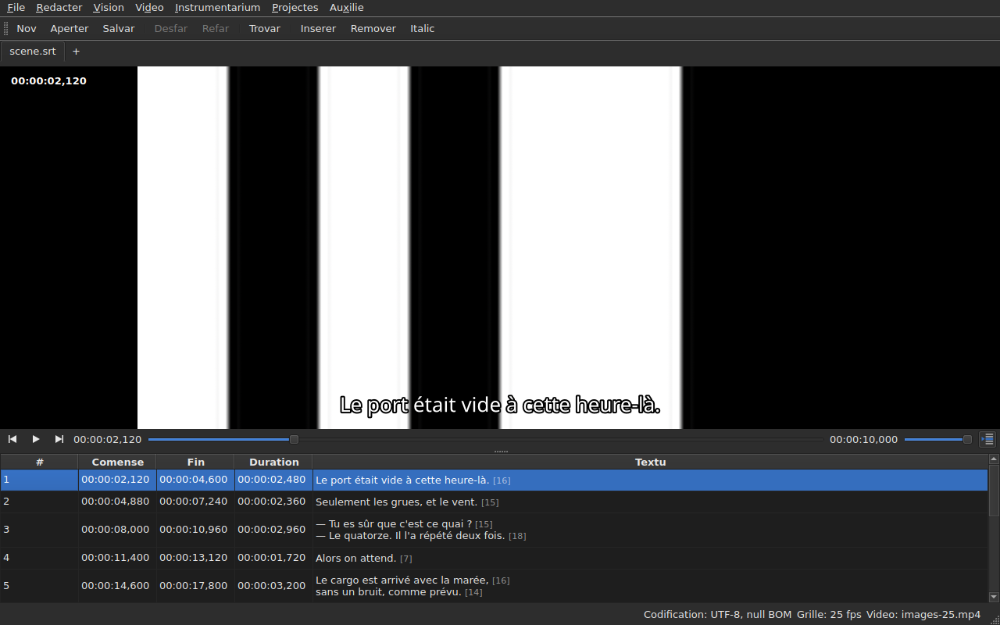

# Li reproductor

<!-- machine-translated -->
> Ca págine es un traduction machinal e it ancor ne ha esset revidet de un lector del lingue.

Li video associat es regardat **in li fenestre**, con li linea actual
tracet sur it. To permete verificar sur li film li resultate
de un displaciament, de un transformation o de un conversion de frequentie de fotogrammas.

Vide [Li video associat](video.md) por qualmen associar un film; ca
págine descri quo evenit un vez que it es associat.

## Li vise del video

| Situation | Quo li fenestre monstra |
| :-------- | :-------------------- |
| un video es associat e aperte | li image prende li suprem, li tabelle sub it |
| null video associat | null image, li tabelle prende li fenestre integral |
| li video ne aperte | null image, un missage, e li fenestre resta usabil |

Li division inter li image e li tabelle **move se con li mus**. Li image ne
descende sub 180 pixeles de altore. Agrandar li fenestre dona li spacie ganiat
al tabelle, ne al image: quo mancha durant li redaction es lineas.

Sub li image, **un barre de reproduction**: u li film es, quant it dura,
reproducter e pausa, e li volúmine. Vide [Li barre de reproduction](#li-barre-de-reproduction).

## Reproducter e halter

| Comande | Via rapid | Quo it fa |
| :------ | :------- | :----------- |
| Video ▸ Reproducter / Pausa | `Ctrl+P` | reproducte si li reproduction es haltat, halta it altrimen |

Li comande es **desactivat tam long quam null video es aperit**. Un video quel
just esset associat es aperit **haltat**: aperter un film ne es
regardar it.

`Ctrl+P` u Gaupol have un simplic `P`: un via rapid de un sol littre a
scale de fenestre es prendet ante que li widget con li foco it vide,
talmen que un `P` esset englutit durant su via vers un redactor de cellule. Nullcos
se imprimi ci, li combination es libere.

## Li barre de reproduction

Sub li image, de sinistre a dextre — li tri butones es **icones**, ti del tema del table de labor quande it les have, ti del stil de Qt altrimen:

| Element | Quo it fa |
| :------ | :----------- |
| li du butones de passu | move li film retro, avan **de un passu de fotogramma** — vide [Fotogramma por fotogramma](timing.md#fotogramma-por-fotogramma) |
| reproducter / pausa | reproducte o halta, quam `Ctrl+P` — li buton monstra **quo it va far**: un triangul quande haltat, du barres quande it reproducte; li tooltip it dice in parol simplic |
| li position | `HH:MM:SS,mmm`, scrit quam li tabelle scri un position — **quam un númere de fotogramma** quande [`Vision ▸ Positiones in images`](table.md#positiones-in-fotogrammas) es marcat |
| li glissor | **lee e move**: on trai li manico, clica in li canal, usa li sagittes |
| li duration | ti quel li video declara, scrit quam li position |
| li volúmine | de 0 a 100, vide [Li volúmine](#li-volúmine) |
| sequentie del tabelle | pressat tam long quam li tabelle seque li reproduction, e it reconduce it al linea in reproduction quande on it pressa — vide [Li tabelle seque li reproduction](#li-tabelle-seque-li-reproduction) |

**Li glissor ne transmisse a chascun pixel.** Trainar li manico demanda dúzenes de
positiones per second, e chascun costa un fotogramma decodat: li prim position va
immediatmen, li sequent atende un vintesim de second, e **li ultim position demandat es
sempre ti atinget** — al max tard quande on lassa li manico. Li image dunc ne
retarda detra li manu, e ne comensa tracer un via quel nequi regarda.

**Li glissor move se per se self durant li reproduction**, e to ne conta quam geste:
solmen quo on fa move li film. Durant que on tene li manico, li reproduction ne it reprende.

## Li code de tempore

**Li position es scrit sur li image**, in li suprem a sinistre, sur un fond translucid quel fa it
leibil sur quelcunque scene. It es tracet per li fenestre, in su fonte, e it demanda
nullcos al reproductor foris li position quel it dona ja; it se actualisa con chascun geste,
sin atender li sequent circul de sequentie.

## Mover se tra li film

In li menu **Video**, **li gestes de Gaupol**, sub su nómines. Omni es **desactivat sin video**, quam li
reproduction; li tri quel actua sur li selection es anc desactivat tam long quam nullcos es selectet.

| Comande | Via rapid | Quo it fa |
| :------ | :------- | :----------- |
| Video ▸ Reproducter li selection | `Ctrl+Shift+P` | reproducte ex **poc ante li comense** del selection **til li fin de su ultim subtitul**, e halta sur li image |
| Video ▸ Ear al precedent | `Ctrl+Left` | pone li reproduction al comense del ultim subtitul **finit** ante li position |
| Video ▸ Ear al sequent | `Ctrl+Right` | pone li reproduction al comense del prim subtitul quel **comensa** pos li position |
| Video ▸ Saltar retro | `Ctrl+Shift+Left` | retroea de un saltada — trenta secundas per predefinit |
| Video ▸ Saltar avan | `Ctrl+Shift+Right` | avansa de un saltada |
| Video ▸ Saltar al inicie del selection | `Ctrl+Up` | pone li reproduction al comense del selection, **li avantage ante it** |
| Video ▸ Saltar al fin del selection | `Ctrl+Down` | pone li reproduction al fin del selection, **li avantage ante it** |

**Li vias rapid es ti de Gaupol**, except un: `Play Selection` es ibi `O`, e un
littre sol es prendet per li fenestre ante que li cellule redactet it vide — tipar un
`o` in un textu comensaret li film. `Ctrl+P` es li response del reproduction, `Ctrl+Shift+P` ti del
selection. Li sagittes del claviere resta con li redactor de cellule quande it es
aperit: `Ctrl+Left` move ibi li cursor de un parol, ne li reproduction.

- **Li saltada** es 30 secundas, e it posse esser fixat de 1 secunda til un hora — vide
  [Li preferenties](preferences.md#li-reproductor). It ne passa ni li comense del film ni su fin.
- **Li avantage** es un secunda: on regarda poc **ante** li subtitul, por vider it venir.
  It posse esser fixat de 0 a 60 secundas, e li reproduction ne descende sub zero.
- **Un vicin quel ne existe** — nullcos ante li prim subtitul, nullcos pos li ultim — ne
  fa nullcos, e ne dice nullcos: li reproduction resta u it es.
- **Chascun geste monstra se immediatmen**: li barre, li code de tempore e li linea tracet es
  actual quande it fini, sin atender li sequent circul.

## Li volúmine

Li volúmine es ti del **reproductor**, de 0 a 100, e ne ti del sistema. It es fixat con li glissor del
barre, o per du gestes, in li submenu `Video ▸ Audio`, per passus de cin:

| Comande | Via rapid | Quo it fa |
| :------ | :------- | :----------- |
| Video ▸ Audio ▸ Diminuer li volúmine | `Ctrl+-` | diminue li volúmine de cin |
| Video ▸ Audio ▸ Augmentar li volúmine | `Ctrl++` o `Ctrl+=` | augmenta it de cin — li secund por claviers u li plus besona li clave de majuscules |

**It es memorat de un session al altri**, e dat a chascun video quel on aperte. Un valore foris de
0 til 100 in li file de parametres ne rupte li apertion: it es ignorat, e li fenestre it dice.
**Li pista audio, in contrari, ne es memorat** — un númere de pista es ti de su file; vide
[Li pista audio](video.md#li-pista-audio).

## Selection e reproduction

Ambi vade in ambi direction.

| Quo on fa | Quo evenit |
| :---------- | :----------- |
| selecter un linea | li reproduction move se **al comense de ti subtitul** |
| extender li selection in bass | nullcos plu: it es li prim linea del selection quel conta |
| li reproduction avansa | li **linea actual** seque li subtitul sur ecran, **tintat**, e li tabelle it **centra** — vide [Li tabelle seque li reproduction](#li-tabelle-seque-li-reproduction) |

Li linea actual e li selection es du cosas distinct. Li reproduction
move li prim e **nequande tange li secund**: li selection es quo
un operation aplica a, e un film reproductent in un angul ne have null
dret a rescrir li linea ciellat del usator linea pos linea.

Li tinte seque ti sam regul: it es un marca, ne un selection. **Un
anomalie it vinci** — un linea quel porta ambi conserva li colore de
su defecte, un defecte esset ibi por esser reparat quande un linea monstrat ne es tal
que por li duration de un replica. Vide [Li tabelle](table.md).

### Li tabelle seque li reproduction

**Li tabelle centra li linea in reproduction** — in li medie de quo it monstra, ne al bord u it basta por
far it visibil. It fa to **quande li linea changea**, ne a chascun tic del sequentie: un replica dura
secundas, e recentrar a chascun decim de second esset defilar sin utilité.

**Un scrollation manual suspende li sequentie.** Li rotelle, li barre de scrollation e un clic in li tabelle
it suspende: li tabelle resta u on it ha metet, durant que li linea actual, li linea tracet e li barre
continua sequer li film. Li buton de sequentie — **li icone de lineas de un tabelle, un marcat con un sagitte**, a dextre del barre de
reproduction; su tooltip dice «Follow playback» — **es pressat tam long quam li tabelle seque** e poy it se leva.

**Li sequentie reprende per un geste del reproductor**: reproduction comensat, un saltada, un passu, un marca fixat, un
insertion a li position, o un movement del barre — li tabelle centra alor immediatmen sur li
linea in reproduction, mem si it esset ja li sam. **O sur demande**: pressar li buton it restaura, e
lassar it it suspende. Il ne have timer: quo reprende li sequentie es sempre un geste.

Passar a un altri tab reprende li sequentie sur li film de ti tab.

**Un redaction in cursu ne es interrupet.** Tam long quam un redactor de cellule
es aperit, li linea actual resta u it es; li linea tracet sur
li image, in contrari, continua sequer, pro que it ne incomoda nequi.

## Li linea tracet

Quo es monstrat sur li image veni del **document aperit**, nequande de un file:
**quo on vide sur li image es quo on just ha tipat**, sin passar per li
disco. Li textu apare centrat, in li fond del image, e desapare inter du
subtitules.

**Con un traduction, li linea es ti del textu ciellat**: li traduction quande
li cellule actual es in li columne `Translation`, li textu principal
in omni altri locs. It es li regul de omni operationes sur textu — vide [Li
textu quel li operationes ciela](table.md#li-textu-quel-li-operationes-ciela) —
e **il ne have parametre**: passar de un columne al altri changea quo
li image monstra, al max un decim de second plu tard. Sin traduction, o
con li columne removet, nullcos changea: it es li textu principal.

Un subtitul queles traduction ne es ancor arrivat monstra **nullcos** tam long
quam li columne actual es li traduction: it ne es li textu principal quel
prende su loc.

**Li etiquettes del formate es comprendet, nequande tracet quam ili es.** Li modelle porta li
textu quam li file it scri, e it es li pivot de etiquettes — ti del conversion de
formate — quel lee it ante donar it al image:

| In li file | Sur li image |
| :---------- | :------------- |
| grassi, italic, suslinear | aplicat: `<i>no</i>` es monstrat quam *no*, sin su etiquettes |
| colore | aplicat |
| fonte, grandore | removet, li textu resta |
| position, alliniament, parlator, omnicos sin equivalente sur ecran | removet, li textu resta |
| `{` e `}` in li textu | tracet: «{laughs}» es monstrat quam «{laughs}» |

Un file Advanced SSA es leet de ti sam manere: su `{\i1}` aplica, e su
`{\an8}` es removet — li linea resta in li fond del image. Chascun textu es leet **in li formate
de su propri file**, li traduction quam li textu principal.

**Li file de subtitules vicin ne es cargat** per li reproductor, mem si it porta li nómine del
film. It esset ti quel es redactet, e li image monstraret alor li statu del disco
durant que li tabelle monstra altri cose.

## Previder un change

Il ne have **nullcos special a far**: on aplica li operation, regarda
li film, e elige `Undo: shifting` — o li operation concernet — si li
resultate ne convene. Vide [Anullar e refar](undo.md).

Null modo de previsa separat existe, e to es deliberat: quo on
regarda es li document quam it es, ne un statu provisori invisibil.

## Quande li image ne apare

Du missages possibil, ambi con li via del file quam prefix:

| Missage | Quo evenit |
| :------ | :------------ |
| `<file>: <reason>` | li reproductor ha refusat li file — formate ínconosset, file mancant, directoria |
| `<file>: no video player is available` | null reproductor posset esser construet |

In ambi casus, **li video resta associat** — on besona vider qual
file it es por eliger un altri — e **li fenestre resta usabil**:
li document es aperit, li operationes functiona, e talmen li salvation.

**Li image es tracet in li fenestre self**: `libmpv` plena un buffer al
grandore del vise, in pixeles real, e li fenestre it pinte. Nullcos de it depende del
platforma grafic — li sam image sub X11, sub Wayland e sin ecran — e it
seque li redimension: li ratio de aspecte del film es conservat, li resta del
vise es nigri.

Li secund missage dunc apare solmen si li biblioteca `libmpv` refusa comensar,
benque it es besonat al compilation.

Li rendition passa per li processor, ma **li decodation posse esser fat sur li carta graphic**: it
it decoda, li image es copiat in li memorie, poy tracet quam ante. Un machine sin
carta usabil decoda sur li processor, sin missage. Sur un film 1080p in H.264, li reproduction sequa
li tempore real con marge. **Un film 4K in HEVC pesant posse ne sequer**: mesurat sur du
nucleos, it decoda a 0,6 vices li tempore real sin li carta, e avansar un fotogramma ibi prende plu secundas
quande li fotogramma clave es lontan. Li carta reduce ti tempore — de un tertie a du tertie secun li film
— sin remover it. **It ne changea li image monstrat**: un passu o un saltada cade sur li
sam fotogramma con e sin. Por desactivar it, desmarcar `Decode on the graphics card` in
[`Preferences…`](preferences.md#li-reproductor).

## Quo ne existe ci

**Fixar un marca, avansar fotogramma por fotogramma e mover un bord de un fotogramma** es in
[Temporisar secun li video](timing.md), ne ci. Quo ne existe, e es inutil a serchar:

- un forme de unda;
- reproduction automatic quande un film es aperit;
- li stil del linea tracet (fonte, colore, position, fond): it conserva ti del fenestre;
- decodation material sin copiage: vide «Quande li image ne apare» supra.

Ca manual descri quo existe: quo va venir, e in qual órdine, es in li
[plan de via](../../../../feuille-de-route.md).
