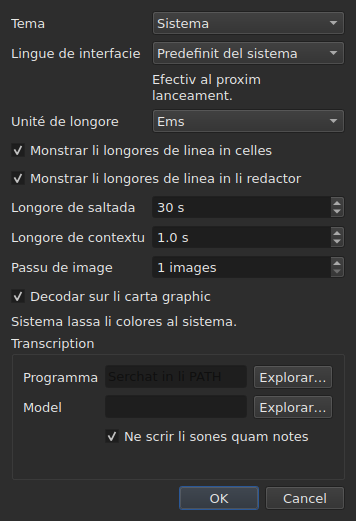

# Li preferenties

<!-- machine-translated -->
> Ca págine es un traduction machinal e it ancor ne ha esset revidet de un lector del lingue.

Li fenestre memora quo on regla per li mus — **u it esset**, **si
it esset maximisat**, **li largore de su columnes**, **li position del
manico** inter li film e li tabelle — e **u on labora**, por que
`Open…` aperte se in li ver loc. Nullcos de to es definit per un casse de dialog:
on move, on trahe, e it es memorat.

**Six preferenties ha un casse de dialog propri**, `Redacter ▸ Preferenties…`, e to es li
criterie: un preferentie quel have ja un gesto ne besona un campe. Li
tema ne have, ni li unité de longes de linea, ni li du casses a marcar quel
les monstra, ni li salt e li avantie del reproductor. Vide [Li tema](#li-tema),
[Longes de linea](#longes-de-linea) e [Li reproductor](#li-reproductor).

**Li lingue del interfacie es in li sam casse, e it es ti quel atende**: it aplica se al
sequent lancement, ne strax. Vide [Li lingue del interfacie](#li-lingue-del-interfacie).

**Li volúmine have null**: li barre sub li image e du gestos lo regla, e it es memorat.

**Un altri es definit u it es usat**: li latere u `Insert Subtitles…` pone su
lineas es un campe de ti casse de dialog, e li ultim election es memorat. Vide
[Inserter, remover, coalescer e separar lineas](lines.md#li-latere-es-memorat).

**Talmen li du optiones de sercha**: `Regular expression` e
`Ignore case` resta marcat o desmarcat de un apertion del casse de dialog al
sequent, e de un session al sequent. Vide
[Trovar e substituer](find-and-replace.md#li-du-optiones).

**Talmen li parametres de `Adjust Durations…`**: li rapidesse de lectura, su du
directiones, e li tri durationes con lor casses a marcar — chascun conserva su valore, marcat
o ne. Vide [`Adjust Durations…`](operations.md#adjust-durations).

**E li ultim codification eliget in `Save As…`**, con su marca de órdine de
bytes. Vide [li file](#li-file).

**E quo li assistent `Correct Texts…` e `Spell-Check Settings…` regla**: li
taches marcat e lor code, li casses a marcar de patrones, li parametres de ruptura de linea, li lingue,
li campe del controle e li suslineation durant li tipation. Vide [Corecter textus…](correct-texts.md) e
[Controlar ortografie…](check-spelling.md#parametres-de-ortografie). **Li campe e li
document de `Correct Texts…` ne es memorat.**

**Quo ne es memorat:** li ultim file aperit — vide
[Li directoria memorat](#li-directoria-memorat).

## Li reproductor

Quar campes. **Seek length** e **Context length** es ti de Gaupol e have su valores; **Frame step** e **Decode on the graphics card** es propri a subedit:

| Campe | Quo it regla | Predefinit | Limites |
| :---- | :----------- | ------: | :----- |
| `Seek length` | li salt de `Seek Backward` e `Seek Forward` | 30 s | de 1 s til un hora |
| `Context length` | li avantie ante li selection, por `Seek Selection Start`, `Seek Selection End` e `Play Selection` | 1 s | de 0 til 60 s, al decim |
| `Frame step` | li passu, **in fotogrammas**, de `Step Backward` e `Step Forward`, e del movement de un bordo | 1 fotogramma | de 1 til 1000 fotogrammas |
| `Decode on the graphics card` | lassa li carte grafic decodar li film quande li machine have un; sin carte, nullcos changea | marcat | marcat o ne |

Ili aplica se **strax**, sin atender un relansament, e es memorat de un session al sequent
sub `video.seek-length` (in secundes), `video.context-length-ms` (in millisecundes) `video.step-frames` (in fotogrammas) e `video.hardware-decoding` (`true` o `false`).
**Un valore foris de limites, o quel ne es un númere**, ne impedi que li fenestre aperte se: it
es ignorat, li predefinit resta, e li fenestre dice it al apertion. **Li passu de fotogramma nequande es in millisecundes**: un passu de N fotogrammas es sempre N fotogrammas, quelcunque li frequentie de fotogrammas del film — vide [Temporisar secun li video](timing.md#fotogramma-por-fotogramma). Li volúmine es memorat in `video.volume`,
de 0 til 100, con li sam tolerantie.

## Li file

```
~/.config/subedit/settings.conf
```

Plu exactmen `$XDG_CONFIG_HOME/subedit/settings.conf` quande ti variabile
es definit. It es scrit **quande li fenestre se clúde**, e leet quande it aperte se.
Un programma interrupet — kill, o halt per un crash — scri nullcos, e li
sequent session trova quo li precedent havet lassat.

Li file es textu, e it posse esser redactet per manu. To es un proprietá e ne
un efecte lateral: it es quo fa un parametre corectibil quande li interfacie
quel lo regla es precisimen ti quel es rupet.

### Du blocs, un partit con li linea de comande

Li file es scrit in **du blocs**, chascun sub un comentarie de bandera:

| Bloc | Claves | Leet per |
| :---- | :--- | :------ |
| `# Operation settings: shared by the window and the command line` | li claves `duration-adjust.*` e `correction.*` | li fenestre **e** `subedit-cli` |
| `# Display preferences: the window's own` | chascun altri clave — geometrie, columnes, tema, lingue del interfacie, sercha, controle de ortografie, redactor, video, ultim directoria, codification de scrition | solmen li fenestre |

**`subedit-cli` lee li bloc de operationes per predefinit**: quo `Adjust Durations…` e
`Correct Texts…` memora hic es anc ti de quo [`subedit-cli adjust`](../subedit-cli/adjust.md)
e un parte de [`subedit-cli correct`](../subedit-cli/correct.md) comensa, except si un option del
linea de comande dice altrimen. **It nequande lee li preferenties de monstration.** Su comande
[`config`](../subedit-cli/config.md) lista li claves de operation, monstra lor valores e
les changea — `subedit-cli config set duration-adjust.speed 12` — e li fenestre vide li change
a su sequent apertion. **Un change fat durante que li fenestre es aperit ne survive a su clusion**: li
fenestre rescri li file integral con quo it tene. `--no-config` fa que un linea de comande ignora li
file. Vide
[Li file de configuration](../subedit-cli/invocation.md#li-file-de-configuration).

Li lector prende li claves in quelcunque órdine, con o sin li banderas: un file scrit ante que li
du blocs existeva es leet sin change, e rescrit in du blocs al sequent clusion.

| Option | Quo it contene | Predefinit |
| :----- | :------------ | :------ |
| `window.geometry` | `x,y,width,height`, in pixeles; largore e altore ne zero | li fenestre dimensiona se self |
| `window.maximised` | `true` o `false` | `false` |
| `table.columns` | quar largores in pixeles, separat per commas — `#`, `Start`, `End`, `Duration`, anc celat | li tabelle dimensiona se self |
| `table.order` | li six columnes, **chascun un vez**, in li órdine quel li tabelle les monstra: `number`, `start`, `end`, `duration`, `text`, `translation` | `number,start,end,duration,text,translation` |
| `table.hidden` | li columnes removet, inter `number`, `start`, `end` e `duration`; vacui, null | null |
| `window.table-share` | li parte de altore donat al tabelle, in procent, de 1 til 99 | li fenestre divide quam sempre |
| `file.directory` | un via **absolut** de directoria | null: `Open…` aperte se u li programma esset lansat |
| `general.theme` | `system`, `light` o `dark` | `system` |
| `interface.language` | `system`, o li nómine de un lingue quam su catalogo es nominat: du o tri líttere minuscul, tande optionalmen `_` e du majusculas — `fr`, `pt_BR`; `en` por anglesi | `system` |
| `edit.insert-placement` | `above` o `below` | `below` |
| `file.write-encoding` | li nómine de un codification quel ICU posse scrir, e de quel li convertor ne scri su propri marca | null |
| `file.write-bom` | `true` o `false` | `false` |
| `search.regex` | `true` o `false` — li modelle es un expression regulari | `false` |
| `search.ignore-case` | `true` o `false` — li casu de líttere es ignorat | `true` |
| `duration-adjust.speed` | li rapidesse de lectura, in characteres per second, strictmen positiv; un númere decimal es scrit li plu curt possibil (`15`, `12.5`) | `15` |
| `duration-adjust.lengthen` | `true` o `false` — allongar quo es tro curt por esser leet | `true` |
| `duration-adjust.shorten` | `true` o `false` — curtar quo resta monstrat plu long quam besonat | `false` |
| `duration-adjust.minimum-enabled` | `true` o `false` — li duration minimal es demandat | `true` |
| `duration-adjust.minimum-ms` | li duration minimal, in millisecundes, integral e ne negativ | `1500` |
| `duration-adjust.maximum-enabled` | `true` o `false` — li duration maximal es demandat | `false` |
| `duration-adjust.maximum-ms` | li duration maximal, in millisecundes, integral e ne negativ | `6000` |
| `duration-adjust.gap-enabled` | `true` o `false` — li interstice al sequent subtitul es demandat | `true` |
| `duration-adjust.gap-ms` | li interstice, in millisecundes, integral e ne negativ | `0` |
| `correction.mentions.enabled`, `correction.common-errors.enabled`, `correction.capitalization.enabled`, `correction.line-break.enabled` | `true` o `false` — li tache es marcat sur li prim págine de `Correct Texts…` | `false`, `true`, `true`, `false` |
| `correction.mentions.code`, `correction.common-errors.code`, `correction.capitalization.code`, `correction.line-break.code` | li code de patrones del tache: `Zyyy`, o `Script[-language[-COUNTRY]]` — `Latn-en-US`; ne vacui | `Zyyy` |
| `correction.human`, `correction.ocr` | `true` o `false` — li classes de errores comun | `true`, `true` |
| `correction.sound-in-brackets`, `correction.sound-in-parentheses` | `true` o `false` — li du casses a marcar del págine `Mentions` | `false`, `false` |
| `correction.line-break.max-length` | li long maximal de un linea, decimal; li casse de dialog limita it de 1 til 1000 | `24` |
| `correction.line-break.max-lines` | li númere maximal de lineas, integral; li casse de dialog limita it de 1 til 100 | `3` |
| `correction.line-break.in-ems` | `true`: li long es mesurat in *ems*; `false`: in characteres | `true` |
| `correction.line-break.skip-on-length`, `correction.line-break.skip-on-lines` | `true` o `false` — li du condicion de omission es demandat | `true`, `true` |
| `correction.line-break.skip-max-length`, `correction.line-break.skip-max-lines` | li du limites de omission, in li unité eliget | `24`, `3` |
| `correction.join-split.enabled` | `true` o `false` — li tache `Join or Split Words` es marcat | `false` |
| `correction.join-split.join`, `correction.join-split.split` | `true` o `false` — unir, separar | `true`, `false` |
| `correction.join-split.language` | un code de locale — `fr`, `en_US`, `sr@Latn` —; vacui: li lingue del sistema | vacui |
| `correction.remove-blank` | `true` o `false` — `Remove all blank subtitles` | `true` |
| `transcription.engine` | li nómine del motor: líttere minuscul, cifres, `.`, `-` e `_` | `whisper.cpp` |
| `transcription.executable`, `transcription.model` | un chemin absolut; vacui: li motor es serchat in `PATH`, e null model es definit | vacui |
| `transcription.language` | du líttere minuscul, un code ISO 639-1; vacui: li lingue es detectet | vacui |
| `transcription.suppress-notes` | `true` o `false` — `Do not write sounds as notes` | `true` |
| `transcription.merge-gap-ms` | fragmentes de un sam frase plu proxim ca to es junit, in millisecondes, integri e ne negativ | `400` |
| `transcription.max-duration-ms` | li max long duration quel un subtitul transcrit resta sur li ecran, in millisecondes, de 1 til 3600000 | `7000` |
| `transcription.max-characters` | li max númere de characteres de un subtitul transcrit, de 1 til 1000 | `84` |
| `correction.activations` | li casses a marcar de patrones quel li usator ha changeat, `<type>:<code>:<name>:<0\|1>`, separat per commas; **un comma o un backslash in un nómine es scrit precedet de un backslash** (`\,` e `\\`), e un entrata ineleibil perde solmen su propri parametre — it es raportat, li altris es conservat | vacui |
| `spell-check.language` | un code de locale, quam `fr_FR`; vacui: li lingue del sistema | vacui |
| `spell-check.target` | `selection`, `current-project` o `all-projects` | `current-project` |
| `spell-check.document` | `main` o `translation` | `main` |
| `spell-check.inline` | `true` o `false` — suslinear paroles incognosset durant li tipation in li redactor de un cellule | `false` |
| `editor.length-unit` | `em` o `characters` — li unité de longes de linea monstrat per li tabelle e li redactor | `em` |
| `editor.show-lengths-cell` | `true` o `false` — chascun linea de un cellule de textu es sequet per su long | `true` |
| `editor.show-lengths-edit` | `true` o `false` — li redactor de un cellule monstra li long de chascun linea in un margine | `true` |

**Li file accepta plu quam li casse de dialog.** Li lector prende quelcunque rapidesse
strictmen positiv e quelcunque duration ne negativ; li casse de dialog `Adjust
Durations…`, por su part, limita li rapidesse de 1 til 99 characteres per second e chascun
duration de 0 til 99 s. Un valore del file foris ti limites es remenat al
limite quande li casse de dialog aperte se, e li file conserva it talmen pos que li
casse de dialog es acceptat e li fenestre clúdet. Un casse de dialog anullat changea nullcos in quo
es memorat.

**`file.write-encoding` memora li ultim codification eliget in `Save As…`, e
nequande se impone a un file.** Un document aperit porta su propri codification,
e it es ti quel li casse propone: rescrir it in un altri pro que un
parametre de tri semanes dice it vell perder quo li lectura ha conservat.
Quo ti parametre memora serve li document sin file — ti just
creat.

**It es un «no» deliberat e ne un omission.** Qui livra sempre in li
sam codification e aperte files heredat in un altri lo elige denov por
chascun file; li casse lo propone, e li garantie de ear e reveni tene
por omnes.

**`file.write-bom` porta li marca del sam codification**, e du
lineas es ver besonat: li nómine de un codification ne dice si it es precedet de su marca, ne plu
quam `--encoding` dice quo `--bom` dice. Ambi es leet junt, in
quelcunque órdine, e un `file.write-bom` sin codification memorat regla nullcos.

**Un parte e ne altores por li manico**, e to es quo fa it
util: tri altores in pixeles significa plu nullcos quande li fenestre
aperte se a un altri grandore, e un fenestre sovente aperte se a un altri grandore.
Li parte se reproduce ubicunque. It es **remenat a quo li fenestre accepta** si
it es tro poc — li bande del film have un altore minimal.

**Quar largores por six columnes**, e to ne es un omission: ili es ti
de `#`, `Start`, `End` e `Duration`, in ti órdine quelcunque li órdine del
tabelle, e **un columne celat conserva su propri** — it retrova it quande it es
monstrat denov. Li ultim columne monstrat prende quo li altris lassa, e donar le
un largore fa nullcos; ti del textu e del traduction dunc ne es
memorat.

## Quo evenit quande li file ne di quo es expectat

Un configuration es un comodité. **Su fallimente costa li comodité e nullcos
altri**: li fenestre aperte se in omni casu.

| Casu | Quo evenit |
| :--- | :----------- |
| li file ne existe | omni li predefinit, e nullcos es dit — it es li prim lancement |
| li file existe e ne posse esser leet | omni li predefinit, e li rason es scrit sur li canal de errores |
| un option es absent | su predefinit |
| un clave es incognosset | ignorat, sin un parole, e absent del file rescrit |
| un valore ne posse esser leet | su predefinit es conservat, e li option es nominat sur li canal de errores |

```console
$ subedit-gui film.srt
subedit-gui: /home/vous/.config/subedit/settings.conf: window.geometry: "plus tard" cannot be read, keeping the default
```

**Li missage va sur li canal de errores e nulubi altri.** Un fenestre
modal al demarrage por un preferentie ineleibil vell halter li usator por
un defecte quel impedi li nullcos, e ante que il ha demandat quelcunque cose.

## Li optiones comentat

Li file rescrit contene **omni** li optiones conosset, e ti lassat a lor
predefinit es scrit quam comentaries:

```
#window.geometry = 0,0,1280,800
#window.maximised = false
#table.columns = 60,110,110,110
#table.order = number,start,end,duration,text,translation
#table.hidden = start,end
```

To ne es un affectation. Sin it, un option nequande tanget resta
fixat al valore del die u it esset scrit, e **un predefinit meliorat
nequande vell atinger alqui**. Con it, changear un predefinit changea li
comportament de omnes qui ne l'ha substituet — quo es exactmen
quo un predefinit deve far.

Por substituer un option: remover li `#` e changear li valore. Por retornar
al predefinit: deleer li linea, o comentar it denov.

Li geometrie, li largores e li columnes removet monstra un **forme** e
ne un valore in vigore: li predefinit del geometrie e ti del largores es
«quo li fenestre elige», quel ne es scrit in númeres, e ti de
`table.hidden` es «null», quel ne posse esser leet. Li capite del file dice it
anc. `table.order`, por su part, monstra li órdine predefinit.

## Li directoria memorat

`Open…` aperte se sur li directoria del **ultim file aperit o salvat**,
e ne sur ti de un casse quel on ha anullat: quo conta es u on
labora, ne u on ha regardat.

**Li ultim file, por su part, ne es memorat.** Memorar it significa
reaperter al lancement un document quel nequi ha demandat. Memorar un directoria
*indica* un casse de dialog; memorar un file vell aperter un.

## Li tema

`Redacter ▸ Preferenties…` aperte se con li tema, un preferentie sin gesto, supra li
[longes de linea](#longes-de-linea).

| Valore | Quo it fa |
| :---- | :----------- |
| `System` | **nullcos** — li colores resta ti del table de labor |
| `Light` | fixa un paletta clar |
| `Dark` | fixa un paletta obscur |

Li tema eliget aplica se **strax**, sin relansar.

**«System» fa nullcos, e to ne es un manc.** Li version de Qt con
quel subedit es compilat have null maniere de demandar al table de labor si it vole esser
clar o obscur, ni de esser notificat quande it changea de opinion. Vice
inventar un lectura quel nos ne save far, li instrument livra li du temas
quel on posse demandar e lassa li toolkit decider por li tertie —
quo Gaupol fa sub li sam condicion.

Sub un table de labor de quel li tema es ja obscur, `System` dunc da un fenestre
obscur; sub un table de labor clar, un fenestre clar. `Light` e `Dark` les
substitue, quelcunque li table de labor.

**Li tintes de anomalie resta leibil in ambi palettas** — vide
[Li tabelle](table.md#li-anomalies). To ne es un supposition: li contraste
del textu sur chascun del tintes es verificat per un test, sur ambi fundes.

## Transcription

Li gruppe **`Transcription`** del dialog contene li du fattes pri li machine quel
[`Transcribe Audio…`](video.md#transcrir-li-audio) besona: **li programma** del motor (whisper.cpp,
`whisper-cli`) e **li model** quel it leer. Chascun have un buton `Browse…`. Si it resta vacui, li programma es serchat
in li `PATH`; li model have null predefinit.

Sub li camps, **li dialog dit quo es ibi**: si li motor es trovat e u, si `ffmpeg`
es trovat, e li model — ne definit, ne trovat, ne un model, solmen por anglesi, o multilingual. Quande alquo
manca, it adjunte li indication a
[Instalar li utensiles de transcription](../subedit-cli/install-transcription.md), quel dit u trovar
chascun. Li du camps es li parametres `transcription.executable` e `transcription.model`.

Un caxa, **“Ne scrir li sones quam notes”**, es li parametre `transcription.suppress-notes` (marcat per defecte): li motor recive li órdine de ne scrir li sones
quam notes quam `(phone ringing)`. Desmarca it por conservar les, por subtitules por li dur de audition. Li dialog de `Transcribe Audio…` ofri li sam caxa por li transcription singul.

## Li lingue del interfacie

`Redacter ▸ Preferenties…` elige li lingue del fenestre, sub li tema.

| Campe | Valores | Predefinit |
| :---- | :----- | :------ |
| `Interface language` | `System default`; `English`; tande chascun lingue installat con li programma, per su propri nómine — `Français` | `System default` |

**It have efecte al sequent lancement**, e li casse de dialog dice it sub li campe: li fenestre es
traductet quande it es construet, e un fenestre in execution conserva li lingue in quel it ha comensat. Li election es
conservat in li file de parametres, sub `interface.language`, e leet quande li fenestre aperte se denov.

| Election | Li fenestre comensa in |
| :----- | :------------------- |
| `System default` | li lingue del ambiente, quam ante omni election — `LANGUAGE`, `LC_ALL`, `LC_MESSAGES`, `LANG`; vide [Lingue](invocation.md#lingue) |
| `English` | anglesi, quo que li ambiente dice |
| un lingue installat | ti lingue, **quo que li ambiente dice**, `LC_ALL=C` includet: un election fat hic es explicit |

Li liste contene li lingues de quel li catalogo es installat sub `<prefix>/share/subedit/locale`;
anglesi es sempre ta, pro que it es li lingue in quel li programma es scrit. Un lingue es monstrat
per su propri nómine, quel null catalogo traduce, por que un lector trova ti quel il lee.

**Un valore quel li programma ne posse honorar costa solmen li election:**

| Quo li file dice | Quo evenit |
| :----------------- | :----------- |
| li nómine de un lingue sin catalogo installat — un file portat de un altri machine | li fenestre seque li ambiente, sin un parole; `Preferences…` monstra ti lingue, per su nómine o su code, e conserva it si un altri ne es eliget |
| alquo quel ne es un nómine de lingue — `French`, `fr_FR.UTF-8` | `system`, li predefinit, e li option es nominat sur li canal de errores, quam quelcunque valore ineleibil |

```console
$ subedit-gui film.srt
subedit-gui: /home/vous/.config/subedit/settings.conf: interface.language: "French" cannot be read, keeping the default
```

**Li linea de comande nequande lee it**: `subedit-cli` elige su lingue ex li ambiente
sol, e `subedit-cli config set interface.language fr` es refusat quam un preferentie de monstration.

## Longes de linea




`Redacter ▸ Preferenties…` regla anc **quo li tabelle e li redactor monstra del
long de lineas** — li regula e li margine de Gaupol.

| Campe | Quo it fa | Predefinit |
| :---- | :----------- | :------ |
| `Length unit` | li unité de longes: `Ems` o `Characters` | `Ems` |
| `Show line lengths in cells` | chascun linea de un cellule de textu es sequet per su long | marcat |
| `Show line lengths in the editor` | li redactor de un cellule monstra li long de chascun linea in un margine a dextre | marcat |

**`Length unit` es grisat quande null casse a marcar es marcat**: sin
long a monstrar, li unité regla nullcos. Li election aplica se **strax** al
tabelle, e li redactores quel aperte se pos lo seque. Li tri valores es
memorat de un session al sequent: `editor.length-unit`, `editor.show-lengths-cell`
e `editor.show-lengths-edit`, in li tabelle [del file](#li-file). Vide
[Li long de lineas](table.md#li-long-de-lineas) e
[in li redactor](editing.md#li-long-de-lineas).

**It ne es li limite del assistent.** Li unité de `Correct Texts…` — li
long a quel it rupte lineas — es un parametre separat, in su
assistent: on posse leer ems in li tabelle e rupter in characteres.

## Quo ne posse esser definit

**Nin parametres memorat es eliget in un casse de dialog** — ne contante ti
del assistent de correction e del controle de ortografie, queles have chascun
su propri —, e chascun in ti u it es usat: li tema e li tri parametres de long de linea, hic; li latere de un insertion, in li casse de insertion;
li du optiones de sercha, in li casse de sercha; li codification e
li marca de órdine de bytes, in `Save As…`; li rapidesse de lectura, li durationes
e li interstice del ajustation de durationes, in su propri casse. Il ne ha
altri: nullcos posse esser regulat por li diagnoses, li volúmine del reproductor,
ni li formate de salvation predefinit — ti veni del file aperit.

E **null númere quel apartene a un document es conservat de un session al
sequent**: un quantité de displaciament, du marcas de transformation es ver por un
file e fals por li sequent. Li casses de dialog les demanda denov a chascun lancement,
deliberatmen. Li parametres de `Adjust Durations…` es un exception del sam maniere quam
li du optiones de sercha: un rapidesse de lectura, un duration minimal o
un interstice es electiones de metode plu quam mesuras de un file, e
persiste de un session al sequent pro to.

Ca manual descri quo existe: quo venira es in li
[plan de via](../../../../feuille-de-route.md).
