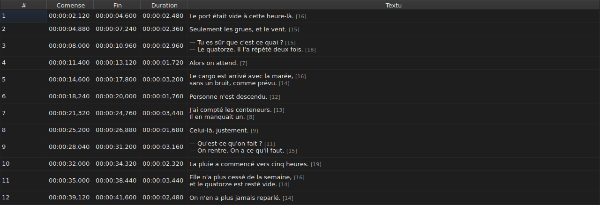
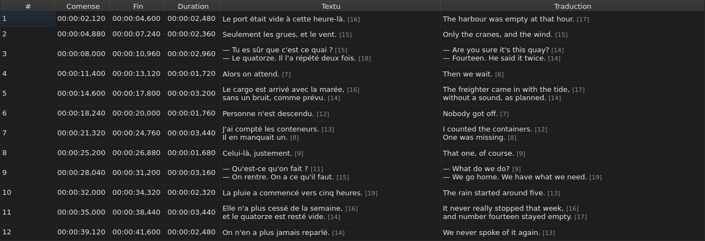
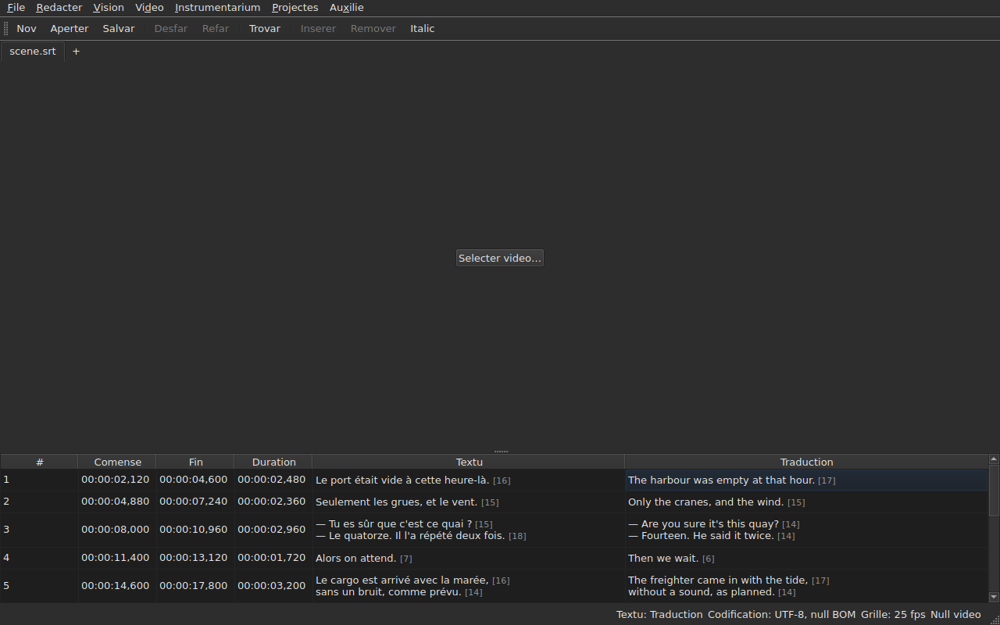

# Li tabelle

<!-- machine-translated -->
> Ca págine es un traduction machinal e it ancor ne ha esset revidet de un lector del lingue.

Li fenestre monstra li subtitules del file aperit, un per linea, in cin
columnes — sex quande li projecte porta un traduction.

**Ca manual cita li titules del fenestre quam li fenestre anglesi les monstra**,
quam it fa por li linea de comande; un fenestre traductet les monstra in
su propri lingue.

| Columne | Quo it monstra |
| :----- | :------------ |
| `#` | li rang del subtitul, ex 1 |
| `Start` | li position u it apare, `HH:MM:SS,mmm` |
| `End` | li position u it desapare |
| `Duration` | `End − Start` |
| `Text` | li textu del subtitul |
| `Translation` | li traduction del subtitul — **absent tam long quam li projecte have null** |




## Li long de lineas


**Chascun linea de un cellule de textu es sequet de su long**, `[N]`, plu poc
grand e plu pallid — in li columne `Text` quam in li columne `Translation`.
To es quo Gaupol fa.

| Quo conta | Quo li tabelle fa |
| :---------- | :------------------ |
| **li etiquettes** | ne conta: `<i>Bonjour</i>` fa `[7]`, quam `Bonjour` |
| **li arrotundation** | in bass: un linea de 12,9 ems es monstrat `[12]` |
| **un linea vacui** | have null long; ni un textu vacui |
| **li unité** | *ems* per predefinit, o characteres — `Redacter ▸ Preferenties…` |
| **un linea tro long por li columne** | es talliat per `…` **ante** li númere, quel resta visibil |

**Li *em* es ti de Gaupol, ne ti del tipografie**: li alfabet minuscul
valet 0,55 em per littre, sub li tipo de littres del tabelle. Un long in *ems* depende
dunc del tipo de littres; un long in characteres conta li punctos de code, un
accent por un.

**Li tabelle ne marca un linea tro long.** It monstra li númere, e it es al
okul a comparar it con li límite quel on self ha fixat — quam Gaupol. It ne es
li límite del assistente `Correct Texts…`, quel have su propri parametre.

**Por ne vider les:** desmarcar `Show line lengths in cells` in
`Redacter ▸ Preferenties…`. Vide [Longes de linea](preferences.md#longes-de-linea).

## Celar e mover columnes

**`Vision ▸ Columnes`** porta un entrata marcabil per columne, **except `Text`**:
sin li textu principal, il ne resta nullcos a redacter.

| Entrata | Columne |
| :---- | :----- |
| `Vision ▸ Columnes ▸ Nró` | `#` |
| `Vision ▸ Columnes ▸ Comense` | `Start` |
| `Vision ▸ Columnes ▸ Fin` | `End` |
| `Vision ▸ Columnes ▸ Duration` | `Duration` |
| `Vision ▸ Columnes ▸ Traduction` | `Translation` — vide [Li columne del traduction](#li-columne-del-traduction) |

Desmarcar un entrata remove su columne, marcar it denov repone it, a su
largore. **Li parametre aplica a omni li fenestre**, tabs incluset:
il have un sol tabelle, quel projecte changea con li tab.

**Li cellule actual quita li columne removet**: it move se in `Text`,
sur li sam linea, e li selection ne move. Un cellule actual in un
columne quel nequi vide esset un cellule quel un tast redacte
sin vider.

**Li columnes es movet per trainar lor capite**, quelcunque, `Text`
incluset. Li ultim columne monstrat prende li spacie quel li altris lassa.

**Li órdine e li columnes removet es memorat de un session al altri**, con
li largores, in li [file de preferenties](preferences.md) — `table.order`
e `table.hidden`. Li columne del traduction ne es ibi: it seque su propri
regul, e reveni con chascun traduction aperit.

**Li númere ne es data del file** ma li rang del linea. Un
inserter o un remover dunc renumera omni quo seque, sin que nullcos
es rescrit.

**Li separator decimal seque li formate del file**: un comma por SubRip,
un punctu por li oct altri. SubRip es li sol del nov a scrir un comma.

**It es li separator quel seque, ne li ortografie integral.** Li tabelle scri sempre
li hores e sempre tri decimales; un file WebVTT omisse li
hores sub un hora, SubViewer 2 e li du Sub Station Alpha conta in
centesimas, MPL2 in decimas, TMPlayer in secundas, MicroDVD in fotogrammas. Un
columne queles largore sequet li formate esset plu fatigant a leer que un
columne quel simplicmen ne es li ortografie exact del file.

Quo li tabelle garanti es dunc **li valore e li separator**, ne li númere
de decimales. Quo un formate de destination arrotundaret es dit al moment del
salvation — vide
[Quo un formate ne va conservar, dit ante scrir](files.md#quo-un-formate-ne-va-conservar-dit-ante-scrir).

**Li duration (`Duration`) es calculat**, nequande conservat: tipar it move li
fin. Un subtitul queles fin precede su
comense monstra un duration negativ plu tost que zero: it es un anomalie del
file, e celar it fa it impossibil a trovar.

**Li comense, li fin, li duration, li textu e li traduction es redactet sur loc**; li
númere ne. Vide [Redacter un cellule](editing.md).

**Li selection designa sur quo un operation actua** — vide
[Li operationes](operations.md).

**Li altore de un linea seque li subtitul quel it porta**: un subtitul de
du lineas prende du, un de tri prende tri. Li textu es monstrat
integralmen, quam it va esser scrit.

**Quo resta talliat es un linea tro long por su columne**, e it fini
alor per un punctus suspensiv. Largar li columne `Text`, o li fenestre, it monstra
integralmen; talmen aperter li cellule. Li lineas del textu es nequande
rupet: solmen un ver ruptura de linea fa un linea, talmen que li altore
de un rangea del tabelle ne changea quande on trai li bord de un columne.

## Positiones in fotogrammas

**`Vision ▸ Positiones in images`** — un entrata marcabil, un sol parametre por li fenestre — monstra li
columnes `Start` e `End` **quam númeres de fotogramma** in loc de marcas de tempore, e **accepta un númere de fotogramma quam input**. Li
capites it dice: `Start (frames)` e `End (frames)`.

| Quo changea | Quo ne changea |
| :----------- | :------------------- |
| quo `Start` e `End` scri, e quo ili accepta | li columne `Duration`, quel resta un tempore |
| li capites de ti du columnes | li document: nullcos es modificat, li historie have null nov entrata, e **quo li file scri es quo it scrit** |

**Li frequentie de fotogrammas quel conta li fotogrammas** es, in ti órdine:

1. **ti del file**, quande it es contat in fotogrammas — MicroDVD, quel porta númeres e null
   frequentie de fotogrammas: **li fenestre monstra alor li cifres de su file**, quelcunque li video;
2. **li frequentie quel li video associat declara**;
3. **li grille quel li positiones designa**, quande ili designa un.

Li tooltip del entrata dice qual esset retenet: *Positions are frame numbers, counted at 25 fps, the rate the
video declares*. **Con null del tri, li entrata es desactivat, e su tooltip dice pro quo**: li file ne
es contat in fotogrammas, li video declara null frequentie de fotogrammas, e li positiones cade sur null grille.

- **Un númere es li númere del fotogramma in quel li position cade**, arrotundat al plu proxim fotogramma. **Tipat, it
  dona li instant u ti fotogramma comensa**, arrotundat **solmen un vez** del ratio exact
  ([ADR 0013](../../../../adr/0013-mise-a-l-echelle-exacte-des-positions.md)): li fotogramma 37 a 23,976 fotogrammas per second
  comensa a 1543,04 ms, to es `00:00:01,543`.
- **Solmen númeres integral es acceptat** — con li signe minus, pro que un comense posse preceder li film. Un
  marca de tempore tipat in modo fotogramma, o un númere quel ne es un, lassa li cellule quam it esset.
- **Li barre de reproduction seque li sam parametre**: li position e li duration de ambi lateres del glissor
  es scrit quam númeres de fotogramma quam `Start` e `End`, al sam instant — vide
  [Li barre de reproduction](player.md#li-barre-de-reproduction). Li horloge tracet al cap del image resta un
  marca de tempore.
- **Ti parametre ne es memorat** de un session al altri: it es un parametre del fenestre, ne de un
  document, e it es revenit in un sol geste.

## Li anomalies

Un subtitul queles positiones ne tene junt es **tintat sur su
columnes de tempore**, e survolar it dice quo es mal.

| Tinte | Quo it reporta | Quo far |
| :--- | :-------------- | :--------- |
| rubi | `ends before it starts` | corecter su fin, o su comense |
| blu | `starts before the previous one starts` | metter it denov a su loc in li órdine |
| ambre | `starts before the previous one ends` | ajustar su temporisation |


Solmen li columnes `Start`, `End` e `Duration` es tintat: un anomalie
parla solmen de tempore, e tintar li textu suggereret que it have ligament
con it.

**Un subtitul posse portar plu**, e li tooltip les nomina omni. Li
tinte es ti del prim a reparar: un subtitul rupet in se self
es rupet quelcunque su vicines fa; un subtitul mal plazzat es repost a su loc,
e su superposition desapare con it.

> It ne es hasard que li desórdine quasi sempre precede li
> superposition: comensar ante que li precedent comensa es comensar
> ante que it fini — except si li precedent es self rupet.

**Li marcation es recalculat pos chascun change de position**, que it veni
de un cellule redactet, de un operation o de un anullation. It dice quo li
file es nunc, ne quo it esset al apertion.

It ne se basa sur null grille de fotogrammas: tam rapid quam un position es corectet a
manu, it lassa li grille, e un marcation basat sur it reportaret li labor del
usator.

## Li columne del traduction

Un subtitul porta **du textus e un sol par de positiones**: li
traduction have null temporisation propri, it es atachat a ti del subtitul.
Li tabelle it monstra in un sexesim columne, `Translation`, a dextre de `Text`.




**Li columne es ibi solmen si li projecte have un traduction.** Sin un, li tabelle
conserva su cin columnes, e li fenestre se comporta quam si li traduction
ne existet — nullcos es grisat o adjuntet. `File ▸ Aperter un traduction…` aperte
un: vide [Aperter un traduction](files.md#aperter-un-traduction).

**Un entrata del menu `View` it monstra o it remove**:

| Entrata | Quo it fa |
| :---- | :----------- |
| `Vision ▸ Columnes ▸ Traduction` | marcat: li columne es monstrat; desmarcat: it es removet |

Li entrata es **desactivat quande li projecte have null traduction** — il ne have nullcos a
monstrar — e marcat al comensa. **Li decision de remover it es ti del
usator**: it tene de un file al altri, til que it es marcat denov.
Remover li columne ne remove li traduction: it resta in li
projecte, e reveni con li entrata. Aperter un file quel porta null remove li
columne.

**Li cellules del traduction es tipat in quam ti del textu** — vide
[Redacter un cellule](editing.md).

### Li textu quel li operationes ciela

Con du textus in un linea, li operationes sur textu deve saver qual
ili rescri. **It es ti del columne del cellule actual**: li
traduction si li cellule actual es in li columne `Translation`, li textu
principal in omni altri locs — in un columne de tempore quam in `Text`.

| Operation | Quo it ciela |
| :-------- | :-------------- |
| `Italic`, `Case`, `Dialogue`, `Remove Hearing-Impaired Mentions…` | li textu del columne actual |
| `Cut Texts`, `Copy Texts`, `Paste Texts` | li textu del columne actual |
| `Find and Replace…` | li textu del columne actual — vide [Trovar e substituer](find-and-replace.md#in-qual-textu) |
| li operationes de position, inserter, remover, coalescer, separar | **ambi textus**: un subtitul es un tot |

**Li barre de statu it dice quande il have du textus**, a sinistre del altri
indications:

```text
Text: Translation
```

o `Text: Main` por li textu principal. It resta silentiosi quande li columne ne es
monstrat: il have alor solmen un textu, e il ne have raison por dir it.




**Li linea tracet sur li image seque li sam regul**: it es li textu del
columne actual. Vide [Li reproductor](player.md#li-linea-tracet).

**Nullcos es grisat.** Li operationes sur textu resta disponibil quelcunque
li columne actual, e sin columne de traduction ili ciela li textu
principal, quam ante.

## Adjunter e remover lineas

`Redacter ▸ Inserer subtitules…` e `Redacter ▸ Remover subtitules` adjunte e remove
lineas, `Redacter ▸ Coalescer li subtitules` e `Redacter ▸ Separar li subtitul` les coalesce e
les separa; li tabelle se renumera. Vide
[Inserter, remover, coalescer e separar lineas](lines.md).

## Quo li tabelle ne fa

**Ordinar per columne ne existe.** Li órdine monstrat es ti del file, e
it es li sol quel have sens por subtitules: li rang de un linea *es*
su loc in li tempore.
