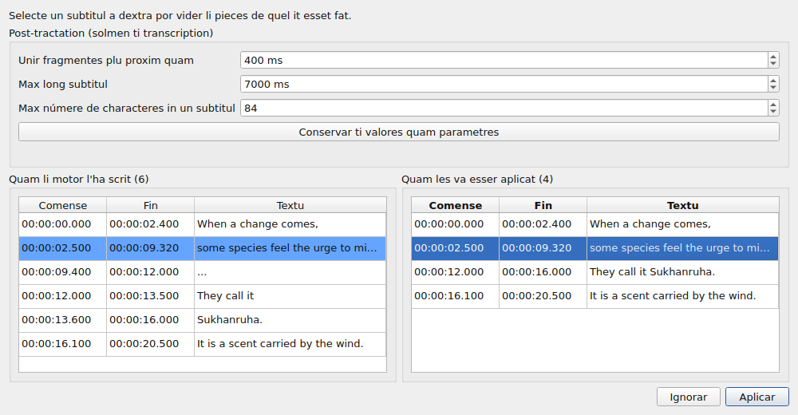
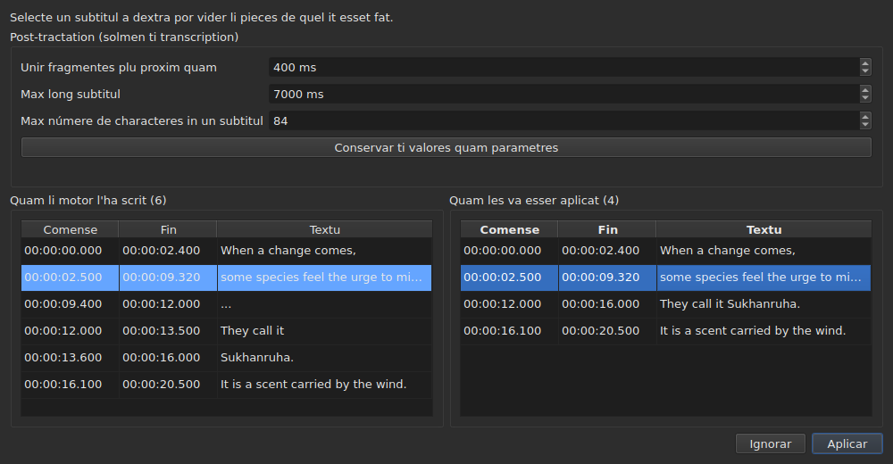

# Li video associat

<!-- machine-translated -->
> Ca págine es un traduction machinal e it ancor ne ha esset revidet de un lector del lingue.

Li menu **Video** porta prim tri comandes, e li gestes quel condui li film
— vide [Li reproductor](player.md#mover-se-tra-li-film).

| Comande | Via rapid | Quo it fa |
| :------ | :------- | :----------- |
| Selecter video… | null | elige li file de video con quel li document vade |
| Transcrir audio… | null | transcrive li audio del film in subtitules quel remplazza ti del projecte — vide [Transcrir li audio](#transcrir-li-audio) |
| Reproducter / Pausa | `Ctrl+P` | reproducte o halta li video — vide [Li reproductor](player.md#reproducter-e-halter) |

Li video associat es **un proprietá del document aperit**, ne un parametre de
l'aplication: aperter un altri file de subtitules comensa ex zero. It
ne es scrit in null file e desapare con li fenestre.

## Li pista audio

Un film posse porta plu pistas de son — li version original, un doblage, un commentario. Li
submenu **`Video ▸ Audio ▸ Lingue`** les lista, **un entrata per pista**, e **marca ti quel es in reproduction**:

| Quo li file dona | Quo li entrata dice |
| :------------------ | :------------------ |
| un lingue e un titul | `1: fra — Original` |
| un lingue sol | `2: eng` |
| un titul sol | `3: Commentary` |
| null de ambi | `1` |

Li númere es **li loc del pista in li film**, un per un, in li órdine del file: du pistas
posse dir `eng`, e un file silent pri su etiquettes have tamen un prim e un secund.

**Eliger un entrata reproducte ta pista.** Li marca es li response del reproductor, ne li clic: it dice li
pista quel es in reproduction.

- **Li submenu es desactivat** sin video o sin pista audio. Con un sol pista, it resta activ e
  monstra it, marcat: it dice li lingue del film. Li du gestes de volúmine, queles es apu, resta
  activ in cada cas: vide [Li volúmine](player.md#li-volúmine).
- **Li pista ne es memorat** de un video al altri, ni de un session al altri: un númere de pista es
  ti de su file, e portar it al film sequent vell eliger ti quel have ta númere ta.
  Retornar a un lingueta reaperte su film sur li pista quel li reproductor elige per se.
- Null via rapid: on changea lingue rarmen, e li menu basta.

## Selecter un video

Li dialog aperte sur li directoria del file de subtitules e filtra sur
li extensiones de video recognosset:

    .avi .flv .m2ts .mkv .mov .mp4 .ogg .ogv .vob .webm

It propone anc monstrar omni files. Anullar li dialog changea
nullcos.

Li file elet es **aperit strax**: li image apare in li fenestre,
in pausa sur su prim instante. Vide [Li reproductor](player.md).

**Lassar cader un file de video sur li fenestre fa li sam** — vide
[Lassar cader files sur li fenestre](files.md#lassar-cader-files-sur-li-fenestre).

**Li video es ti del projecte del lingueta actual.** Chascun lingueta conserva
li su; changear lingueta changea li film. **Retornar a un lingueta reprende su
film u on on lassat it**, in pausa, quam cada apertion. Un altri film
elet pro ti projecte intertande comensa, ci, ex li comense.

## Li proposition automatic

Quande un file de subtitules es aperit, **si null video ha esset elet**,
li fenestre sercha un in li sam directoria: un file de video queles nómine
sin extension es un prefix del nostre, til un punctu.

| File de subtitules | Video trovat | Pro quo |
| :------------ | :---------- | :-- |
| `film.fr.srt` | `film.mkv` | `film` es un prefix de `film.fr` |
| `film.en.forced.srt` | `film.mkv` | egalmen, quant que sia li númere de segmentes |
| `film.fr.srt` | `film.fr.mkv` plu tosc quam `film.mkv` | li nómine li max long gania |
| `film.fr.srt` | null, si `film.mkv` **e** `film.mp4` es ta | du candidatos ne posse esser distinget |
| `film.fr.srt` | null, si solmen `fil.mkv` es ta | `fil` ne halta sur un punctu |

**Un proposition ne es un election.** Un proposition lassa se remplazzar per un altri
proposition — aperter un altri file, salvar sub un altri nómine. Un election
explicit, in contrari, nequande es superscrit: pos haver usat `Select Video…`, li
proposition automatic ne retorna plu detra it.

To es quo fa li conjectura acceptabil: it posse esser corecte, e su
correction tene.

## Quo li barre de statu monstra

A dextre del barre de statu, un linea dice con quo li document vade. It
es li ultim de tri: li [codification](files.md#li-codification-in-li-barre-de-statu)
del file leet vene prim, li [grille de fotogrammas](frame-grid.md) deducet del
positiones seque.

| Situation | Quo es scrit |
| :-------- | :-------------- |
| un video es associat | `Video: film.mkv` |
| … e `ffprobe` dona su frequentie de fotogrammas | `Video: film.mkv, 24000/1001 fps` |
| null | `No video` |

**Li frequentie de fotogrammas vade con li film plu tosc quam apu it.** Les es un sol fact — con quo
ca document vade — e un tertie mention vell metter it sur li sam rang quam
li [grille deducet del positiones](frame-grid.md), quel es un altri.

## Transcrir li audio

**`Transcribe Audio…`** scri li parol del film quam subtitules. It es desactivat til que un film es aperit: it es
li audio del **film del projecte**, e jamais un file quel vu electe — por transcrir un
file audio, usa [`transcribe`](../subedit-cli/transcribe.md) in li linea de comande.

Li dialog demanda quar cosas, e dit si it posse comensar:

- **li pista audio**, listat quam li menu [`Audio`](#li-pista-audio) les lista, con li lingue
  e li titul quel li file declara;
- **li lingue**, selectet in un **liste**: unesim un intrada quel detecte it, “Detecter del prim 30 secondes de son”, pois li lingues quel
  li motor ofri por li model, per nómine in li lingue del fenestre e sequet de lor code — “Francesi (fr)”. Li liste es ti del
  motor self: circa cent con un model multilingual; con un model solmen por anglesi it have li singul intrada, anglesi, e ne posse esser
  changeat, e un linea dit que li film va ixir in anglesi quelcunc lingue it parla. Li liste comensa con li lingue del pista
  selectet quande li file declara it e li motor ofri it, seque li pista tam long quam vu ne ha selectet un, e
  **un linea sub it dit de u it veni**. Quande li file declara null lingue por li pista, li linea dit it, e avisa:
  li model detectará it tande del prim triant secondes de son, e **un film quel comensa con musica o silentie posse esser prenet por un altri lingue e su parlada tande tradutet in it**.
  Selecte li lingue si vu save it;
- **li sones scrit quam notes**: un caxa, “Ne scrir li sones quam notes”, marcat per defecte. Li motor recive tande li órdine de ne scrir li sones quam
  notes, quam `(phone ringing)` o `[MUSIC PLAYING]`; u it have null parol a scrir it scri `...`, e li fragmentes quel have null líttere e null cifre
  es lassat cader per li post-tractation. Desmarca li caxa por conservar li notes, por subtitules por li dur de audition. Li caxa es gris, con li motive,
  por un motor a quel on ne posse dir it. It es li parametre `transcription.suppress-notes`, quel li [preferenties](preferences.md#transcription)
  contene anc;
- **li parte del film**, de un témpor til un altri — vide [Provar un parte ante](#provar-un-parte-ante). Con ambi campes
  vacui, it es li tot film.

**It dit anc quo manca.** Tri lineas dit si li motor, `ffmpeg` e li model es ibi, e
u; quande un ne es ibi, `OK` resta extint, e li dialog dit it con li indication a
[Instalar li utensiles de transcription](../subedit-cli/install-transcription.md). Un buton `Preferences…` aperi
li [preferenties](preferences.md#transcription), u li programma e li model es definit — ples es fattes
pri li machine, ne selectiones a refar a chascun transcription — e li dialog regarda denov quande les es cludet.

Li lingue es conservat por li sequent vice. Li motor self e li límites del subtitules es
[parametres](preferences.md) (`transcription.*`).

**Quande li projecte ja contene subtitules, li fenestre demanda ante remplazzar les**, e dit
quant va partir. It demanda ante li labor, por que refusar costa nequo. Quande li projecte es vacui, il ne ha
nequo a demandar.

Li labor funde **in li fon**, con un cadre e un buton `Cancel`; li fenestre resta usabil circum it. **Li cadre
dit u li labor es**, por que vu save que it vive e quant de témpor it va prender:

- **li pass**: unesim “Extraction del audio…” — li cadre es tande occupat, sin númere, nam extraer dit nequo pri quant es fat —,
  pois “Transcription del audio…”, con un barre;
- **li témpor restant**, “resta circa 38 min”: absent in li comense, monstrat quande li motor ha raportat suficent progress por extrapolar, e calculat secun su rapiditá desde li comense til li ultim minute; it es un precision de qualque minutes, ne un promission;
- **li témpor passat**, “passat: 0:05:12”, quel avansa mem quande nequo altri ne move;
- **li position**, “0:12:30 de 0:50:00”: til u in li film li motor ha arrivat, tam rapid quam it ha producet su prim textu, monstrat **just super li ultim textu** al quel it corresponde;
- **li ultim textu** obtenet, por que vu vide que li labor ha sens.

Sur un long film con un grand model sur un processor, li prim minutes posse esser longi: li motor carga e labora sur su prim
fenestres de trenta secondes. Li position e li ultim textu move ante li procent propri del motor, quel veni solmen per passus
de 5 % del film.

### Li previsu

**Nequo remplazza li subtitules del projecte ante que vu ha videt les.** Quande li labor fini — e anc quande vu anulla it, o it fallis
pos haver producet alquo — un fenestre monstra li resultate in du tabelles unmem al altri, chascun con **su propri comense e fine**:

- **a sinistra, “Quam li motor l'ha scrit”**: omnicos quo li motor ha retornat, quam it l'ha talliat, sin null post-tractation — quo
  [`--raw`](../subedit-cli/transcribe.md) scriet —, con li locotenentes (`...`) includet;
- **a dextra, “Quam les va esser aplicat”**: li subtitules pos li post-tractation, exactmen quo va intrar in li projecte. It es fat in tri etapes, chascun sur li tot transcription ante que li sequent comensa: li fragmentes sin litere ni cifre (`...`) es lassat cader; li proxim fragmentes de un sam frase es junt; ti quel es tro long es talliat — **unmen a un fine de frase (`. ? ! …`), poy a un comma, un punctocomma o un duplic puncte, e in li medie de un frase solmen si ples ne es punctuation u talliar**. Un talliada quel lassarea un subtitul tro small por esser leet (alqui characteres, un fraction de un seconde) es evitat quande un altri existe. Un subtitul quel comensa un fragment conserva su comension, e ti quel fini it conserva su fine: li tempores del paroles serve solmen por li talliadas in un fragment.

Sur li tabelles, **“Post-tractation (solmen ti transcription)”** contene li tri límites del post-tractation: “Unir fragmentes plu proxim quam”, “Max long subtitul” e “Max númere de characteres in un subtitul” — li parametres `transcription.merge-gap-ms`, `transcription.max-duration-ms` e `transcription.max-characters`. **Changear un refa li tabelle a dextra strax**, sin li motor, e li subtitul selectet resta selectet. Li valores quel vu intra vale solmen por **ti transcription**: che vu aplica it o ignora it, li parametres del aplication resta quam ili esset. **“Conservar ti valores quam parametres”** dona li tri valores al parametres del aplication — ti del [preferenties](preferences.md#transcription), conservat con les —, e li fenestre dí it; clúder li fenestre ne fa it per se.

Li du ne se alinea ne linea per linea, e it es pro to que chascun have su propri tempores. **Selecter un subtitul a dextra mette in evidentie, a sinistra, li pieces de quel it
esset fat**, e fa scrollar li latere sinistre til les; un subtitul a un vice, e solmen in ti direction. Null del tabelles posse esser modificat: quo null parametre arrange it corecte, it es modificat pos, in li tabelle del projecte, quam omni subtitul.

Du butones clude it. **“Aplicar”** remplazza li subtitules del projecte **in un singul operation**: un `Undo` redona quo esset ibi, textus
de traduction includet. **“Ignorar”** lassa cader li resultate, e it es perdit. “Aplicar” es extinct quande
il ne ha nequo a aplicar.

**Quande li execution esset halt**, li fenestre dit it — “Resultate partial: li labor ha halt a …” — e ofri quo esset obtenet til ibi, por aplicar
o por ignorar, por que un long execution halt tard ne perde su labor sin demandar. Ti fragmentes have null parol con tempore (li motor scri les al fine), e li
post-tractation talli al límites propri del fragmentes. Un fallida es unesim dit in un cadre, quam omni fallida; un anullation ne dit tal cose.

### Provar un parte ante

Un interval permisse **jugar un model o un lingue sur du minutes ante engagear se por du hores**. Li campes “Parte del film” prende un comense e un fine, chascun scrit `HH:MM:SS` e scrit super, cifre por cifre, quam in [li dialog de decalage](operations.md#shift-positions) (un tempore collat quam `2:00` es mettet in forme); solmen un es permisset (de ibi til li fine, o del comense til ibi). `OK` resta extinct til un camp
ne es un témpor o li fine ne es pos li comense, e un linea sub li campes dit quel.

- **Li subtitules conserva li témpor del film**: quo es dit a 2:10 es a `0:02:10` in li resultate.
- **It passa per li previsu quam omni transcription**, e remplazza li subtitules del projecte unquam aplicat; un `Undo` redona les.
  Por provar un interval sin tangeer vor labor, ignora li previsu, o gardar unesim.

**Quo it besona ne es livrat con li programma**: un motor (whisper.cpp), un model, e `ffmpeg` por extraer li audio.
Vide [Instalar li utensiles de transcription](../subedit-cli/install-transcription.md).

## Quande il ne ha film

Li fenestre monstra un buton **`Select Video…`** u li image esset, vice
nullcos del tot. It es li sam comande quam ti del menu `Video`, a portata
del mus: un absentie sur quel on ne posse actuar es mal distinget de un
defecte.

Li buton desapare tam rapid quam un film es aperit, e li image prende **tot** su
loc: li altore quel li tabelle lassa supra it — ti quel
[`window.table-share`](preferences.md) memorat de un session al altri —, e
nequande minus quam li altore minimal del image, quel li tabelle cede si necessi.
Quande li film vada, li buton reprende li sam loc.

**Li nómine del file, nequande su path.** Un path de du cent characteres
vell pussar omni altri cosess foris del barre; li path complet es ti quel li
dialog monstrat.

## `ffmpeg` ne es obligatori

`subedit-gui` interroga `ffprobe` — livrat con `ffmpeg` — por un sol cose:
**li frequentie de fotogrammas quel li contenitor declara**. It es leet un vez
per film, quande it es associat.

| Con `ffprobe` | Sin |
| :------------- | :------ |
| li barre de statu scri li frequentie de fotogrammas apu li nómine del film | it scri solmen li nómine |
| li dialog de conversion propone li frequentie de fotogrammas del film in li campe del fundo | it propone nullcos, e aperte quam ante |
| li dialog de alliniation aperte sur it | it aperte sur li frequentie de fotogrammas del projecte |

**Nullcos altri depende de it, e null operation refusa.** Li reproductor
ne besona `ffprobe` del tot: it se basa sur `libmpv`, quel es un
dependentie de compilation. Li duration del film, ti usat por reportar quo
passa ultra li fin, vene del reproductor e ne de `ffprobe`.

**Li transcription es li sol cosa quel besona vermen `ffmpeg`**: it extrae li audio del film. Vide
[Instalar li utensiles de transcription](../subedit-cli/install-transcription.md).

It es dunc ne un modo degradat ma **li functionament normal** de un machina
quel nequande ha installat `ffmpeg`: li data vene del usator, e `ffprobe`
propone it quande it es ta.

Un frequentie de fotogrammas leet es un **rational exact** — `24000/1001`, ne `23.976`.
To es li rason pro quo `ffprobe` es conservat por ta response: li
reproductor conosce li sam cose quam un númere in virgul flottant, e un frequentie de fotogrammas
aproximativ vell retemporisar li tot file un poc mal.
