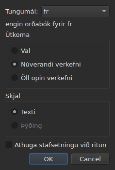
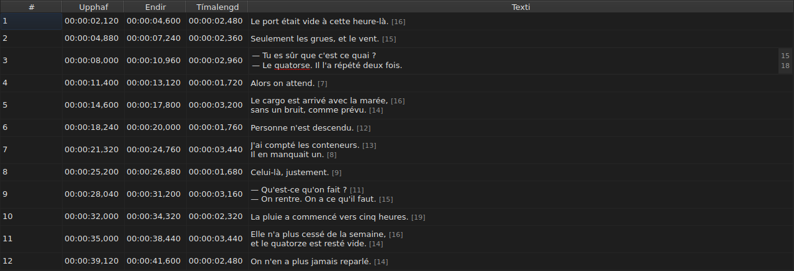
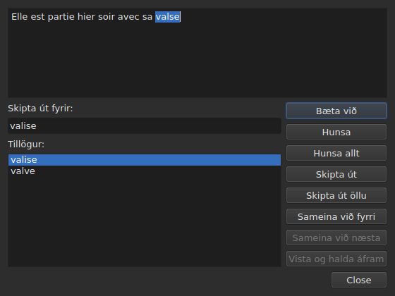

# Athuga stafsetningu…

<!-- machine-translated -->
> Þessi síða er vélþýðing sem enginn lesandi tungumálsins hefur enn farið yfir.

`Verkfæri ▸ Athuga stafsetningu…` fer í gegnum orðin sem orðabókin þekkir ekki,
eitt í einu, að fyrirmynd stafsetningarathugunar Gaupol. Henni fylgir förunautur,
`Verkfæri ▸ Stillingar stafsetningarprófunar…`, sem stillir tungumálið, markmiðið og skjalið, og undirstrikunina við innslátt.
Báðar styðjast við orðabækur kerfisins, í gegnum Enchant.

Merkimiði fyrri skipunarinnar er ritaður `Chec&k Spelling…` í enska glugganum: `C` er þegar
flýtistafur `Correct Texts…`, og `k` er laus í valmyndinni `Tools`.
Hvorug skipananna hefur flýtilykil.

**Báðar eru óvirkar á skjali án skjátexta**, eins og
[`Correct Texts…`](correct-texts.md): það er ekkert til að athuga. `Check Spelling…`
er einnig óvirk án orðabókar fyrir tungumálið sem er stillt, sjá
[Án orðabókar](#án-orðabókar).

## Stillingar stafsetningarathugunar…




| Hópur | Valkostir | Sjálfgefið |
| :---- | :------ | :------ |
| `Language` | tungumálskóðarnir sem kerfið býður, og sá sem þegar er valinn | tungumál kerfisins, ef það er meðal þeirra |
| `Target` | `Selection`, `Current Project`, `All Open Projects` | `Current Project` |
| `Document` | `Text`, `Translation` | `Text` |
| `Check spelling while editing` | gátreitur, sjá [Undirstrikun við innslátt](#undirstrikun-við-innslátt) | ekki hakað |

`Selection` er óvirkt þegar engin lína er valin í flipanum sem sýndur er; `Translation`
er óvirkt svo lengi sem ekkert opið verkefni ber þýðingu. Munuð
stilling sem er ekki lengur tiltæk — tómt val, þýðing sem vantar —
opnast á `Current Project` eða `Text`. `OK` heldur stillingunum, `Cancel` breytir
engu.

**Þessi gluggi er ekki háður orðabókinni**: hann helst virkur svo lengi sem
skjalið hefur skjátexta, jafnvel án orðabókar fyrir tungumálið sem er stillt, og hann er
sá sem gerir þér kleift að yfirgefa tungumál sem hefur enga. Tungumálið sem engin
orðabók er til fyrir helst breytanlegt og birtist í listanum, með, undir
því, setningunni `no dictionary for` og síðan kóða þess.

**Stillingarnar fjórar eru munaðar** frá einni setu til annarrar, í
stillingaskrá `subedit` — sjá [Kjörstillingarnar](preferences.md) um staðsetningu
hennar:

| Lykill | Gildi | Sjálfgefið |
| :-- | :----- | :------ |
| `spell-check.language` | tungumálskóði, eins og `fr_FR`; tómt: tungumál kerfisins | tómt |
| `spell-check.target` | `selection`, `current-project`, `all-projects` | `current-project` |
| `spell-check.document` | `main`, `translation` | `main` |
| `spell-check.inline` | `true` eða `false` — undirstrika óþekkt orð í ritli reits | `false` |

Gildi sem lykillinn tekur ekki við er hunsað, sjálfgefna gildið gildir, og valkosturinn
er nefndur á villustraumnum þegar glugginn opnast — sjá
[Hvað gerist þegar skráin segir ekki það sem búist er við](preferences.md#hvað-gerist-þegar-skráin-segir-ekki-það-sem-búist-er-við).

## Undirstrikun við innslátt




Gátreiturinn `Check spelling while editing` í `Spell-Check Settings…` undirstrikar,
**með rauðri bylgjulínu og meðan þú skrifar**, hvert óþekkt orð í ritli
textareits — bæði þeim í dálkinum `Text` og þeim í dálkinum
`Translation`. Undirstrikunin fylgir innslættinum: hún birtist, færist og
hverfur með orðinu. **Hún er ekki hökuð sjálfgefið**, eins og í Gaupol: án
hennar breytist ekkert í ritlinum.

**Tungumálið er það í `Language:`**, í sama glugga, og óþekktu orðin
eru þau sem `Check Spelling…` myndi finna: sömu tilvik talmálsensku
(`goin'`, `we'd`, `1st`), sama skipting í orð. Undirstrikað orð er ekki leiðrétt
úr valmynd: gátreiturinn sýnir það aðeins.

**Án orðabókar fyrir tungumálið sem er stillt þegir ritillinn**: ekkert er
undirstrikað og ekkert bilar, og setning gluggans `no dictionary for` segir
hvers vegna. Gátreiturinn gildir um ritla sem eru opnaðir á eftir honum; ritill sem er þegar
opinn heldur því sem hann hafði.

## Yfirferðin




Glugginn sýnir texta skjátextans þar sem hún stöðvaðist, með óþekkta orðið
valið í honum. **Við hvert óþekkt orð kemur flipi verkefnisins aftur fram og
lína skjátextans er valin í töflunni.** Yfirferðin fer skjátexta
fyrir skjátexta, síðan verkefni fyrir verkefni þegar markmiðið tilgreinir nokkur.

Undir textanum: reiturinn `Replace with:`, fylltur með fyrstu tillögunni, og
listinn `Suggestions:`. Að velja tillögu afritar hana í reitinn; að skrifa í
reitinn endurnýjar listann.

| Hnappur | Hvað hann gerir |
| :----- | :----------- |
| `Add` | bætir orðinu við persónulega orðabók notandans og heldur áfram á það næsta |
| `Ignore` | lætur þetta orð vera og heldur áfram á það næsta |
| `Ignore All` | lætur þetta orð vera, og öll önnur tilvik þess í þessari yfirferð |
| `Replace` | skiptir orðinu út fyrir innihald `Replace with:`; óvirkur svo lengi sem reiturinn er tómur |
| `Replace All` | gerir hið sama fyrir önnur tilvik þess; óvirkur svo lengi sem reiturinn er tómur |
| `Join with Previous` | sameinar orðið við orðið á undan því; óvirkur ef ekkert er, eða ef bil aðskilur þau ekki |
| `Join with Next` | sameinar orðið við orðið á eftir því, með sömu skilyrðum |
| `Save and Resume` | geymir textann eins og textasvæðið ber hann, og hefur lestur **þessa texta frá upphafi** aftur |
| `Close` | lokar glugganum |

**Textasvæðið er breytanlegt.** Um leið og þú skrifar í það helst aðeins `Save and Resume`
virkur: hinar aðgerðirnar verka á valda orðið, sem er ekki lengur
það í textanum.

**Yfirferðinni lýkur sjálfri** þegar ekkert óþekkt orð er eftir: hnapparnir
eru óvirkir, textinn tæmist. Markmið án nokkurs óþekkts orðs
sýnir engan glugga.

### Að loka í miðri yfirferð

`Close`, eða kross gluggans, **framkvæmir það sem hefur verið gert**, eins og lok
yfirferðarinnar: textana sem þegar hefur verið farið frá, **og** aðgerðirnar — skipta út,
skipta út öllu, sameina — sem þegar voru gerðar á núverandi texta. Það er frávik frá
Gaupol, sem tapar núverandi texta. Það sem telst ekki er það sem er eftir af yfirferðinni, né
lagfæringarnar sem voru slegnar inn í textasvæðið og `Save and Resume` hefur ekki
staðfest.

**Ein færsla í ferlinum fyrir hvert verkefni sem er snert**, hver sem fjöldi
útskipta er: `Undo` afturkallar allar leiðréttingar þess verkefnis í einu.
Valmyndin nefnir hana `Undo: correcting texts`. Stöðulínan gefur þá
töluna:

```text
Edited 2 and removed 0 subtitles
```

**Listi yfir útskipti** — það sem notandinn skipti út, og fyrir hvað —
er skrifaður við lokun í `spell-check/<language>.repl`, undir stillingamöppu
`subedit`, en ekki í þeirri hjá Gaupol, sem er aldrei lesin.
Hann telst þá með tillögum stafsetningarathugunarinnar, hér eins og í
[`Correct Texts…`](correct-texts.md#sameina-eða-skipta-orðum--sameining-og-skipting-með-stafsetningarathugun).
Ef ekki er hægt að skrifa hann segir villureitur frá því, `Could not save the
replacements for` og síðan tungumálið og ástæðan, án þess að hætta við
leiðréttingarnar.

## Án orðabókar

Þegar tungumálið sem er stillt — kerfisins, ef ekkert hefur verið valið — hefur enga
orðabók er **`Check Spelling…` óvirk**, og ábending hennar sem og stöðu-
línan, þegar sveimað er yfir færslunni, segja hvers vegna:

```text
no dictionary for fr
```

`Spell-Check Settings…` er áfram til staðar, til að velja tungumál sem hefur eina. Gluggi
sem er smíðaður án nokkurs orðabókarveitanda segir hið sama og athugar
ekkert.

## Skilaboðin

| Skilaboð | Hvar | Hvað kallar þau fram |
| :------ | :---- | :--------------- |
| `no dictionary for fr` | ábending og stöðulína | engin orðabók fyrir tungumálið sem er stillt |
| `Nothing to check.` | stöðulína | markmiðið tilgreinir engan texta — tómt val, til dæmis |
| `Edited N and removed M subtitles` | stöðulína | í lokin eða við lokun; `M` helst `0` |
| `Could not save the replacements for fr: …` | villureitur | listi yfir útskipti var ekki skrifaður |

## Dæmi

Opin skrá ber `Elle est partie hier soir avec sa valse`. Franska
orðabókin er til: `Verkfæri ▸ Athuga stafsetningu…` stöðvast á `valse`, velur
línuna í töflunni, og leggur til `valise`, þegar í `Replace with:`. `Replace`
síðan `Close`: línan verður `Elle est partie hier soir avec sa valise`, og
stöðulínan segir:

```text
Edited 1 and removed 0 subtitles
```
