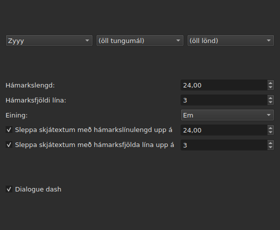
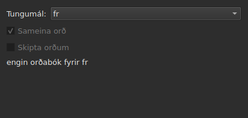
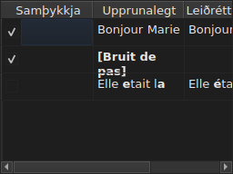

# Leiðrétta texta…

<!-- machine-translated -->
> Þessi síða er vélþýðing sem enginn lesandi tungumálsins hefur enn farið yfir.

`Verkfæri ▸ Leiðrétta texta…` opnar leiðsagnarforrit með mörgum síðum að fyrirmynd
Gaupol: síðu með markmiði og verkum, eina síðu fyrir hvert hakað verk,
framvindusíðu og staðfestingarsíðu sem leggur til
breytingarnar án þess að þvinga þeim nokkru sinni upp á neinn.

**Óvirkt á tómu skjali**: það er ekkert til að leiðrétta.

**Skipanalínan gerir það sama** fyrir öll verkin: [`subedit-cli correct`](../subedit-cli/correct.md), með
sömu mynstrum og sömu talningum — og í stöfum þar sem glugginn mælir í ems.
**Hún les fjórar af munuðum stillingum þessa leiðsagnarforrits** sjálfgefið — báða flokka
algengra villna (`Human`, `OCR`), `Remove all blank subtitles` og hámarksfjölda lína í
`Line Break` — og tekur allt annað (verkin, kóða þeirra, línulengdina, tungumálið,
mynsturreitina) úr sinni eigin línu. Sjá
[Tvær blokkir, önnur sameiginleg með skipanalínunni](preferences.md#tvær-blokkir-önnur-sameiginleg-með-skipanalínunni)
og [`subedit-cli config`](../subedit-cli/config.md).

## Markmið og verk — fyrsta síðan

| Hópur | Valkostir | Sjálfgefið |
| :---- | :------ | :------ |
| `Target` | `Selection`, `Current Project`, `All Open Projects` | `Current Project` |
| `Document` | `Text`, `Translation` | `Text` |
| `Tasks` | `Mentions`, `Join or Split Words`, `Common Errors`, `Capitalization`, `Line Break` — til að haka við, eitt eða fleiri | `Common Errors` og `Capitalization` hökuð, hin þrjú ekki |

`Selection` er óvirkt þegar engin lína er valin í flipanum sem sýndur er; `Translation`
er óvirkt svo lengi sem ekkert opið verkefni ber þýðingu.

**Markmiðið og skjalið eru ekki munuð**: leiðsagnarforritið opnast alltaf aftur
á `Current Project` og `Text`. Hökuðu verkin eru hins vegar munuð.

**Hvað hvert markmið merkir**:

| Markmið | Verkar á |
| :----- | :------- |
| `Selection` | línurnar sem eru valdar í flipanum sem sýndur er |
| `Current Project` | alla skrána í flipanum sem sýndur er |
| `All Open Projects` | alla skrána í hverjum opnum flipa |

**`All Open Projects` á `Translation` sleppir verkefnum án þýðingar**:
verkefni sem ber enga hefur ekkert að leggja til í tómum dálki, og
leiðsagnarforritið telur það ekki.

**Verkasíðurnar koma á eftir, í röð Gaupol — `Mentions`,
`Join or Split Words`, `Common Errors`, `Capitalization`, `Line Break` — aldrei í þeirri röð sem
reitirnir voru hakaðir í.** Verk sem er ekki hakað hefur enga síðu; munaðar
stillingar þess breytast ekki þrátt fyrir það. **Engin verkasíða ber sinn eigin
reit „virkt“**: það er reiturinn á þessari fyrstu síðu, og hann einn,
sem ræður því hvort verkið er keyrt.

## Verkasíðurnar

Hver af fjórum mynstrasíðunum — allar nema `Join or Split Words`, sem hefur enga — ber sama grunn: þrjá hnígandi
valmyndalista í röð — letur, tungumál, land — til að velja kóða mynstranna sem
beita á, síðan lista yfir mynstur þess kóða, eitt til að haka við fyrir hvert heiti. **Valmyndalistarnir
þrír bjóða aðeins það sem mynstraskráin ber í raun** — þau sem fylgja forritinu og þau sem notandi
hefur sleppt þar (sjá [Fallin mynstur](#fallin-mynstur)) — aldrei lista
yfir tungumál eða lönd lesinn annars staðar frá. `Zyyy` („hvaða letur sem er“) er upphafs-
kóði `Common Errors`, sem gefur mynstur sem gilda alls staðar. **Hinar þrjár
gerðirnar hafa aðeins mynstur undir letri**: síða þeirra opnast á
því fyrsta sem skráin býður, `Latn` með mynstrunum sem fylgja forritinu, og ekki á `Zyyy`.

**Lýsing hvers mynsturs er ábending reitsins þess.** Heiti og lýsingar fylgja
tungumáli gluggans fyrir mynstur sem fylgja forritinu; mynstur sem þú átt sjálfur er sýnt
eins og skráin skrifar það ([Tungumál](invocation.md#tungumál)).

**Mynstur sem er ekki hakað helst ekki hakað þar til það er hakað aftur**, einnig þegar
skipt er um kóða og síðan snúið aftur að honum, og það val er munað frá einni opnun
leiðsagnarforritsins til annarrar. Þegar það er hakað aftur finnur það einfaldlega upphaflega
stillingu sína, og munaða valið hverfur.

| Síða | Hvað hún bætir við grunninn |
| :--- | :----------------------- |
| `Mentions` | tveir gátreitir, `Sound in brackets` og `Sound in parentheses`, ekki hakaðir sjálfgefið |
| `Common Errors` | tveir gátreitir, `Human` og `OCR`, hakaðir sjálfgefið |
| `Capitalization` | ekkert meira |
| `Line Break` | hámarkslengd (`24` sjálfgefið), hámarksfjöldi lína (`3`), eining — `Characters` eða `Ems`, `Ems` sjálfgefið — og tvö undanþáguskilyrði, lýst hér á eftir |

**Reitirnir tveir í `Mentions` nefna ekkert þýtt mynstur**: þeir
stjórna leit í textanum í kjarnanum, þeirri sömu og
[`Remove Hearing-Impaired Mentions…`](operations.md#remove-hearing-impaired-mentions)
gerir nú þegar í beinni aðgerð. Annar **eða** hinn hakaður nægir til að ræsa hana. **Mynstralisti síðunnar endurtekur þá ekki**: þessi tvö heiti birtast þar aðeins einu sinni, sem gátreitir.

**`Common Errors` síar eftir flokki**: mynstur sem ber báða flokka
gildir um leið og annar reiturinn er hakaður; hinar þrjár síðurnar
þekkja ekki þennan mun.

### Line Break — einingin og undanþágan




| Stilling | Hvað hún gerir | Sjálfgefið |
| :------ | :----------- | :------ |
| `Maximum length` | lengd línu, í völdu einingunni; frá `1` til `1000` | `24` |
| `Maximum lines` | fjöldi lína sem stefnt er að; frá `1` til `100` | `3` |
| `Unit` | `Characters` telur stafi; `Ems` mælir breiddina með letri gluggans, þar sem meðalstafur í lágstöfum er `0.55` virði — eining Gaupol | `Ems` |
| `Skip subtitles with maximum line length of` | lætur skjátexta vera óbreyttan ef lengsta lína hans rúmast innan þessarar lengdar, í völdu einingunni | hakað, `24` |
| `Skip subtitles with maximum line amount of` | lætur skjátexta vera óbreyttan ef fjöldi lína hans rúmast innan þessarar tölu | hakað, `3` |

**Undanþágan hefur sína eigin þröskulda**, aðra en mörkin sem stefnt er að: það er
regla Gaupol. Skjátexti er látinn vera óbreyttur ef hann rúmast innan **allra
þröskulda þar sem reiturinn er hakaður**; annars er hann brotinn, og brotið er
aðeins geymt ef það færir skjátextann nær þröskuldi sem hann fór yfir — styttri
lengd eða færri línur. Enginn reitur hakaður: hver skjátexti er brotinn,
hvort sem hann rúmast nú þegar eða ekki.

**Að breyta einingunni breytir því sem lagt er til**: lengd hverrar línu er
mæld við hvern útreikning, í einingu síðunnar á því augnabliki, og ekkert
er eftir af fyrri mælingu. Texti með tuttugu og níu stöfum, helmingur
þeirra mjóir stafir, fer yfir `24` í `Characters` og rúmast auðveldlega
í `Ems`.

**Stillingarnar sjö eru munaðar** frá einni setu til annarrar, einingin með.

### Sameina eða skipta orðum — sameining og skipting með stafsetningarathugun




Sérstök síða, milli `Mentions` og `Common Errors`, til að lagfæra það sem
textagreiningarhugbúnaður gerir við bil. Hún hefur engan lista yfir
mynstur: hún styðst við orðabækur kerfisins, í gegnum Enchant.

| Stilling | Hvað hún gerir | Sjálfgefið |
| :------ | :----------- | :------ |
| `Language` | tungumál orðabókarinnar; kóðarnir sem kerfið býður, og sá sem þegar er valinn | tungumál kerfisins, ef það er meðal þeirra |
| `Join words` | sameinar rangt stafsett orð við orðið við hliðina | hakað |
| `Split words` | sker rangt stafsett orð í tvennt | ekki hakað |

**Sameining**: rangt stafsett orð er sameinað orðinu á undan því eða því
á eftir **ef, og aðeins ef, aðeins önnur áttin gefur rétt
stafsett orð**. Þegar báðar gera það, eða hvorug, er ekkert gert.
`bon jour` verður `bonjour`; tvö bil í röð eru fyrst felld niður í
eitt, en texti þar sem engu er sameinað er skilað eins og hann var, bil
með talin.

**Skipting**: rangt stafsett orð er skorið ef, meðal tillagna
stafsetningarathugunarinnar, **aðeins ein** er það orð með bili í — sömu
stafir, í sömu röð. Tvær tillögur af því tagi, eða engin: ekkert
er gert. Orð þar sem upphafsstafurinn einn er hástafur (`Bonjourtous`) er
aldrei skorið: það er oft nafn, og orðabækur hafa þau ekki.

**Skiptilisti notandans** (`spell-check/<language>.repl`,
í stillingamöppu forritsins) telst með tillögum
stafsetningarathugunarinnar; leiðsagnarforritið les hann og skrifar hann ekki.

**Án orðabókar fyrir valið tungumál helst síðan og er grá**: báðir
reitirnir eru óvirkir og síðan segir `no dictionary for` og síðan kóða
tungumálsins. Tungumálið helst breytanlegt — orðabók fyrir annað gæti
verið til — og verkið, hakað eða ekki á fyrstu síðu, gerir þá ekkert
og tilkynnir enga villu.

**Tungumálið, reitirnir tveir og reitur fyrstu síðu eru munaðir** frá einni
opnun leiðsagnarforritsins til annarrar.

### Fallin mynstur

Mynstur sem notandi hefur sleppt í sína eigin mynstramöppu
bætist við þau sem fylgja forritinu, í sömu skrá og undir sömu
valmyndalistum — ekkert aðgreinir þau þegar þau hafa verið hlaðin.

| Mynstur | Hvar |
| :------- | :---- |
| fylgja forritinu | `<prefix>/share/subedit/patterns`, við hliðina á `<prefix>/bin` |
| notandans | `$XDG_DATA_HOME/subedit/patterns`, eða `~/.local/share/subedit/patterns` ef breytan er ekki stillt eða er ekki alger slóð |

**Sniðið er Gaupol, lesið óbreytt**: ein skrá `<Code>.<type>` fyrir hvert letur,
tungumál og land — `Latn-en.common-error` —, með virkjunar-`.conf` við hliðina. Gerðirnar
eru `common-error`, `capitalization`, `hearing-impaired` og `line-break`. Skrárnar sem fylgja
forritinu þjóna sem fyrirmynd. **Mynstur eru lesin einu sinni, við ræsingu**: skrá
sem er sleppt meðan glugginn er opinn sést ekki fyrr en við næstu ræsingu.

## Framvinda

Þegar ýtt er á `Next` af síðustu hökuðu verkasíðunni (eða af
fyrstu síðu ef ekkert verk er hakað) reiknar leiðsagnarforritið tillögurnar
að leiðréttingum á bakgrunnsþræði, með óákveðinni framvindustiku á
skjánum. Þegar útreikningnum er lokið opnast staðfestingarsíðan sjálf.

**`Cancel` á þessu stigi hættir við útreikninginn án þess að trufla hann**: ekkert
er framkvæmt, en leiðsagnarforritið bíður, áður en því er lokað, eftir að útreikningurinn
sem er í gangi klárist — bið sem er takmörkuð af tímamörkunum sem mynstra-
vélin setur á hverja leit.

**`Back` á þessu stigi fer aftur á fyrri síðu án þess að bíða**: útreikningurinn
klárast í bakgrunni og niðurstaða hans er hent — leiðsagnarforritið stekkur ekki
sjálft á staðfestinguna. `Next` ræsir nýjan útreikning.

## Staðfesting — síðasta síðan




Ein lína fyrir hvern texta sem leiðsagnarforritið myndi breyta — aldrei lína fyrir
texta sem verk lét vera óbreyttan.

| Dálkur | Hvað hann sýnir |
| :----- | :------------ |
| `Accept` | gátreitur, hakaður sjálfgefið: leiðréttingin verður framkvæmd eða ekki |
| `Original` | textinn eins og hann er, sá hluti sem myndi breytast **feitletraður** |
| `Corrected Text` | tillaga að texta, breytti hlutinn feitletraður, **breytanlegur** — að lagfæra hann breytir því sem verður skrifað, án þess að breyta reitnum `Accept` |

**Breytingin er merkt með feitletri, aldrei með lit**: sami munur
les sig í báðum litapalettum án þess að vera háður nokkrum blæ.

**Lína þar sem tillagan er fjarlæging** — skjátextinn myndi ekki hafa neinn
texta eftir — sýnir dálkinn `Corrected Text` tóman, og allan `Original` hennar
feitletraðan.

| Hnappur | Hvað hann gerir |
| :----- | :----------- |
| `Mark All` | hakar við `Accept` á öllum línum |
| `Unmark All` | tekur hakið af `Accept` á öllum línum |
| `Preview` | setur innbyggða spilarann á skjátexta völdu línunnar, ef verkefnið hefur kvikmynd — ekkert ef það hefur enga |
| `Finish` | framkvæmir hökuðu línurnar og lokar leiðsagnarforritinu |

`Remove all blank subtitles`, hakað sjálfgefið, fjarlægir skjátextana
sem leiðrétting myndi skilja eftir án nokkurs texta í stað þess að halda þeim tómum.

**Mynstur sem útreikningurinn gat ekki beitt er nefnt undir töflunni**, með
ástæðunni:

```text
Not applied: some pattern (will not compile)
```

Mynstur sem er nefnt á þennan hátt er nefnt **einu sinni fyrir hverja ástæðu**, hver sem fjöldi
texta eða verkefna sem það brást á er: skjárinn segir ekki hvaða.

| Ástæða | Hvað kallar hana fram |
| :----- | :--------------- |
| `cannot be translated` | segðin notar það sem þýðing á setningafræði Python hafnar |
| `will not compile` | vélin hafnar segðinni |
| `has an invalid replacement` | útskiptin lesast ekki eins og Python les þau |
| `timed out` | leit fór yfir tímann sem vélin veitir á texta |
| `never settled` | `Repeat` breytti textanum enn eftir hundrað umferðir |
| `grew the text too long` | textinn fór yfir 16384 bæti meðan mynstrið vann á honum |

**Mynstur sem bregst á texta skilur hann eftir eins og hann var áður en það kom**: útskipti
sem eru hálfgerð eru minna virði en engin útskipti. Hin mynstrin eru framkvæmd.

**Lína í mynstraskrá sem ekki er hægt að lesa er nefnd á sama
stað**, með skrá sinni, línu sinni og ástæðunni — við hverja opnun
leiðsagnarforritsins, þar sem mynstrin eru aðeins lesin einu sinni, við ræsingu:

```text
Could not be read: Zyyy.common-error, line 8 (malformed line)
```

| Ástæða | Hvað kallar hana fram |
| :----- | :--------------- |
| `directory cannot be read` | ekki var hægt að ganga í gegnum möppu mynstranna sem fylgja forritinu |
| `file cannot be read` | ekki var hægt að lesa mynstraskrá |
| `malformed line` | lína sem er hvorki haus, né athugasemd, né `Key=Value` |
| `field outside any pattern` | `Key=Value` á undan fyrsta mynstrahausnum |
| `unknown field` | lykill sem þessi gerð mynsturs hefur engin not fyrir — mynstrið er geymt |
| `missing field` | lykill sem þessi gerð mynsturs getur ekkert án — mynstrinu er hent |
| `invalid value` | gildi sem lykillinn tekur ekki við — mynstrinu er hent |
| `malformed activation` | frumefnið `<pattern>` í `.conf` sem nefnir ekkert |

Hin mynstrin, þau sem voru lesin og framkvæmd rétt, eru ekki
fyrir áhrifum.

## Hvað afturköllunin segir, og hvað `Cancel` gerir aldrei

**`Finish` gerir eina færslu í ferlinum fyrir hvert verkefni sem er snert**, aldrei eina fyrir hverja
leiðréttingu: `Undo` afturkallar í einu lagi allar leiðréttingar sem voru samþykktar á því
verkefni, hverja með textanum sem hún hafði. Valmyndin nefnir hana
`Undo: correcting texts`.

Stöðulínan gefur töluna, breyttu textana fyrst, fjarlægðu
skjátextana næst:

```text
Edited 3 and removed 1 subtitles
```

**`Cancel`, á hvaða síðu sem er, framkvæmir ekkert og man ekkert** — hvorki
stillingarnar sem voru valdar í þessari opnun, né minnstu leiðréttingu. Næsta
opnun leiðsagnarforritsins byrjar aftur á stillingunum frá því áður.

## Dæmi

Opin skrá ber tvö bil milli tveggja orða í línu og
tilvísun í hornklofum án annars texta. `Verkfæri ▸ Leiðrétta texta…`,
`Common Errors` þegar hakað, `Next` fram að staðfestingunni: línan með tveimur bilunum
sýnir `Bonjour  Marie` til vinstri, `Bonjour Marie` til hægri, leiðréttinguna
feitletraða og þegar samþykkta. `Finish` framkvæmir hana, og stöðulínan segir:

```text
Edited 1 and removed 0 subtitles
```
