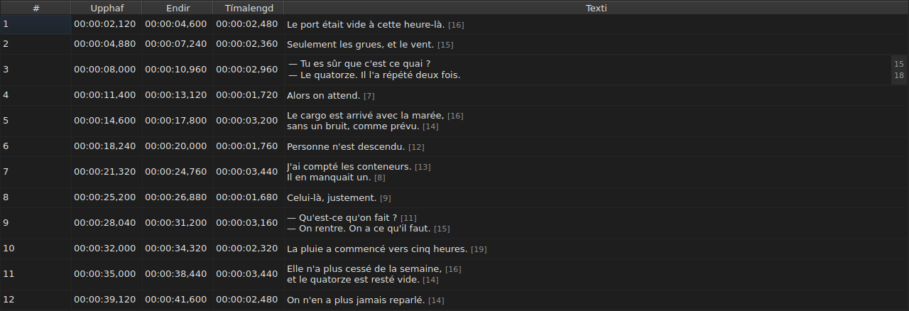
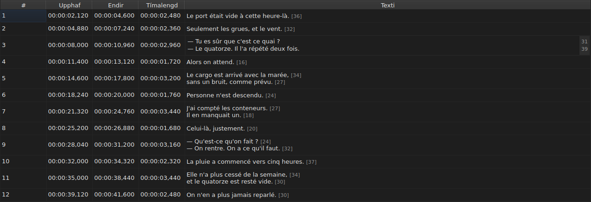

# Að breyta reit

<!-- machine-translated -->
> Þessi síða er vélþýðing sem enginn lesandi tungumálsins hefur enn farið yfir.

Fjórum dálkum er breytt á staðnum: `Start`, `End`, `Duration` og `Text` — fimm
með dálkinum `Translation`, þegar verkefnið hefur þýðingu. `#` er ekki hægt að
breyta — númerið er sæti línunnar, ekki gögn skrárinnar.

**Ritill reits opnaður:** tvísmelltu á hann, eða veldu hann
og ýttu á `F2`.

## Textinn

**Þýðingu er breytt eins og textanum**, með sama margra lína reitnum og
sömu reglum; aðeins reiturinn breytist, og aðaltextinn helst eins og
hann var. Staðfesting sem breytir engu gerir ekkert, hvort sem er fyrir annan
eða hinn — sjá [hér að neðan](#staðfesting-sem-breytir-engu-gerir-ekkert).

Ritillinn er **margra lína** reitur og opnast í hæð skjátextans:
tveggja lína skjátexti er sleginn inn í honum eins og hann verður skrifaður,
línurnar tvær læsilegar og án skrunstikis. `Shift+Enter` sem bætir við línu
stækkar ritilinn; röð töflunnar aðlagast við staðfestingu.

| Lykill | Áhrif |
| :----- | :---- |
| `Enter` | staðfestir og lokar ritlinum |
| `Shift+Enter` | setur línuskil í textann |
| `Esc` | lokar ritlinum; reiturinn heldur því sem hann hafði |
| `Tab` | staðfestir og fer í næsta reit |

Að smella annars staðar staðfestir líka: að missa fókusinn jafngildir `Enter`.

**Ellefu aðgerðir án glugga staðfesta á sama hátt** áður en þær reikna skotmark
sitt:
`Italic`, `Case ▸ …`, `Dialogue`, `Merge Subtitles`, `Split Subtitle`,
`Cut Texts`, `Paste Texts`, `Copy Texts`, `Remove Subtitles`, `Undo` og `Redo`.
Þegar þær eru ræstar úr valmyndinni, verkfærastikunni eða flýtilykli gluggans
taka þær textann eins og ritillinn var að staðfesta hann, eins og eftir smell
annars staðar. `Ctrl+X`, `Ctrl+C` og `Ctrl+V` haldast þó hjá ritlinum svo lengi
sem hann er opinn — sjá [Að klippa, afrita og líma texta](clipboard.md): það er
þá valmyndin sem ræsir `Cut Texts`, `Copy Texts` og `Paste Texts`.

`Undo` og `Redo` lesa ferilinn en ekki skjalið: sjá
[Afturkalla og endurgera](undo.md). Aðgerð sem opnar glugga þarf ekki
á þessari reglu að halda, því glugginn tekur fókusinn þegar hann opnast, sem
staðfestir nú þegar innsláttinn.

### Merkin eru þau sem eru í skránni

Textinn sem er sýndur og sleginn inn er **sá sem er í skránni, með merkjum**:
`<i>…</i>` í SubRip er skrifað þannig, og `{\i1}…{\i0}` í Advanced SSA
einnig. Ekkert er þýtt til birtingar — taflan í
[`Italic`](operations.md#italic) segir hvað hvert snið skrifar.

Varðandi skáletur er því ekkert sem þarf að vita: `Ctrl+I` setur rétta merkið
fyrir opna skjalið, og snið sem ber ekkert — TMPlayer, LRC —
gerir færsluna óvirka í stað þess að láta þig leita. Feitletrun og undirstrikun
eru slegnar inn, eins og í Gaupol.

**Og merkin fylgja ekki textaaðgerðum**: að setja skjátexta í
lágstafi breytir ekki `<I>` hans í `<i>`, og þankastrik er
sett á undan textanum en ekki á undan upphafsmerki. Sjá
[`Case` og `Dialogue`](operations.md#case-og-dialogue).

## Lengd lína

**Textaritillinn sýnir, á spássíu til hægri, lengd hverrar
línu**, í beinni línu við fyrstu röð þeirrar línu. Spássían er jafn breið
og stærsta talan, uppfærist **um leið og þú skrifar** og fylgir skruninni.
Tómur texti sýnir ekkert. Lengdirnar eru þær sem taflan sýnir — án
merkja, námundaðar niður, í einingunni sem er stillt — og eru fjarlægðar með
gátreitnum `Show line lengths in the editor` í `Breyta ▸ Kjörstillingar…`. Sjá
[Línulengdir](preferences.md#línulengdir).

## Upphaf og endir

Ritillinn er eins línu reitur, **bundinn við lögun tímamerkis**:
hann neitar meðan skrifað er því sem gæti aldrei orðið slíkt.

Leyfð snið eru þau sem lestur skráar samþykkir nú þegar:

| Þáttur | Hvað kemst í gegn |
| :----- | :---------------- |
| svið | `MM:SS` eða `HH:MM:SS`, einn eða tveir tölustafir hvert |
| tugabrot | einn til þrír, á eftir kommu eða punkti, eða engir |
| formerki | `-` fremst, fyrir stöðu á undan upphafi myndskeiðsins |
| mörk | mínútur og sekúndur undir 60 |

`00:01:02,500`, `1:02.5` og `-0:01,000` eru því þrír gildir innsláttir.

**Innsláttur sem lesturinn neitar skilur reitinn eftir óbreyttan.** Þannig er
það með `00:70:00,000`, sem hefur rétta lögun en mínúturnar eru utan marka:
ritillinn lokast og ekkert hefur færst. Engin staðsetning er fundin upp
— að fara rangt með staðsetningu er hljóðlaust, ekkert á skjánum greinir
illa tímasettan skjátexta frá vel tímasettum.

Breyting á upphafi eða enda uppfærir `Duration` strax.

## Tímalengdin

**Að slá inn tímalengd færir endinn, en aldrei upphafið**: endirinn verður
`Start + Duration`. Að færa upphafið myndi færa allan skjátextann, sem er
verkefni [`Shift Positions…`](operations.md), og dálkinum `Start` er nú þegar
hægt að breyta.

Tímalengdin er slegin inn **í lögun tímamerkis**, þeirri sem dálkurinn
sýnir, og snið töflunnar hér að ofan gilda — með einum mun:

| Þáttur | Upphaf, endir | Tímalengd |
| :----- | :------------ | :-------- |
| lögun | lögun tímamerkis | sú sama |
| `-` fremst | leyft | **neitað meðan skrifað er** |

`0:02.5` og `00:00:02,500` eru því tveir gildir innsláttir tímalengdar upp á
tvær og hálfa sekúndu; `-0:01,000` er ekki hægt að slá inn. Núll tímalengd er
leyfð: skjátextinn hverfur þá á sömu stundu og hann birtist.

**Endir sem fer yfir næsta skjátexta er leyfður.** Skörunin er lituð
í töflunni, með ábendingu sinni — sjá
[Taflan](table.md#frávikin) — tilkynning, ekki synjun: það getur verið það sem
þú vildir. [Listi yfir greiningarboð](files.md#greiningarboð-lesturs)
ber hana einnig og fjarlægir hana þegar þú hefur lagað hana.

**Endir sem er sleginn inn handan enda kvikmyndarinnar er ekki tilkynntur**, öfugt
við aðgerð í valmyndinni `Tools` sem myndi ýta honum þangað — sjá
[Aðgerðirnar](operations.md#út-fyrir-lok-kvikmyndarinnar). Reitur sýnir nú þegar
gildið sem þú varst að slá inn.

Ólæsilegur innsláttur skilur reitinn eftir óbreyttan, eins og fyrir staðsetningu, og
tímalengd sem er eins og sú sem er sýnd fer ekki í ferilinn.

## Staðfesting sem breytir engu gerir ekkert

Opnaðu reit, sláðu ekkert inn, ýttu á `Enter`: ekkert gerist.
Engin breyting er skráð og skráin telst áfram eins og
sú sem er á disknum.

Samanburðurinn er á **staðsetningunni**, ekki á strengnum: að slá inn `0:01.0`
í reit sem sýnir `00:00:01,000` vísar til sömu stundar og
breytir því heldur engu.

## Hvað verður um breyttan reit

Hægt er að **afturkalla hann** — einn reitur, ein færsla. Sjá
[Afturkalla og endurgera](undo.md).

Hann **er vistaður**, og að loka glugganum án þess að hafa gert það biður um
staðfestingu. Sjá [Að opna og vista](files.md).
