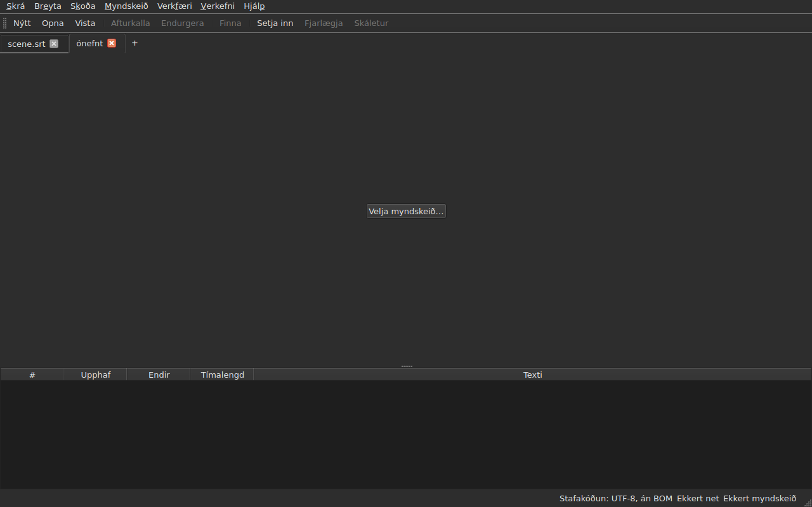
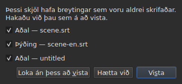
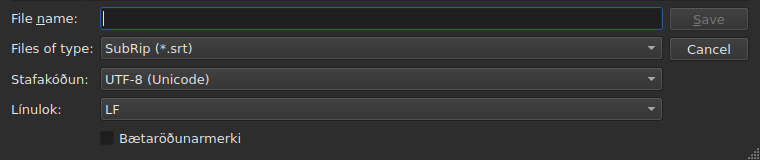
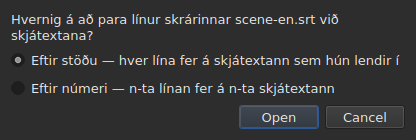
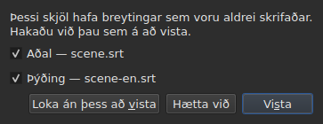

# Að opna og vista

<!-- machine-translated -->
> Þessi síða er vélþýðing sem enginn lesandi tungumálsins hefur enn farið yfir.

Valmyndin **Skrá** hefur skipanirnar þrjár, tvær fyrir flipana og þrjár til
viðbótar fyrir þýðinguna; valmyndin **Verkefni** verkar á alla flipana í einu.

| Skipun | Flýtilykill | Hvað hún gerir |
| :------ | :------- | :----------- |
| Nýtt verkefni | `Ctrl+N` | autt verkefni, í nýjum flipa — líka hnappurinn `+` á eftir síðasta flipanum |
| Opna… | `Ctrl+O` | velur skrá og opnar hana í nýjum flipa — eða í stað auðs verkefnis |
| Opna þýðingu… | — | velur þýðingarskrá og paraði hana við aðalskrá núverandi flipa |
| Vista | `Ctrl+S` | skrifar opnu skrána upp á nýtt |
| Vista sem… | `Ctrl+Shift+S` | velur slóð og snið, skrifar svo |
| Vista þýðingu | — | skrifar skrá þýðingarinnar upp á nýtt |
| Vista þýðingu sem… | — | velur slóð og snið fyrir þýðinguna, skrifar svo |
| Loka | `Ctrl+W` | lokar núverandi flipa — óvirk ef flipinn er aðeins einn |

`New Project`, `Open…` og `Save` eru líka á
[verkfærastikunni](index.md#verkfærastikan), undir orðunum `New`, `Open` og
`Save`. **Færslurnar þrjár fyrir
þýðinguna eru ekki á stikunni**: þær nýtast aðeins þeim sem hafa
þýðingu, og stikan er allra.

## Mörg verkefni, í flipum

**Hvert opið verkefni hefur sinn flipa**, fyrir ofan myndina og töfluna:
merkimiði hans er heiti skrárinnar, eða `untitled` fyrir verkefni sem hefur enga
enn. Að smella á flipa skiptir yfir á hann; `Ctrl+PageDown` og `Ctrl+PageUp` gera
það sama, án músar, og fara aftur á fyrsta flipann eftir þann síðasta.
**Hnappurinn `+`, rétt á eftir síðasta flipanum**, opnar autt verkefni í
nýjum flipa, eins og `New Project`.




**`Open…` snertir þá aldrei.** Að opna skrá kemur ekki lengur í stað þess sem
glugginn sýndi: hún kemur í nýjum flipa, við hlið þess, og flipinn sem þú
horfðir á áður heldur öllu sem hann hafði — feril sinn, val sitt, tengda
myndskeiðið sitt. Þess vegna spyr opnunin heldur ekki lengur um neitt: það er
engu að tapa, þar sem ekkert er að skipta út.

**Ein undantekning: autt verkefni víkur sæti sínu.** Þegar glugginn er ræstur án skrár, eða
eftir `New Project`, sýnir hann verkefnið `untitled` með ekkert í. Skrá sem er opnuð —
með `Open…` eða með því að sleppa henni á gluggann — **tekur þá flipa þess,
á sama stað á stikunni**, frekar en að opna annan við hlið
gagnslauss verkefnis. Verkefni er autt þegar það hefur **enga skrá, engan skjátexta,
ekkert til að afturkalla eða endurgera, enga kvikmynd, og hefur aldrei verið breytt**: eitthvert
þessara atriða nægir til að það haldi flipa sínum. Autt verkefni sem er ekki
núverandi flipi er látið í friði.

**Skrá sem er þegar opin er ekki opnuð í annað sinn.** `Open…` á
skrá sem annar flipi heldur færir fókusinn aftur á þann flipa og segir frá því
í stöðulínunni:

```text
premier.srt: already open
```

**Hver flipi er heilt verkefni, óháð hinum**: ferill
hans, val hans, tengda myndskeiðið hans og það sem síðasti lestur hans
rakst á eru aðeins sýnd þegar flipinn er sá núverandi, og
breytast ekki meðan annar er það. **Ein undantekning, og hún er í ADR
0033**: myndskeiðsspilarinn er einn fyrir allan gluggann — eitt mpv-ferli — og kvikmynd hans breytist með flipanum; **hver flipi man hvar kvikmynd hans
var**, og tekur hana upp þar, í hléi, þegar þú kemur aftur til hans. Klippispjaldið tilheyrir aftur á móti glugganum: að afrita
í einum flipa og líma í öðrum er ástæðan fyrir því að opna tvo.

**`Close` lokar núverandi flipa** og spyr, ef þörf krefur,
[spurningarinnar um óvistaðar breytingar](#óvistaðar-breytingar) —
þeirrar sem á við þennan flipa einan, því hinir koma málinu ekki við. **Óvirk þegar
flipinn er aðeins einn**: glugginn heldur alltaf að minnsta kosti einum, og að loka honum
væri að loka glugganum — sem hnappur kerfisins gerir nú þegar.

**Hver flipi hefur líka kross**, sem lokar **hans** verkefni, með sömu
spurningu. Krossinn á flipa sem er ekki sá núverandi lokar þeim flipa, og
flipinn sem þú horfir á helst sýndur; ef það verkefni hefur breytingar kemur
flipi þess fremst á meðan spurt er. **Enginn kross þegar aðeins einn
flipi er eftir**, af sömu ástæðu og `Close` er óvirk.

**Flipi segir að hann sé breyttur**: stjarna fylgir nafni hans, `premier.srt*`,
svo lengi sem eitthvert skjala hans víkur frá skrá sinni — eins og titill gluggans
segir um verkefnið sem þú horfir á. Hún hverfur við vistun.

## Verkefnavalmyndin

Tvær skipanir verka á öll verkefni í einu.

| Skipun | Flýtilykill | Hvað hún gerir |
| :------ | :------- | :----------- |
| Vista allt | `Ctrl+Shift+L` | skrifar hvert breytt skjal, flipa fyrir flipa |
| Loka öllu | `Ctrl+Shift+W` | lokar öllum verkefnum — það er að segja glugganum |

**`Save All` fer í röð flipanna**, aðalskjalið á undan þýðingunni.
Skjal sem hefur skrá er skrifað upp á nýtt þar **án þess að flipi þess komi fremst**;
**skjal sem hefur enga opnar `Save As…`, eitt í einu**, á flipa sínum —
eina tilvikið þar sem `Save All` skiptir um flipa, svo að gluggi sýni um hvaða
verkefni er að ræða. **Ef hætt er við `Save As…`, eða vistun
mistekst, stöðvast afgangurinn**: næstu verkefni eru ekki
snert, og gluggi segir hvað var skrifað.

```text
Save All stopped: 1 of 3 documents saved
```

Þegar allt er skrifað segir stöðulínan það — `2 documents saved`, eða
`Nothing to save` þegar engu var breytt. Ef `Save As…` kom
flipa fremst fer glugginn síðan aftur á þann flipa þar sem skipunin var
ræst.

**`Close All` og kross gluggans eru eitt og hið sama**: glugginn
heldur alltaf verkefni, og að loka þeim öllum er að loka honum. Þau spyrja því
**einnar spurningar fyrir öll verkefni**, þeirrar sömu og með
[tvö breytt skjöl](#að-loka-með-tvö-breytt-skjöl), með einum gátreit
fyrir hvert breytt skjal í hverjum flipa:




**`Cancel` lokar engu**, og skilur ekkert eftir skrifað. `Save` skrifar
skjölin sem hakað er við eins og `Save All`: á bak við flipa þeirra, nema skjal án
nafns, en flipi þess kemur fremst fyrir `Save As…`. Þegar aðeins eitt skjal er
breytt í öllum verkefnum er þetta einfalda spurningin sem við höfum alltaf
haft, spurð á flipa þess. `Save All As…` er ekki til: það er runa af
`Save As…`, sem `Save All` spyr nú þegar, eitt í einu, fyrir skjöl án nafns.

## Opnun

Glugginn síar **níu sniðin sem eru lesin**, eina færslu fyrir hvert, og fyrsta
færslu sem sýnir þau öll. Sniðið er síðan greint **af innihaldinu, ekki af
skráarendingunni**: `.txt` skrá sem inniheldur SubRip opnast, og sían ræður
engu — hún felur aðeins skrár.

| Síufærsla | Skráarending |
| :----------- | :-------- |
| `SubRip` | `.srt` |
| `WebVTT` | `.vtt` |
| `SubViewer 2` | `.sub` |
| `Sub Station Alpha` | `.ssa` |
| `Advanced SSA` | `.ass` |
| `MicroDVD` | `.sub` |
| `MPL2` | `.txt` |
| `TMPlayer` | `.txt` |
| `LRC` | `.lrc` |

**Tvær skráarendingar vísa á tvö snið hvor** — `.sub` er SubViewer 2 og
MicroDVD, `.txt` er MPL2 og TMPlayer. Það hefur engar afleiðingar við opnun,
þar sem innihaldið ræður; við vistun er það **heiti**
færslunnar sem er valin sem gefur sniðið, aldrei mynstur hennar.

**Skrá sem ekki er hægt að lesa opnar ekkert.** Skrá sem vantar, kerfið neitar, er rituð
í stafakóðun sem bæti hennar afkóðast ekki í, eða er á engu þekktu
sniði: gluggi sem krefst svars **nefnir orsökina**, enginn flipi er opnaður, og þeir sem
voru opnir haggast ekki.

| Skilaboð | Hvað gerðist |
| :------ | :------------ |
| `does not exist` | slóðin vísar á enga skrá |
| `cannot be opened: permission denied` | kerfið neitar að opna hana |
| `cannot be read` | kerfið neitaði af annarri ástæðu |
| `cannot be decoded in the chosen encoding` | bætin lesast ekki í stafakóðuninni sem var valin |
| `is in no format this tool knows` | ekkert snið þekkir innihaldið |
| `holds nothing recognisable as a subtitle` | sniðið er þekkt, en ekkert í skránni er skjátexti |

Slóðin fer á undan skilaboðunum: `notes.txt: is in no format this tool knows`.
Þetta eru orð skipanalínunnar, og það er engin tilviljun — báðir
fletir lesa skrá með sömu uppskrift.

### Að sleppa skrám á gluggann

**Að sleppa skrám hvar sem er á glugganum opnar þær**, úr
skráastjóranum: töflunni, flipastikunni, hnappnum
`Select Video…`, og **sjálfri mynd kvikmyndarinnar**, bæði í spilun og stöðvaðri.
Myndin er sérstakur gluggi sem spilarinn teiknar, og ekkert tryggði
að hann sendi slepptar skrár áfram; þetta var athugað í höndunum á raunverulegu skjáborði,
í Wayland-lotu. `subedit-gui` er ræstur þar undir X11 til að geta sýnt
kvikmyndina, þannig að sleppingin fer um X11-samskiptareglurnar — þær sem gilda í
X11-lotu, þar sem þetta hefur ekki verið reynt sérstaklega.

- **Hver skjátextaskrá opnar sinn flipa**, í þeirri röð sem þeim var
  sleppt — nákvæmlega eins og `Open…`. Skrá sem er **þegar opin** er ekki
  lesin aftur: flipi hennar kemur fremst, og stöðulínan segir frá því
  (`premier.srt: already open`).
- **Myndskeið sem er sleppt er tengt núverandi flipa**, eins og með
  `Select Video…`. Ef því er sleppt með skjátextum fer það á síðasta flipann
  sem þeir opnuðu, hvað sem líður röð sleppingarinnar. Myndskeið er þekkt á
  skráarendingunni — sama lista og þeim sem leggur til kvikmynd við hlið
  skrárinnar.
- **Tvö myndskeið eða fleiri í einu eru ekki opnuð**: verkefni fylgist með einni
  kvikmynd. Skjátextarnir í sömu sleppingu opnast hins vegar.
- **Skrá sem opnast ekki stöðvar ekki hinar.** Einn gluggi segir þá
  hvað ekki var hægt að gera, eina línu fyrir hverja skrá, með orðum
  `Open…`:

  ```text
  /films/notes.txt: is in no format this tool knows
  /films/absent.srt: does not exist
  ```

Aðeins staðbundnar skrár eru teknar: tengill sem er dreginn úr vafra
vísar á ekkert sem glugginn getur lesið.

Það að opna úr skipanalínunni virkar enn: `subedit-gui film.srt`.
Þar er sama ástæðan skrifuð á villustrauminn, og glugginn opnast
tómur — sjá [Ræsing](invocation.md#þegar-opnun-mistekst).

## Greiningarboð lesturs

Raunveruleg skrá er sjaldan fullkomin, og lesturinn bjargar sér frekar en að
gefast upp: númer sem vantar, lína sem leiðir ekkert, blönduð línulok.
**Það sem hann rakst á rúmast í hnappi í stöðulínunni**
— `2 diagnostics`, vinstra megin við það sem stikan segir nú þegar um skjalið —, og **listinn opnast með smelli
í fljótandi glugga** fyrir ofan hnappinn. Engin lína gluggans er tekin fyrir hann:
taflan heldur fullri hæð sinni, hvort sem lesturinn hafði eitthvað að segja eða ekki. Listinn
lokast með smelli annars staðar eða með `Esc`.

```
a SubRip block without its number, settled by the reader: 5
```

**Hver lína telur**: það sem var rekist á, það sem var gert við því, og
hve oft. Mjög illa gerð skrá rekst á hundruð, og að vita
hve mörg af hverri gerð er það sem gerir þér kleift að bregðast við; línunúmer hvers tilviks í
skránni er aftur á móti lesið í skipanalínunni, með ítarstigi `-vvv`. Hnappurinn
telur þessar línur — eina fyrir hverja gerð —, ekki tilvikin.

**Stafakóðunin sem var giskað á birtist þar líka**, einu sinni: henni var stungið upp á með því að vega
bætin, áður en ein einasta lína skrárinnar var til.

```
an encoding nothing declared, settled by the reader: 1
```

Hún er aðeins sýnd þegar stafakóðuninni **var giskað á og hún er ekki
UTF-8** — UTF-8 skrá sem er lesin sem slík er ekki atvik, og að segja frá því
við hverja opnun myndi setja hnapp í stöðulínu hvers venjulegs
skjals. Skrá sem hefur bætaröðunarmerki kallar hana ekki fram heldur:
hún lýsti stafakóðun sinni yfir, engu var giskað.

**Sami listi telur líka það sem er að í skjátextunum sjálfum**: skjátexti
sem byrjar áður en sá fyrri hefur endað, endir á undan upphafi sínu, upphaf á undan upphafi
skjátextans fyrir ofan. Taflan litar þá, en
litur finnst með því að skruna, og í skrá með tvö þúsund línum
fer einn auðveldlega fram hjá manni; hér eru gerðirnar allar saman, **ein í
línu og með fjölda sínum**, með orðum skýrslunnar `inspect`:

```
subtitle starts before the previous one ends: 12
subtitle starts before the previous one starts: 3
```

**Smellur á eina leiðir á fyrsta skjátextann sem á við**, valinn í
töflunni. Þessar línur **fylgja leiðréttingunum** — að raða eða leiðrétta tímalengd
fjarlægir einhverjar, eða lækkar fjölda þeirra —, án þess að loka listanum sem þú ert
að lesa. Skjátexti getur verið talinn tvisvar: að byrja áður en sá fyrri endar
og áður en hann byrjar eru tvær niðurstöður, leiðréttar á tvo
vegu. Til að nefna þær eina og eina, `subedit-cli inspect --detail`.

Hnappurinn **birtist ekki** þegar ekkert er að tilkynna, hvorki í lestrinum né
í skjátextunum, og **hann fylgir flipanum**: hvert verkefni heldur
greiningarboðum eigin lesturs, og hnappurinn sýnir þau sem tilheyra verkefninu sem er sýnt.

## Stafakóðunin í stöðulínunni

**Stöðulínan gefur alltaf stafakóðun opna skjalsins**, vinstra megin við það sem
hún segir um [rammanetið](frame-grid.md) og
[tengda myndskeiðið](video.md):

| Staða | Hvað er skrifað |
| :-------- | :-------------- |
| skráin var lesin sem UTF-8, án merkis | `Encoding: UTF-8, no BOM` |
| … með merki | `Encoding: UTF-8, BOM` |
| skrá í Latin-1 | `Encoding: ISO-8859-1, no BOM` |

**Greiningarboðið og þessi lína svara ekki sömu spurningunni**, og þess vegna
eru þau bæði til. Greiningarboðið segir hvað lesturinn **gerði** — hann
giskaði, og þú vilt kannski athuga; það er því aðeins sýnt þegar
var giskað. Stöðulínan segir hvað skjalið **er**,
varanlega, einnig fyrir skrá sem lýsir stafakóðun sinni yfir sjálf og sem
lesturinn hefur ekkert að segja um.

**Hvaðan svarið kemur sést ekki þar.** `inspect` gefur það — `detected`,
`from its byte order mark`, `as asked for` — því skýrsla hefur rúm til að
segja það; lína í stöðulínu hefur það ekki, og listi greiningarboðanna ber það nú þegar þegar
á þarf að halda.

## Vistun

`Save` skrifar opnu skrána upp á nýtt **í upprunalegri mynd hennar**: sniði hennar,
stafakóðun, línulokum, bætaröðunarmerki og haus. Skrá
sem er opnuð og síðan vistuð án breytinga haggast ekki um eitt bæti — sjá
nákvæmu trygginguna hér á eftir.

Skrifunin er **lotubundin**: hún fer um tímabundna skrá sem er endurnefnd
yfir hina. Vistun sem er rofin hvenær sem er skilur fyrri útgáfuna eftir
óskerta.

Að vista skjal sem hefur aldrei verið á diski jafngildir `Save As…`.

**Skrifun sem mistekst segir frá því og tapar engu**: fullur diskur, skrá
sem er aðeins til lestrar, mappa sem vantar — eða **stafur sem stafakóðun skrárinnar
getur ekki skrifað**, `ł` í Latin-1 skrá. Skilaboðin eru
þá `holds a character the chosen encoding cannot write`, og ekkert er
skrifað: að skipta stafnum út fyrir `?` myndi tapa texta fyrir augum þess sem
var að slá hann inn. Skilaboðin nefna skrána og ástæðuna, glugginn heldur
breytingum sínum, og merkið í titlinum helst.

## Vista sem

`Save As…` biður um slóð, snið, **og lögun bætanna sem eru skrifuð**:
stafakóðun, línulok, bætaröðunarmerki. Skjalið **lifir síðan
þar**: titillinn breytist, `Save` beinist að nýju skránni og skrifar í
valinni mynd, og upprunalega skráin helst eins og hún var.

**Sniðin níu eru í boði**, og færslan sem er valin þegar glugginn
opnast er **skjalsins**. Að vista undir öðru nafni án þess að snerta
síuna breytir því ekki sniðinu.




**Myndirnar sýna aðeins neðri hluta gluggans**, ekki skráalistann
fyrir ofan: hann fer eftir vélinni — möppum hennar, dagsetningum, flýtileiðum
til hliðar —, svo að mynd af honum yrði aldrei söm tvisvar.
Þessi ræma er það, og það er þar sem allt gerist.

| Svið | Hvað það býður | Sjálfgefið |
| :---- | :------------- | :------ |
| `Encoding` | fjórtán stafakóðanir sem skjátextaskrá ber í reynd, auk `Other…` | **sú sem skráin sem var lesin hafði** |
| `Other…` | svið til að slá inn hvaða stafakóðun sem ICU getur skrifað, **með útfyllingu** — `cp1257`, `EUC-KR` | — |
| `Line endings` | `LF`, `CRLF` eða `CR` | þau sem skráin sem var lesin hafði |
| `Byte order mark` | merkið, **óvirkt fyrir stafakóðun sem ber ekkert slíkt** | það sem skráin sem var lesin hafði |

**Sjálfgefnu gildin eru þau sem skráin sem var lesin hafði, og það er trygging frekar en
þægindi**: skrá sem er opnuð og síðan vistuð aftur án þess að snerta þessi þrjú
svið gefur sömu bæti til baka.

**Listinn er stuttur, og hann er ekki þak.** ICU þekkir tvö hundruð
tuttugu og eina; það sem valmyndin býður er það sem skjátextaskrá ber
í reynd, því valmynd með tvö hundruð færslum hjálpar engum. `Other…`
opnar afganginn.

**Sviðið fyllir út yfir allar tvö hundruð tuttugu og einar**, svo það þarf ekki að
vita nákvæmt heiti: að slá inn `1252` leggur til `windows-1252`, að slá inn `koi`
leggur til `KOI8-R` og `KOI8-U`. Útfyllingin er á því sem heitið **inniheldur**
en ekki á því sem það byrjar á — kanónískt heiti vesturevrópska Windows-kóðans er
`windows-1252`, og `cp1252` er það sem fólk hefur í huga. Bæði má
líka skrifa í heild án útfyllingar: ICU tekur við eigin samnöfnum.

**Heiti sem enginn þekkir skrifar ekkert.** Að slá inn `klingon-1` fellur
ekki aftur á UTF-8: ekkert er skrifað, og skilaboðin segja frá því.

**Ekki heldur heiti sem tilgreinir ekki bætaröðina.** `UTF-16` og `UTF-32` eru
heiti sem ICU þekkir, og umbreytirinn þeirra skrifar **sitt eigið merki**:
gátreiturinn `Byte order mark` myndi þá hætta að ráða nokkru. Báðum
er hafnað, og skilaboðin vísa á `UTF-16LE` eða `UTF-16BE`, sem skrifa
sömu bæti undir stjórn gátreitsins. Þetta er sama höfnunin, með
sömu orðum, og hjá skipanalínunni.

**Stafur sem valin stafakóðun getur ekki skrifað stöðvar vistunina**
— `ł` í Latin-1. Skilaboðin eru
`holds a character the chosen encoding cannot write`, glugginn heldur
breytingum sínum, og markskráin er ekki snert.

**Skjalið haggast heldur ekki**: það helst á skrá sinni, í
sniði sínu og stafakóðun sinni, og næsta `Save` skrifar upp á nýtt þá sem var opnuð.
Vistun sem fór ekki fram breytir engu — hvorki á diski
né í glugganum.

Að skipta um snið breytir því sem taflan sýnir — tugaskiljan fylgir
sniðinu, komma fyrir SubRip, punktur fyrir WebVTT, og **merkin eru endurrituð
á orðaforða marksniðsins**: `<i>` verður `{\i1}` í Sub
Station Alpha, `{Y:i}` í MicroDVD, `/` í upphafi línu í MPL2. Skjalið
**er orðið** sú skrá, svo taflan sýnir það sem skráin ber.

**Það er ekki skipun, og `Ctrl+Z` afturkallar það ekki.** Skjal þar sem
sniðið sagði LRC og textarnir sögðu enn `<i>` væri
ósamstætt skjal; það er enginn helmingur til að afturkalla.

## Hvað snið ber ekki, sagt áður en skrifað er

**Gluggi varar við, og þú getur samt svarað nei.** Hann telur upp það sem
marksniðið mun ekki geyma, lið fyrir lið, með orðum sem skipanalínan
skrifar á eftir:

```
ends are not carried by LRC, line breaks were joined in 2 subtitles, 1 tag dropped
```

| Hnappur | Áhrif |
| :----- | :----- |
| `Save` | skrifar samt, tapið samþykkt |
| `Cancel` | skrifar ekkert; skjalið haggast ekki, hvorki skrá né snið |

`Cancel` er sjálfgefni hnappurinn: Enter-lykill sem er sleginn án þess að lesa heldur
skránni eins og hún er.

**Ekkert er spurt þegar ekkert tapast.** Gluggi sem tilkynnti „ekkert
mun tapast“ myndi kenna þér að vísa frá þeim sem skiptir máli.

Það sem hægt er að tilkynna:

| Liður | Hvenær |
| :--- | :--- |
| endarnir | marksniðið ber enga — TMPlayer, LRC |
| línuskiptin | marksniðið ber engin — LRC |
| merkin | merki í upprunanum hefur ekkert jafngildi í markinu, eða miðlunarsniðið þekkir það ekki |
| hausinn | skráin sem var lesin hafði haus, og hann berst ekki yfir |
| tilgreindu sviðin | röð SSA-dálkanna, lögun TMPlayer-tímans |
| nákvæmnin | marksniðið telur grófar — tíundi hluti MPL2, sekúnda TMPlayer |

**Það sem tilheyrir hinu sniðinu er látið liggja.** WebVTT skrá
ber auðkenni skjátexta og staðsetningarstillingar; SubRip ber birtingar-
hnit. Að skrifa í hinu sniðinu sleppir þeim frekar en að
þýða þær af handahófi — þau tapast ekki fyrir því, þau eru einfaldlega
ekki skrifuð.

## Tryggingin um fram og til baka

Hún hefur tvo helminga, og báða þarf:

- **trú bæti fyrir bæti** á skrá sem er þegar í því skipulagi sem
  `subedit` skrifar, Gaupol-skipulaginu, með lokatómu línunni meðtalinni —, og **hvaða
  stafakóðun sem er**: skrá í CP1252 eða UTF-16 er skrifuð upp á nýtt í
  sinni eigin, merkið meðtalið;
- **idempotent** annars: fyrsta vistun samræmir skipulagið,
  engin eftir það snertir neitt lengur.

Í reynd: skrá þar sem á síðustu blokkinni fylgir ekki tóm lína
fær eina, einu sinni. Það er eina breytingin sem vistun án
breytinga getur valdið.

## Að opna þýðingu

`Skrá ▸ Opna þýðingu…` setur **aðra skrá** við hlið aðalskrárinnar.
Færslan er óvirk svo lengi sem enginn skjátexti er til að gefa línum
þýðingarinnar.

**Tvær spurningar, hver á eftir annarri.** Skráavalið, það sama og hjá
`Open…` — sama sía, sama upphafsmappa, stafakóðunin greind eins og fyrir
aðalskrána — síðan **pörunaraðferðin**:




| Aðferð | Hvað hún gerir |
| :----- | :----------- |
| `By position` (sjálfgefið) | hver lína fer á skjátextann þar sem miðja hennar lendir |
| `By number` | n-ta línan fer á n-ta skjátextann, án þess að líta á tímasetningarnar |

**Staða er sjálfgefin**, því ein lína sem vantar í miðjunni lætur
*allar* þær sem á eftir koma renna til eftir númeri, en eftir stöðu verður aðeins einn
skjátexti án þýðingar.

**Hvað er gert, hvað er skrifað:**

- textar línanna sem eru tengdar fara í dálkinn `Translation`, sem
  birtist;
- **lína sem finnur engan skjátexta fæðir einn af sér**, með **tímasetningum
  þeirrar línu** — með hvorri aðferðinni sem er;
- **ekkert er raðað**, hvorki skránni né skjalinu: línurnar eru gengnar í
  tímaröð, og fjöldi þeirra sem voru ekki í henni er gefinn upp;
- **þýðing sem er þegar opin er leyst af hólmi**, allir textar hennar fyrst afmáðir.

**Það sem gerðist er sagt.** Þegar hver lína hefur fundið skjátexta sinn og
enginn er skilinn eftir einn skrifar stöðulínan það; annars **gluggi til að loka**,
eins og fyrir hvert handtak sem hefur eitthvað að segja:

```text
translation: 3 lines attached
translation: 2 lines attached; 1 subtitle left without a translation
translation: 3 lines attached; 1 subtitle born of a line; 2 lines out of order
```

Liðirnir eru aðeins skrifaðir ef þeir eru ekki núll: línurnar sem voru tengdar,
skjátextarnir sem fæddust af línu, þeir sem engin lína náði til, línurnar sem eru
úr röð. Skrá án nokkurrar línu segir það
(`translation: the file holds no line`) frekar en að kenna
skjátextunum um.

**Færð þýðing er þekkt, og opnuð aftur færð.** Þýðing sem er tímasett tveimur
sekúndum of seint paraðist við röng skjátexta án þess að nokkuð greini hana frá
réttri tengingu. Þegar opnun **eftir stöðu** er ekki hrein leitar glugginn að
**fastri færslu**: bilin milli upphafs hverrar línu og upphafs skjátextanna
í kring gefa frambjóðendur, flokkaða á tíu millisekúndur, og **hver
er dæmdur af sjálfri tengingu opnunarinnar**. Ef ein færsla gerir opnunina
hreina segir glugginn það á eftir talningu sinni og **býður að opna aftur færða**:

```text
translation: 4 subtitles born of a line; 4 subtitles left without a translation
the lines sit 2.000 s later than the subtitles; moved back, 4 lines would attach instead of 0
```

`Yes` afturkallar opnunina og gerir hana aftur með línunum fluttum með þeirri færslu; `No`, sjálfgefna
svarið, lætur opnunina vera eins og hún er. **Niðurstaðan er ein færsla í
ferlinum**: að afturkalla hana skilar öllu, eins og fyrir hverja opnun.

**Ekkert er lagt til þegar færslan er ekki föst** — rek, færsla sem
snertir aðeins hluta skrárinnar —, þegar tvær færslur myndu gera opnunina jafn
hreina, eða þegar engin gerir hana hreina: setningin segir þá ekki að ein sé til. Ekki heldur
eftir númeri, þar sem tímasetningarnar eru ekki skoðaðar. Það er **engin skipanalína** fyrir
það.

**Að opna þýðingu er ein færsla í ferlinum**, `Undo: opening a translation`,
og að afturkalla hana skilar öllu: textunum, fæddu skjátextarnir fjarlægðir,
skrá þýðingarinnar aftengd — dálkurinn hverfur með henni. Til að opna hana með
hinni aðferðinni afturkallarðu fyrst.

**Þýðingin sem var nýbúið að opna er ekki breytt**: ekkert hefur verið slegið inn, og
að loka henni býður ekki upp á að vista hana. Ef skjátextar fæddust er það
aðalskjalið sem er breytt.

**Breytt þýðing er boðin til vistunar áður en hún er
leyst af hólmi**, með þremur niðurstöðunum úr kaflanum um
[óvistaðar breytingar](#óvistaðar-breytingar).

| Skilaboð | Hvað gerðist |
| :------ | :------------ |
| `the file is already open as the main document` | valda skráin er aðalskjalið sjálft, hvernig sem slóð hennar er skrifuð |
| `does not exist`, `cannot be decoded in the chosen encoding`, … | sömu orsakir og fyrir `Open…` |

Slóðin fer á undan skilaboðunum, og **ekkert breytist**: glugginn heldur
ferli sínum og breytingum sínum.

**Vandamálin sem lesturinn rakst á**, ef einhver — lína sem var lagfærð,
svið sem var hunsað —, fara í lista greiningarboðanna, þann sem tilheyrir
[síðasta lestri](#greiningarboð-lesturs).

**Það sem þýðingin heldur ekki**: stillingarnar **fyrir hvern skjátexta** í skrá
hennar — SSA-stíll, staðsetning WebVTT-skjátexta. Skjátexti
ber aðeins eitt sett, aðalskjalsins; þær eru hvorki lesnar til baka né endurskrifaðar.

## Að vista þýðinguna

**Hvert skjal er vistað sérstaklega**, í skrá sinni, sniði sínu,
stafakóðun sinni og línulokum sínum: þýðing í `.ass` undir aðalskrá í
`.srt`, í Windows-1252 undir aðalskrá í UTF-8, kemur til baka eins og hún er.

| Færsla | Hvað hún gerir |
| :---- | :----------- |
| `Save Translation` | skrifar skrá þýðingarinnar upp á nýtt — þá sem hún kemur úr |
| `Save Translation As…` | skráavalið úr `Save As…`, opnað á skrá **þýðingarinnar**, með sniði hennar og stafakóðun |

Báðar eru **óvirkar svo lengi sem verkefnið hefur enga þýðingu**.
`Save Translation As…` er `Save As…` á hinu skjalinu: sömu svið, sama
[tapsviðvörun](#hvað-snið-ber-ekki-sagt-áður-en-skrifað-er), sem
telur **það sem skráin sem yrði skrifuð myndi tapa** — merki aðaltextans
eru ekki merki þýðingarinnar, og snið sem skrifar ekkert skáletur
kvartar yfir því aðeins ef þýðingin hefur eitthvert.

**Hvert skjal hefur sína eigin breytingastöðu.** Að vista aðalskjalið skilur
þýðinguna eftir breytta, og öfugt; **titill gluggans er breyttur ef annað hvort
skjalið er það**, og hann hefur aðeins eina stjörnu.

**Ekkert af öðru snertir hitt**: að vista þýðinguna skrifar ekki
aðalskjalið, og breytir hvorki skrá þess, sniði né textum.

## Að loka með tvö breytt skjöl

Að loka núverandi flipa, eða glugganum, meðan **tvö skjöl** eða fleiri
víkja frá skrám sínum spyr **einnar spurningar**, með einum gátreit fyrir hvert
skjal:




| Hnappur | Hvað gerist |
| :----- | :----------- |
| `Save` | skrifar skjölin sem hakað er við, heldur síðan áfram — óvirkur þegar ekkert er það |
| `Close Without Saving` | tapar báðum, hvað sem gátreitirnir segja |
| `Cancel` | ekkert gerist; glugginn helst eins og hann var |

**Að taka hakið af skjali er að tapa því**: `Save` skrifar hin og heldur
áfram. **Ef vistun mistekst heldur aðgerðin ekki áfram.** Að loka
glugganum án þess að svara jafngildir `Cancel`.

**Með einu breyttu skjali er spurningin sú sem við höfum alltaf haft**,
lýst hér fyrir neðan, og setningin segir hvaða skjal: `The translation has changes that were never written.`
eða `The document has …`.

**Skrá sem er horfin af diskinum telst breytt**, og listinn segir það —
`(file is gone from the disk)`: það sem glugginn heldur er þá **eina
eintakið**, og að loka án þess að skrifa myndi eyða því. Með einu skjali í því tilviki
er setningin `The document is no longer where it was read from.`

## Óvistaðar breytingar

Að loka glugganum, núverandi flipa, eða opna þýðingu sem myndi leysa þá
sem er þegar til af hólmi, meðan skjalið víkur frá því sem er á diski, **biður um
staðfestingu**, með þremur niðurstöðum:

| Svar | Hvað gerist |
| :----- | :----------- |
| `Save` | skjalið er skrifað, síðan heldur aðgerðin áfram |
| `Discard` | breytingarnar tapast, og aðgerðin heldur áfram |
| `Cancel` | ekkert gerist; glugginn helst eins og hann var |

Að loka glugganum án þess að svara jafngildir `Cancel`.

**Ef vistun mistekst** heldur aðgerðin ekki áfram: verkið er hvorki
skrifað né tapað.
