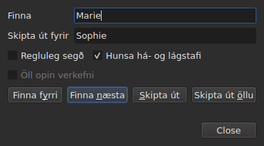
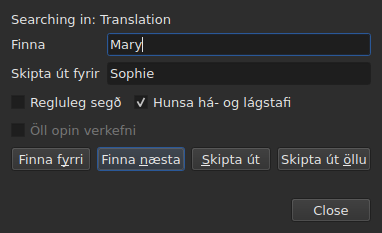

# Leita og skipta út

<!-- machine-translated -->
> Þessi síða er vélþýðing sem enginn lesandi tungumálsins hefur enn farið yfir.

`Breyta ▸ Finna og skipta út…`, eða `Ctrl+F`, opnar leitargluggann.




**Glugginn er ekki svarglugginn**: hann helst opinn meðan þú horfir á töfluna,
breytir reit, leitar aftur. `Close` lokar honum; þegar hann er opnaður aftur
fæst hann eins og þú skildir við hann, með mynstri og útskiptatexta.

| Svið | Hvað það ber |
| :---- | :-------------- |
| `Find` | mynstrið sem leitað er að |
| `Replace with` | það sem kemur í staðinn |
| `Regular expression` | mynstrið er reglulegt segðamynstur frekar en venjulegur texti |
| `Ignore case` | „marie“ finnur „Marie“ |
| `All open projects` | leitin fer í gegnum alla flipana — [sjá hér á eftir](#í-öllum-opnum-verkefnum) |

Færslan er óvirk á tómu skjali: það er ekkert til að leita í.

## Aðgerðirnar fjórar

| Hnappur | Hvað hann gerir |
| :----- | :----------- |
| `Find Previous` | finnur fyrri samsvörun, og taflan fer til hennar |
| `Find Next` | finnur þá næstu — það er hnappurinn sem `Enter` ýtir á |
| `Replace` | skiptir út samsvöruninni sem fannst, finnur síðan þá næstu |
| `Replace All` | skiptir út öllum samsvörunum í markmiðinu |

Allir fjórir eru óvirkir svo lengi sem `Find` er tómt.

**Taflan fer til samsvörunarinnar** með því að velja línu hennar. Þegar komið er að
þeirri síðustu byrjar `Find Next` aftur á þeirri fyrstu; `Find Previous` gerir það sama í
hina áttina.

**`Replace` án samsvörunar sem fannst leitar fyrst**: fyrsta ýtingin
sýnir hvað verður skipt út, sú næsta skiptir því út. Það er það sem
Gaupol gerir.

## Hvað leitin nær yfir

**Valið, eða allt skjalið ef ekkert er valið** — regla
valmyndarinnar `Tools`. Sjá [Aðgerðirnar](operations.md#á-hvað-þær-verka).

**Markmiðið er tekið við fyrstu aðgerð og haldið** svo lengi sem leitin
stendur: `Find Next` velur línu samsvörunar, og það
val þrengir ekki markmiðið. **Að velja aðrar línur sjálfur
breytir markmiðinu** fyrir næstu aðgerð.

Leitin nær yfir texta skjátextanna; hvorki tímasetningar né númer
eru leitað.

### Í öllum opnum verkefnum

Gátreiturinn **`All open projects`** víkkar umfangið í alla flipa. **Óvirkur með
eitt verkefni opið** — það er ekkert til að víkka —, hann verður virkur um leið og
annar flipi opnast, og tekur hakið af sjálfum sér þegar aðeins einn er eftir.

**Þegar hakað er telur valið ekki lengur**: hvert verkefni er leitað í heild,
í **skjalinu sem miðað er á** — því í núverandi dálki, aðal- eða
þýðingarskjalinu, eins og fyrir eitt verkefni.

- **`Find Next` og `Find Previous` fara frá flipa til flipa, í röð
  flipanna.** Verkefnið sem sýnt er fyrst; þegar það hefur ekki fleiri samsvaranir, það
  næsta, þar sem glugginn sýnir flipa þess og velur línu þess.
- **Hringnum lýkur þar sem hann byrjaði**: þegar leitin fer fram hjá síðasta
  flipa og aftur á þann fyrsta — eða öfugt á leið upp —, segir lína
  gluggans frá því, frekar en að byrja aftur orðalaust:

  ```text
  Search wrapped around
  ```

  Skrefið á eftir er venjulegt skref, og línan hreinsast.
- **`Replace` skiptir út þar sem leitin er**, færir sig síðan á næstu
  samsvörun, sem getur verið í öðrum flipa.
- **`Replace All` fer í gegnum öll verkefnin**, og **gerir eina færslu í ferlinum
  fyrir hvert verkefni sem er snert**: að afturkalla í flipa afturkallar aðeins það sem sá flipi
  fékk. Talningin segir hve mörg verkefni breyttust, ekki aðeins hve margar
  útskiptingar:

  ```text
  replaced 4 matches in 3 projects
  ```

  Verkefni þar sem mynstrið er ekki til er ekki snert, og hefur ekkert til að afturkalla.
  **Enginn flipi kemur fram**: hvert verkefni fær sínar útskiptingar
  á bak við flipa sinn, sem fær stjörnu sína, og flipinn sem aðgerðin
  byrjaði á helst sýndur, með kvikmynd sinni.

### Í hvaða texta

**Með þýðingu nær leitin aðeins yfir annan af textunum tveimur: þann í
dálki núverandi reits** — þýðinguna ef núverandi reitur er
í dálkinum `Translation`, aðaltextann alls staðar annars staðar. Það er
regla allra textaaðgerða, og engin aukastilling er til:
sjá [Textinn sem aðgerðirnar beinast að](table.md#textinn-sem-aðgerðirnar-beinast-að).

**Glugginn segir í hvaða texta hann leitar**, á línu fyrir ofan
`Find`, og breytir því þegar núverandi dálkur breytist — jafnvel meðan hann er opinn:




| Núverandi reitur er í | Línan segir |
| :--------------------- | :------------ |
| dálkinum `Translation` | `Searching in: Translation` |
| hvaða öðrum dálki sem er | `Searching in: Main` |
| — verkefnið hefur enga þýðingu, eða dálkurinn er fjarlægður | ekkert: línan er ekki til staðar |

**Útskipti skrifa í þann texta, og hann einan.** `Replace` og `Replace
All` á þýðingunni skilja aðaltextann eftir eins og hann var, og
öfugt; `Undo` skilar því sem þau skrifuðu. **Merkin eru þau í sniði
skrár þess texta**: þýðing á Advanced SSA er lesin með
`{\i1}` sínu, jafnvel þegar aðaltextinn er SubRip. `Replace with` er ritað þar
með sömu merkjum.

**Taflan helst í dálkinum þar sem hún var.** `Find Next` velur línu
samsvörunar án þess að færa núverandi reit frá einum dálki í annan:
leit sem hófst í þýðingunni heldur áfram í þýðingunni.

**Að leita í báðum textum í einu er ekki til**: hver samsvörun
yrði par (skjátexti, texti), og taflan sem færi til hennar hefði
engan skýran stað til að fara á. Þú leitar í öðrum, skiptir síðan um dálk.

**Það sem byrjar aftur frá grunni**:

| Aðgerð | Hvað gleymist |
| :------ | :---------------- |
| að breyta `Find`, `Replace with` eða valkosti | núverandi samsvörun, og stöðulínan |
| að velja aðrar línur sjálfur | markmiðið og samsvörunin |
| að færa núverandi reit frá einum texta í annan — úr `Text` í `Translation`, eða öfugt | samsvörunin: hún er staður í texta |
| að opna aðra skrá | markmiðið og samsvörunin; glugginn helst opinn, með mynstrinu |

## Textinn sem leitað er í er sýnilegi textinn

**Merki eru ekki texti.** Að leita að `<i>` finnur ekkert, og að leita að
`Bonjour` finnur `<i>Bon</i>jour` sem er skorið af merki.

**Útskiptin eru gerð í texta skrárinnar, án þess að brjóta merkin**:

| Texti | Leitað → sett í staðinn | Hvað er ritað |
| :--- | :-------------------------- | :-------------- |
| `<i>Bonjour</i>` | `Bonjour` → `Salut` | `<i>Salut</i>` |
| `<i>Bon</i>jour` | `Bonjour` → `Salut` | `<i>Salut</i>` |
| `<i>Bonjour</i> Marie` | `Bonjour Marie` → `Salut Sophie` | `<i>Salut Sophie</i>` |

Merki sem sker orð tekur til alls orðsins, og hver sá stíll sem snertir
samsvörunina þekur útskiptin. **Merkin sem samsvörunin snertir
ekki haldast þar sem þau eru**, jafnvel merki sem sker annað orð í sama
skjátexta: að skipta út `Marie` í `<i>Bon</i>jour Marie` gefur
`<i>Bon</i>jour Sophie`. Orð er gert úr bókstöfum og tölustöfum — fast
bil eða gæsalappir eru ekki hluti af því. **`Replace with` er lesið með merkjum
textans sem miðað er á**: að slá `<b>Salut</b>` þar inn í SubRip gerir orðið feitletrað.

## Valkostirnir tveir

| Valkostur | Sjálfgefið | Hverju hann breytir |
| :----- | :------ | :-------------- |
| `Regular expression` | ekki hakað | `.` leitar ekki lengur að punkti heldur að hvaða staf sem er |
| `Ignore case` | hakað | stafstaða telur ekki, áherslustafir með: `élise` finnur `Élise` |

Þetta eru sjálfgefin gildi Gaupol. **Báðir eru munaðir** frá einni opnun til
annarrar og frá einni setu til annarrar, í valkostunum `search.regex` og
`search.ignore-case` í [kjörstillingaskránni](preferences.md#skráin).

### Reglulegt segðamynstur

Mynstrið er lesið af ICU. Eins og í Gaupol fer `.` yfir línuskipti, og `^`
og `$` gilda í upphafi og enda **hverrar línu** skjátexta:
að skipta út `^` fyrir `- ` setur þankastrik á undan hverri línu.

Í `Replace with`, og aðeins fyrir reglulegt segðamynstur:

| Ritað | Hvað það setur |
| :------ | :----------- |
| `$1` til `$9` | hópinn með því númeri; hópur sem vantar setur ekkert |
| `$0` | alla samsvörunina |
| `\n` | línuskipti |
| `\$`, `\\` | `$`, bakstrik |
| `\` á eftir hvaða öðrum staf sem er | þann staf: `\t` setur `t` |

**`\1` er ekki hópur**, og setur `1`. Það er setningafræði Gaupol, sem les
segðir sínar í Python; sú hér er ICU, sem les mynstrið.

## Hvað glugginn segir

Undir hnöppunum segir lína hvað leitin gat ekki gert, eða hvað
`Replace All` gerði:

| Aðstæður | Hvað er sýnt |
| :-------- | :------------ |
| engin samsvörun í markmiðinu | `"Sophie" not found` |
| regluleg segð sem les ekki | `not a regular expression (U_REGEX_MISMATCHED_PAREN)` |
| `Replace All` skipti út | `replaced 3 matches` |
| `Replace All` fann mynstrið, en útskiptin breyta engum texta | `nothing to change` |

**Leit sem finnur ekkert snertir ekkert**: valið helst þar sem
það var, og ekkert fer í ferilinn.

**`not found` og `nothing to change` segja ekki það sama.** `not found`
segir að mynstrið sé hvergi í markmiðinu. `nothing to change` segir að það
sé þar, en útskiptin skilja hvern texta eftir eins og hann var — að skipta út
`Marie` fyrir `Marie`, til dæmis. Í báðum tilvikum fer ekkert í
ferilinn. Talan í `replaced N matches` telur samsvaranir
skjátextanna þar sem textinn breyttist.

## Hvað afturköllunin segir um það

| Aðgerð | Hvað `Undo` les |
| :------ | :---------------- |
| `Replace` | `Undo: replacing` — ein fyrir hverja útskiptingu |
| `Replace All` | `Undo: replacing all` — **ein færsla**, hver sem fjöldi samsvarana er |

Sjá [Afturkalla og endurgera](undo.md).
