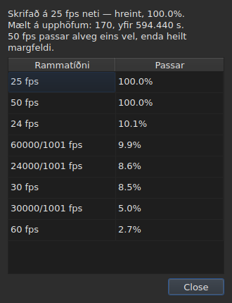

# Rammanetið

<!-- machine-translated -->
> Þessi síða er vélþýðing sem enginn lesandi tungumálsins hefur enn farið yfir.

Skjátextaskrá **lýsir ekki yfir** rammatíðninni sem staðsetningar hennar voru
reiknaðar út frá: SubRip hefur engan haus, og haus
WebVTT er frjáls texti. Glugginn **ályktar hana** út frá staðsetningunum sjálfum,
við opnun, og sýnir hana á tveimur stöðum sem svara ekki sömu
spurningu.

| Flötur | Hvað hann gefur |
| :----- | :-------------- |
| stöðulínan | **svarið**, stöðugt og án þess að spurt sé |
| `Verkfæri ▸ Greining rammatíðni…` | **röksemdafærsluna**, þegar þú vilt sjá hana |

## Hvað stöðulínan sýnir

Hægra megin, milli þess sem hún segir um
[stafakóðun](files.md#stafakóðunin-í-stöðulínunni) skrárinnar sem var lesin og þess sem
hún segir um [tengda myndskeiðið](video.md#hvað-stöðulínan-sýnir):

| Staða | Það sem er skrifað |
| :---- | :----------------- |
| staðsetningarnar eru á neti | `Grid: 24 fps` |
| aðeins sumar þeirra | `Grid: 29.97 fps (partial)` |
| ekkert þekkt net passar | `No grid` |

**`No grid` nefnir enga rammatíðni, og það er ætlunin.** Mengi
kandídata er lokað — rammatíðnirnar átta sem umbreytingarglugginn býður — og
að tilkynna þá sem er minnst röng væri að gefa rangt svar þar sem
„ég veit það ekki“ er rétta svarið.

**`No grid` hefur tvær orsakir, og þær eru ekki sama svarið.** Annaðhvort passar ekkert
net, eða skráin hefur of fáa skjátexta til að hægt sé að segja nokkuð
um hana — tvö upphöf virðast alltaf fullkomlega samstillt, og það sannar
ekkert. Stöðulínan segir það sama um báðar;
**greiningin greinir þær í sundur**, og gefur í fyrra tilvikinu upp hve mikið
besti kandídatinn missir marks.

Línan **uppfærist eftir hverja aðgerð**. Að jafna skrá á aðra
rammatíðni breytir netinu, og stöðulínan má ekki halda áfram að
tilkynna það gamla.

### Skjal sem talið er í römmum hefur ekkert net, það hefur rammatíðni

**MicroDVD er það eina af þeim níu sem telur í römmum.** Hver lína þess
ber tvö rammanúmer og ekkert annað, og skráin **segir ekki** á hvaða
rammatíðni á að lesa þau. Sami staður í stöðulínunni skrifar þá:

| Staða | Það sem er skrifað |
| :---- | :----------------- |
| skjalið er talið í römmum | `Frames: 24000/1001 fps` |

**Þetta er ekki netið, og netið væri hringrök hér.** Staðsetningar
MicroDVD-skjals voru reiknaðar *út frá* römmum þess á nákvæmlega þeirri
rammatíðni; að draga net af þeim myndi skila þeirri tölu aftur, það er að segja gögnum
dulbúnum sem mæling.

**Hvaðan hún kemur er sagt einu sinni**, af lestrinum, í
[lista yfir greiningarboð](files.md#greiningarboð-lesturs):
`counts in frames and states no rate; it was read at ("24000/1001")`. Lína
stöðulínunnar segir hins vegar hvað er, stöðugt.

**Að fara rangt með rammatíðnina færir alla skrána**, og glugginn
[`Convert Frame Rate…`](operations.md#convert-frame-rate) er þar sem þú leiðréttir það:
hann opnast á lestrarrammatíðninni og segir að það sé hún.

## Hvað greiningin sýnir

`Verkfæri ▸ Greining rammatíðni…` **breytir engu.** Hún opnast á samantekt og
röðun kandídatanna átta með stigum þeirra.




Samantektin gefur svarið, síðan það sem takmarkar það — hver setning birtist
aðeins ef hún hefur eitthvað að segja:

| Það sem má lesa þar | Hvenær |
| :------------------ | :----- |
| yfir hve mörg upphöf, og yfir hvaða spann | alltaf |
| um hve mikið skráin er hliðruð frá netinu sínu | staðsetningar hennar eru á því upp að fasta |
| að önnur rammatíðni passar alveg jafn vel | hún er heilt margfeldi þeirrar sem var valin |
| að spannið leyfir ekki að greina tvær rammatíðnir í sundur | skráin er of stutt til að aðgreina þær |
| hve mörg upphöf fara af netinu, **og í hve mörgum hrinum** | skráin er að hluta |

**Fjöldi hrina er það sem greinir í sundur tvær sögur** sem hlutfallið
eitt og sér ruglar saman. Margar hrinur með einu upphafi eru staðsetningar
leiðréttar með hendi, hver fyrir sig. Fáar langar hrinur eru endurtímasettur
kafli, eða skrá sett saman úr tveimur öðrum.

**Öll röðunin er sýnd frekar en eitt svar.** Skrá sem
passar við 25 upp á hundrað af hundraði og við 50 upp á hundrað af hundraði segir nokkuð sem
dómur einn og sér myndi fela.

## Þegar umbreytingin var röng

Skrá sem fellur á ekkert net er stundum skrá sem var **umbreytt á rangri
rammatíðni**: hún er þá á mjög raunverulegu neti, en hliðruð um hlutfall sem er hlutfall
engrar af þeim átta. Þegar ályktunin skilar `none` eða `partial` leitar greiningin **meðal
sextíu og sex raðaðra para af rammatíðnunum átta** — það er mengið, lokað — að því
sem umbreytingin setur staðsetningarnar aftur á net. Hvert hlutfall er beitt á staðsetningarnar og
**það er ályktunin sjálf sem dæmir niðurstöðuna**: öryggið er það sem hún myndi segja, aldrei
uppfundin tala. Tvö pör sem gefa sama hlutfall, eins og 30 í 25 og 60 í 50, eru ein
umbreyting.

Setningunni er bætt við samantektina:

```text
converting from 24 to 25 fps puts the positions on a 24 fps grid: 99.9%, against 11.8% as they are and 14.9% for the next best conversion
```

Hún gefur umbreytinguna, netið sem staðsetningarnar myndu falla á og hve vel þær falla á það,
**síðan mismuninn við staðsetningarnar eins og þær eru og við bestu af hinum
umbreytingunum.** Hnappurinn `Convert Frame Rate…` lokar greiningunni og opnar [glugga
umbreytingarinnar](operations.md#convert-frame-rate)
**útfylltan með parinu sem fannst** — ekkert er framkvæmt
svo lengi sem glugginn er ekki samþykktur, og nóg er að hætta við til að fara til baka. Myndskeiðið, opið við hliðina,
leyfir þér að dæma á myndinni hvort svarið sé rétt.

**Þegar tvö pör eru jafn góð er ekkert lagt til, og setningin segir frá því:**

```text
converting from 30 to 25 fps and converting from 25 to 24 fps fit equally well (99.7% and 99.6%), so none is proposed
```

Þetta er venjulegt tilvik frekar en undantekning: net við 28,8 ramma á sekúndu fer aftur
á 24 jafnt og á 30, og skrá þar sem allar tímasetningar eru tvöfaldaðar helst á 25 netinu.
Aðgerðin sem hefur eina lagfæringu er að umbreyta skrá sem er **þegar** á markrammatíðninni. Við
jafnt val ræður myndskeiðið: þú opnar sjálf(ur) `Convert Frame Rate…` á öðru af pörunum tveimur.

**Ekkert er sagt** um skrá sem er þegar á neti, skrá sem er of stutt til að dómur
hafi nokkurt gildi, né skrá sem engin umbreyting mengisins setur aftur á net — rek,
hlutfall utan rammatíðnanna átta, staðsetningar án byggingar.

## Það sem taflan sýnir ekki

**Engin lína í töflunni er merkt vegna netsins**, aldrei.

Um leið og þú leiðréttir staðsetningu með hendi hættir hún að vera samstillt.
Sjálfvirk merking myndi því tilkynna vinnu notandans sem
frávik, í skrá sem hann er einmitt að leiðrétta. Ályktunin
talar um **skjalið**, og greiningin er eina undantekningin — því þú
opnaðir hana til þess.

Merki töflunnar varða hins vegar það sem heldur ekki saman: endi
á undan upphafi sínu, skörun, rofin röð. Sjá [Taflan](table.md).
