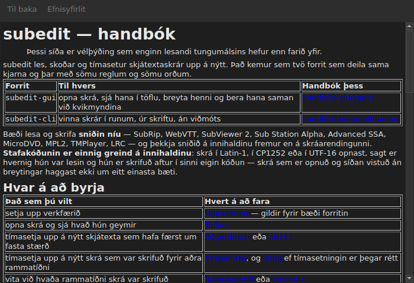

# Handbókin í glugganum

<!-- machine-translated -->
> Þessi síða er vélþýðing sem enginn lesandi tungumálsins hefur enn farið yfir.

`Hjálp ▸ Handbók`, eða `F1`, opnar **einmitt þessa handbók** í sérstökum glugga.




## Hvað hún opnar, og hvers vegna ekki vefslóð

**Handbókin sem er uppsett við hlið forritsins**, ekki síða á Internetinu.

Vefslóð myndi lýsa útgáfunni sem er í þróun, ekki þeirri sem er við höndina.
Notandi sem les handbók útgáfu sem hann hefur ekki er verr settur en
notandi án nokkurrar handbókar — og þess vegna les glugginn skrárnar sem uppsetningin
leggur niður, undir `<prefix>/share/subedit/manual`. Sjá
[Uppsetning](../subedit-cli/installation.md).

Hún opnast á [heimasíðunni](../index.md), þeirri sem segir hvar á að byrja.

## Á hvaða tungumáli

**Á tungumáli gluggans.** Handbókin opnast á því tungumáli sem
viðmótið talar: því sem er valið í `Breyta ▸ Kjörstillingar…`, eða annars tungumáli
umhverfisins — sjá
[Viðmótstungumálið](preferences.md#tungumál-viðmótsins).

| Glugginn talar | Handbókin opnast á |
| :---------------- | :------------------ |
| ensku | ensku |
| tungumáli sem handbók er uppsett fyrir — katalónsku, tékknesku, þýsku, spænsku, finnsku, frönsku, galisísku, hebresku, ungversku, interlingue, íslensku, ítölsku, hollensku | því tungumáli |
| tungumáli sem handbók er ekki uppsett fyrir | ensku |

**Síða fyrir síðu, ekki allt eða ekkert**: síða sem þýðingin hefur ekki
opnast á ensku, og hver önnur síða helst á tungumáli gluggans. Tengill
leiðir úr einni í aðra á sama hátt.

Þýðingarnar eru uppsettar við hlið ensku handbókarinnar, hver í möppu
sem heitir eftir tungumáli sínu: `<prefix>/share/subedit/manual/fr` fyrir frönsku. Tungumálið
er það sem glugginn ræsti á, þannig að tungumál sem er valið í
kjörstillingunum gildir líka um handbókina, við næstu ræsingu.

## Að fara um

| Hvað þú gerir | Hvað gerist |
| :---------- | :----------- |
| smella á tengil í handbókinni | síðan opnast í sama glugga |
| smella á tengil sem vísar á kafla | síðan opnast og glugginn skrunar niður að honum |
| smella á tengil sem vísar aðeins á kafla | glugginn skrunar niður að honum, án þess að skipta um síðu |
| `Back` | fer aftur á fyrri síðu; óvirkt á þeirri fyrstu |
| `Contents` | fer aftur á heimasíðuna; óvirkt þegar þú ert þar |

Glugginn **lokar ekki á aðra glugga**: hann helst opinn meðan þú vinnur, sem er allur
tilgangurinn með því að hafa handbókina við höndina. Að velja færsluna aftur býr ekki til
annan glugga, hún færir þennan fremst.

## Það sem hún getur ekki opnað, og hún segir það

Handbókin vísar stundum í **vegvísinn** eða í **ákvörðun um
högun**. Þau eru skjöl geymslunnar, ekki pakkans: þau eru
ekki uppsett, og glugginn segir það hreint út frekar en að láta
smellinn engu skila.

```
../../feuille-de-route.md is not part of the installed manual;
it lives in the project's repository.
```

Þau má lesa í geymslunni, en vistfang hennar er í `Hjálp ▸ Um subedit`.

## Þegar færslan er óvirk

**`Hjálp ▸ Handbók` er óvirk þegar engin handbók er við hlið forritsins.** Tvö
tilvik, og hvorugt er galli:

| Tilvik | Hvers vegna |
| :--- | :-- |
| tvíundarskráin er keyrð úr smíðatré sínu | ekkert var sett upp þar, svo ekkert er til að lesa |
| uppsetningin er að hluta | handbókin var fjarlægð, eða var aldrei afrituð |

Að láta bendilinn hvíla á færslunni segir hvort tveggja: „Engin handbók er uppsett við hlið þessa forrits“.

Síða sem vantar meðan handbókin er til staðar — skrá sem var eytt í höndunum — lokar ekki
glugganum: hann nefnir skrána sem hann gat ekki lesið og heldur á skjánum því sem
hann var að sýna.

## Hvar handbókarinnar er leitað

**Við hlið keyrsluskrárinnar**, í `../share/subedit/manual` — sú skipan sem hver
uppsetning býr til, hvaða forskeyti sem er. Það er það sem gerir uppsetningu
undir `~/.local` færa um að finna handbók sína jafnt og pakka sem er settur upp undir `/usr`.
