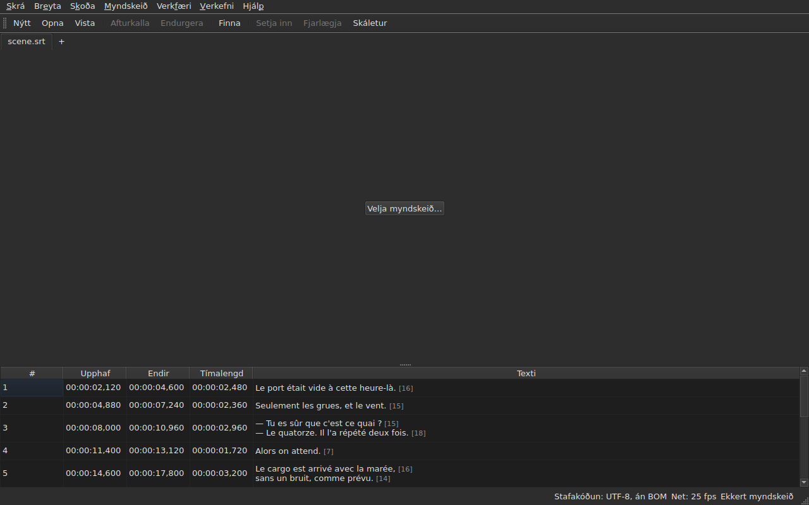

# subedit-gui — handbók

<!-- machine-translated -->
> Þessi síða er vélþýðing sem enginn lesandi tungumálsins hefur enn farið yfir.

Glugginn í subedit: opnaðu skjátextaskrá og sjáðu hana í töflu. Um hitt forritið og til að vita
hvar á að byrja, sjá [handbókina](../index.md).

> **Núverandi staða.** Glugginn **opnar nokkrar skrár, hverja í sínum flipa**, hvaða stafakóðun
> sem þær hafa — með `Open…` eða með því að sleppa þeim á hann —, **birtir** þær,
> **breytir reitum þeirra**, **setur inn og fjarlægir línur**,
> **afturkallar**, **vistar — með vali á stafakóðun, línulokum og
> bætaröðunarmerki** — og **merkir þá skjátexta þar sem tímasetningarnar
> ganga ekki upp**. Hann **sameinar og skiptir** línum, **klippir,
> afritar og límir** texta, og **finnur og skiptir út** í sýnilega textanum
> án þess að brjóta merkin, í einu verkefni eða í öllum. Hann **opnar þýðingu
> við hlið aðalskrárinnar**, pöruð eftir stöðu eða númeri, í einum dálki til viðbótar,
> og vistar hana sérstaklega. Valmyndin `Tools` hefur sextán aðgerðir og tvær færslur fyrir stafsetningu —
> að færa, ummynda, umbreyta rammatíðni, aðlaga tímalengdir,
> **bæta skrá aftan við, skipta verkefni í tvennt**, setja í
> skáletur, bæta við þankastrikum, breyta stafstöðu á fjóra vegu,
> fjarlægja lýsingar fyrir heyrnarskerta, **leiðrétta texta með
> fjölsíðna hjálp**, **athuga stafsetningu orð fyrir orð**, jafna við rammatíðni, færa aftur á
> netið — og netgreininguna, sem breytir engu. Valmyndin `Projects`
> **vistar og lokar öllu** í einu handtaki. Hann **tengir myndskeið
> við skjalið**, valið eða giskað á, og **spilar það í glugganum**, með núverandi
> línu teiknaða á myndina; hann **setur upphaf, endi eða
> skjátexta út frá stöðu kvikmyndarinnar**, **stígur ramma fyrir ramma** og **hnikar brún um einn ramma**. Spilunarstikan **leitar, stillir
> hljóðstyrk og stöðu**, taflan **fylgir spiluninni** án þess að afturkalla handvirka skrunun, tímasetningar
> má sýna **í römmum**, og valmyndin `Video` **velur hljóðrásina**. Tvær greiningar
> **leggja til án þess að beita nokkru sinni**: þýðing sem er færð um fasta stærð og hægt er að **opna aftur
> færða**, og umbreyting rammatíðni sem setur skrá aftur á netið. Hann **man stærð og staðsetningu gluggans, röð, breidd og sýnileika
> dálkanna, og stillingar sínar** milli
> lota, og birtist **ljós eða dökkur** eftir vali þínu. `Hjálp ▸ Handbók`
> opnar **þessa handbók** í glugga. Þessi handbók lýsir því sem er til, aldrei
> því sem er fyrirhugað; það sem kemur næst er í
> [vegvísinum](../../../../feuille-de-route.md).

> **Myndir þessarar handbókar eru búnar til, textinn ekki.** Dæmin í
> `subedit-cli` eru búin til með því að keyra skipunina; skjámyndirnar
> eru búnar til með því að smíða raunverulega gluggann og mynda hann — `make
> manual` gerir hvort tveggja. Mynd getur því ekki lýst viðmóti sem er ekki
> lengur til, og viðmót sem breytist sést í mismun
> geymslunnar. Eftir stendur án öryggisnets textinn í kringum þær, en
> nákvæmni hans hvílir á yfirlestri.

**Hver skjár er sýndur tvisvar, með litapalettunum tveimur sem forritið
býður** — `Light` og `Dark`, þeim sem
[kjörstillingarnar](preferences.md#þemað) bjóða. Á skjáborði þar sem
þemað ræður gefur `System` annað hvort, eftir því sem skjáborðið valdi.

## Valmyndirnar

`File`, `Edit`, `View`, `Video`, `Tools`, `Projects`, `Help` — í þeirri röð sem
þær eru notaðar: skjalið, það sem þú gerir við það, hvernig þú skoðar það, það sem
fylgir því, það sem rannsakar það, það sem á við öll opin verkefni, það sem
útskýrir það.

`View` hefur undirvalmynd, `Columns`, með einni færslu sem hægt er að haka við fyrir hvern dálk nema `Text`
— sjá [Taflan](table.md#að-fela-og-færa-dálka) — og eina stillingu, `Positions in Frames`, sem sýnir
`Start` og `End` sem rammanúmer — sjá [Staðsetningar í römmum](table.md#staðsetningar-í-römmum).

`Projects` hefur tvær færslur, `Save All` og `Close All` — sjá
[Verkefnavalmyndin](files.md#verkefnavalmyndin).

`Edit` hefur fimm blokkir, hverja undir skilrúmi: afturköllun; klippispjaldið
— klippa, afrita og líma texta; `Find and Replace…`;
að setja inn, fjarlægja, sameina og skipta línum; og loks
`Preferences…`. Afturköllun er það sem þú gerir *við* breytingu, að færa texta
bætir hvorki við línu né fjarlægir hana, færslurnar fjórar í næstu blokk breyta fjölda
lína, og að velja þema er alls ekki breyting.

**Lyklar eru nefndir eins og valmyndin sýnir þá**, á ensku eins og afgangur
viðmótsins: `Ins`, `Del`, `Ctrl+Shift+Z`. Lykill sem þú ýtir á og
engin valmynd nefnir heldur enska heitinu sínu: `Enter`, `Esc`, `Shift`.

`Help` hefur tvær færslur, í þeirri röð sem valmyndin sýnir þær. `Manual`, eða
`F1`, opnar þessa handbók í glugga — sjá
[Handbókin í glugganum](help.md). `About subedit` gefur útgáfuna,
leyfið og bókasöfnin sem glugginn keyrir með ásamt útgáfum þeirra — sjá
[`--version`](invocation.md#--version).

## Verkfærastikan

Undir valmyndunum hefur stika **algengustu handtökin**, í hópum.
Hver hnappur hefur stutt orð; valmyndin heldur allri færslunni, og
flýtilykillinn er sá sami.

| Hnappur | Valmyndarfærsla | Flýtilykill |
| :----- | :--------- | :------- |
| Nýtt | Skrá ▸ Nýtt verkefni | `Ctrl+N` |
| Opna | Skrá ▸ Opna… | `Ctrl+O` |
| Vista | Skrá ▸ Vista | `Ctrl+S` |
| Afturkalla | Breyta ▸ Afturkalla | `Ctrl+Z` |
| Endurgera | Breyta ▸ Endurgera | `Ctrl+Shift+Z` |
| Finna | Breyta ▸ Finna og skipta út… | `Ctrl+F` |
| Setja inn | Breyta ▸ Setja inn skjátexta… | `Ins` |
| Fjarlægja | Breyta ▸ Fjarlægja skjátexta | `Del` |
| Skáletur | Verkfæri ▸ Skáletrað | `Ctrl+I` |

**Óvirkur hnappur er óvirkur af sömu ástæðu og færsla hans**: `Undo` þegar
ekkert er til að afturkalla, `Remove` þegar engin lína er valin. Færslur
þýðingarinnar og aðgerðir valmyndarinnar `Tools`, nema `Italic`, haldast í
valmyndum sínum: þær eru notaðar sjaldnar, eða ekki af öllum.

## Kaflar

| Kafli | Efni |
| :------ | :------- |
| [Uppsetning](../subedit-cli/installation.md) | smíði og uppsetning — síðan gildir um bæði forritin |
| [Ræsing](invocation.md) | að ræsa gluggann, röksemdir, skilakóðar |
| [Að opna og vista](files.md) | skipanirnar, flipana, valmyndina `Projects`, að sleppa skrám á gluggann, þýðinguna og að opna hana aftur færða, greiningarboðin, stafakóðunina í stöðulínunni, ferðina fram og til baka, lokun |
| [Taflan](table.md) | hvað hver dálkur sýnir, að fela þá og færa, tímasetningar í römmum, þýðingardálkinn og textann sem aðgerðirnar beinast að |
| [Að breyta reit](editing.md) | hvaða reitum má breyta, og hvernig |
| [Að klippa, afrita og líma texta](clipboard.md) | færslurnar þrjár, það sem berst með, línurnar sem bætast við, þýdd merki |
| [Leita og skipta út](find-and-replace.md) | gluggann, handtökin fjögur, valkostina tvo, hvað leitin nær yfir, í öllum opnum verkefnum |
| [Að setja inn, fjarlægja, sameina og skipta línum](lines.md) | færslurnar fjórar, flýtilykla þeirra, hvert nýju línurnar fara |
| [Afturkalla og endurgera](undo.md) | ferilinn, aðgerðirnar tvær, breytingamerkið |
| [Rammanetið](frame-grid.md) | rammatíðnina sem er dregin af tímasetningunum, greininguna og umbreytinguna sem setur skrá aftur á net |
| [Aðgerðirnar](operations.md) | að færa, ummynda, umbreyta, aðlaga tímalengdir, bæta skrá aftan við, skipta verkefninu, setja í skáletur, stafstöðuna, þankastrikin, fjarlægja lýsingar, jafna, færa aftur á netið, og það sem fer út fyrir lok kvikmyndarinnar |
| [Leiðrétta texta…](correct-texts.md) | leiðréttingarhjálpina: útkomuna og verkin, hverja verksíðu, framvinduna, staðfestinguna |
| [Athuga stafsetningu…](check-spelling.md) | stafsetningarathugunina: stillingar hennar, yfirferðina, lokun í miðju kafi, skort á orðabók |
| [Tengda myndskeiðið](video.md) | að velja myndskeið, sjálfvirku tillöguna, hljóðrásina, stöðulínuna, `ffmpeg` |
| [Spilarinn](player.md) | myndskeiðssýnina, spilunarstikuna, að spila, að fara um, hljóðstyrkinn, töfluna sem fylgir, teiknuðu línuna |
| [Tímasetning út frá myndskeiðinu](timing.md) | að setja upphaf eða endi skjátexta, að setja inn, að velja út frá stöðu kvikmyndarinnar, að stíga ramma fyrir ramma, að hnika brún |
| [Kjörstillingarnar](preferences.md) | þemað, kjörstillingaskrána, valkosti hennar og hvað verður um gildi sem ekki er hægt að lesa |
| [Handbókin í glugganum](help.md) | `Help ▸ Manual`, hvað hún opnar og hvernig á að fara um í henni |
