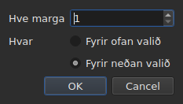

# Að setja inn, fjarlægja, sameina, skipta, raða og losa línur við skörun

<!-- machine-translated -->
> Þessi síða er vélþýðing sem enginn lesandi tungumálsins hefur enn farið yfir.

Átta færslur í valmyndinni `Edit`, undir skiljulínu sem aðgreinir þær frá
`Find and Replace…`. Fjórar eiga það sameiginlegt að breyta fjölda línanna, en
klipping, afritun og líming, hér að ofan, flytja texta; `Sort Subtitles` breytir
aðeins **röð** línanna, `Join Repeated Subtitles` býr aftur til einn
skjátexta úr samfelldum hlutum sama textans, og `Make Ranges Disjoint…`
sker þá upp á nýtt þar sem þeir skarast.

| Færsla | Flýtilykill | Hvað hún gerir |
| :---- | :------- | :----------- |
| Setja inn skjátexta… | `Ins` | opnar glugga og bætir síðan við auðum línum |
| Fjarlægja skjátexta | `Del` | fjarlægir valið án þess að spyrja að nokkru |
| Sameina skjátexta | enginn | býr til eina línu úr blokk lína sem liggja saman |
| Skipta upp skjátexta | enginn | sker línu í tvennt í miðri tímalengd hennar |
| Sameina endurtekna skjátexta | enginn | býr til einn skjátexta úr samfelldum hlutum sama textans |
| Raða skjátextum | enginn | setur línurnar aftur í röð eftir upphafi þeirra, yfir allt verkefnið |
| Láta tímabil ekki skarast… | enginn | sker línur sem skarast þannig að ekkert tímabil skarist við annað |
| Lagfæra skjátexta… | enginn | keðjar saman þrjár færslurnar á undan — sameinar endurtekningar, raðar, sker tímabilin — í einni aðgerð |

Allar átta fara í ferilinn: `Ctrl+Z` afturkallar þær eins og allt annað.

## Innsetning

| Svið | Hvað það inniheldur | Sjálfgefið |
| :---- | :------------ | :------ |
| `How many` | heil tala frá 1 til 99999 | `1` |
| `Where` | `Above the selection` eða `Below the selection` | síðasta valið, `Below` við fyrstu ræsingu |

`OK` bætir línunum við, `Cancel` bætir engu við.

### Hvert þær fara

**Við síðustu línuna sem er valin**, ekki þá fyrstu. Ef línur 1 og 3 eru valdar
og sett er inn fyrir neðan lendir nýja línan í stöðu 4 — ekki í
stöðu 2. Þetta hefur Gaupol gert í tuttugu ár, og þetta er það sem höndin
býst við eftir að hafa sópað frá toppi til botns.

`Above the selection` setur hana rétt á undan þeirri sömu línu.

### Hve lengi þær vara

Auð lína hefur engan texta, en hún hefur tímasetningar. Þær eru dregnar
af plássinu sem er laust:

| Aðstæður | Upphaf | Tímalengd |
| :-------- | :---- | :------- |
| milli tveggja skjátexta | endir þess fyrri | plássið fram að þeim næsta, skipt í jafna hluta |
| á eftir þeim síðasta | endir þess síðasta | þrjár sekúndur hver |
| fremst í skrá | upphafspunkturinn | plássið fram að þeim fyrsta, skipt |
| í tómri skrá | upphafspunkturinn | þrjár sekúndur hver |

Þegar skráin skarast á þeim stað sem valinn er, er **ekkert pláss til að
skipta**: línurnar fá tímalengdina núll, sem taflan sýnir, frekar
en tilbúna tímalengd sem færi yfir nágrannann.

### Tómt skjal

**Ekkert val er nauðsynlegt**, og þetta er eina leiðin til að byrja
nýja skrá: línurnar fara á vísi núll. Val á hlið er þá óvirkt
í glugganum — ekkert val er til að miða staðsetninguna við.

Um leið og skjalið ber línu er færslan `Insert Subtitles…` **óvirk svo lengi sem
ekkert er valið**: án vals yrði vísirinn giskaður.

### Á eftir

Línurnar sem bætt var við eru **valdar**, og taflan fer til þeirra. Ef ýtt er
aftur á `Ins` er því sett inn á eftir þeim, án þess að smella á milli
tveggja.

### Hliðin er munuð

`Above` eða `Below` er munað **frá einni innsetningu til annarrar, og frá einni setu til
annarrar**: það er valkosturinn `edit.insert-placement` í
[kjörstillingaskránni](preferences.md#skráin). Maður setur ekki inn einu sinni,
maður setur inn tíu línur í röð, alltaf á sömu hlið.

## Fjarlæging

`Remove Subtitles`, eða `Del`, fjarlægir valdar línur — einnig
val sem er ekki samfellt, og hver lína fer aftur á sinn stað ef afturkallað er.

**Engin staðfesting er beðin um**, og það er ekki yfirsjón:
aðgerðin er afturkölluð með `Ctrl+Z`. Gluggi sem krefst svars fyrir aðgerð sem hægt er að afturkalla
kostaði smell í hvert sinn til að spara `Ctrl+Z` öðru hverju.

**Færslan er óvirk þegar ekkert er valið.** Annars staðar í glugganum
þýðir „ekkert valið“ „öll skráin“ — það er það sem gerir færslu á tímasetningum
nothæfa án þess að velja fjögur þúsund línur. Hér myndi sá lestur
tæma skjal með óheppilegu `Del`, þess vegna er hann ekki í boði.

Eftir fjarlæginguna er **línan sem tók sæti fyrstu fjarlægðu línunnar
valin** — eða sú síðasta sem eftir er, ef fjarlægingin tók burt enda
skrárinnar. Ef ýtt er nokkrum sinnum í röð á `Del` eru línurnar því fjarlægðar
ein af annarri.

Skrá sem er tæmd alveg skilur gluggann eftir nothæfan: `Insert Subtitles…`
verður aftur virk, þar sem sett er inn í tómt skjal án vals.

## Sameining

`Merge Subtitles` býr til **eina línu** úr völdum línum:

| Hvað sameinaða línan fær | Hvaðan það kemur |
| :---------------------------- | :------------------ |
| upphaf hennar | upphaf þeirrar fyrstu |
| endir hennar | endir þeirrar síðustu |
| texti hennar | textar allra, í röð, með línuskiptum á milli |
| þýðing hennar | þýðingarnar, sameinaðar á sama hátt |
| það sem sniðið ber að auki — stíll, lag, hnit | það sem sú fyrsta ber |

**Tómur texti skilur ekki eftir tóma línu**: sameining á `Un.`, línu án
texta og `Trois.` gefur tvær línur af texta, ekki þrjár.

Sameinuðu línurnar hverfa, og línan sem kemur í þeirra stað tekur sæti
þeirrar fyrstu.

**Færslan er óvirk** svo lengi sem valið er ekki **blokk með að minnsta kosti
tveimur línum sem liggja saman**. Ein lína hefur ekkert til að sameinast;
línur 1 og 3 án 2 ekki heldur, því að niðurstaðan færi yfir 2 og
þekti hana.

Eftir sameininguna er **sameinaða línan valin**: `Split Subtitle` er
tilbúin til að skera hana aftur.

## Skipting

`Split Subtitle` sker valda línu **í miðri tímalengd hennar**, upp á
millisekúndu:

| Helmingur | Upphaf | Endir | Texti |
| :--- | :---- | :-- | :--- |
| sá fyrri | upphaflegt upphaf | miðjan | **allur** textinn og þýðingin |
| sá seinni | miðjan | upphaflegur endir | tómur |

**Textinn er ekki skorinn við línuskipti sín.** Það væri rétt fyrir
skjátexta með tveimur línum og rangt fyrir skjátexta með einni línu eða þremur;
allur textinn helst í fyrri helmingnum, og þú flytur sjálfur það sem á að
fara í þann seinni.

Fyrri helmingurinn heldur því sem sniðið bar að auki við textann; sá seinni
fæðist eins og innsett lína, með ekkert.

**Færslan er óvirk** svo lengi sem valið telur ekki **nákvæmlega eina
línu**. Ekkert valið þýðir ekki „öll skráin“ hér.

Eftir skiptinguna eru **báðir helmingarnir valdir** — það er það sem Gaupol
gerir eftir hverja innsetningu, og `Merge Subtitles` er þá tilbúin til að afturkalla
aðgerðina.

## Röðun

`Sort Subtitles` setur **allt verkefnið** aftur í röð eftir upphafi. Aldrei
valið: röð er eiginleiki skjalsins, og að raða helmingi
skráar þýðir ekkert. Röðunin er **stöðug**: tveir skjátextar sem
byrja saman halda þeirri röð sem skráin gaf þeim.

**Stika gengur í stöðulínunni meðan á röðun stendur, og bendillinn verður að
stundaglasi**: á langri skrá er glugginn ósvarandi um stund — taflan
endurbyggist línu fyrir línu —, og án þess veistu ekki hvort eitthvað
er í gangi. Stikan sýnir engan hluta, röðunin tilkynnir ekki neinn,
og hún hverfur með henni.

Stöðulínan segir hve margar línur skiptu um stað — `3 subtitles moved`
— eða, þegar allt var í röð, `already in order`. **Verkefni sem er þegar í röð
fer ekki í ferilinn**: aðgerð sem breytir engu er ekki
aðgerð til að afturkalla. Færslan er óvirk fyrir verkefni með einn skjátexta.

Skrá **með eitthvað til að leiðrétta við opnun** býður það fram sjálf,
[í einum reit](#við-opnun-einn-reitur): sjá neðar. Skjátextar á röngum stað eru
einnig [taldir með greiningarboðunum](files.md#greiningarboð-lesturs),
svo að þú finnir þá án þess að fletta töflunni.

Á skipanalínunni gerir [`sort`](../subedit-cli/sort.md) það sama á
skrám, og `--sort` gerir það í leiðinni á
[`convert`](../subedit-cli/convert.md#röðun-við-ritun),
[`append`](../subedit-cli/append.md#röðun-niðurstöðunnar) og
[`split-file`](../subedit-cli/split-file.md#skurður-í-tímaröð).

## Að sameina endurtekna skjátexta

`Join Repeated Subtitles` býr til **einn skjátexta** úr skjátextum sem sýna
það sama í röð: texta sem er skorinn í samfellda hluta, eins og
sum sundurgreiningarverkfæri skilja hann eftir. Hún verkar á **allt verkefnið**.

**Endurtekning** hefur sama texta, sömu þýðingu og sömu sniðstillingar
(stíl, staðsetningu, stillingar skjátexta) og annar, **og byrjar í
síðasta lagi þegar sá endar**. Röð af endurtekningum verður að þeim sem byrjar
fyrst, með stærsta endi raðarinnar; hinir hverfa.
`Alpha [1, 2]`, `Alpha [2, 4]` og `Alpha [4, 6]` gefa `Alpha [1, 6]`.

- **Röð skrárinnar breytir engu um það, og hún breytir henni ekki**: skjátextinn sem er geymdur
  er sá sem byrjar fyrst, hvar sem hinir eru.
- **Engu er sameinað fyrir mistök**: annar texti, aðrar stillingar, bil
  milli tveggja hluta, skjátexti án texta eða með endi á undan upphafi
  haldast aðskildir.
- Stöðulínan segir hvað var gert — `2 repeated subtitles joined`, eða
  `no repeated subtitles`.

**Gera þarf það áður en raðað er og skorið**, því að þær lesa hreina röð betur: texti
í þremur hlutum, auk annars texta yfir allt tímabilið, gefinn í
ólagi, raðast og skerst í línur sem skipta á milli hlutanna; sé hann sameinaður
fyrst fellur hann í röð og sameinast hreint. Reiturinn við opnun, hér á eftir,
gerir allt þrennt í þeirri röð.

## Að losa tímabilin við skörun

`Make Ranges Disjoint…` sker skjátexta sem skarast þannig að **ekkert
tímabil `[start, end]` skarist við annað**. Hún verkar á **allt
verkefnið**, aldrei á valið: hópur skjátexta sem skarast
er skorinn þar sem þeir skarast, og helmingur af hópi þýðir ekkert.

**Ekkert er stytt eða lengt.** Á hverju augnabliki sýnir glugginn
sömu texta og áður. Það sem breytist er hvernig tímalínan er skorin:
hún er skorin við hvert upphaf og hvern endi hóps; bil sem einn
skjátexti þekur helst sá skjátexti; bil sem nokkrir þekja
verður **einn** skjátexti með línum þeirra, **þá elstu í línu 1**.
`A [0, 5]` og `B [3, 8]` gefa `[0, 3] A`, `[3, 5] A / B`, `[5, 8] B`.

Glugginn biður um þrjár stillingar, munaðar frá einu sinni til annars:

| Svið | Hvað það inniheldur | Sjálfgefið |
| :---- | :------------ | :------ |
| `Shortest interval kept` | frá 0 til 10000 ms: styttra bil er yfirtekið af nágranna | `80 ms` (um það bil tveir rammar) |
| `Most lines in a subtitle` | frá 0 til 10; `No limit` við 0 | `2` |
| `Put a dash before each subtitle's text` | þankastrik á undan því sem hver skjátexti leggur til sameinaðs skjátexta | ekki hakað |

`OK` sker, `Cancel` gerir ekkert. **Línurnar sem eru skrifaðar eru valdar**
á eftir, og stöðulínan segir hvað var gert: `2 subtitles split, 1 merged`.
Önnur umferð breytir engu og segir það: `already disjoint`.

- **Lína er aldrei tvöfölduð.** Tveir skjátextar með sama texta gefa eina
  línu þar sem þeir skarast, og tveir hlutar sem liggja saman og sýna
  það sama mynda aðeins einn skjátexta. Texti skjátexta sem er skorinn í marga
  hluta er annars endurtekinn í hverjum: það er það sem er á skjánum á því augnabliki.
- **Mjög stutt bil er yfirtekið af nágranna**: sá sem línur
  innihalda þegar sínar eigin, annars sá lengsti, lengir tímabil sitt til að þekja það.
  Heill skjátexti sem er styttri en þröskuldurinn er aldrei yfirtekinn.
- **Fleiri línur en mörkin: gluggar.** Þrjár línur yfir þrjár sekúndur
  verða tveir helmingar, fyrst tvær fyrstu línurnar og síðan tvær síðustu;
  fjórar línur, þrír þriðjungar, og svo framvegis. Ekkert er stytt.
- Þýðingin fylgir sömu skurðum; stíll og staðsetning fyrsta
  skjátextans sem þekur eru geymd.

**Það sem ekki var hægt að gera til fulls er sagt í reit sem lokað er**, ekki í
stöðulínunni: gluggar, yfirtekin bil, of stuttir skjátextar
látnir heilir, stílar sem eru ólíkir, skjátextar með endi á undan
upphafi (látnir vera þar sem þeir eru).

**Færslunni er hafnað, með ástæðu, þegar skjátextarnir eru ekki í
röð eftir upphafi**: hóparnir eru raðir nágranna, og kjarninn raðar
aldrei sjálfur. Fyrst `Sort Subtitles` — eða reiturinn við opnun, sem
gerir hvort tveggja í þeirri röð.

### Allt í einu: `Repair Subtitles…`

`Repair Subtitles…` gerir þrjár færslurnar á undan **hverja á eftir annarri**, í einu röðinni sem virkar: endurtekningar
eru sameinaðar, skjátextum raðað eftir upphafi, og síðan tímabilin losuð við skörun. Hún er færslan
fyrir skrá sem er illa sundurgreind, illa raðað og skarast, þegar þú veist að þú vilt allt þrennt. Glugginn biður um
stillingar skurðarins (sömu og í `Make Ranges Disjoint…`, munaðar frá einu sinni til annars) og segir að hann sameinar og raðar
fyrst. Stöðulínan — eða reiturinn sem er lokað, þegar eitthvað var ekki hægt að gera til fulls — gefur **eina skýrslu**
um allt þrennt: `2 repeated subtitles joined; already in order; 2 subtitles split, 1 merged`. Hver leiðrétting er sín eigin
færsla í ferlinum: `Ctrl+Z` afturkallar þær eina í einu. Á skipanalínunni: [`repair`](../subedit-cli/repair.md).

### Við opnun, einn reitur

Skrá sem opnast með eitthvað sem við kunnum að leiðrétta **býður það fram í
einum reit**, `Problems found in this file`, frekar en að opna einn fyrir
hvert vandamál. Hvert vandamál sem finnst er lína með sínum gátreit, hakaðan:

- `Join the repeated subtitles` — skjátextar endurtaka annan sem þeir
  snerta, með fjölda þeirra;
- `Sort the subtitles` — skjátextarnir eru ekki í röð eftir upphafi,
  með fjölda þeirra;
- `Make the ranges disjoint` — skjátextar byrja áður en sá fyrri endar,
  taldir **þegar skráin er komin í röð**, því að þar eru þeir leiðréttir.

**Hvert vandamál er talið þar sem það er leiðrétt**, á afriti sem
leiðréttingarnar á undan hafa þegar verið gerðar á: texti skorinn í hluta er
orsök sumrar óreiðu, og að sameina hann fyrst getur skilið enga eftir — reiturinn
býður þá ekki upp á röðunina.

Vandamál sem fannst ekki hefur enga línu. Ef afhakað er við röðunina er hinn reiturinn **grár og
afhakaður**: tímabil eru aðeins losuð við skörun í réttri röð.
`Fix` beitir því sem er hakað — sameiningunni, síðan röðuninni, síðan skurðinum, með
stillingum síðustu `Make Ranges Disjoint…` — og gefur **eina skýrslu** um það;
`Keep as is` snertir ekkert. **Ekkert er gert án já**, hver leiðrétting
er færsla í ferlinum, og skrá án leiðréttinga er ekki
efni neinnar spurningar.

Á skipanalínunni gerir [`disjoint`](../subedit-cli/disjoint.md) það sama á skrám, og `--disjoint`
gerir það í leiðinni á [`convert`](../subedit-cli/convert.md#að-losa-tímabilin-við-skörun),
[`append`](../subedit-cli/append.md#að-losa-tímabilin-við-skörun) og
[`split-file`](../subedit-cli/split-file.md#að-losa-tímabilin-við-skörun).

### Hvers vegna ekki flýtilyklar Gaupol

Gaupol sameinar með `M` og skiptir með `S`. Staki stafurinn yrði tekinn af
töflunni áður en hann næði til reits í breytingu, og `Ctrl+S`
vistar þegar: báðar færslurnar eru opnaðar í gegnum valmyndina.

## Hvað afturköllunin segir um það

**Ein færsla í ferlinum fyrir hverja aðgerð.** Sameining fimm lína er afturkölluð með einu
`Ctrl+Z`, og skilar línunum fimm eins og þær voru — tímasetningar, textar og
allt sem sniðið bar.

| Aðgerð | Hvað `Undo` les |
| :-------- | :---------------- |
| innsetning | `Undo: inserting` |
| fjarlæging | `Undo: removing` |
| sameining | `Undo: merging` |
| skipting | `Undo: splitting` |
| sameining endurtekninga | `Undo: joining repeated subtitles` |
| skurður á tímabilum | `Undo: making the ranges disjoint` |

Leiðrétting sem boðin er við opnun er ein færsla í ferlinum fyrir hverja leiðréttingu: sameiningin, röðunin og síðan skurðurinn eru afturkölluð hver á eftir annarri.

Sjá [Afturkalla og endurgera](undo.md).

## Flýtilyklar meðan reitur er opinn

`Ins` og `Del` tilheyra innsláttarreitnum svo lengi sem reitaritill
er opinn: eyðingarlykillinn eyðir þar staf, ekki
skjátexta. Þegar ritlinum er lokað — `Enter` eða `Esc` — fá þeir merkingu sína aftur. Þegar hún er ræst
úr valmyndinni staðfestir `Remove Subtitles` fyrst innsláttinn, eins og hinar
aðgerðirnar í [Að breyta reit](editing.md).

Þessi handbók nefnir lyklana eins og valmyndin sýnir þá — sjá
[Valmyndirnar](index.md#valmyndirnar).
