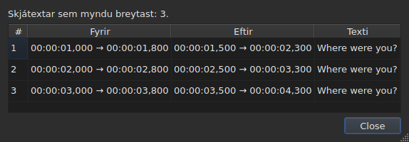
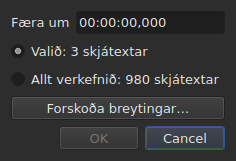
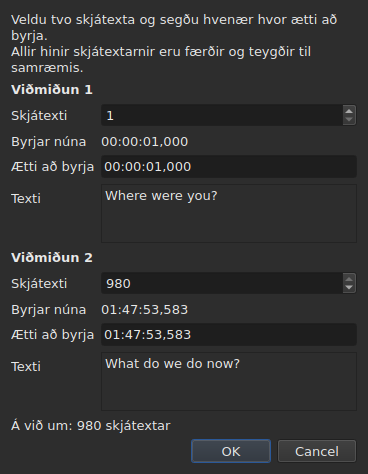
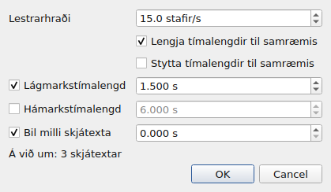
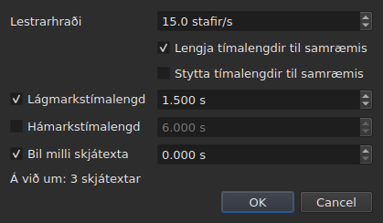
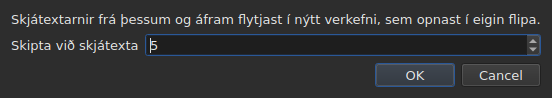

# Aðgerðirnar

<!-- machine-translated -->
> Þessi síða er vélþýðing sem enginn lesandi tungumálsins hefur enn farið yfir.

Valmyndin **Verkfæri** hefur sextán aðgerðir, eina greiningu og tvær færslur fyrir stafsetningu. Hverja
af þessum sextán er afturkallað með `Ctrl+Z`; greiningin breytir engu. `Check Spelling…` er líka afturkölluð, og `Spell-Check Settings…` snertir engan texta.

| Færsla | Gluggi | Hvað hún gerir |
| :---- | :----- | :----------- |
| `Shift Positions…` | já | færir útkomuna um tímalengd |
| `Transform Positions…` | já | leiðréttir útkomuna út frá tveimur merkjum |
| `Convert Frame Rate…` | já | tímastillir útkomuna upp á nýtt úr einni rammatíðni í aðra |
| `Adjust Durations…` | já | færir endana til að halda lestrarhraða, tímalengdum og bili |
| `Append File…` | skráaval | bætir skrá aftan við verkefnið |
| `Split Project…` | já | klýfur verkefnið í tvennt, afgangurinn fer í nýjan flipa |
| `Italic` | **nei** | setur útkomuna í skáletur, eða tekur það af |
| `Dialogue` | **nei** | setur þankastrik í upphaf hverrar línu, eða fjarlægir það |
| `Stafstaða ▸ Fyrirsagnarstafsetning` | **nei** | hvert orð fær hástaf |
| `Stafstaða ▸ Setningastafsetning` | **nei** | fyrsti stafur textans, og hann einn |
| `Stafstaða ▸ HÁSTAFIR` | **nei** | allt í hástöfum |
| `Stafstaða ▸ lágstafir` | **nei** | allt í lágstöfum |
| `Remove Hearing-Impaired Mentions…` | já, án stillinga | fjarlægir lýsingar fyrir heyrnarskerta |
| `Correct Texts…` | já, fjölsíðna hjálp | leggur til leiðréttingar — lýsingar, sameiningu og skiptingu orða, algengar villur, hástafi, línuskiptingu — og beitir þeim þegar þær eru samþykktar, sjá [Leiðrétta texta…](correct-texts.md) |
| `Check Spelling…` | já, yfirferð orð fyrir orð | fer yfir orðin sem orðabókin þekkir ekki og beitir því sem var leiðrétt, sjá [Athuga stafsetningu…](check-spelling.md) |
| `Spell-Check Settings…` | já | velur tungumál, útkomu og skjal athugunarinnar, og undirstrikunina við innslátt, sjá [Athuga stafsetningu…](check-spelling.md#stillingar-stafsetningarathugunar) |
| `Snap to Frame Rate…` | já | setur hvert tímamerki aftur á næsta ramma |
| `Shift Whole File onto Grid (…)` | **nei** | færir alla skrána aftur á netið sitt |
| `Frame Rate Analysis…` | já, án stillinga | **breytir engu** — sjá [Rammanetið](frame-grid.md) |

**Það sem aðgerð gerði er sagt í upplýsingaglugga sem þarf að
loka, nema fyrir `Italic`, `Case` og `Dialogue`**: þessar þrjár opna engan
glugga, og skýrsla þeirra — „ekkert til að breyta“ meðtalið — er sýnd
í stöðulínunni, án nokkurs til að loka. `Split Project…` gefur líka sína eigin
í stöðulínunni: niðurstaðan er þegar fyrir augum þér, í nýja flipanum. Skilaboðin eru tilgreind í
kafla hverrar aðgerðar.

Að setja inn, fjarlægja, sameina og skipta línum er ekki hér heldur í
valmyndinni `Edit`, því það breytir fjölda lína. Sjá
[Að setja inn, fjarlægja, sameina og skipta línum](lines.md).

## Á hvað þær verka

**Valdar línur, eða öll skráin ef engin er valin.** Sama
regla gildir um allar, og gluggarnir, þegar til er gluggi, minna á hana með
einföldum orðum:

```
Applies to: 4 subtitles
```

Að velja allar línur jafngildir því að velja engar.

**Þegar aðeins hluti línanna er valinn spyr glugginn
á hvað á að verka.** Tveir kostir eru sýndir, með fjölda sínum, og **valið
er það sem hakað er við**:

```
(•) Selected: 2 subtitles
( ) Whole project: 4 subtitles
```

Að haka við `Whole project` víkkar aðgerðina út til allrar skrárinnar án þess að þurfa fyrst
að breyta valinu. Þegar ekkert er að velja — ekkert valið,
eða allt —, stendur línan `Applies to:` hér að ofan ein.

Gluggar `Shift Positions…`, `Transform Positions…`,
`Convert Frame Rate…`, `Adjust Durations…`, `Snap to Frame Rate…` og
`Remove Hearing-Impaired Mentions…` bjóða þetta val.

### Að sjá áður en beitt er

`Shift Positions…`, `Transform Positions…`, `Convert Frame Rate…`,
`Adjust Durations…` og `Snap to Frame Rate…` hafa hnappinn **`Preview changes…`**.
Hann opnar lítinn glugga sem segir hve mörgum skjátextum aðgerðin
myndi breyta **með því sem er slegið inn á því augnabliki, á útkomuna sem hakað er við**, og
telur upp þá fyrstu tólf: númer þeirra, tímasetningu þeirra áður, tímasetningu þeirra
eftir, og fyrstu línu texta þeirra. **Engu er beitt**: að loka
glugganum fer aftur í gluggann, þar sem þú getur breytt gildi og litið
aftur.




Hann opnast nógu stór til að sýna alla dálkana, og má breyta stærð hans
í höndunum.

Ef aðgerðin myndi engu breyta segir glugginn það (`Nothing would change.`).
Meðan það sem er slegið inn skilgreinir ekki aðgerð — tímalengd sem ekki er hægt að lesa, tvö
merki á sama skjátexta —, er forskoðunin tóm af sömu ástæðu og hnappurinn
`OK` er grár. `Remove Hearing-Impaired Mentions…` hefur enga forskoðun: það sem
hún breytir er texti, og skýrslan sem hún gefur á eftir
segir það.

**Með þýðingu, hvaða texta?** Aðgerðir á tímasetningar og gerð
verka á allan skjátextann — báðir textar hans fylgja. Þær sem
endurskrifa texta — `Italic`, `Case`, `Dialogue`,
`Remove Hearing-Impaired Mentions…` — beinast að **texta dálksins þar sem núverandi reitur er**:
þýðingunni í dálki hennar, aðaltextanum annars staðar. Hinn helst óbreyttur, og
stöðulínan segir hvor er markið. Sjá [Taflan](table.md#textinn-sem-aðgerðirnar-beinast-að).

**Ein undantekning, og merkimiði hennar ber hana**: `Shift Whole File onto Grid`
hunsar valið. Net er eiginleiki skjalsins, og hálft
skjal hefur ekkert net af eigin: færslan segir það því í nafni sínu frekar en
aðeins í þessari handbók.

**`Append File…` hunsar valið líka**, af annarri ástæðu: hún
endurskrifar ekki útkomu, hún ýtir enda aftur. Sjá
[eigin kafla](#append-file) hennar. **Svo gerir `Split Project…`**: hún klýfur þar sem henni er
sagt. Sjá [hennar eigin](#split-project).

**`Correct Texts…` velur útkomu sína á sinni eigin síðu**, frekar en að fylgja
núverandi vali: valið, núverandi verkefnið eða öll opin
verkefni. Sjá [Leiðrétta texta…](correct-texts.md). **`Check Spelling…` velur hana í
`Spell-Check Settings…`**, og man hana: sjá [Athuga stafsetningu…](check-spelling.md).

**Netaðgerðirnar tvær tala ekki um sama hlut og netið.**
Aðgerð verkar á valið; greiningin og stöðulínan tala um **allt
skjalið**. Að jafna fimm línur af hundrað sjötíu og sex breytir þessum
fimm — taflan sýnir það — án þess að hvorug þeirra haggist, sem
lítur út eins og misheppnuð endurnýjun. Það er hún ekki: þær hafa ekkert að
segja. Sjá [`Snap to Frame Rate…`](#snap-to-frame-rate) og
[Rammanetið](frame-grid.md).

### Hvað „ekkert valið“ þýðir, færsla fyrir færslu

Reglan gildir um valmyndina `Tools` og um leitina. Færslur
valmyndarinnar `Edit` sem snerta línurnar eða tæma þær lesa hana á annan hátt — annars myndi
óheppileg `Del` eða `Ctrl+X` tæma skjalið.

| Færsla | Án vals | Hvað hún krefst |
| :---- | :------------------ | :--------------- |
| aðgerðir valmyndarinnar `Tools` | öll skráin | skjal sem er ekki tómt |
| `Shift Whole File onto Grid` | öll skráin, **alltaf** | net fannst |
| `Find and Replace…` | öll skráin | skjal sem er ekki tómt |
| `Cut Texts`, `Copy Texts`, `Paste Texts` | **óvirk** | að minnsta kosti ein lína valin |
| `Remove Subtitles` | **óvirk** | að minnsta kosti ein lína valin |
| `Merge Subtitles` | **óvirk** | blokk með að minnsta kosti tveimur línum sem liggja saman |
| `Split Subtitle` | **óvirk** | nákvæmlega ein lína |
| `Insert Subtitles…` | óvirk, nema á tómu skjali | lína til að staðsetja þær gagnvart |

Hver síða gefur ástæðuna: [klippispjaldið](clipboard.md#á-hvað-þær-verka),
[línurnar](lines.md), [leitin](find-and-replace.md#hvað-leitin-nær-yfir).

Færslurnar eru **óvirkar á tómri skrá**: það væri ekkert til að
færa. `Italic` hefur annað skilyrði, sem kafli hennar lýsir: opna
sniðið verður að geta skrifað stíl. Stafstaða og þankastrik hafa ekkert — texti
er texti í öllum sniðunum níu.

## `Shift Positions…`

Færir útkomuna um tímalengd, áfram eða afturábak. Báðar tímasetningar
hvers skjátexta færast um sömu stærð: enginn helst lengur eða skemur á skjánum
en áður.

Tímalengdin er skrifuð **eins og tímamerki, með formerki** — `00:00:02,500` færir áfram,
`-0:01,250` færir afturábak. Leyfileg form eru þau sem gilda í tímasetningarreit.




| Höfnun | Hvers vegna |
| :------ | :-- |
| tímalengd sem ekki er hægt að lesa | hnappurinn helst óvirkur; ekkert er fært af handahófi |
| færsla upp á núll | engin aðgerð er til að skrá |
| skjátexti færi fyrir upphaf myndskeiðsins | **engin skrá getur borið slíka tímasetningu** |

Þriðja tilvikið nefnir sökudólginn — „skjátexti 1 myndi byrja á undan upphafspunkti“ —
og það er það sem þarf að líta á til að sjá hve mikið þér skjátlaðist. Engu
er beitt.

## `Transform Positions…`

Leiðrétting skrár sem er tímasett miðað við annað snið. Þú segir hvar **tveir**
skjátextar byrja í raun, og allt annað fylgir, í réttu hlutfalli.

Glugginn biður tvisvar um sama hlutinn: skjátextanúmer, og
tímasetninguna þar sem upphaf hans á heima. Fyrir hvert merki sýnir hann **hvað það
númer vísar á** — texta hans (`Text`) og tímann sem hann byrjar á
**núna** (`Now starts`), sem einfalda merkimiða — og þeir fylgja númerinu
þegar þú breytir því. Textinn heldur **þriggja lína rými** hvað sem
skjátextinn segir: lengri texti, eða löng vistföng, skrunast inni í því, og
glugginn heldur stærð sinni meðan merkið breytist. **Aðeins eitt svið er slegið inn fyrir hvert merki:
`Should start`**, tíminn sem þessi skjátexti á að byrja á. Það þarf ekki að leita í töflunni að því hvaða lína er `980`.

`Should start` er **lagt til með núverandi gildi**: svo lengi sem þú snertir það
ekki segir merkið „þessi skjátexti er þegar þar sem hann á að vera“. Þú breytir aðeins
því sem þú vilt breyta. Seinna merkið er forfyllt á síðasta
skjátexta skrárinnar — tvö fjarlæg merki gefa öruggari leiðréttingu
en tvö sem liggja saman.




**Bæði merkin lenda nákvæmlega þar sem um var beðið.** Það er ekki
nálgun: útreikningurinn er gerður þannig að það sé satt.

| Höfnun | Hvers vegna |
| :------ | :-- |
| tvö merki á sama skjátexta | þau skilgreina enga leiðréttingu |
| tímasetning sem ekki er hægt að lesa | sama ástæða og fyrir færsluna |

Ekki er hægt að slá inn númer utan skrárinnar: sviðið er takmarkað við
fjölda skjátexta.

## `Convert Frame Rate…`

Tímastillir útkomuna upp á nýtt þegar tímasetningarnar voru reiknaðar miðað við eina rammatíðni
og eiga að vera miðað við aðra.

Báðir listarnir bjóða rammatíðnirnar átta sem eru staðlaðar.

> **Að fara rangt með inntaksrammatíðnina færir alla skrána án þess að tilkynna
> neitt.** Það er versta bilunarháttur þessarar aðgerðar, og þess vegna
> segir glugginn hvaðan gildin sem hann leggur til koma frekar en að
> stilla þau þegjandi.

### Heimildirnar tvær, og hverju þær svara

Glugginn hefur allt að tvær línur til viðbótar, hvor birtist þegar hún hefur
eitthvað að segja:

| Lína | Hvað hún segir | Hverju hún forfyllir |
| :--- | :----------- | :---------------- |
| `The positions say` | [rammanetið](frame-grid.md) sem er dregið af tímasetningum skrárinnar | `Timed against` |
| `The video declares` | rammatíðnin sem ílátið tilkynnir, til dæmis `24000/1001` | `Should play at` |
| `The file was read at` | rammatíðnin sem skrá **talin í römmum** var lesin á | `Timed against` |

**Hver tillaga fer á sviðið sem hún svarar.** Netið segir við hvað
skráin var *skrifuð* — það er efri listinn. Það sem ílátið tilkynnir er
rammatíðnin sem kvikmyndin *gengur* á, og þar með sú sem skjátextarnir
verða að koma á — það er neðri listinn.

**Aðeins hreint net forfyllir inntakið.** Hlutanet er
vísbending sem útdrátturinn sjálfur kallar að hluta, og þetta svið ræður
aðgerð á alla skrána. [Stöðulínan](frame-grid.md) og greiningin
bera það tilvik; þessi gerir það ekki.

**Skrá talin í römmum leysir netið af hólmi frekar en að bætast við það.**
MicroDVD ber rammanúmer, og tímasetningar skjalsins voru
reiknaðar út frá þeim á lestrarrammatíðninni: net dregið af þessum tímasetningum
getur aðeins fundið þá tölu aftur. `The positions say` hverfur því, og
`The file was read at` tekur sæti þess — það er sama valið og
[stöðulínan](frame-grid.md#skjal-sem-talið-er-í-römmum-hefur-ekkert-net-það-hefur-rammatíðni) gerir.

**Þannig breytirðu rammatíðni MicroDVD.** Að stilla lestrarrammatíðnina
sem inntak og hina réttu sem úttak endurreiknar hverja tímasetningu út frá
römmum skrárinnar — án þess að lesa neitt aftur, og aðgerðin er afturkölluð eins og
hinar.

### Ósamræmi er ekki mótsögn

Báðar línur geta verið sýndar saman og tilkynnt mismunandi tölur.
**Það er ekki villa sem þarf að skera úr um**: kvikmyndin gengur á einni rammatíðni,
skráin var skrifuð á öðru neti. Skrá á 24 fyrir kvikmynd á 25 er
einmitt tilvikið sem jöfnun — `snap` á skipanalínunni — er til
fyrir.

Ekkert er því valið fyrir notandann: báðir listar haldast
breytanlegir, og það er af ásettu ráði. Heimild sem þröngvar sér upp á kemur í veg fyrir víxlathugun.

Línurnar birtast ekki þegar ekkert er að segja: ekkert myndskeið
tengt, enginn `ffprobe`, eða ekkert hreint net. Glugginn er þá sá sem er
lýst hér að ofan, og **engin aðgerð neitar fyrir því** —
rammatíðnin kemur frá notandanum. Sjá
[Tengda myndskeiðið](video.md#ffmpeg-er-ekki-nauðsynlegt).

Rammatíðni sem kvikmyndin tilkynnir en er ekki ein þeirra átta stöðluðu
er **sýnd án þess að vera valin**: að vita að kvikmyndin gengur á
óvenjulegri rammatíðni er upplýsingin, og hér er ekkert til að umbreyta henni í.

Að umbreyta rammatíðni í sjálfa sig breytir engu: hnappurinn helst óvirkur.

## `Adjust Durations…`

Lengir eða styttir tímalengd skjátexta útkomunnar **með því að færa
endi þeirra, aldrei upphaf**. Að færa upphafið myndi færa skjátextann, sem er
verk [`Shift Positions…`](#shift-positions).





### Skilyrðin fjögur

| Svið | Hverju það biður um | Gildi | Sjálfgefið |
| :---- | :--------------- | :----- | :------ |
| `Reading speed` | tímann sem þarf til að lesa textann | frá 1 til 99 stafir á sekúndu, upp á tíunda hluta | 15 stafir/s |
| `Lengthen durations to match it` | lengja það sem er of stutt til að lesa | hakað við eða ekki | hakað við |
| `Shorten durations to match it` | stytta það sem helst sýnt lengur en þarf | hakað við eða ekki | ekki hakað við |
| `Minimum duration` | lágmarkstímalengd | frá 0 til 99 s, upp á millisekúndu | hakað við, 1,5 s |
| `Maximum duration` | hámarkstímalengd | frá 0 til 99 s, upp á millisekúndu | ekki hakað við, 6 s |
| `Gap between subtitles` | bilið sem á að skilja eftir fyrir næsta skjátexta | frá 0 til 99 s, upp á millisekúndu | hakað við, 0 s |

Þetta eru sjálfgefin gildi Gaupols.

**Skilyrði sem ekki er hakað við er fjarverandi**: svið þess er grátt og ekki lesið.
Skilyrði sem er hakað við á núlli er núll virði — bil upp á 0 s bannar
skjátexta að skarast við þann næsta. Lestrarhraðinn er aðeins lesinn ef
`Lengthen` eða `Shorten` er hakað við.

**Þegar ekkert er hakað við er `OK` óvirkur**: það er ekkert til að biðja um.

Glugginn opnast aftur á gildum síðustu aðlögunar, **og heldur þeim frá einni
lotu til annarrar** — eins og leitarvalkostirnir tveir. **Gátreitur sem ekki er hakað við
heldur gildi sínu**: að taka hakið af `Minimum duration` eftir að hafa stillt 2 s færir ekki aftur
1,5 s, og að haka við aftur finnur 2 s. Stillingarnar níu eru í
[kjörstillingaskránni](preferences.md#skráin), undir `duration-adjust.`.

**Skipanalínan deilir þeim.** [`subedit-cli adjust`](../subedit-cli/adjust.md) les
sömu stillingarnar níu sjálfgefið, svo hraði sem er stilltur hér er hraðinn sem hún notar, nema eigin valkostir hennar
segi annað; [`subedit-cli config`](../subedit-cli/config.md) sýnir þær og breytir þeim. Sjá
[Tvær blokkir, önnur sameiginleg með skipanalínunni](preferences.md#tvær-blokkir-önnur-sameiginleg-með-skipanalínunni).

### Í hvaða röð, og hvert þeirra sigrar

Hver skjátexti útkomunnar fer í gegnum skilyrðin fjögur **í þessari röð**, og
hvert setur endinn í sinni röð:

| Röð | Skilyrði | Hvað það setur |
| ---: | :--------- | :----------- |
| 1 | lestrarhraði | `end = start + length ÷ speed`, ef skjátextinn er of stuttur (`Lengthen`) eða of langur (`Shorten`) |
| 2 | lágmarkstímalengd | `end = start + minimum`, ef tímalengdin er styttri |
| 3 | hámarkstímalengd | `end = start + maximum`, ef tímalengdin er lengri |
| 4 | bil | `end = next start − gap`, ef endirinn er of nálægt honum — aldrei fyrir upphafið |

**Það síðasta sem er beitt sigrar.** Bilið kemur síðast og getur komið
tímalengd aftur niður fyrir lágmarkið sem var nýbúið að setja: tveir skjátextar á skjánum á sama
tíma eru galli sem áhorfandinn sér, örlítið stuttur skjátexti er það
ekki.

**Lengd textans er talin án merkja**, í stöfum, með línuskiptum:
`<i>été</i>` telur þrjá stafi. Lestrarhraðinn talar um
það sem áhorfandinn les.

**Sá næsti er næsti skjátexti skrárinnar**, hvort sem hann er í útkomunni eða
ekki. **Síðasti skjátexti skrárinnar hefur engan næsta**: bilið
takmarkar hann ekki.

### Það sem enginn endir getur fullnægt er sagt

Þegar aðlögunin er búin segir glugginn hve margir endar færðust, og **hvað
var ekki hægt að halda** — skilyrði birtist aðeins ef því var
fórnað fyrir að minnsta kosti einn skjátexta:

```text
adjusted the durations of 12 subtitles; could not satisfy the reading speed in 9 subtitles, the minimum duration in 4 subtitles
```

Tilgreiningarnar þrjár sem eru mögulegar eru `the reading speed`, `the minimum duration` og
`the gap`. **Hámarkstímalengdinni er alltaf haldið**: hún kemur á eftir hraðanum
og lágmarkinu, og aðeins bilið fylgir henni, sem getur aðeins stytt. Lágmark
sem er stærra en hámarkið lætur undan því, og það er lágmarkið sem er talið. Bilinu
er aðeins fórnað þegar sá næsti byrjar áður en skjátextinn sjálfur byrjar.

Talningin nær yfir alla útkomuna, **líka skjátextana sem endir þeirra færðist
ekki**: skjátexti sem er þegar stilltur gagnvart þeim næsta og of stuttur fyrir
lágmarkið er talinn. Þegar enginn endir færist segir glugginn það —
`no duration to adjust` — og ekkert fer í ferilinn.

## `Append File…`

Bætir skrá aftan við opna verkefnið. **Ekkert er sett inn á milli
tveggja**: valda skráin er færð um enda síðasta skjátexta
verkefnisins, nákvæmlega eins og Gaupol gerir.

**Óvirk á tómu skjali**: það væri enginn endir til að færa frá. Skráaval
opnast, án stafakóðunar til að velja — eins og `Open…`.

**Skráin sem er bætt við fer í gegnum umbreytingu**, með orðum `Save As…` og
[límingar úr öðru sniði](clipboard.md#merki-úr-öðru-sniði-eru-þýdd):
merki hennar eru þýdd á snið verkefnisins, og það sem það snið getur ekki
skrifað er sagt:

```text
appended 12 subtitles; Advanced SSA into SubRip: 1 tag dropped
```

**Það sem skráin sem var bætt við bar lifir ekki af heilt.** Tímasetningar hennar
fylgja, merkin meðtalin; haus hennar, sniðbundin svið — heiti stíls,
spássíur — og það sem merki getur ekki orðið í sniði verkefnisins
fylgja ekki, og segja frá því. **Hún hefur enga þýðingu**: þýðing helst
bundin við skjalið sem fékk hana, og skráin sem er bætt við kemur ein.

**Valið á eftir**, eins og línurnar sem líming skrifaði handan
endans. Þegar ekkert tapast er talningin sýnd í stöðulínunni frekar en
í glugga til að loka — sama regla og fyrir
[að opna þýðingu](files.md#að-opna-þýðingu).

**Ein færsla í ferlinum**, hve marga skjátexta sem er bætt við:
`Ctrl+Z` fjarlægir þá alla í einu.

**Skrá sem er þegar opin má bæta við sjálfa sig**: ekkert bannar það, eins og
hjá Gaupol.

**Á skipanalínunni** gerir [`append`](../subedit-cli/append.md) það sama fyrir margar skrár í
einu, í einni niðurstöðu.

## `Split Project…`

Klýfur verkefnið í tvennt: **nákvæm andhverfa `Append File…`**. Gluggi
spyr frá hvaða skjátexta á að klippa — frá öðrum til síðasta, númeraða
eins og í töflunni — og opnast á núverandi línu.

**Taflan sýnir hvar þú klippir áður en þú klippir**: hvert númer sem glugginn
tekur velur línu sína. `Cancel` skilar fyrra vali.




**Óvirk undir tveimur skjátextum**: klipping vill skjátexta sitt hvorum
megin.

**Afgangurinn er afritaður í nýtt verkefni, opnað í nýjum flipa, og
fjarlægður úr upprunalega verkefninu.** Nýja verkefnið er **fært um mínus enda
síðasta skjátextans sem varð eftir**: að klofna og bæta síðan við skilar upphafsverkefninu.
Báðir textar þess, aðal og þýðing, fylgja skjátextum sínum, og það
heldur sniði og stafakóðun upprunalega verkefnisins — **án slóðar**: engin skrá
geymir það enn. Flipi þess er því skrifaður `untitled*` frá fæðingu, og
að loka því án þess að vista spyr spurningarinnar sem er spurð fyrir allt sem er ekki
skrifað.

**Stöðulínan segir hve margir skjátextar fóru**, án glugga til að
loka — nýi flipinn sýnir niðurstöðuna nú þegar:

```text
split 12 subtitles into a new project
```

**Ein færsla í ferlinum**, í upprunalega verkefninu:
`Undo: splitting the project` skilar því afganginum. Nýja verkefnið hefur
eigin feril, tóman; afturköllun snertir það ekki, og það helst opið.

**Hafnað þegar engin skrá gæti skrifað niðurstöðuna.** Ef helmingarnir
tveir skarast við klippinguna myndi færslan færa skjátexta fyrir
upphaf myndskeiðsins — neikvæða tímasetningu, sem ekkert snið skrifar. Glugginn
sem hafnar **nefnir skjátextann** og leggur til að klippa annars staðar:

```text
Cannot split at subtitle 3: subtitle 3 would fall before the start of the video. Cut somewhere else.
```

Að koma nákvæmlega á upphafið er leyft: núll er tímasetning.

**Á skipanalínunni** klippir [`split-file`](../subedit-cli/split-file.md) skrá á sama hátt, í tvær
nefndar skrár.

## `Snap to Frame Rate…`

Setur **hvert tímamerki** — upphaf og endi — á næsta ramma valinnar
rammatíðni. Einn listi, og það er allur munurinn á
umbreytingu: umbreyting þarf tvær rammatíðnir því hún skalar
skrána úr einni í aðra; jöfnun þarf aðeins netið til að
lenda á.

| | `Convert Frame Rate…` | `Snap to Frame Rate…` |
| :--- | :-------------------- | :-------------------- |
| hreyfing | í réttu hlutfalli við tímann — **nokkrar sekúndur** yfir heila kvikmynd | í mesta lagi hálfur rammi, **alls staðar** |
| fyrir hvaða skrá | skrá þar sem **tímasetningin er röng** | skrá þar sem tímasetningin er **rétt** og netið rangt |

**Notkunartilvikið**, skrifað út: kvikmynd á 25 römmum á sekúndu,
skjátextar skrifaðir á neti á 24, línur þegar nokkurn veginn á sínum
stað upp á fáeinar millisekúndur. Það er ekkert til að tímastilla upp á nýtt — aðeins til að
setja tímamerkin aftur á réttu rammana.

Listinn **opnast á því sem myndskeiðið tilkynnir**, en ekki á því sem
tímasetningarnar segja: ætlunin er að ganga í net kvikmyndarinnar, og
útdrátturinn nefnir það sem verið er að yfirgefa. Án myndskeiðs eða án `ffprobe` opnast hann
á rammatíðni verkefnisins.

Að jafna skrá á netið sem hún er þegar á breytir henni ekki, og það er ekki
villa: aðgerðin gildir, hreyfir ekkert, og er afturkölluð eins og
hver önnur.

**Að jafna hluta skrárinnar segir það, þegar því er lokið.** Tilkynning er sýnd
þegar valið nær ekki yfir allt og skjalið er enn lesið á öðru
neti:

```
5 of 176 subtitles aligned to 25 fps; the document is still read on a 24 fps grid
```

Hún tengir handtakið við áhrif þess, og útskýrir hvers vegna stöðulínan og
greiningin hreyfðust ekki: þær tala um skjalið, aðgerðin verkaði á
fimm línur. Ekkert er hindrað — að jafna hluta skrár getur verið
ætlunin.

**Það er næstum alltaf óætlað, og það er mælt.** Yfir átta netskrárnar í
geymslunni kemur það að jafna alla skrána rammatíðninni sem dregin er út
á markið og styrk hennar í 100 %; að jafna fimm línur hreyfir aldrei dregna
rammatíðnina og **lækkar** styrkinn í sjö tilvikum af átta — línurnar sem
voru jafnaðar hafa yfirgefið netið sem afgangur skrárinnar lifir á. Áttunda er
50 í 25, þar sem marknetið deilir net skrárinnar og þar sem tímasetningarnar voru
þegar á því.

Tilkynningin er ekki sýnd þegar valið nær yfir alla skrána, þegar
ekkert net er dregið, eða þegar skjalið er nú lesið á
umbeðinni rammatíðni — það er þegar jöfnunin gerði það sem um var beðið.

## `Shift Whole File onto Grid`

Færir **alla skrána** um stærðina sem setur tímasetningar hennar aftur á netið
sem þær yfirgáfu. Skrá þar sem tímasetningarnar eru á neti upp að
fastri stærð hefur verið færð, og þá stærð er hægt að mæla.

**Valmyndarfærslan ber stærðina og umfangið** —
`Shift Whole File onto Grid (+0.001 s)`. Það er enginn gluggi:
aðgerðin tekur engan valkost, og færsla sem ætlar að færa heila
skrá verður að segja um hve mikið, og að hún geri það að fullu, áður en hún er valin.
Hún er eina aðgerð valmyndarinnar sem hunsar valið.

**Hún er óvirk þegar ekkert net hefur fundist.** Það er þá ekkert til að
ganga í, og fasi mældur á suði myndi færa skrána af handahófi.
„Ekkert til að ganga í“ og „ganga í um núll“ segja ekki það sama: hið
síðara er áfram í boði, því skrá sem er þegar á netinu sínu er
eðlilegt tilvik þess.

**Þetta er ekki `Snap to Frame Rate…`.** Þessi færsla færir allt um sömu stærð
og varðveitir hlutfallslega tímasetningu **nákvæmlega**; jöfnun hreyfir hverja
tímasetningu fyrir sig og gleypir í leiðinni þær sem hafði verið leiðrétt í
höndunum. Á hreinni skrá gefa báðar sömu niðurstöðu; á
hlutaskrá ekki — og [nánari greining](frame-grid.md) segir til um hvora
þú hefur fyrir framan þig.

## `Italic`

Setur útkomuna í skáletur með því að skrifa merki **opna sniðsins**, eða
fjarlægir þau ef hún er þegar í skáleturi. Enginn gluggi: aðgerðin hefur enga stillingu, og
hún er afturkölluð með `Ctrl+Z` eins og hinar.

| Aðgerð | Flýtilykill | Hvar |
| :----- | :------- | :---- |
| Skáletrað | `Ctrl+I` | valmyndin **Verkfæri**, verkfærastikan |

Hún er eina aðgerð valmyndarinnar `Tools` sem hefur hnapp á
[verkfærastikunni](index.md#verkfærastikan).

### Hvað hún skrifar, snið fyrir snið

Texti skjátexta er texti skrár hans, með merkjunum — sjá
[Að breyta reit](editing.md). Hvert snið hefur sín eigin, og það er það sem
þessi færsla sparar þér að vita:

| Snið | Hvað er skrifað |
| :----- | :-------------- |
| SubRip, WebVTT, SubViewer 2 | `<i>text</i>` |
| Sub Station Alpha, Advanced SSA | `{\i1}text{\i0}` |
| MicroDVD | `{Y:i}text` — merkið nær til loka skjátextans, það er ekkert til að loka |
| MPL2 | `/` í upphafi **hverrar** línu, merkið gildir aðeins um sína eigin |
| TMPlayer, LRC | ekkert: þessi tvö snið skrifa engan stíl |

**Færslan er óvirk fyrir TMPlayer og LRC, ekki falin.** Færsla sem er
fjarverandi kennir ekkert; færsla sem er grá svarar „hvers vegna get ég
það ekki?“.

**Sniðið sem er lesið er sniðið á textanum sem er miðað á.** Með þýðingu getur aðaltextinn
verið í SubRip og þýðingin í Advanced SSA: `Italic` skrifar `<i>` í
þann fyrri og `{\i1}` í þann seinni. Færslan er líka óvirk þegar
textinn sem er miðað á er á sniði sem skrifar engan stíl, jafnvel þótt hinn geri það.

### Í hvora áttina hún fer

Ein færsla fyrir báðar áttir, og það er útkoman sem ræður:

- **einn skjátexti utan skáleturs nægir** til að öll útkoman fari í skáletur;
- útkoman fer aðeins úr því þegar hún er **öll** í því.

Það er regla Gaupols, og hún er sú eina sem gerir einn hnapp
nothæfan: blandað val fer sem ein blokk frekar en að vera snúið við
lína fyrir línu, og að ýta tvisvar skilar því eins og það var.

Skýrslan segir hvað var gert, í þá átt sem það var gert:

```
2 subtitles put in italics
2 subtitles taken out of italics
```

**Tóm lína fær aldrei merki** — `<i></i>` utan um ekkert myndi
sjást í töflunni. Útkoma sem inniheldur aðeins slíkar línur breytir því engu, og
segir það: „ekkert til að breyta“. Engin færsla fer þá í ferilinn.

### Það sem hún snertir ekki

**Hin merkin haldast nákvæmlega þar sem þau eru**: litur,
letur, Advanced SSA `{\pos(x,y)}` fara í gegnum aðgerðina án þess að hreyfast.
Aðeins skáletursmerki eru sett og fjarlægð.

Merki sem segir nokkra hluti í einu er ekki tekið burt í heild:
`{\b1\i1}` verður `{\b1}`, og `{Y:bi}` verður `{Y:b}`. Feitletrið helst, og
textinn kemur í raun úr skáleturi.

## `Case` og `Dialogue`

Tvær umbreytingar á **sýnilega textanum**, og merkin eru ekki snert: skjátexti
settur í lágstafi heldur `<I>` sínu eins og það er, og þankastrik er sett
á undan textanum, ekki á undan opnunarmerki. **Ekkert merki skiptir
um stað**: `<i>bon</i>jour` í hástöfum gefur `<i>BON</i>JOUR`, þar sem
[skipti](find-and-replace.md#textinn-sem-leitað-er-í-er-sýnilegi-textinn) hefði
lengt skáletrið yfir allt orðið.

| Færsla | Flýtilykill | Hvað hún gerir |
| :---- | :------- | :----------- |
| Stafstaða ▸ Fyrirsagnarstafsetning | — | `bonjour marie` verður `Bonjour Marie` |
| Stafstaða ▸ Setningastafsetning | — | `BONJOUR MARIE` verður `Bonjour marie` |
| Stafstaða ▸ HÁSTAFIR | — | allt í hástöfum |
| Stafstaða ▸ lágstafir | — | allt í lágstöfum |
| Samtal | — | bætir við eða fjarlægir þankastrikin |

### Það sem stafstaða snertir ekki

**Það sem fer á undan fyrsta bókstafnum eða fyrsta tölustafnum er látið vera.**
Þankastrik í samtali, upphafsgæsalappir, svigi lifa af:
`- bonjour` sett í setningastafsetningu gefur `- Bonjour`, en ekki `- bonjour` með
hástaf á þankastrikinu, sem væri tilgangslaust.

**Setningastafsetning setur afganginn aftur í lágstafi.** `BONJOUR MARIE` verður
`Bonjour marie`: það er það sem Gaupol gerir, og það er það sem gerir þér kleift að draga úr
skjátexta sem var sleginn í hástöfum.

**Áherslumerki og stafróf sem eru ekki latnesk eru meðhöndluð rétt.** `éléonore`
gefur `ÉLÉONORE`, og úrfellingarmerki klýfur ekki orð: `l'été` sett í fyrirsagnar-
stafsetningu gefur `L'été` og ekki `L'Été`. Stafur sem breytir lengd heldur
merkjum sínum í kringum sig: `fi <i>x</i>` í hástöfum gefur `FI <i>X</i>`.

**Stafstaða er óháð tungumáli kerfisins.** Hún fylgir reglunum sem eru sameiginlegar
öllum tungumálum: `istanbul` í hástöfum gefur `ISTANBUL`, hvort sem vélin
er stillt á frönsku eða tyrknesku.

### Í hvora áttina `Dialogue` fer

Ein færsla fyrir báðar áttir, og það er útkoman sem ræður:

- **ein lína án þankastriks nægir** til að öll útkoman fái eitt;
- útkoman missir þau aðeins þegar **allar** línur hennar hafa eitt.

Að ýta tvisvar skilar útkomunni eins og hún var. Það er regla
[`Italic`](#italic), og sú eina sem gerir einn hnapp nothæfan.

**Þrjú þankastrik eru þekkt** — bandstrik lyklaborðsins og tvö þankastrik
prentarans, `–` og `—` — og það er bandstrikið sem er skrifað.
Aukabil á eftir þankastrikinu hverfa. Tóm lína fær
ekkert.

### Hvað þær segja

```
2 subtitles recased
2 subtitles dashed
2 subtitles undashed
```

Og þegar ekkert breytist — útkoma sem er þegar í umbeðinni stafstöðu — „ekkert til að
breyta“, án þess að setja neitt í ferilinn.

## `Remove Hearing-Impaired Mentions…`

Fjarlægir lýsingarnar sem eru ætlaðar heyrnarlausum eða heyrnarskertum áhorfendum —
lýsingar á hljóðum í hornklofum. **Svigar haldast**: þeir þjóna líka fyrir
hvíslaðar línur, og það er `Correct Texts…` sem fjarlægir þá, með gátreitnum `Sound in parentheses`.
**Ekkert annað**: söngtextar
á milli myllumerkja og nafn mælandans á undan tvípunkti eru aðeins fjarlægð með
[`Correct Texts…`](correct-texts.md), síðunni `Mentions`.

Glugginn biður um ekkert: aðgerðin hefur enga stillingu, og glugginn þjónar aðeins til að
staðfesta og minna á það sem hún verkar á.

**Hún er sú eina í valmyndinni `Tools` sem lætur línur hverfa**, og sú eina
í öllu forritinu sem lætur þær hverfa án þess að vera beðin um það. Skjátexti
sem var *aðeins* lýsing hefur engan texta eftir þegar hann er hreinsaður, og
skjátexti án texta hefur enga ástæðu til að vera: hann er fjarlægður úr skránni. Hinir
eru endurskrifaðir án lýsingar sinnar.

**Merki sniðsins teljast ekki texti**: `<i>[SOUPIR]</i>` í
SubRip og `{\i1}[SOUPIR]{\i0}` í Advanced SSA eru fjarlægð jafnt.
`<i>` í TMPlayer eða LRC, sem skrifa engin merki, er texti.

**Þegar miðað er á þýðinguna fjarlægir hún enga línu.** Þýðing sem reglan
tæmir — texti sem var aðeins lýsing — er **tæmd** og skjátextinn
helst: hann hefur aðaltexta, sem aðgerðin miðaði ekki á, og að fjarlægja hann myndi
eyðileggja hann. Skýrslan telur hana sem hreinsaða:

```text
1 subtitle cleaned, 0 removed
```

Merkin sem eru lesin eru merki sniðs þýðingarinnar, sem þarf ekki að vera það
sama og aðalskrárinnar.

Skýrslan segir hvort tveggja:

```
1 subtitle cleaned, 1 removed
```

**Þegar ekkert bítur gerist ekkert** — og glugginn segir það: „engin lýsing
til að fjarlægja“. Engin færsla fer í ferilinn, því aðgerð sem
breytir engu er ekki aðgerð til að afturkalla.

**Að afturkalla skilar öllu**, fjarlægðu skjátextunum jafnt og endurskrifuðu
textunum, hverjum með textann sem hann hafði. Skjátexti sem reglan tæmdi
er aldrei endurskrifaður áður en hann er fjarlægður, einmitt til þess að hann komi til baka
heill.

> **Valið tapast við þetta tækifæri**: að fjarlægja línur breytir
> gerð töflunnar, sem er endurbyggð. Allar hinar aðgerðir
> valmyndarinnar `Tools` halda því, `Italic`, `Case` og `Dialogue` meðtalin. Færslurnar
> fjórar um gerð í valmyndinni `Edit` — setja inn, fjarlægja, sameina, skipta —
> breyta gerðinni líka, og skila vali í stað þess sem þær
> tóku burt — sjá
> [Að setja inn, fjarlægja, sameina og skipta línum](lines.md).

Eingöngu töluleg tilvísun — „Sjá [1] athugasemdina“ — er ekki lýsing
og helst eins og hún er.

## Út fyrir lok kvikmyndarinnar

Þegar myndskeið er opið tilkynnir aðgerð sem **ýtir skjátextum út fyrir
lok kvikmyndarinnar** það, þegar henni er lokið:

```
shifting leaves 3 subtitles past the end of the video, by 4.200 s at most
```

Setningin nefnir aðgerðina — `shifting`, `transforming`,
`converting the frame rate`, `adjusting durations`,
`aligning on the frame rate` —, hve margir skjátextar fara út fyrir, og um hve mikið
sá lengsti fer. `Shift Whole File onto Grid` er færsla, og er nefnd
`shifting`.

| Hvað er talið | Hvað er ekki talið |
| :-------------- | :---------- |
| það sem aðgerðin var nýbúin að snerta, það er útkoman | skjátexti sem enginn færði |
| skjátexti sem endar **eftir** endann | skjátexti sem endar nákvæmlega með honum |

**Þetta er viðvörun, og ekkert annað.** Engu er hafnað, ekkert er
leiðrétt: skjátexti sem lendir á eftir lokatextunum getur verið
einmitt það sem þú vildir, og höfnun sem er röng kostar meira en
viðvörun sem þú hunsar. Aðgerðin er í ferlinum, og `Undo`
afturkallar hana eins og hverja aðra.

**Einn gluggi fyrir hverja aðgerð.** `Adjust Durations…` og `Align` hafa nú þegar
eitthvað að segja — það sem aðlögun gat ekki haldið, það sem hlutajöfnun
skildi eftir. Þegar þær ýta líka skjátexta út fyrir endann
ber glugginn báðar setningar, aðra undir hinni, setningu aðgerðarinnar
fyrst:

```
adjusted the durations of 2 subtitles
adjusting durations leaves 1 subtitle past the end of the video, by 1.000 s at most
```

Skilaboðin birtast ekki ef ekkert myndskeið er opið: tímalengdin kemur frá
spilaranum, og án kvikmyndar er enginn endir til að fara út fyrir. Aðeins aðgerðirnar fimm
sem eru nefndar hér að ofan eiga við — `Adjust Durations…` meðtalin, sem getur
lengt endi handan kvikmyndarinnar. Allar hinar gera það ekki: þær í
valmyndinni `Tools` sem endurskrifa texta, og í valmyndinni `Edit` innsetning,
sameining, skipting, líming, skipti og breyttir reitir — endir
sem er sleginn inn í höndunum handan kvikmyndarinnar er ekki tilkynntur.
