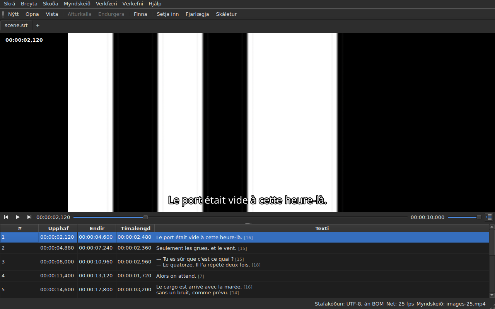

# Spilarinn

<!-- machine-translated -->
> Þessi síða er vélþýðing sem enginn lesandi tungumálsins hefur enn farið yfir.

Tengda myndskeiðið er horft á **í glugganum**, með núverandi línu
teiknaða yfir það. Það er það sem gerir þér kleift að athuga á kvikmyndinni niðurstöðu
færslu á tímasetningum, umbreytingar eða breytingar á rammatíðni.

Sjá [Tengda myndskeiðið](video.md) um hvernig kvikmynd er tengd; þessi
síða lýsir því sem gerist þegar það hefur verið gert.

## Myndskeiðssýnin

| Aðstæður | Hvað glugginn sýnir |
| :-------- | :-------------------- |
| myndskeið er tengt og opnast | myndin tekur efri hlutann, taflan fyrir neðan |
| ekkert myndskeið tengt | engin mynd, taflan tekur allan gluggann |
| myndskeiðið opnast ekki | engin mynd, skilaboð, og glugginn helst nothæfur |

Skiptingin milli myndarinnar og töflunnar **færist með músinni**. Myndin
fer ekki niður fyrir 180 díla á hæð. Þegar glugginn er stækkaður fær taflan plássið
sem vinnst, ekki myndin: það sem vantar við breytingar eru línur.

Undir myndinni er **spilunarstika**: hvar kvikmyndin er, hve lengi hún varir,
spilun og hlé, og hljóðstyrkurinn. Sjá [Spilunarstikan](#spilunarstikan).

## Spilun og stöðvun

| Skipun | Flýtilykill | Hvað hún gerir |
| :------ | :------- | :----------- |
| Myndskeið ▸ Spila / Hlé | `Ctrl+P` | spilar ef spilun er stöðvuð, stöðvar hana annars |

Skipunin er **óvirk svo lengi sem ekkert myndskeið er opið**. Myndskeið sem
var að tengjast er opnað **stöðvað**: að opna kvikmynd er ekki
að horfa á hana.

`Ctrl+P` þar sem Gaupol hefur einfalt `P`: flýtilykill með einum staf á
umfangi gluggans er tekinn áður en græjan sem hefur fókusinn sér hann,
svo að `P` myndi gleypast á leið sinni að reitaritli. Ekkert
prentast hér, samsetningin er laus.

## Spilunarstikan

Undir myndinni, frá vinstri til hægri — hnapparnir þrír eru **tákn**, þau úr skjáborðsþemanu þegar það hefur þau, annars úr stíl Qt:

| Element | Hvað það gerir |
| :------ | :----------- |
| hnapparnir tveir fyrir skref | færa kvikmyndina aftur á bak, áfram **um eitt rammaskref** — sjá [Ramma fyrir ramma](timing.md#ramma-fyrir-ramma) |
| spila / hlé | spilar eða stöðvar, eins og `Ctrl+P` — hnappurinn sýnir **hvað hann mun gera**: þríhyrning þegar stöðvað, tvær stikur þegar spilað; ábendingin segir það með einföldum orðum |
| staðan | `HH:MM:SS,mmm`, rituð eins og taflan ritar tímasetningu — **sem rammanúmer** þegar hakað er við [`Skoða ▸ Tímasetningar í römmum`](table.md#staðsetningar-í-römmum) |
| sleðinn | **les og færir**: þú dregur handfangið, smellir í raufina, notar örvarnar |
| tímalengdin | sú sem myndskeiðið gefur upp, rituð eins og staðan |
| hljóðstyrkurinn | frá 0 til 100, sjá [Hljóðstyrkurinn](#hljóðstyrkurinn) |
| töflufylgni | niðurýtt svo lengi sem taflan fylgir spiluninni, og færir hana aftur á línuna sem er spiluð þegar ýtt er á hana — sjá [Taflan fylgir spiluninni](#taflan-fylgir-spiluninni) |

**Sleðinn afhendir ekki á hverjum díl.** Þegar handfangið er dregið er beðið um tugi
staða á sekúndu, og hver kostar afkóðaðan ramma: fyrsta staðan fer út
strax, þær næstu bíða tuttugasta hluta úr sekúndu, og **síðasta staðan sem beðið var um er
alltaf sú sem er náð** — í síðasta lagi þegar handfanginu er sleppt. Myndin dregst því ekki
aftur úr hendinni, og byrjar ekki að teikna leið sem enginn horfir á.

**Sleðinn færist sjálfur meðan á spilun stendur**, og það telst ekki aðgerð:
aðeins það sem þú gerir færir kvikmyndina. Meðan þú heldur á handfanginu tekur spilunin það ekki til baka.

## Tímakóðinn

**Staðan er rituð á myndina**, efst til vinstri, á hálfgagnsæjum bakgrunni sem gerir hana
læsilega á hvaða atriði sem er. Hún er teiknuð af glugganum, með letri hans, og biður
spilarann ekki um neitt nema stöðuna sem hann gefur nú þegar; hún uppfærist við hverja aðgerð,
án þess að bíða eftir næstu umferð fylgningar.

## Að fara um kvikmyndina

Í valmyndinni **Myndskeið** eru **aðgerðir Gaupol**, undir heitum þess. Allar eru **óvirkar án myndskeiðs**, eins og
spilunin; þær þrjár sem verka á valið eru einnig óvirkar svo lengi sem ekkert er valið.

| Skipun | Flýtilykill | Hvað hún gerir |
| :------ | :------- | :----------- |
| Myndskeið ▸ Spila valið | `Ctrl+Shift+P` | spilar frá **örlitlu á undan upphafi** valsins **til enda síðasta skjátexta þess**, og stöðvast á myndinni |
| Myndskeið ▸ Leita að fyrra | `Ctrl+Left` | setur spilunina á upphaf síðasta skjátexta sem **endaði** á undan stöðunni |
| Myndskeið ▸ Leita að næsta | `Ctrl+Right` | setur spilunina á upphaf fyrsta skjátexta sem **byrjar** á eftir stöðunni |
| Myndskeið ▸ Leita afturábak | `Ctrl+Shift+Left` | fer aftur um eitt stökk — þrjátíu sekúndur sjálfgefið |
| Myndskeið ▸ Leita áfram | `Ctrl+Shift+Right` | fer áfram um eitt stökk |
| Myndskeið ▸ Leita að upphafi vals | `Ctrl+Up` | setur spilunina á upphaf valsins, **forskotið á undan því** |
| Myndskeið ▸ Leita að enda vals | `Ctrl+Down` | setur spilunina á enda valsins, **forskotið á undan því** |

**Flýtilyklarnir eru Gaupol**, nema einn: `Play Selection` er `O` þar, og
staki stafurinn er tekinn af glugganum áður en reiturinn í breytingu sér hann — að slá inn
`o` í texta myndi ræsa kvikmyndina. `Ctrl+P` er svar spilunarinnar, `Ctrl+Shift+P` svar
valsins. Örvar lyklaborðsins haldast hjá reitaritlinum þegar hann er
opinn: `Ctrl+Left` færir bendilinn þar um eitt orð, ekki spilunina.

- **Stökkið** er 30 sekúndur, og má stilla frá 1 sekúndu upp í eina klukkustund — sjá
  [Kjörstillingarnar](preferences.md#spilarinn). Það fer hvorki fram yfir upphaf kvikmyndarinnar né endi hennar.
- **Forskotið** er ein sekúnda: þú horfir örlítið **á undan** skjátextanum, til að sjá hann nálgast.
  Það má stilla frá 0 til 60 sekúndur, og spilunin fer ekki niður fyrir núll.
- **Nágranni sem er ekki til** — ekkert á undan fyrsta skjátexta, ekkert á eftir þeim síðasta — gerir
  ekkert, og segir ekkert: spilunin helst þar sem hún er.
- **Hver aðgerð sést strax**: stikan, tímakóðinn og teiknaða línan eru
  uppfærð þegar henni lýkur, án þess að bíða eftir næstu umferð.

## Hljóðstyrkurinn

Hljóðstyrkurinn er **spilarans**, frá 0 til 100, en ekki kerfisins. Hann er stilltur með sleða
stikunnar, eða með tveimur aðgerðum, í undirvalmyndinni `Myndskeið ▸ Hljóð`, í skrefum upp á fimm:

| Skipun | Flýtilykill | Hvað hún gerir |
| :------ | :------- | :----------- |
| Myndskeið ▸ Hljóð ▸ Lækka hljóðstyrk | `Ctrl+-` | lækkar hljóðstyrkinn um fimm |
| Myndskeið ▸ Hljóð ▸ Hækka hljóðstyrk | `Ctrl++` eða `Ctrl+=` | hækkar hann um fimm — seinni fyrir lyklaborð þar sem plúsinn þarf skiptilykilinn |

**Hann er munaður frá einni setu til annarrar**, og gefinn hverju myndskeiði sem þú opnar. Gildi utan
0 til 100 í stillingaskránni brýtur ekki opnunina: það er hunsað, og glugginn segir frá því.
**Hljóðrásin er hins vegar ekki munuð** — rásarnúmer er númer skrárinnar sinnar; sjá
[Hljóðrásin](video.md#hljóðrásin).

## Val og spilun

Hvort tveggja gengur í báðar áttir.

| Það sem þú gerir | Hvað gerist |
| :---------- | :----------- |
| velur línu | spilunin færist **á upphaf þess skjátexta** |
| stækkar valið niður á við | ekkert meira: það er fyrsta lína valsins sem gildir |
| spilunin heldur áfram | **núverandi lína** fylgir skjátextanum á skjánum, **lituð**, og taflan **miðjar** hana — sjá [Taflan fylgir spiluninni](#taflan-fylgir-spiluninni) |

Núverandi lína og valið eru tveir aðskildir hlutir. Spilunin
færir þann fyrri og **snertir aldrei þann seinni**: valið er það sem
aðgerð beitist á, og kvikmynd sem spilast í horni á ekkert með að
endurskrifa markalínu notandans lína eftir línu.

Liturinn fylgir þessari sömu reglu: hann er merki, ekki val. **Frávik
hefur forgang yfir hann** — lína sem ber hvort tveggja heldur lit
galla síns, galli er til að lagfæra þegar lína sem sýnd er er það aðeins
meðan ein samtalslína varir. Sjá [Töfluna](table.md).

### Taflan fylgir spiluninni

**Taflan miðjar línuna sem spilast** — í miðju þess sem hún sýnir, ekki við jaðarinn þar sem nóg væri til að
gera hana sýnilega. Hún gerir það **þegar línan breytist**, ekki við hvern takt fylgningarinnar: samtalslína varir
sekúndur, og að miðja aftur á tíunda hluta úr sekúndu væri að fletta til einskis.

**Handvirk fletting stöðvar fylgnina.** Hjólið, flettistikan og smellur í töflunni
stöðva hana: taflan helst þar sem þú settir hana, meðan núverandi lína, teiknaða línan og stikan
halda áfram að fylgja kvikmyndinni. Fylgnihnappurinn — **tákn línanna í töflu, einni merktri með ör** — hægra megin á spilunar-
stikunni; ábending hans segir „Fylgja spilun“ — **er niðurýttur svo lengi sem taflan fylgir** og lyftist þá.

**Fylgnin hefst aftur við aðgerð í spilaranum**: spilun ræst, stökk, skref, merki sett, innsetning
á stöðunni, eða færsla á stikunni — taflan miðjar þá strax á
línunni sem spilast, jafnvel þótt það væri þegar sú sama. **Eða eftir beiðni**: að ýta á hnappinn endurheimtir hana, og
að sleppa honum stöðvar hana. Enginn tímamælir er til: það sem hefur fylgnina aftur er alltaf aðgerð.

Að skipta yfir í annan flipa hefur fylgnina aftur á kvikmynd þess flipa.

**Breyting í gangi er ekki trufluð.** Svo lengi sem reitaritill
er opinn helst núverandi lína þar sem hún er; línan sem er teiknuð á
myndina heldur hins vegar áfram að fylgja, þar sem hún truflar engan.

## Teiknaða línan

Það sem er sýnt á myndinni kemur úr **opna skjalinu**, aldrei úr skrá:
**það sem þú sérð á myndinni er það sem þú varst að slá inn**, án þess að fara í gegnum
diskinn. Textinn birtist miðjaður, neðst á myndinni, og hverfur milli tveggja
skjátexta.

**Með þýðingu er línan sú úr textanum sem miðað er á**: þýðingin þegar
núverandi reitur er í dálkinum `Translation`, aðaltextinn
alls staðar annars staðar. Það er regla allra textaaðgerða — sjá [Textinn
sem aðgerðirnar beinast að](table.md#textinn-sem-aðgerðirnar-beinast-að) —
og **engin stilling er til**: að fara frá einum dálki í annan breytir því sem
myndin sýnir, í mesta lagi tíunda hluta úr sekúndu síðar. Án þýðingar, eða
með dálkinn fjarlægðan, breytist ekkert: það er aðaltextinn.

Skjátexti sem þýðingin hefur ekki náð enn sýnir **ekkert** svo lengi sem
núverandi dálkur er þýðingin: það er ekki aðaltextinn sem
tekur sæti hans.

**Merki sniðsins eru skilin, aldrei teiknuð eins og þau eru.** Líkanið ber
textann eins og skráin ritar hann, og það er merkjamiðjan — sú sem notuð er í
umbreytingu sniða — sem les hann áður en hann er gefinn myndinni:

| Í skránni | Á myndinni |
| :---------- | :------------- |
| feitletur, skáletur, undirstrikun | beitt: `<i>no</i>` birtist sem *no*, án merkja sinna |
| litur | beitt |
| leturgerð, stærð | fjarlægt, textinn helst |
| staðsetning, réttun, mælandi, allt án samsvörunar á skjá | fjarlægt, textinn helst |
| `{` og `}` í textanum | teiknað: „{laughs}“ birtist sem „{laughs}“ |

Advanced SSA-skrá er lesin á sama hátt: `{\i1}` hennar eru beitt, og
`{\an8}` hennar er fjarlægt — línan helst neðst á myndinni. Hver texti er lesinn **á sniði
sinnar eigin skrár**, þýðingin eins og aðaltextinn.

**Nágrannaskjátextaskráin er ekki hlaðin** af spilaranum, jafnvel þótt hún beri nafn
kvikmyndarinnar. Hún væri sú sem er í breytingu, og myndin sýndi þá stöðu disksins
meðan taflan sýnir annað.

## Forskoðun breytingar

Það er **ekkert sérstakt að gera**: þú beitir aðgerðinni, horfir á
kvikmyndina, og velur `Undo: shifting` — eða aðgerðina sem um ræðir — ef
niðurstaðan hentar ekki. Sjá [Afturkalla og endurgera](undo.md).

Enginn sérstakur forskoðunarhamur er til, og það er af ásettu ráði: það sem þú
horfir á er skjalið eins og það er, ekki ósýnilegt bráðabirgðaástand.

## Þegar myndin birtist ekki

Tvenn möguleg skilaboð, bæði með slóð skráarinnar á undan:

| Skilaboð | Hvað gerðist |
| :------ | :------------ |
| `<file>: <reason>` | spilarinn hafnaði skránni — óþekkt snið, skrá vantar, mappa |
| `<file>: no video player is available` | ekki var hægt að smíða neinn spilara |

Í báðum tilvikum **helst myndskeiðið tengt** — þú þarft að sjá hvaða
skrá það er til að velja aðra — og **glugginn helst nothæfur**:
skjalið er opið, aðgerðirnar virka, og vistunin einnig.

**Myndin er teiknuð í glugganum sjálfum**: `libmpv` fyllir biðminni í
stærð sýnarinnar, í raunverulegum dílum, og glugginn málar það. Ekkert af því er háð
grafíkvettvanginum — sama myndin undir X11, undir Wayland og án skjás — og hún
fylgir stærðarbreytingu: myndhlutfall kvikmyndarinnar er varðveitt, restin af
sýninni er svört.

Seinni skilaboðin birtast því aðeins ef `libmpv`-safnið neitar að ræsa,
þótt þess sé krafist við smíði.

Teikningin fer í gegnum örgjörvann, en **afkóðun getur farið fram á skjákortinu**: það
afkóðar, myndin er afrituð aftur í minni, síðan teiknuð eins og áður. Vél án
nothæfs korts afkóðar á örgjörvanum, án skilaboða. Á 1080p kvikmynd í H.264 heldur spilunin í við
rauntíma með miklu svigrúmi. **4K kvikmynd í þungu HEVC gæti ekki haldið í við**: mælt á tveimur
kjörnum afkóðast hún á 0,6 földum rauntíma án kortsins, og að stíga einn ramma tekur þar nokkrar
sekúndur þegar lykilramminn er langt í burtu. Kortið styttir þann tíma — um þriðjung til tvo þriðju hluta eftir kvikmynd
— án þess að fjarlægja hann. **Það breytir ekki myndinni sem er sýnd**: skref eða leit lenda á
sama ramma með og án þess. Til að slökkva á því skaltu taka hakið af `Decode on the graphics card` í
[`Preferences…`](preferences.md#spilarinn).

## Það sem er ekki til

**Að setja merki, stíga ramma fyrir ramma og hnika jaðri um einn ramma** er í
[Tímasetning út frá myndskeiðinu](timing.md), ekki hér. Það sem er ekki til, og tilgangslaust að leita að:

- bylgjuform;
- sjálfvirk spilun þegar kvikmynd er opnuð;
- stíll teiknuðu línunnar (leturgerð, litur, staðsetning, bakgrunnur): hún heldur stíl gluggans;
- vélbúnaðarafkóðun án afritunar: sjá „Þegar myndin birtist ekki“ hér að ofan.

Þessi handbók lýsir því sem er til, aldrei því sem er fyrirhugað: það sem kemur og í hvaða röð er í
[vegvísinum](../../../../feuille-de-route.md).
