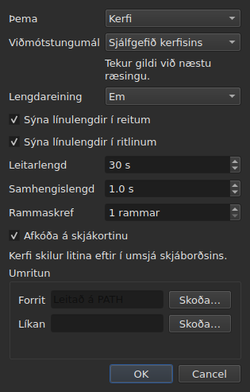

# Kjörstillingarnar

<!-- machine-translated -->
> Þessi síða er vélþýðing sem enginn lesandi tungumálsins hefur enn farið yfir.

Glugginn man það sem þú stillir með músinni — **hvar hann var**, **hvort
hann var hámarkaður**, **breidd dálkanna sinna**, **stöðu
handfangsins** milli kvikmyndarinnar og töflunnar — og **hvar þú vinnur**, svo að
`Open…` opnist á réttum stað. Ekkert af þessu er stillt í glugga:
þú færir, þú dregur, og það er munað.

**Sex kjörstillingar hafa sinn eigin glugga**, `Breyta ▸ Kjörstillingar…`, og það er
viðmiðið: kjörstilling sem hefur þegar handtak þarf ekki svið. Þemað
hefur ekkert, ekki heldur eining línulengda, né gátreitirnir tveir sem
sýna þær, né stökk og forskot spilarans. Sjá [Þemað](#þemað),
[Línulengdir](#línulengdir) og [Spilarinn](#spilarinn).

**Viðmótstungumálið er í sama glugga, og það er það sem bíður**: það tekur gildi við næstu
ræsingu, ekki strax. Sjá [Tungumál viðmótsins](#tungumál-viðmótsins).

**Hljóðstyrkurinn hefur engan**: stikan undir myndinni og tvö handtök stilla hann, og hann er munaður.

**Önnur er stillt þar sem hún er notuð**: hliðin sem `Insert Subtitles…` setur
línur sínar á er svið í þeim glugga, og síðasta valið er munað. Sjá
[Að setja inn, fjarlægja, sameina og skipta línum](lines.md#hliðin-er-munuð).

**Svo eru einnig valkostirnir tveir í leitinni**: `Regular expression` og
`Ignore case` haldast hökuð eða óhökuð frá einni opnun gluggans til
þeirrar næstu, og frá einni lotu til annarrar. Sjá
[Leita og skipta út](find-and-replace.md#valkostirnir-tveir).

**Svo eru einnig stillingar `Adjust Durations…`**: lestrarhraðinn, áttirnar
tvær, og tímalengdirnar þrjár með gátreitum sínum — hver heldur gildi sínu, hvort sem hakað er
við eða ekki. Sjá [`Adjust Durations…`](operations.md#adjust-durations).

**Og síðasta stafakóðunin sem var valin í `Save As…`**, með bætaröðunar-
merkinu. Sjá [skrána](#skráin).

**Og það sem hjálpin `Correct Texts…` og `Spell-Check Settings…` stilla**: verkin
sem hakað er við og kóði þeirra, gátreitir mynstranna, línuskiptingarstillingarnar, tungumálið,
útkoma athugunarinnar og undirstrikunin við innslátt. Sjá [Leiðrétta texta…](correct-texts.md) og
[Athuga stafsetningu…](check-spelling.md#stillingar-stafsetningarathugunar). **Útkoma og skjal
`Correct Texts…` eru ekki munuð.**

**Það sem er ekki munað:** síðasta skráin sem var opnuð — sjá
[Munaða mappan](#munaða-mappan).

## Spilarinn

Fjögur svið. **Leitarlengd** og **Samhengislengd** eru Gaupol-sviðin og hafa gildi þess; **Rammaskref** og **Afkóða á skjákortinu** eru subedit sjálfs:

| Svið | Hvað það stillir | Sjálfgefið | Mörk |
| :---- | :----------- | ------: | :----- |
| `Seek length` | stökk `Seek Backward` og `Seek Forward` | 30 s | frá 1 s til einnar klukkustundar |
| `Context length` | forskotið á undan valinu, fyrir `Seek Selection Start`, `Seek Selection End` og `Play Selection` | 1 s | frá 0 til 60 s, upp á tíunda hluta |
| `Frame step` | skrefið, **í römmum**, hjá `Step Backward` og `Step Forward`, og þegar brún er hnikað | 1 rammi | frá 1 til 1000 ramma |
| `Decode on the graphics card` | leyfir skjákortinu að afkóða kvikmyndina þegar vélin hefur slíkt; án korts breytist ekkert | hakað við | hakað við eða ekki |

Þær taka gildi **strax**, án þess að bíða eftir endurræsingu, og eru munaðar frá einni lotu til annarrar
undir `video.seek-length` (í sekúndum), `video.context-length-ms` (í millisekúndum) `video.step-frames` (í römmum) og `video.hardware-decoding` (`true` eða `false`).
**Gildi utan marka, eða sem er ekki tala**, kemur ekki í veg fyrir að glugginn opnist: því
er sleppt, sjálfgefna gildið stendur, og glugginn segir frá því við opnun. **Rammaskrefið er aldrei í millisekúndum**: skref upp á N ramma er alltaf N rammar, hver sem rammatíðni kvikmyndarinnar er — sjá [Tímasetning út frá myndskeiðinu](timing.md#ramma-fyrir-ramma). Hljóðstyrkurinn er munaður í `video.volume`,
frá 0 til 100, með sama umburðarlyndi.

## Skráin

```
~/.config/subedit/settings.conf
```

Nánar tiltekið `$XDG_CONFIG_HOME/subedit/settings.conf` þegar sú breyta
er stillt. Hún er skrifuð **þegar glugganum er lokað**, og lesin þegar hann opnast.
Forrit sem er rofið — drepið, eða stöðvað af hruni — skrifar ekkert, og
næsta lota finnur það sem sú fyrri skildi eftir.

Skráin er texti, og má breyta henni í höndunum. Það er eiginleiki en ekki
aukaverkun: það er það sem gerir stillingu leiðréttanlega þegar viðmótið
sem stillir hana er einmitt það sem er bilað.

### Tvær blokkir, önnur sameiginleg með skipanalínunni

Skráin er skrifuð í **tveimur blokkum**, hvorri undir borðaathugasemd:

| Blokk | Lyklar | Lesin af |
| :---- | :--- | :------ |
| `# Operation settings: shared by the window and the command line` | lyklarnir `duration-adjust.*` og `correction.*` | glugganum **og** `subedit-cli` |
| `# Display preferences: the window's own` | hver annar lykill — stærð og staðsetning, dálkar, þema, viðmótstungumál, leit, stafsetningarathugun, ritill, myndskeið, síðasta mappa, skrifunarstafakóðun | glugganum einum |

**`subedit-cli` les aðgerðablokkina sjálfgefið**: það sem `Adjust Durations…` og
`Correct Texts…` muna hér er líka það sem [`subedit-cli adjust`](../subedit-cli/adjust.md)
og hluti af [`subedit-cli correct`](../subedit-cli/correct.md) byrja á, nema valkostur á
skipanalínunni segi annað. **Hún les aldrei sýnarkjörstillingarnar.** Skipunin
[`config`](../subedit-cli/config.md) telur upp aðgerðalyklana, sýnir gildi þeirra og
breytir þeim — `subedit-cli config set duration-adjust.speed 12` — og glugginn sér breytinguna
við næstu opnun. **Breyting sem er gerð meðan glugginn er opinn lifir ekki lokun hans**:
glugginn endurskrifar alla skrána með því sem hann heldur. `--no-config` lætur skipanalínu hunsa
skrána. Sjá
[Stillingaskráin](../subedit-cli/invocation.md#stillingaskráin).

Lesarinn tekur lyklana í hvaða röð sem er, með eða án borðanna: skrá sem var skrifuð áður en
blokkirnar tvær voru til er lesin óbreytt, og endurskrifuð í tveimur blokkum við næstu
lokun.

| Valkostur | Hvað hann geymir | Sjálfgefið |
| :----- | :------------ | :------ |
| `window.geometry` | `x,y,width,height`, í punktum; breidd og hæð ekki núll | glugginn stærir sig sjálfur |
| `window.maximised` | `true` eða `false` | `false` |
| `table.columns` | fjórar breiddir í punktum, aðgreindar með kommum — `#`, `Start`, `End`, `Duration`, jafnvel falin | taflan stærir sig sjálf |
| `table.order` | dálkarnir sex, **hver einu sinni**, í þeirri röð sem taflan sýnir þá: `number`, `start`, `end`, `duration`, `text`, `translation` | `number,start,end,duration,text,translation` |
| `table.hidden` | dálkarnir sem eru fjarlægðir, úr `number`, `start`, `end` og `duration`; tómt, enginn | enginn |
| `window.table-share` | hlutur hæðarinnar sem taflan fær, í prósentum, frá 1 til 99 | glugginn skiptir eins og hann hefur alltaf gert |
| `file.directory` | **alger** slóð möppu | engin: `Open…` opnast þar sem forritið var ræst |
| `general.theme` | `system`, `light` eða `dark` | `system` |
| `interface.language` | `system`, eða heiti tungumáls eins og þýðingaskrá þess heitir: tveir eða þrír lágstafir, síðan valfrjálst `_` og tveir hástafir — `fr`, `pt_BR`; `en` fyrir ensku | `system` |
| `edit.insert-placement` | `above` eða `below` | `below` |
| `file.write-encoding` | heiti stafakóðunar sem ICU getur skrifað, og sem umbreytir hennar skrifar ekki sitt eigið merki | engin |
| `file.write-bom` | `true` eða `false` | `false` |
| `search.regex` | `true` eða `false` — mynstrið er regluleg segð | `false` |
| `search.ignore-case` | `true` eða `false` — há- og lágstafir eru hunsaðir | `true` |
| `duration-adjust.speed` | lestrarhraðinn, í stöfum á sekúndu, strangt jákvæður; tugatala er skrifuð eins stutt og hægt er (`15`, `12.5`) | `15` |
| `duration-adjust.lengthen` | `true` eða `false` — lengja það sem er of stutt til að lesa | `true` |
| `duration-adjust.shorten` | `true` eða `false` — stytta það sem helst sýnt lengur en þarf | `false` |
| `duration-adjust.minimum-enabled` | `true` eða `false` — lágmarkstímalengdar er óskað | `true` |
| `duration-adjust.minimum-ms` | lágmarkstímalengdin, í millisekúndum, heil tala og ekki neikvæð | `1500` |
| `duration-adjust.maximum-enabled` | `true` eða `false` — hámarkstímalengdar er óskað | `false` |
| `duration-adjust.maximum-ms` | hámarkstímalengdin, í millisekúndum, heil tala og ekki neikvæð | `6000` |
| `duration-adjust.gap-enabled` | `true` eða `false` — bils að næsta skjátexta er óskað | `true` |
| `duration-adjust.gap-ms` | bilið, í millisekúndum, heil tala og ekki neikvæð | `0` |
| `correction.mentions.enabled`, `correction.common-errors.enabled`, `correction.capitalization.enabled`, `correction.line-break.enabled` | `true` eða `false` — hakað er við verkið á fyrstu síðu `Correct Texts…` | `false`, `true`, `true`, `false` |
| `correction.mentions.code`, `correction.common-errors.code`, `correction.capitalization.code`, `correction.line-break.code` | kóði mynstra verksins: `Zyyy`, eða `Script[-language[-COUNTRY]]` — `Latn-en-US`; ekki tómt | `Zyyy` |
| `correction.human`, `correction.ocr` | `true` eða `false` — flokkar algengra villna | `true`, `true` |
| `correction.sound-in-brackets`, `correction.sound-in-parentheses` | `true` eða `false` — gátreitirnir tveir á síðunni `Mentions` | `false`, `false` |
| `correction.line-break.max-length` | hámarkslengd línu, tugatala; glugginn takmarkar hana við 1 til 1000 | `24` |
| `correction.line-break.max-lines` | hámarksfjöldi lína, heil tala; glugginn takmarkar hann við 1 til 100 | `3` |
| `correction.line-break.in-ems` | `true`: lengdin er mæld í *em*; `false`: í stöfum | `true` |
| `correction.line-break.skip-on-length`, `correction.line-break.skip-on-lines` | `true` eða `false` — skilyrðanna tveggja um að sleppa er óskað | `true`, `true` |
| `correction.line-break.skip-max-length`, `correction.line-break.skip-max-lines` | viðmiðin tvö um að sleppa, í valinni einingu | `24`, `3` |
| `correction.join-split.enabled` | `true` eða `false` — hakað er við verkið `Join or Split Words` | `false` |
| `correction.join-split.join`, `correction.join-split.split` | `true` eða `false` — sameina, skipta | `true`, `false` |
| `correction.join-split.language` | staðarkóði — `fr`, `en_US`, `sr@Latn` —; tómt: tungumál kerfisins | tómt |
| `correction.remove-blank` | `true` eða `false` — `Remove all blank subtitles` | `true` |
| `transcription.engine` | heiti vélarinnar: lágstafir, tölustafir, `.`, `-` og `_` | `whisper.cpp` |
| `transcription.executable`, `transcription.model` | altæk slóð; tómt: leitað er að vélinni í `PATH` og ekkert líkan er stillt | tómt |
| `transcription.language` | tveir lágstafir, ISO 639-1 kóði; tómt: tungumálið er greint sjálfkrafa | tómt |
| `transcription.merge-gap-ms` | bútar úr einni setningu sem eru nær hver öðrum en þetta eru sameinaðir, í millisekúndum, heil tala sem er ekki neikvæð | `400` |
| `transcription.max-duration-ms` | lengsti tími sem umritaður skjátexti er á skjánum, í millisekúndum, frá 1 til 3600000 | `7000` |
| `transcription.max-characters` | flestir stafir sem umritaður skjátexti rúmar, frá 1 til 1000 | `84` |
| `correction.activations` | gátreitir mynstranna sem notandinn breytti, `<type>:<code>:<name>:<0\|1>`, aðgreindir með kommum; **kommu eða bakskástrik í heiti er skrifað með bakskástriki á undan** (`\,` og `\\`), og færsla sem ekki er hægt að lesa tapar aðeins sinni eigin stillingu — hún er tilkynnt, hinar haldast | tómt |
| `spell-check.language` | staðarkóði, eins og `fr_FR`; tómt: tungumál kerfisins | tómt |
| `spell-check.target` | `selection`, `current-project` eða `all-projects` | `current-project` |
| `spell-check.document` | `main` eða `translation` | `main` |
| `spell-check.inline` | `true` eða `false` — undirstrika óþekkt orð við innslátt í ritli reits | `false` |
| `editor.length-unit` | `em` eða `characters` — eining línulengdanna sem taflan og ritillinn sýna | `em` |
| `editor.show-lengths-cell` | `true` eða `false` — lengd fylgir hverri línu textareits | `true` |
| `editor.show-lengths-edit` | `true` eða `false` — ritill reits sýnir lengd hverrar línu í spássíu | `true` |

**Skráin tekur við meiru en glugginn.** Lesarinn tekur hvaða strangt
jákvæðan hraða sem er og hverja tímalengd sem er ekki neikvæð; glugginn `Adjust
Durations…` takmarkar aftur á móti hraðann við 1 til 99 stafi á sekúndu og hverja
tímalengd við 0 til 99 s. Gildi í skránni utan þessara marka er fært aftur að
markinu þegar glugginn opnast, og skráin heldur því þannig þegar
glugginn er samþykktur og glugganum lokað. Gluggi sem hætt er við breytir engu í því sem
er munað.

**`file.write-encoding` man síðustu stafakóðunina sem var valin í `Save As…`, og
þröngvar sér aldrei upp á skrá.** Opið skjal ber sína eigin stafakóðun,
og það er hún sem glugginn leggur til: að skrifa það upp á nýtt í annarri vegna þess að
stilling sem er þriggja vikna gömul segir svo myndi tapa því sem lesturinn varðveitti.
Það sem þessi stilling man þjónar skjali sem hefur enga skrá — því sem var
nýbúið til.

**Þetta er yfirvegað „nei“ en ekki yfirsjón.** Sá sem afhendir alltaf í
sömu stafakóðun og opnar erfðar skrár í annarri velur hana aftur fyrir
hverja skrá; glugginn leggur hana til við hann, og trygging fram-og-til-baka gildir
fyrir alla.

**`file.write-bom` ber merki sömu stafakóðunar**, og tvær
línur þarf í raun: heiti stafakóðunar segir ekki hvort merkið fer á undan henni, frekar
en `--encoding` segir það sem `--bom` segir. Báðar eru lesnar saman, í
hvaða röð sem er, og `file.write-bom` án munaðrar stafakóðunar stillir ekkert.

**Hlutur en ekki hæðir fyrir handfangið**, og það er það sem gerir hann
gagnlegan: þrjár hæðir í punktum þýða ekkert lengur um leið og glugginn
opnast í annarri stærð, og gluggi opnast oft í annarri stærð.
Hluturinn endurspilast hvar sem er. Hann er **færður aftur að því sem glugginn tekur við** ef
hann er of lítill — ræman með kvikmyndinni hefur lágmarkshæð.

**Fjórar breiddir fyrir sex dálka**, og það er ekki yfirsjón: þær eru
breiddir `#`, `Start`, `End` og `Duration`, í þeirri röð hver sem röð
töflunnar er, og **falinn dálkur heldur sinni eigin** — hann finnur hana aftur þegar hann
er sýndur aftur. Síðasti dálkurinn sem er sýndur tekur það sem hinir skilja eftir, og að gefa honum
breidd myndi engu breyta; breiddir textans og þýðingarinnar eru því
ekki munaðar.

## Hvað gerist þegar skráin segir ekki það sem búist er við

Stilling er þægindi. **Bilun hennar kostar þægindin og ekkert
annað**: glugginn opnast í öllum tilvikum.

| Tilvik | Hvað gerist |
| :--- | :----------- |
| skráin er ekki til | öll sjálfgefnu gildin, og ekkert er sagt — þetta er fyrsta ræsing |
| skráin er til og ekki er hægt að lesa hana | öll sjálfgefnu gildin, og ástæðan er skrifuð á villustrauminn |
| valkost vantar | sjálfgefið gildi hans |
| lykill er óþekktur | honum er sleppt, án orðs, og hann vantar í endurskrifuðu skrána |
| gildi er ekki hægt að lesa | sjálfgefið gildi þess er haldið, og valkosturinn er nefndur á villustraumnum |

```console
$ subedit-gui film.srt
subedit-gui: /home/vous/.config/subedit/settings.conf: window.geometry: "plus tard" cannot be read, keeping the default
```

**Skilaboðin fara á villustrauminn og hvergi annars staðar.** Gluggi sem krefst svars
við ræsingu vegna kjörstillingar sem ekki er hægt að lesa myndi stöðva notandann
vegna galla sem kemur í veg fyrir ekkert hjá honum, og áður en hann hefur beðið um neitt.

## Valkostirnir sem eru í athugasemdum

Endurskrifaða skráin inniheldur **alla** þekkta valkosti, og þeir sem eru látnir
halda sjálfgefnu gildi eru skrifaðir sem athugasemdir:

```
#window.geometry = 0,0,1280,800
#window.maximised = false
#table.columns = 60,110,110,110
#table.order = number,start,end,duration,text,translation
#table.hidden = start,end
```

Þetta er ekki tilgerð. Án þess myndi valkostur sem aldrei var snertur haldast
frosinn á gildi þess dags sem hann var skrifaður, og **bætt sjálfgefið gildi
næði aldrei til neins**. Með því breytir breyting á sjálfgefnu gildi
hegðun allra sem hafa ekki ráðið öðru — sem er einmitt
það sem sjálfgefið gildi á að gera.

Til að ráða valkosti: fjarlægðu `#` og breyttu gildinu. Til að fara aftur
á sjálfgefna gildið: eyddu línunni, eða gerðu hana aftur að athugasemd.

Stærð og staðsetning gluggans, breiddirnar og dálkarnir sem eru fjarlægðir sýna **lögun** en
ekki gildi sem er í gildi: sjálfgefið gildi stærðar og staðsetningar og breiddanna er
„það sem glugginn velur“, sem er ekki skrifað í tölum, og sjálfgefið gildi
`table.hidden` er „enginn“, sem ekki er hægt að lesa. Haus skráarinnar segir það
líka. `table.order` sýnir aftur á móti sjálfgefnu röðina.

## Munaða mappan

`Open…` opnast á möppu **síðustu skrár sem var opnuð eða vistuð**,
en ekki á möppu glugga sem þú hættir við: það sem skiptir máli er hvar þú
vinnur, ekki hvar þú leitaðir.

**Síðasta skráin er aftur á móti ekki munuð.** Að muna hana þýddi að
opna við ræsingu skjal sem enginn bað um. Að muna möppu
*bendir* glugga; að muna skrá myndi opna eina.

## Þemað

`Breyta ▸ Kjörstillingar…` opnast með þemanu, kjörstillingu sem hefur ekkert handtak, fyrir ofan
[línulengdir](#línulengdir).

| Gildi | Hvað það gerir |
| :---- | :----------- |
| `System` | **ekkert** — litirnir haldast þeir sem skjáborðið hefur |
| `Light` | setur ljósa litapalettu |
| `Dark` | setur dökka litapalettu |

Þemað sem er valið tekur gildi **strax**, án endurræsingar.

**„System“ gerir ekkert, og það er ekki skortur.** Útgáfan af Qt sem
subedit er smíðað á hefur enga leið til að spyrja skjáborðið hvort það vilji vera
ljóst eða dökkt, né til að fá tilkynningu þegar það skiptir um skoðun. Frekar en að
finna upp lestur sem við kunnum ekki býður tólið þemun tvö
sem hægt er að biðja um og lætur verkfærasafnið ráða því þriðja —
sem er það sem Gaupol gerir við sömu aðstæður.

Undir skjáborði þar sem þemað er þegar dökkt gefur `System` því dökkan
glugga; undir ljósu skjáborði, ljósan glugga. `Light` og `Dark` ganga framar
því, hvað sem skjáborðið er.

**Litbrigði frávikanna haldast læsileg í báðum litapalettunum** — sjá
[Taflan](table.md#frávikin). Það er ekki forsenda: birtuskil
textans á hverju litbrigði eru athuguð með prófi, á báðum bakgrunnum.

## Umritun

Hópurinn **`Transcription`** í glugganum geymir staðreyndirnar tvær um tölvuna sem
[`Transcribe Audio…`](video.md#umritun-hljóðsins) þarf: **forrit** vélarinnar (whisper.cpp,
`whisper-cli`) og **líkanið** sem hún les. Hvort um sig hefur hnapp sem heitir `Browse…`. Sé forritið skilið eftir autt er þess leitað
að á `PATH`; líkanið hefur ekkert sjálfgefið gildi.

Undir reitunum **segir glugginn hvað er til staðar**: hvort vélin finnst og hvar, hvort `ffmpeg`
finnst, og líkanið — ekki stillt, fannst ekki, er ekki líkan, fyrir ensku eingöngu, eða fjöltyngt. Þegar eitthvað
vantar bætir hann við tilvísun á
[Uppsetning umritunartækjanna](../subedit-cli/install-transcription.md), sem segir hvar finna má
hvert um sig. Reitirnir tveir eru stillingarnar `transcription.executable` og `transcription.model`.

## Tungumál viðmótsins

`Breyta ▸ Kjörstillingar…` velur tungumál gluggans, undir þemanu.

| Svið | Gildi | Sjálfgefið |
| :---- | :----- | :------ |
| `Interface language` | `System default`; `English`; síðan hvert tungumál sem er uppsett með forritinu, undir eigin nafni — `Français` | `System default` |

**Það tekur gildi við næstu ræsingu**, og glugginn segir það undir sviðinu: glugginn er
þýddur um leið og hann er smíðaður, og gluggi sem er í gangi heldur því tungumáli sem hann ræsti á. Valið er
geymt í stillingaskránni, undir `interface.language`, og lesið þegar glugginn opnast næst.

| Val | Glugginn ræsir á |
| :----- | :------------------- |
| `System default` | tungumáli umhverfisins, eins og fyrir hvert val — `LANGUAGE`, `LC_ALL`, `LC_MESSAGES`, `LANG`; sjá [Tungumál](invocation.md#tungumál) |
| `English` | ensku, hvað sem umhverfið segir |
| uppsett tungumál | því tungumáli, **hvað sem umhverfið segir**, `LC_ALL=C` meðtalið: val sem er gert hér er yfirlýst val |

Listinn geymir tungumálin sem þýðingaskrá er uppsett fyrir undir `<prefix>/share/subedit/locale`;
enska er alltaf þar, þar sem hún er tungumálið sem forritið er skrifað á. Tungumál er sýnt
undir eigin nafni, sem engin þýðingaskrá þýðir, svo að lesandi finni það sem hann les.

**Gildi sem forritið getur ekki orðið við kostar ekkert nema valið:**

| Hvað skráin segir | Hvað gerist |
| :----------------- | :----------- |
| heiti tungumáls án uppsettrar þýðingaskrár — skrá sem er komin frá annarri vél | glugginn fylgir umhverfinu, án orðs; `Preferences…` sýnir það tungumál, undir nafni eða kóða, og heldur því nema annað sé valið |
| eitthvað sem er ekki heiti tungumáls — `French`, `fr_FR.UTF-8` | `system`, sjálfgefið gildi, og valkosturinn er nefndur á villustraumnum, eins og hvert gildi sem ekki er hægt að lesa |

```console
$ subedit-gui film.srt
subedit-gui: /home/vous/.config/subedit/settings.conf: interface.language: "French" cannot be read, keeping the default
```

**Skipanalínan les það aldrei**: `subedit-cli` velur tungumál sitt eingöngu úr umhverfinu,
og `subedit-cli config set interface.language fr` er hafnað sem sýnarkjörstillingu.

## Línulengdir




`Breyta ▸ Kjörstillingar…` stillir líka **það sem taflan og ritillinn sýna af
lengd lína** — reglustiku og spássíu Gaupols.

| Svið | Hvað það gerir | Sjálfgefið |
| :---- | :----------- | :------ |
| `Length unit` | eining lengdanna: `Ems` eða `Characters` | `Ems` |
| `Show line lengths in cells` | lengd fylgir hverri línu textareits | hakað við |
| `Show line lengths in the editor` | ritill reits sýnir lengd hverrar línu í spássíu hægra megin | hakað við |

**`Length unit` er grátt þegar hvorugt gátreitanna er hakað við**: þegar engin
lengd er til að sýna stillir einingin ekkert. Valið tekur gildi **strax** í
töflunni, og ritlarnir sem opnast eftir það fylgja því. Gildin þrjú eru
munuð frá einni lotu til annarrar: `editor.length-unit`, `editor.show-lengths-cell`
og `editor.show-lengths-edit`, í töflunni [um skrána](#skráin). Sjá
[Lengd lína](table.md#lengd-lína) og
[í ritlinum](editing.md#lengd-lína).

**Þetta er ekki mörk hjálparinnar.** Eining `Correct Texts…` — lengdin
sem hún skiptir línum við — er sérstök stilling, í hjálp hennar:
þú getur lesið em í töflunni og skipt í stöfum.

## Það sem ekki er hægt að stilla

**Níu munaðar stillingar eru valdar í glugga** — að frátöldum þeim sem
leiðréttingarhjálpin og stafsetningarathugunin eiga, sem hvor um sig hefur
sinn eigin —, og hver í þeim sem hún er notuð í: þemað og stillingarnar þrjár um línulengdir, hér; hlið innsetningar, í innsetningarglugganum;
valkostirnir tveir í leitinni, í leitarglugganum; stafakóðunin og
bætaröðunarmerkið, í `Save As…`; lestrarhraðinn, tímalengdirnar
og bilið í aðlögun tímalengda, í eigin glugga. Það er engin
önnur: ekkert er hægt að stilla fyrir greiningarboðin, hljóðstyrk spilarans,
né sjálfgefið vistunarsnið — það kemur frá opnu skránni.

Og **engin tala sem tilheyrir skjali er munuð frá einni lotu til
annarrar**: færslustærð, tvö umbreytingarmörk eru sönn um eina
skrá og ósönn um þá næstu. Gluggarnir biðja um þær aftur við hverja ræsingu,
af ásettu ráði. Stillingar `Adjust Durations…` eru undantekning á sama hátt og
valkostirnir tveir í leitinni: lestrarhraði, lágmarkstímalengd eða
bil eru aðferðarval frekar en mælingar á skrá, og
haldast frá einni lotu til annarrar þess vegna.

Þessi handbók lýsir því sem er til: það sem kemur er í
[vegvísinum](../../../../feuille-de-route.md).
