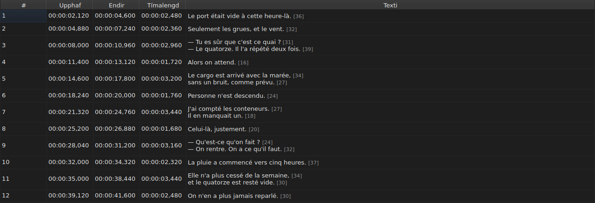
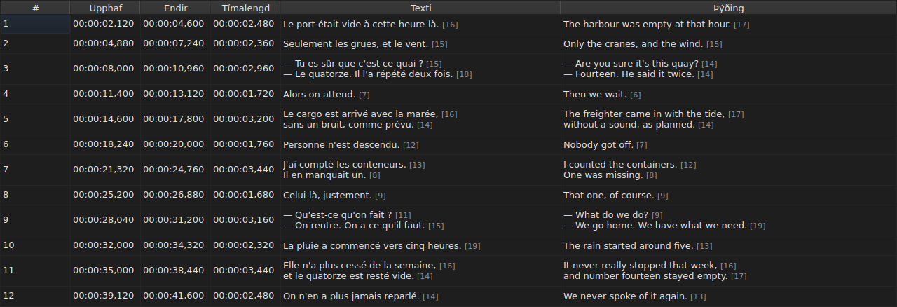
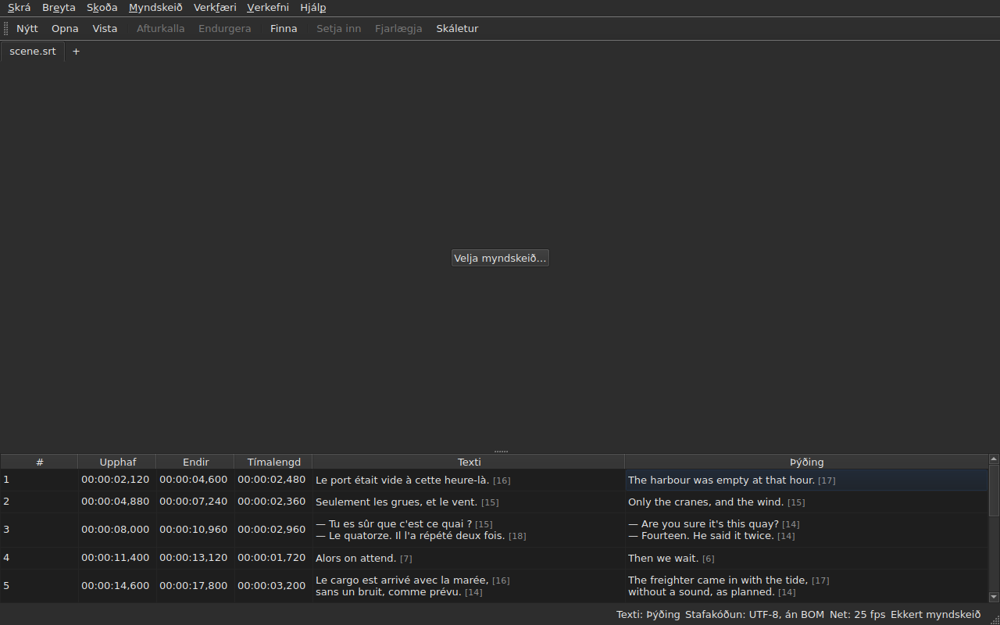

# Taflan

<!-- machine-translated -->
> Þessi síða er vélþýðing sem enginn lesandi tungumálsins hefur enn farið yfir.

Glugginn sýnir skjátexta opnu skrárinnar, einn í hverri línu, í fimm
dálkum — sex þegar verkefnið ber þýðingu.

**Þessi handbók vitnar í fyrirsagnir gluggans eins og enski glugginn sýnir
þær**, eins og hún gerir fyrir skipanalínuna; íslenskur gluggi sýnir þær á
sínu eigin tungumáli.

| Dálkur | Hvað hann sýnir |
| :----- | :------------ |
| `#` | númer skjátextans, frá 1 |
| `Start` | tímasetninguna þar sem hann birtist, `HH:MM:SS,mmm` |
| `End` | tímasetninguna þar sem hann hverfur |
| `Duration` | `End − Start` |
| `Text` | texta skjátextans |
| `Translation` | þýðingu skjátextans — **ekki til svo lengi sem verkefnið hefur enga** |


## Lengd lína




**Á eftir hverri línu í textareit kemur lengd hennar**, `[N]`, minni
og fölari — í dálkinum `Text` eins og í dálkinum `Translation`.
Það er það sem Gaupol gerir.

| Hvað telst | Hvað taflan gerir |
| :---------- | :------------------ |
| **merki** | teljast ekki: `<i>Bonjour</i>` gefur `[7]`, eins og `Bonjour` |
| **námundun** | niður á við: lína sem er 12,9 ems er sýnd `[12]` |
| **tóm lína** | hefur enga lengd; tómur texti ekki heldur |
| **einingin** | *ems* sjálfgefið, eða stafir — `Breyta ▸ Kjörstillingar…` |
| **lína sem er of löng fyrir dálkinn** | er skorin með `…` **á undan** tölunni, sem helst sýnileg |

**Emið er Gaupol, ekki leturfræðinnar**: stafrófið í lágstöfum
er 0,55 em virði fyrir hvern staf, undir letri töflunnar. Lengd í *ems* fer því eftir
letrinu; lengd í stöfum telur kóðapunkta, áherslustaf
sem einn.

**Taflan merkir ekki línu sem er of löng.** Hún sýnir töluna, og það er augans að
bera hana saman við mörkin sem þú hefur sjálfur sett — eins og Gaupol. Þetta eru ekki
mörk leiðsagnarforritsins `Correct Texts…`, sem hefur sína eigin stillingu.

**Til að sjá þær ekki:** taktu hakið af `Show line lengths in cells` í
`Breyta ▸ Kjörstillingar…`. Sjá [Línulengdir](preferences.md#línulengdir).

## Að fela og færa dálka

**`Skoða ▸ Dálkar`** ber eina færslu sem hægt er að haka við fyrir hvern dálk, **nema `Text`**:
án aðaltextans væri ekkert eftir til að breyta.

| Færsla | Dálkur |
| :---- | :----- |
| `Skoða ▸ Dálkar ▸ Nr.` | `#` |
| `Skoða ▸ Dálkar ▸ Upphaf` | `Start` |
| `Skoða ▸ Dálkar ▸ Endir` | `End` |
| `Skoða ▸ Dálkar ▸ Tímalengd` | `Duration` |
| `Skoða ▸ Dálkar ▸ Þýðing` | `Translation` — sjá [Þýðingardálkurinn](#þýðingardálkurinn) |

Að taka hakið af færslu fjarlægir dálk hennar, að haka við hana aftur setur hann til baka, í þeirri breidd
sem hann hafði. **Stillingin gildir um allan gluggann**, alla flipa
með: það er ein tafla, sem verkefni hennar breytist með flipanum.

**Núverandi reitur fer úr dálkinum sem er fjarlægður**: hann færist í `Text`,
á sömu línu, og valið hreyfist ekki. Núverandi reitur í
dálki sem enginn sér væri reitur sem takkaslag myndi breyta
í blindni.

**Dálkar eru færðir með því að draga hausinn þeirra**, hvern sem er, `Text`
með. Síðasti dálkurinn sem er sýndur tekur plássið sem hinir skilja eftir.

**Röðin og dálkarnir sem eru fjarlægðir eru munaðir frá einni setu til annarrar**, með
breiddunum, í [kjörstillingaskránni](preferences.md) — `table.order`
og `table.hidden`. Þýðingardálkurinn er ekki þar: hann fylgir sinni eigin
reglu, og kemur aftur með hverri þýðingu sem er opnuð.

**Númerið er ekki gögn skrárinnar** heldur sæti línunnar. Innsetning
eða fjarlæging endurnúmerar því allt sem á eftir kemur, án þess að nokkuð
sé endurskrifað.

**Tugabrotsskiljan fylgir sniði skrárinnar**: komma fyrir SubRip,
punktur fyrir hin átta. SubRip er eina sniðið af níu sem ritar kommu.

**Það er skiljan sem fylgir, ekki öll stafsetningin.** Taflan ritar alltaf
klukkustundirnar og alltaf þrjá aukastafi; WebVTT-skrá sleppir
klukkustundum undir einni klukkustund, SubViewer 2 og báðar Sub Station Alpha telja í
hundraðshlutum, MPL2 í tíundu hlutum, TMPlayer í sekúndum, MicroDVD í römmum. Dálkur
þar sem breiddin fylgdi sniðinu væri þreytandi að lesa miðað við
dálk sem er einfaldlega ekki nákvæm stafsetning skrárinnar.

Það sem taflan tryggir er því **gildið og skiljan**, ekki fjöldi
aukastafa. Það sem markasnið myndi námunda er sagt á því augnabliki sem
vistað er — sjá
[Hvað snið ber ekki](files.md#hvað-snið-ber-ekki-sagt-áður-en-skrifað-er).

**Tímalengdin (`Duration`) er reiknuð**, aldrei geymd: að slá hana inn færir
endinn. Skjátexti með endi á undan
upphafi sýnir neikvæða tímalengd frekar en núll: það er frávik í
skránni, og að fela það gerði ómögulegt að finna það.

**Upphafið, endirinn, tímalengdin, textinn og þýðingin eru breytt á staðnum**;
númerið ekki. Sjá [Að breyta reit](editing.md).

**Valið tilgreinir það sem aðgerð verkar á** — sjá
[Aðgerðirnar](operations.md).

**Hæð línu fylgir skjátextanum sem hún ber**: skjátexti með
tveimur línum tekur tvær, sá með þremur tekur þrjár. Textinn er sýndur
í heild, eins og hann verður ritaður.

**Það sem helst skorið er lína sem er of löng fyrir dálkinn sinn**, og hún
endar þá á úrfellingarmerki. Að breikka dálkinn `Text`, eða gluggann, sýnir hana
í heild; það gerir einnig að opna reitinn. Línur textans eru aldrei
brotnar um: aðeins raunveruleg línuskipti búa til línu, svo að hæð
töfluraðar breytist ekki þegar þú dregur jaðar dálks.

## Staðsetningar í römmum

**`Skoða ▸ Tímasetningar í römmum`** — færsla sem hægt er að haka við, ein stilling fyrir gluggann — sýnir
dálkana `Start` og `End` **sem rammanúmer** í stað tímamerkja, og **tekur við rammanúmeri sem inntaki**.
Hausarnir segja það: `Start (frames)` og `End (frames)`.

| Hvað breytist | Hvað breytist ekki |
| :----------- | :------------------- |
| það sem `Start` og `End` rita, og það sem þeir taka við | dálkurinn `Duration`, sem helst tími |
| hausar þessara tveggja dálka | skjalið: ekkert er breytt, ferillinn fær enga nýja færslu, og **það sem skráin ritar er það sem hún ritaði** |

**Rammatíðnin sem telur rammana** er, í þessari röð:

1. **sú sem skráin hefur**, þegar hún er talin í römmum — MicroDVD, sem ber númer en enga
   rammatíðni: **glugginn sýnir þá tölurnar úr skrá sinni**, hvað sem myndskeiðinu líður;
2. **sú sem tengda myndskeiðið gefur upp**;
3. **netið sem tímasetningarnar draga**, þegar þær draga eitt.

Ábending færslunnar segir hver var valin: *Tímasetningar eru rammanúmer, talin á 25 fps, tíðninni sem
myndskeiðið gefur upp*. **Með enga af þremur er færslan óvirk, og ábending hennar segir hvers vegna**: skráin er
ekki talin í römmum, myndskeiðið gefur enga rammatíðni upp, og tímasetningarnar falla á ekkert net.

- **Númer er númer rammans sem tímasetningin fellur í**, námundað að næsta ramma. **Þegar það er slegið inn
  gefur það augnablikið sem sá rammi byrjar**, námundað **aðeins einu sinni** úr nákvæmu hlutfalli
  ([ADR 0013](../../../../adr/0013-mise-a-l-echelle-exacte-des-positions.md)): rammi 37 á 23,976 römmum á sekúndu
  byrjar á 1543,04 ms, það er `00:00:01,543`.
- **Aðeins heilar tölur eru samþykktar** — með mínusmerkinu, þar sem upphaf getur verið á undan kvikmyndinni.
  Tímamerki slegið inn í rammaham, eða tala sem er ekki tala, skilur reitinn eftir eins og hann var.
- **Spilunarstikan fylgir sömu stillingu**: staðan og tímalengdin sitt hvorum megin við sleðann
  eru rituð sem rammanúmer eins og `Start` og `End`, á sama augnabliki — sjá
  [Spilunarstikan](player.md#spilunarstikan). Klukkan sem er teiknuð efst á myndinni helst
  tímamerki.
- **Þessi stilling er ekki munuð** frá einni setu til annarrar: hún er stilling gluggans, ekki
  skjals, og hún er kveikt aftur með einni aðgerð.

## Frávikin

Skjátexti þar sem tímasetningarnar ganga ekki saman er **litaður á
tímadálkum sínum**, og að sveima yfir honum segir hvað er að.

| Litur | Hvað hann tilkynnir | Hvað á að gera |
| :--- | :-------------- | :--------- |
| rauður | `ends before it starts` | leiðrétta endi hans, eða upphaf |
| blár | `starts before the previous one starts` | setja hann aftur á sinn stað í röðinni |
| gulur | `starts before the previous one ends` | laga tímasetningu hans |


Aðeins dálkarnir `Start`, `End` og `Duration` eru litaðir: frávik
talar aðeins um tíma, og að lita textann gæfi til kynna að hann hefði eitthvað
með það að gera.

**Skjátexti getur borið nokkur**, og ábendingin nefnir þau öll. Liturinn
er sá á því fyrsta sem þarf að lagfæra: skjátexti sem er bilaður í sjálfum sér
er bilaður hvað sem nágrannarnir gera; skjátexti á röngum stað er settur aftur á sinn stað,
og skörun hans hverfur með því.

> Það er engin tilviljun að óreiða vinnur nær alltaf yfir
> skörun: að byrja á undan því fyrra byrjar er að byrja
> áður en það endar — nema það fyrra sé sjálft bilað.

**Merkingin er endurreiknuð eftir hverja breytingu á tímasetningu**, hvort sem hún kemur
frá breyttum reit, aðgerð eða afturköllun. Hún segir hvað skráin
er núna, ekki hvað hún var við opnun.

Hún styðst ekki við neitt rammanet: um leið og tímasetning er leiðrétt með
höndunum fer hún úr því, og merking byggð á því myndi tilkynna
vinnu notandans.

## Þýðingardálkurinn

Skjátexti ber **tvo texta og eitt par tímasetninga**: þýðingin
hefur enga eigin tímasetningu, hún er fest við tímasetningu skjátextans.
Taflan sýnir hana í sjötta dálki, `Translation`, hægra megin við `Text`.




**Dálkurinn er aðeins til ef verkefnið hefur þýðingu.** Án hennar heldur taflan
fimm dálkum sínum, og glugginn hegðar sér eins og þýðingin
væri ekki til — ekkert er grátt eða bætt við. `Skrá ▸ Opna þýðingu…` opnar
eina: sjá [Að opna þýðingu](files.md#að-opna-þýðingu).

**Færsla í valmyndinni `View` sýnir hann eða fjarlægir**:

| Færsla | Hvað hún gerir |
| :---- | :----------- |
| `Skoða ▸ Dálkar ▸ Þýðing` | hökuð: dálkurinn er sýndur; ekki hökuð: hann er fjarlægður |

Færslan er **óvirk þegar verkefnið hefur enga þýðingu** — það er ekkert til að
sýna — og hökuð við ræsingu. **Valið að fjarlægja hann er
notandans**: það gildir frá einni skrá til annarrar, þar til hakað er
við aftur. Að fjarlægja dálkinn fjarlægir ekki þýðinguna: hún helst í
verkefninu, og kemur aftur með færslunni. Að opna skrá sem ber enga fjarlægir
dálkinn.

**Í reiti þýðingarinnar er skrifað eins og í reiti textans** — sjá
[Að breyta reit](editing.md).

### Textinn sem aðgerðirnar beinast að

Með tvo texta í línu verða textaaðgerðir að vita hvorn þær
endurskrifa. **Það er sá í dálki núverandi reits**:
þýðingin ef núverandi reitur er í dálkinum `Translation`, aðaltextinn
alls staðar annars staðar — í tímadálki eins og í `Text`.

| Aðgerð | Á hvað hún beinist |
| :-------- | :-------------- |
| `Italic`, `Case`, `Dialogue`, `Remove Hearing-Impaired Mentions…` | texta núverandi dálks |
| `Cut Texts`, `Copy Texts`, `Paste Texts` | texta núverandi dálks |
| `Find and Replace…` | texta núverandi dálks — sjá [Leita og skipta út](find-and-replace.md#í-hvaða-texta) |
| tímasetningaaðgerðirnar, innsetning, fjarlæging, sameining, skipting | **báða textana**: skjátexti er heild |

**Stöðulínan segir frá því þegar textarnir eru tveir**, vinstra megin við
aðrar upplýsingar:

```text
Text: Translation
```

eða `Text: Main` fyrir aðaltextann. Hún þegir þegar dálkurinn er ekki
sýndur: þá er aðeins einn texti, og engin ástæða til að segja það.




**Línan sem er teiknuð á myndina fylgir sömu reglu**: hún er texti
núverandi dálks. Sjá [Spilarinn](player.md#teiknaða-línan).

**Ekkert er grátt.** Textaaðgerðir haldast tiltækar hver sem
núverandi dálkur er, og án þýðingardálks beinast þær að aðal-
textanum, eins og áður.

## Að bæta við og fjarlægja línur

`Breyta ▸ Setja inn skjátexta…` og `Breyta ▸ Fjarlægja skjátexta` bæta við og fjarlægja
línur, `Breyta ▸ Sameina skjátexta` og `Breyta ▸ Skipta upp skjátexta` sameina og
skipta þeim; taflan endurnúmerar sig. Sjá
[Að setja inn, fjarlægja, sameina og skipta línum](lines.md).

## Það sem taflan gerir ekki

**Röðun eftir dálki er ekki til.** Röðin sem er sýnd er röð skrárinnar, og
hún er sú eina sem er skynsamleg fyrir skjátexta: sæti línu *er*
staður hennar í tíma.
