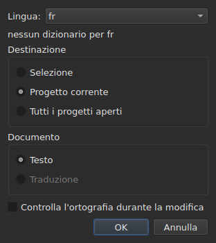
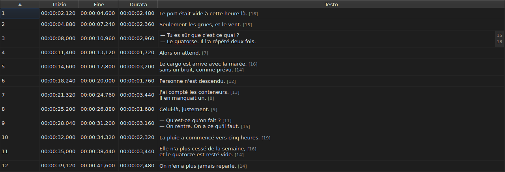
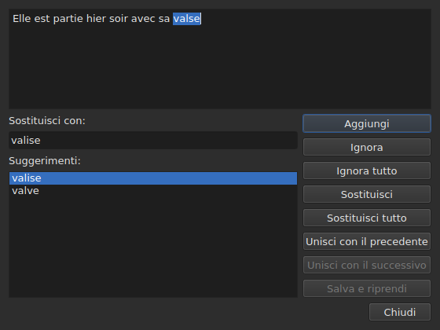

# Controlla l'ortografia…

<!-- machine-translated -->
> Questa pagina è una traduzione automatica e non è ancora stata rivista da un lettore della lingua.

`Strumenti ▸ Controlla ortografia…` percorre le parole che il dizionario non conosce,
una alla volta, sul modello del correttore ortografico di Gaupol. Ha un compagno,
`Strumenti ▸ Impostazioni controllo ortografico…`, che imposta la lingua, la destinazione e il documento, e la sottolineatura durante la digitazione.
Entrambe si appoggiano ai dizionari del sistema, tramite Enchant.

In inglese l'etichetta della prima è scritta `Chec&k Spelling…`: `C` è già
l'acceleratore di `Correct Texts…`, e `k` è libero nel menu `Tools`.
Nessuna delle due ha una scorciatoia.

**Entrambe sono disattivate su un documento senza sottotitoli**, come
[`Correct Texts…`](correct-texts.md): non c'è nulla da controllare. `Check Spelling…`
è disattivata anche senza dizionario per la lingua impostata, vedi
[Senza dizionario](#senza-dizionario).

## Impostazioni del controllo ortografico…




| Gruppo | Scelte | Predefinito |
| :----- | :----- | :---------- |
| `Language` | i codici di lingua che il sistema propone, e quello già scelto | la lingua del sistema, se è tra quelle |
| `Target` | `Selection`, `Current Project`, `All Open Projects` | `Current Project` |
| `Document` | `Text`, `Translation` | `Text` |
| `Check spelling while editing` | una casella di controllo, vedi [Sottolineatura durante la digitazione](#sottolineatura-durante-la-digitazione) | non selezionata |

`Selection` è disattivata se nella scheda mostrata non è scelta alcuna riga; `Translation`
è disattivata finché nessun progetto aperto porta una traduzione. Un'impostazione
ricordata che non è più disponibile — una selezione vuota, una traduzione assente —
si apre su `Current Project` o `Text`. `OK` conserva le impostazioni, `Cancel` non cambia
nulla.

**Questa finestra non dipende dal dizionario**: resta attiva finché il
documento ha dei sottotitoli, anche senza dizionario per la lingua impostata, ed è
quella che permette di lasciare una lingua che non ne ha. La lingua per cui non esiste
alcun dizionario resta modificabile e compare nell'elenco, con, sotto di
essa, la frase `no dictionary for` seguita dal suo codice.

**Le quattro impostazioni vengono ricordate** da una sessione alla successiva, nel
file delle impostazioni di `subedit` — vedi [Le preferenze](preferences.md) per la sua
posizione:

| Chiave | Valori | Predefinito |
| :----- | :----- | :---------- |
| `spell-check.language` | un codice di lingua, come `fr_FR`; vuoto: la lingua del sistema | vuoto |
| `spell-check.target` | `selection`, `current-project`, `all-projects` | `current-project` |
| `spell-check.document` | `main`, `translation` | `main` |
| `spell-check.inline` | `true` o `false` — sottolinea le parole sconosciute nell'editor di una cella | `false` |

Un valore che la chiave non accetta viene ignorato, si applica il valore predefinito, e l'opzione
viene nominata sull'errore standard all'apertura della finestra — vedi
[Che cosa succede quando il file non dice ciò che ci si aspetta](preferences.md#che-cosa-succede-quando-il-file-non-dice-ciò-che-ci-si-aspetta).

## Sottolineatura durante la digitazione




La casella di controllo `Check spelling while editing` di `Spell-Check Settings…` sottolinea,
**con una linea ondulata rossa e mentre si digita**, ogni parola sconosciuta nell'editor di una
cella di testo — quella della colonna `Text` come quella della colonna
`Translation`. La sottolineatura segue la digitazione: compare, si sposta e
scompare con la parola. **Non è selezionata in modo predefinito**, come in Gaupol: senza
di essa, nulla cambia nell'editor.

**La lingua è quella di `Language:`**, nella stessa finestra, e le parole sconosciute
sono quelle che `Check Spelling…` troverebbe: stessi casi di inglese colloquiale
(`goin'`, `we'd`, `1st`), stessa suddivisione in parole. Una parola sottolineata non si corregge
da un menu: la casella di controllo si limita a mostrarla.

**Senza dizionario per la lingua impostata, l'editor resta muto**: nulla viene
sottolineato e nulla fallisce, e la frase `no dictionary for` della finestra ne
spiega il motivo. La casella di controllo si applica agli editor aperti dopo di essa; un editor già
aperto conserva ciò che aveva.

## Il percorso




La finestra mostra il testo del sottotitolo dove si è fermata, con la parola sconosciuta
selezionata al suo interno. **A ogni parola sconosciuta, la scheda del progetto torna in primo piano e
la riga del sottotitolo viene selezionata nella tabella.** Il percorso procede sottotitolo
dopo sottotitolo, poi progetto dopo progetto quando la destinazione ne designa più d'uno.

Sotto il testo: la casella `Replace with:`, riempita con il primo suggerimento, e
l'elenco `Suggestions:`. Scegliere un suggerimento lo copia nella casella; digitare nella
casella rinnova l'elenco.

| Pulsante | Che cosa fa |
| :------- | :---------- |
| `Add` | aggiunge la parola al dizionario personale dell'utente e passa alla successiva |
| `Ignore` | lascia questa parola e passa alla successiva |
| `Ignore All` | lascia questa parola, e tutte le sue altre occorrenze durante questo percorso |
| `Replace` | sostituisce la parola con il contenuto di `Replace with:`; disattivato finché la casella è vuota |
| `Replace All` | fa lo stesso per le sue altre occorrenze; disattivato finché la casella è vuota |
| `Join with Previous` | unisce la parola alla parola che la precede; disattivato se non ce n'è una, o se non sono separate da uno spazio |
| `Join with Next` | unisce la parola alla parola che la segue, alle stesse condizioni |
| `Save and Resume` | conserva il testo come lo porta l'area di testo, e riprende la lettura di **questo testo dall'inizio** |
| `Close` | chiude la finestra |

**L'area di testo è modificabile.** Non appena vi si digita, resta attivo solo `Save and Resume`:
gli altri gesti agiscono sulla parola scelta, che non è più
quella del testo.

**Il percorso termina da solo** quando non resta alcuna parola sconosciuta: i
pulsanti sono disattivati, il testo si svuota. Una destinazione senza alcuna parola sconosciuta
non mostra alcuna finestra.

### Chiudere a metà

`Close`, oppure la croce della finestra, **applica ciò che è stato fatto**, come la fine
del percorso: i testi già lasciati, **e** i gesti — sostituisci,
sostituisci tutto, unisci — già eseguiti sul testo corrente. È uno scostamento da
Gaupol, che perde il testo corrente. Non conta ciò che resta del percorso, né
i ritocchi digitati nell'area di testo che `Save and Resume` non ha
confermato.

**Una sola voce della cronologia per progetto toccato**, qualunque sia il numero di
sostituzioni: `Undo` annulla in una volta tutte le correzioni di quel progetto.
Il menu la chiama `Undo: correcting texts`. La barra di stato dà allora il
conteggio:

```text
Edited 2 and removed 0 subtitles
```

**L'elenco delle sostituzioni** — ciò che l'utente ha sostituito, e con che cosa —
viene scritto alla chiusura in `spell-check/<language>.repl`, nella directory di configurazione
di `subedit`, e non in quella di Gaupol, che non viene mai letta.
Conta poi tra i suggerimenti del correttore ortografico, qui come in
[`Correct Texts…`](correct-texts.md#unisci-o-dividi-parole--riunire-e-separare-secondo-il-correttore-ortografico).
Se non può essere scritto, una casella di errore lo dice, `Could not save the
replacements for` seguito dalla lingua e dal motivo, senza annullare le
correzioni.

## Senza dizionario

Quando la lingua impostata — quella del sistema, se non ne è stata scelta alcuna — non ha
dizionario, **`Check Spelling…` è disattivata**, e il suo suggerimento a comparsa, come la barra
di stato quando ci si passa sopra con il mouse, ne dicono il motivo:

```text
no dictionary for fr
```

`Spell-Check Settings…` rimane, per scegliere una lingua che ne ha uno. Una finestra
costruita senza alcun fornitore di dizionari dice la stessa cosa e non controlla
nulla.

## I messaggi

| Messaggio | Dove | Che cosa lo provoca |
| :-------- | :--- | :------------------ |
| `no dictionary for fr` | suggerimento a comparsa e barra di stato | nessun dizionario per la lingua impostata |
| `Nothing to check.` | barra di stato | la destinazione non designa alcun testo — una selezione vuota, per esempio |
| `Edited N and removed M subtitles` | barra di stato | alla fine o alla chiusura; `M` resta a `0` |
| `Could not save the replacements for fr: …` | casella di errore | l'elenco delle sostituzioni non è stato scritto |

## Un esempio

Un file aperto porta `Elle est partie hier soir avec sa valse`. Il dizionario
francese c'è: `Strumenti ▸ Controlla ortografia…` si ferma su `valse`, seleziona la
riga nella tabella, e propone `valise`, già in `Replace with:`. `Replace`
poi `Close`: la riga diventa `Elle est partie hier soir avec sa valise`, e la
barra di stato dice:

```text
Edited 1 and removed 0 subtitles
```
