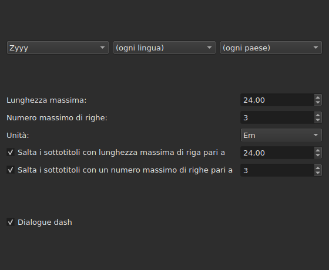
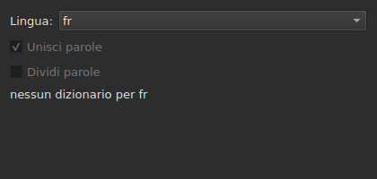
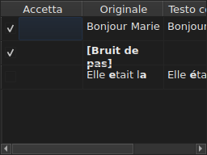

# Correggi i testi…

<!-- machine-translated -->
> Questa pagina è una traduzione automatica e non è ancora stata rivista da un lettore della lingua.

`Strumenti ▸ Correggi testi…` apre un assistente a più pagine, sul modello di
quello di Gaupol: una pagina di destinazione e operazioni da eseguire, una pagina per ogni operazione selezionata,
una pagina di avanzamento e una pagina di conferma che propone le
modifiche senza mai imporle.

**Disattivata su un documento vuoto**: non c'è nulla da correggere.

**La riga di comando fa la stessa cosa** per tutte le operazioni: [`subedit-cli correct`](../subedit-cli/correct.md), con gli
stessi modelli e gli stessi conteggi — e in caratteri dove la finestra misura in em.
**Per impostazione predefinita legge quattro impostazioni ricordate di questo assistente** — le due classi di
errori comuni (`Human`, `OCR`), `Remove all blank subtitles` e il numero massimo di righe di
`Line Break` — e prende tutto il resto (le operazioni, il loro codice, la lunghezza di riga, la lingua,
le caselle dei modelli) dalla propria riga di comando. Vedi
[Due blocchi, uno condiviso con la riga di comando](preferences.md#due-blocchi-uno-condiviso-con-la-riga-di-comando)
e [`subedit-cli config`](../subedit-cli/config.md).

## Operazioni e destinazione — la prima pagina

| Gruppo | Scelte | Predefinito |
| :----- | :----- | :---------- |
| `Target` | `Selection`, `Current Project`, `All Open Projects` | `Current Project` |
| `Document` | `Text`, `Translation` | `Text` |
| `Tasks` | `Mentions`, `Join or Split Words`, `Common Errors`, `Capitalization`, `Line Break` — da selezionare, una o più | `Common Errors` e `Capitalization` selezionate, le altre tre no |

`Selection` è disattivata se nella scheda mostrata non è scelta alcuna riga; `Translation`
è disattivata finché nessun progetto aperto porta una traduzione.

**La destinazione e il documento non vengono ricordati**: l'assistente si riapre sempre
su `Current Project` e `Text`. Le operazioni selezionate, invece, vengono ricordate.

**Che cosa indica ciascuna destinazione**:

| Destinazione | Agisce su |
| :----------- | :-------- |
| `Selection` | le righe scelte nella scheda mostrata |
| `Current Project` | l'intero file della scheda mostrata |
| `All Open Projects` | l'intero file di ogni scheda aperta |

**`All Open Projects` su `Translation` salta i progetti senza traduzione**:
un progetto che non ne porta una non ha nulla da proporre in una colonna vuota, e
l'assistente non lo conta.

**Seguono le pagine delle operazioni, nell'ordine di Gaupol — `Mentions`,
`Join or Split Words`, `Common Errors`, `Capitalization`, `Line Break` — mai in quello in cui le caselle
sono state selezionate.** Un'operazione non selezionata non ha pagina; le sue impostazioni
ricordate non cambiano per questo. **Nessuna pagina di operazione porta una propria
casella «attiva»**: è quella di questa prima pagina, e solo quella, a
decidere se l'operazione viene eseguita.

## Le pagine delle operazioni

Ciascuna delle quattro pagine di modelli — tutte tranne `Join or Split Words`, che non ne ha — porta la stessa base: tre
menu a discesa a cascata — scrittura, lingua, paese — per scegliere il codice dei modelli da
applicare, poi l'elenco dei modelli di quel codice, uno da selezionare per nome. **I
tre menu propongono soltanto ciò che il catalogo dei modelli porta
davvero** — quelli forniti con il programma e quelli che un utente
vi ha depositato (vedi [I modelli depositati](#i-modelli-depositati)) — mai un elenco
di lingue o di paesi letto altrove. `Zyyy` («qualsiasi scrittura») è il codice
iniziale di `Common Errors`, che dà i modelli validi ovunque. **Gli altri
tre tipi hanno modelli soltanto sotto una scrittura**: la loro pagina si apre sulla
prima che il catalogo propone, `Latn` con i modelli forniti, e non su `Zyyy`.

**La descrizione di ogni modello è il suggerimento a comparsa della sua casella.** I nomi e le descrizioni seguono la
lingua della finestra per i modelli forniti con il programma; un modello proprio viene mostrato come
lo scrive il suo file ([Lingua](invocation.md#lingua)).

**Un modello deselezionato resta deselezionato finché non viene selezionato di nuovo**, anche quando
si cambia codice e poi si torna a quello, e questa scelta viene ricordata da un'apertura
dell'assistente alla successiva. Selezionato di nuovo, ritrova semplicemente la sua
impostazione originale, e la scelta ricordata scompare.

| Pagina | Che cosa aggiunge alla base |
| :----- | :-------------------------- |
| `Mentions` | due caselle di controllo, `Sound in brackets` e `Sound in parentheses`, non selezionate in modo predefinito |
| `Common Errors` | due caselle di controllo, `Human` e `OCR`, selezionate in modo predefinito |
| `Capitalization` | nulla di più |
| `Line Break` | una lunghezza massima (`24`, in modo predefinito), un numero massimo di righe (`3`), un'unità — `Characters` oppure `Ems`, `Ems` in modo predefinito — e due condizioni di esclusione, descritte di seguito |

**Le due caselle di `Mentions` non nominano alcun modello compilato**: pilotano
una scansione del testo nel nucleo, la stessa che
[`Remove Hearing-Impaired Mentions…`](operations.md#remove-hearing-impaired-mentions)
esegue già con un gesto diretto. Basta che una **o** l'altra sia selezionata per avviarla. **L'elenco dei modelli della pagina non le ripete**: quei due nomi vi compaiono una sola volta, come caselle di controllo.

**`Common Errors` filtra per classe**: un modello che porta entrambe le classi
si applica non appena una delle due caselle è selezionata; le altre tre pagine non
conoscono questa distinzione.

### Line Break — l'unità e l'esclusione




| Impostazione | Che cosa fa | Predefinito |
| :----------- | :---------- | :---------- |
| `Maximum length` | la lunghezza di una riga, nell'unità scelta; da `1` a `1000` | `24` |
| `Maximum lines` | il numero di righe a cui si mira; da `1` a `100` | `3` |
| `Unit` | `Characters` conta i caratteri; `Ems` misura la larghezza con il carattere tipografico della finestra, dove una lettera minuscola media vale `0.55` — l'unità di Gaupol | `Ems` |
| `Skip subtitles with maximum line length of` | lascia com'è un sottotitolo la cui riga più lunga rientra in questa lunghezza, nell'unità scelta | selezionata, `24` |
| `Skip subtitles with maximum line amount of` | lascia com'è un sottotitolo il cui numero di righe rientra in questo numero | selezionata, `3` |

**L'esclusione ha le proprie soglie**, distinte dai limiti a cui si mira: è la
regola di Gaupol. Un sottotitolo viene lasciato com'è se rientra in **tutte le
soglie la cui casella è selezionata**; altrimenti viene spezzato, e la spezzatura viene
conservata solo se avvicina il sottotitolo a una soglia che superava — meno
lunghezza, o meno righe. Nessuna casella selezionata: ogni sottotitolo viene spezzato,
che rientri già nei limiti o no.

**Cambiare l'unità cambia ciò che viene proposto**: la lunghezza di ogni riga viene
misurata a ogni calcolo, nell'unità della pagina in quel momento, e nulla
resta di una misura precedente. Un testo di ventinove caratteri, di cui la metà
lettere strette, supera `24` in `Characters` e vi rientra senza difficoltà
in `Ems`.

**Le sette impostazioni vengono ricordate** da una sessione alla successiva, unità compresa.

### Unisci o dividi parole — riunire e separare secondo il correttore ortografico




Una pagina a parte, tra `Mentions` e `Common Errors`, per riparare ciò che i
programmi di riconoscimento del testo fanno agli spazi. Non ha un elenco di
modelli: si appoggia ai dizionari del sistema, tramite Enchant.

| Impostazione | Che cosa fa | Predefinito |
| :----------- | :---------- | :---------- |
| `Language` | la lingua del dizionario; i codici che il sistema propone, e quello già scelto | la lingua del sistema, se è tra quelle |
| `Join words` | unisce una parola errata alla parola vicina | selezionata |
| `Split words` | taglia in due una parola errata | non selezionata |

**Unione**: una parola errata viene unita alla parola che la precede o a quella
che la segue **se, e solo se, una sola delle due direzioni dà una parola
scritta correttamente**. Quando entrambe ne danno una, o nessuna, non si fa nulla.
`bon jour` diventa `bonjour`; due spazi di seguito vengono prima ridotti a
uno, ma un testo in cui nulla viene unito è restituito com'era, spazi
compresi.

**Divisione**: una parola errata viene tagliata se, tra i suggerimenti
del correttore ortografico, **uno solo** è quella parola con uno spazio dentro — le stesse
lettere, nello stesso ordine. Due suggerimenti di questo tipo, o nessuno: non si
fa nulla. Una parola la cui sola iniziale è maiuscola (`Bonjourtous`) non viene
mai divisa: spesso è un nome, e i dizionari non li hanno.

**L'elenco delle sostituzioni dell'utente** (`spell-check/<language>.repl`,
nella directory di configurazione del programma) conta tra i suggerimenti
del correttore ortografico; l'assistente lo legge e non lo scrive.

**Senza dizionario per la lingua scelta, la pagina resta ed è disattivata**: le
due caselle sono disattivate e la pagina dice `no dictionary for` seguito dal codice della
lingua. La lingua resta modificabile — un dizionario per un'altra potrebbe
esserci — e l'operazione, selezionata o no nella prima pagina, non fa allora nulla
e non segnala alcun errore.

**La lingua, le due caselle e la casella della prima pagina vengono ricordate** da un'apertura
dell'assistente alla successiva.

### I modelli depositati

Un modello che un utente ha depositato nella propria directory di modelli
viene aggiunto a quelli forniti con il programma, nello stesso catalogo e sotto gli
stessi menu — una volta caricati, nulla li distingue.

| Modelli | Dove |
| :------ | :--- |
| forniti | `<prefix>/share/subedit/patterns`, accanto a `<prefix>/bin` |
| dell'utente | `$XDG_DATA_HOME/subedit/patterns`, oppure `~/.local/share/subedit/patterns` se la variabile non è impostata o non è un percorso assoluto |

**Il formato è quello di Gaupol, letto così com'è**: un file `<Code>.<type>` per scrittura,
lingua e paese — `Latn-en.common-error` —, con la sua attivazione `.conf` accanto. I tipi
sono `common-error`, `capitalization`, `hearing-impaired` e `line-break`. I file
forniti fanno da modello. **I modelli vengono letti una sola volta, all'avvio**: un file
depositato mentre la finestra è aperta si vede solo al prossimo avvio.

## Avanzamento

Una volta premuto `Next` dall'ultima pagina di operazione selezionata (o dalla
prima pagina se nessuna operazione è selezionata), l'assistente calcola le correzioni
proposte in un thread in background, con una barra di avanzamento indeterminata
sullo schermo. Terminato il calcolo, la pagina di conferma si apre da sola.

**`Cancel` in questa fase abbandona il calcolo senza interromperlo**: nulla
viene applicato, ma l'assistente attende, prima di chiudersi, che il calcolo
in corso termini — un'attesa limitata dal tempo massimo che il motore
di modelli impone a ogni ricerca.

**`Back` in questa fase torna alla pagina precedente senza attendere**: il calcolo
termina in background e il suo risultato viene scartato — l'assistente non passa
da solo alla conferma. `Next` avvia un nuovo calcolo.

## Conferma — l'ultima pagina




Una riga per ogni testo che l'assistente modificherebbe — mai una riga per un
testo che un'operazione ha lasciato com'è.

| Colonna | Che cosa mostra |
| :------ | :-------------- |
| `Accept` | una casella di controllo, selezionata in modo predefinito: la correzione verrà applicata oppure no |
| `Original` | il testo com'è, la parte che cambierebbe **in grassetto** |
| `Corrected Text` | il testo proposto, la parte modificata in grassetto, **modificabile** — ritoccarlo cambia ciò che verrà scritto, senza cambiare la casella `Accept` |

**La modifica è segnata in grassetto, mai a colori**: lo stesso confronto si legge
in entrambe le tavolozze senza dipendere da alcuna tinta.

**Una riga la cui proposta è una rimozione** — al sottotitolo non resterebbe
più testo — mostra la colonna `Corrected Text` vuota, e tutto il suo `Original` in
grassetto.

| Pulsante | Che cosa fa |
| :------- | :---------- |
| `Mark All` | seleziona `Accept` su tutte le righe |
| `Unmark All` | deseleziona `Accept` su tutte le righe |
| `Preview` | posiziona il lettore integrato sul sottotitolo della riga scelta, se il progetto ha un film — nulla se non ne ha |
| `Finish` | applica le righe selezionate e chiude l'assistente |

`Remove all blank subtitles`, selezionata in modo predefinito, rimuove i sottotitoli
che una correzione lascerebbe senza alcun testo anziché tenerli vuoti.

**Un modello che il calcolo non ha potuto applicare viene nominato sotto la tabella**, con
il motivo:

```text
Not applied: some pattern (will not compile)
```

Un modello nominato in questo modo viene nominato **una volta per motivo**, qualunque sia il numero di
testi o di progetti su cui è fallito: lo schermo non dice quali.

| Motivo | Che cosa lo provoca |
| :----- | :------------------ |
| `cannot be translated` | l'espressione usa ciò che la traduzione della sintassi di Python rifiuta |
| `will not compile` | il motore rifiuta l'espressione |
| `has an invalid replacement` | la sostituzione non si legge come la legge Python |
| `timed out` | una ricerca ha superato il tempo che il motore le concede su un testo |
| `never settled` | `Repeat` stava ancora cambiando il testo dopo cento passaggi |
| `grew the text too long` | il testo ha superato 16.384 byte mentre il modello ci lavorava |

**Un modello che fallisce su un testo lo lascia com'era prima di lui**: una sostituzione
fatta a metà vale meno di nessuna sostituzione. Gli altri modelli si applicano.

**Una riga di un file di modelli che non può essere letta viene nominata nello stesso
posto**, con il suo file, la sua riga e il motivo — a ogni apertura
dell'assistente, dato che i modelli vengono letti una sola volta, all'avvio:

```text
Could not be read: Zyyy.common-error, line 8 (malformed line)
```

| Motivo | Che cosa lo provoca |
| :----- | :------------------ |
| `directory cannot be read` | la directory dei modelli forniti non ha potuto essere percorsa |
| `file cannot be read` | un file di modelli non ha potuto essere letto |
| `malformed line` | una riga che non è né un'intestazione, né un commento, né `Key=Value` |
| `field outside any pattern` | un `Key=Value` prima della prima intestazione di modello |
| `unknown field` | una chiave di cui questo tipo di modello non sa che farsene — il modello viene conservato |
| `missing field` | una chiave senza la quale questo tipo di modello non può fare nulla — il modello viene scartato |
| `invalid value` | un valore che la chiave non accetta — il modello viene scartato |
| `malformed activation` | un elemento `<pattern>` di un `.conf` che non nomina nulla |

Gli altri modelli, quelli che sono stati letti e applicati correttamente, non sono
interessati.

## Che cosa dice Annulla, e che cosa non fa mai `Cancel`

**`Finish` crea una voce della cronologia per ogni progetto toccato**, mai una per
correzione: `Undo` annulla in una volta tutte le correzioni accettate su quel
progetto, ciascuna con il testo che aveva. Il menu la chiama
`Undo: correcting texts`.

La barra di stato dà il conteggio, prima i testi modificati, poi i sottotitoli
rimossi:

```text
Edited 3 and removed 1 subtitles
```

**`Cancel`, su qualsiasi pagina, non applica nulla e non ricorda nulla** — né
le impostazioni scelte durante questa apertura, né la minima correzione. La
prossima apertura dell'assistente riparte dalle impostazioni di prima.

## Un esempio

Un file aperto porta due spazi tra due parole di una riga e
un'indicazione tra parentesi quadre senza altro testo. `Strumenti ▸ Correggi testi…`,
`Common Errors` già selezionata, `Next` fino alla conferma: la riga con i due spazi
mostra `Bonjour  Marie` a sinistra, `Bonjour Marie` a destra, la correzione in
grassetto e già accettata. `Finish` la applica, e la barra di stato dice:

```text
Edited 1 and removed 0 subtitles
```
