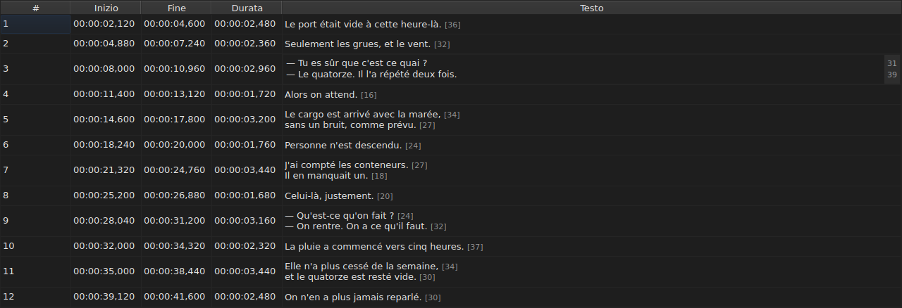

# Modificare una cella

<!-- machine-translated -->
> Questa pagina è una traduzione automatica e non è ancora stata rivista da un lettore della lingua.

Quattro colonne si modificano sul posto: `Start`, `End`, `Duration` e `Text` — cinque
con la colonna `Translation`, quando il progetto ha una traduzione. `#` non si può
modificare — il numero è il rango della riga, non un dato del file.

**Aprire l'editor di una cella:** doppio clic su di essa, oppure selezionarla
e premere `F2`.

## Il testo

**La traduzione si modifica come il testo**, con lo stesso campo su più righe e le
stesse regole; cambia solo la cella, e il testo principale resta
com'era. Una conferma che non cambia nulla non fa nulla, per l'uno come per
l'altra — vedi [più avanti](#una-conferma-che-non-cambia-nulla-non-fa-nulla).

L'editor è un campo **su più righe**, e si apre all'altezza del sottotitolo:
un sottotitolo di due righe vi si digita come verrà scritto, con le sue due righe
leggibili e senza barra di scorrimento. Uno `Shift+Enter` che ne aggiunge una ingrandisce
l'editor; la riga della tabella si adatta alla conferma.

| Tasto | Effetto |
| :-- | :----- |
| `Enter` | conferma e chiude l'editor |
| `Shift+Enter` | inserisce un a capo nel testo |
| `Esc` | chiude l'editor; la cella conserva ciò che aveva |
| `Tab` | conferma e passa alla cella successiva |

Anche fare clic altrove conferma: perdere il focus equivale a un `Enter`.

**Undici gesti senza finestra di dialogo confermano allo stesso modo** prima di calcolare il loro bersaglio:
`Italic`, `Maiuscole e minuscole ▸ …`, `Dialogue`, `Merge Subtitles`, `Split Subtitle`,
`Cut Texts`, `Paste Texts`, `Copy Texts`, `Remove Subtitles`, `Undo` e `Redo`.
Avviati dal menu, dalla barra degli strumenti o da una scorciatoia della finestra,
prendono il testo come l'editor lo ha appena confermato, come dopo un clic
altrove. `Ctrl+X`, `Ctrl+C` e `Ctrl+V` restano tuttavia all'editor finché
è aperto — vedi [Tagliare, copiare e incollare](clipboard.md): è allora il
menu ad avviare `Cut Texts`, `Copy Texts` e `Paste Texts`.

`Undo` e `Redo` leggono la cronologia e non il documento: vedi
[Annulla e ripeti](undo.md). Un gesto che apre una finestra di dialogo non ha
bisogno di questa regola, poiché la finestra prende il focus aprendosi, il che
conferma già l'input.

### I tag sono quelli del file

Il testo mostrato e digitato è **quello del file, tag compresi**: un
`<i>…</i>` di un SubRip si scrive così, e un `{\i1}…{\i0}` di un Advanced SSA
allo stesso modo. Nulla viene tradotto per la visualizzazione — la tabella di
[`Italic`](operations.md#italic) dice che cosa scrive ciascun formato.

Per il corsivo, non c'è quindi nulla da sapere: `Ctrl+I` imposta il tag giusto
per il documento aperto, e un formato che non ne ha — TMPlayer, LRC —
disattiva la voce anziché lasciare che la si cerchi. Grassetto e sottolineato si
digitano, come in Gaupol.

**E i tag non seguono le operazioni sul testo**: mettere un sottotitolo
in minuscolo non trasforma il suo `<I>` in `<i>`, e un trattino di dialogo viene
posto prima del testo e non prima di un tag di apertura. Vedi
[`Case` e `Dialogue`](operations.md#case-e-dialogue).

## La lunghezza delle righe

**L'editor di testo mostra, in un margine a destra, la lunghezza di ciascuna
riga**, allineata con la prima riga visiva di quella riga. Il margine è largo
quanto il numero più grande, si aggiorna **mentre si digita**, e segue lo
scorrimento. Un testo vuoto non mostra nulla. Le lunghezze sono quelle della tabella — senza i
tag, arrotondate per difetto, nell'unità impostata — e si tolgono con la
casella `Show line lengths in the editor` di `Modifica ▸ Preferenze…`. Vedi
[Le lunghezze di riga](preferences.md#le-lunghezze-di-riga).

## L'inizio e la fine

L'editor è un campo su una sola riga, **vincolato alla forma di un indicatore di tempo**:
rifiuta durante la digitazione ciò che non potrebbe mai esserlo.

Le forme accettate sono quelle che la lettura di un file accetta già:

| Elemento | Che cosa passa |
| :---------- | :---------- |
| campi | `MM:SS` o `HH:MM:SS`, una o due cifre ciascuno |
| decimali | da uno a tre, dopo una virgola o un punto, oppure nessuno |
| segno | un `-` iniziale, per una posizione prima dell'inizio del video |
| limiti | minuti e secondi inferiori a 60 |

`00:01:02,500`, `1:02.5` e `-0:01,000` sono quindi tre input validi.

**Un input che la lettura rifiuta lascia la cella invariata.** È il caso
di `00:70:00,000`, la cui forma è giusta ma i cui minuti sono fuori
dai limiti: l'editor si chiude e nulla si è mosso. Nessuna posizione viene inventata
— sbagliare una posizione avviene in silenzio, nulla sullo schermo distingue un
sottotitolo sincronizzato male da uno sincronizzato bene.

Cambiare un inizio o una fine aggiorna subito la `Duration`.

## La durata

**Digitare una durata sposta la fine, e mai l'inizio**: la fine diventa
`Start + Duration`. Spostare l'inizio sposterebbe l'intero sottotitolo, che
è compito di [`Shift Positions…`](operations.md), e la colonna `Start` si può
già digitare.

La durata si digita **nella forma di un indicatore di tempo**, quella che la colonna
mostra, e valgono le forme della tabella qui sopra — con una differenza:

| Elemento | Inizio, fine | Durata |
| :------- | :----------- | :------- |
| forma | quella di un indicatore di tempo | la stessa |
| segno `-` iniziale | accettato | **rifiutato durante la digitazione** |

`0:02.5` e `00:00:02,500` sono quindi due input validi per una durata di due
secondi e mezzo; `-0:01,000` non si può digitare. Una durata nulla è accettata:
il sottotitolo scompare allora nell'istante in cui compare.

**Una fine che supera il sottotitolo successivo è consentita.** La
sovrapposizione viene colorata nella tabella, con il suo suggerimento a comparsa — vedi
[La tabella](table.md#le-anomalie) — un avviso, non un rifiuto: può essere ciò che
si voleva. Anche l'[elenco della diagnostica](files.md#la-diagnostica-di-una-lettura)
la riporta, e la toglie quando la si è corretta.

**Una fine digitata oltre la fine del film non viene segnalata**, a differenza di
un'operazione del menu `Tools` che ve la spingerebbe — vedi
[Le operazioni](operations.md#oltre-la-fine-del-film). Una cella mostra già
il valore appena digitato.

Un input illeggibile lascia la cella invariata, come per una posizione, e
una durata identica a quella mostrata non entra nella cronologia.

## Una conferma che non cambia nulla non fa nulla

Aprire una cella, non digitare nulla, premere `Enter`: non succede nulla.
Nessuna modifica viene registrata, e il file è ancora considerato identico a
quello su disco.

Il confronto riguarda la **posizione**, non la stringa: digitare `0:01.0`
in una cella che mostra `00:00:01,000` designa lo stesso istante, e
non cambia quindi nulla nemmeno così.

## Che cosa ne è di una cella modificata

**Si può annullare** — una cella, una voce. Vedi
[Annulla e ripeti](undo.md).

**Viene salvata**, e chiudere la finestra senza averlo fatto chiede
conferma. Vedi [Aprire e salvare](files.md).
