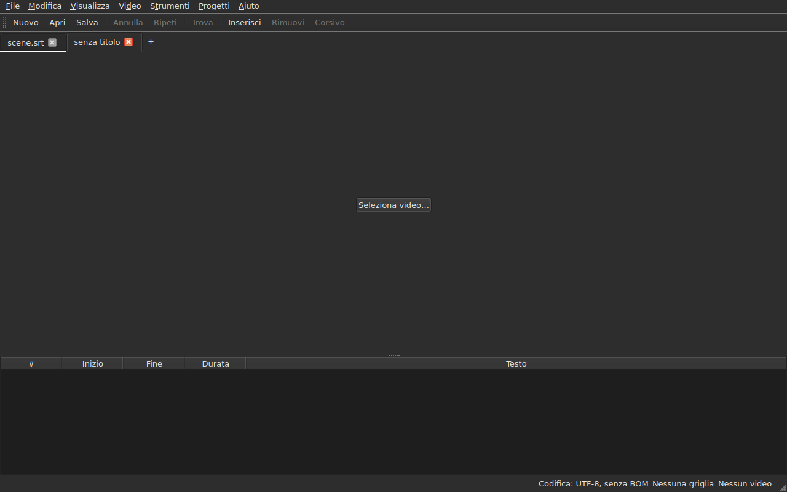
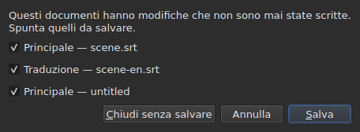
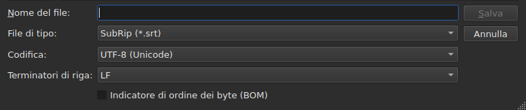
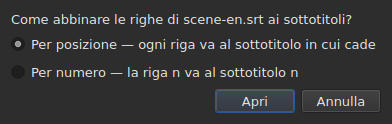
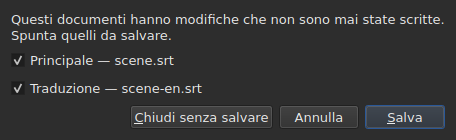

# Aprire e salvare

<!-- machine-translated -->
> Questa pagina è una traduzione automatica e non è ancora stata rivista da un lettore della lingua.

Il menu **File** contiene i tre comandi, due per le schede e altri tre
per la traduzione; il menu **Progetti** agisce su tutte le schede insieme.

| Comando | Scorciatoia | Che cosa fa |
| :------ | :------- | :----------- |
| Nuovo progetto | `Ctrl+N` | un progetto vuoto, in una nuova scheda — anche il pulsante `+` dopo l'ultima scheda |
| Apri… | `Ctrl+O` | sceglie un file e lo apre in una nuova scheda — o al posto di un progetto vuoto |
| Apri traduzione… | — | sceglie un file di traduzione e lo allinea al file principale della scheda corrente |
| Salva | `Ctrl+S` | riscrive il file aperto |
| Salva come… | `Ctrl+Shift+S` | sceglie un percorso e un formato, poi scrive |
| Salva traduzione | — | riscrive il file della traduzione |
| Salva traduzione come… | — | sceglie un percorso e un formato per la traduzione, poi scrive |
| Chiudi | `Ctrl+W` | chiude la scheda corrente — disattivato se ce n'è una sola |

`New Project`, `Open…` e `Save` sono anche nella
[barra degli strumenti](index.md#la-barra-degli-strumenti), con le parole `New`, `Open` e
`Save`. **Le tre voci della
traduzione non sono nella barra**: servono solo a chi ha una
traduzione, e la barra è di tutti.

## Più progetti, in schede

**Ogni progetto aperto ha la sua scheda**, sopra l'immagine e la tabella:
la sua etichetta è il nome del file, oppure `untitled` per un progetto che non ne ha
ancora uno. Un clic su una scheda passa a essa; `Ctrl+PageDown` e `Ctrl+PageUp`
fanno lo stesso, senza il mouse, e tornano alla prima scheda dopo l'ultima.
**Il pulsante `+`, subito dopo l'ultima scheda**, apre un progetto vuoto in una
nuova scheda, come `New Project`.




**`Open…` non le tocca mai.** Aprire un file non sostituisce più ciò che la
finestra mostrava: arriva in una nuova scheda, accanto, e la scheda che si
stava guardando prima conserva tutto ciò che aveva — la sua cronologia, la sua selezione, il suo
video associato. È anche per questo che l'apertura non chiede più nulla: non c'è
nulla da perdere, dato che non c'è nulla da sostituire.

**Un'eccezione: il progetto vuoto cede il suo posto.** Avviata senza file, o
dopo `New Project`, la finestra mostra un progetto `untitled` senza nulla dentro.
Un file aperto — con `Open…` come con un trascinamento — **prende allora la sua scheda,
nello stesso punto della barra**, anziché aprirne un'altra accanto a un progetto
inutile. Un progetto è vuoto quando non ha **né file, né sottotitoli,
né nulla da annullare o ripetere, né film, e non è mai stato modificato**: basta
una qualsiasi di queste cose perché conservi la sua scheda. Un progetto vuoto che non è
la scheda corrente non viene toccato.

**Un file già aperto non viene aperto una seconda volta.** `Open…` su un
file che un'altra scheda già contiene restituisce il focus a quella scheda, e lo dice
nella barra di stato:

```text
premier.srt: already open
```

**Ogni scheda è un progetto intero, indipendente dagli altri**: la sua
cronologia, la sua selezione, il suo video associato e ciò che la sua ultima lettura
ha incontrato vengono mostrati solo quando quella scheda è la corrente, e non
cambiano mentre lo è un'altra. **Un'eccezione, ed è nell'ADR
0033**: il lettore video è unico per tutta la finestra — un solo
processo mpv — e il suo film cambia con la scheda; **ogni scheda ricorda dove si trovava
il suo film**, e lo riprende da lì, in pausa, quando ci si torna. Gli appunti, da parte loro, appartengono alla finestra: copiare
in una scheda e incollare in un'altra è il motivo per cui se ne aprono due.

**`Close` chiude la scheda corrente**, ponendo se necessario
[la domanda sulle modifiche non salvate](#modifiche-non-salvate) —
quella di questa sola scheda, le altre non essendo coinvolte. **Disattivato quando
c'è una sola scheda**: la finestra ne conserva sempre almeno una, e chiuderla
equivarrebbe a chiudere la finestra — cosa che fa già il pulsante del sistema.

**Ogni scheda porta anche una croce**, che chiude **il suo** progetto, con la stessa
domanda. La croce di una scheda che non è la corrente chiude quella, e la scheda
che si sta guardando resta visualizzata; se quel progetto ha modifiche, la sua
scheda passa in primo piano per il tempo della domanda. **Nessuna croce quando resta una
sola scheda**, per la stessa ragione per cui `Close` è disattivato.

**Una scheda dice di essere modificata**: una stella segue il suo nome, `premier.srt*`,
finché uno dei suoi documenti differisce dal suo file — come il titolo della finestra
lo dice del progetto che si sta guardando. Scompare al salvataggio.

## Il menu Progetti

Due comandi agiscono su tutti i progetti insieme.

| Comando | Scorciatoia | Che cosa fa |
| :------ | :------- | :----------- |
| Salva tutto | `Ctrl+Shift+L` | scrive ogni documento modificato, scheda per scheda |
| Chiudi tutto | `Ctrl+Shift+W` | chiude tutti i progetti — cioè la finestra |

**`Save All` procede nell'ordine delle schede**, il documento principale prima della traduzione.
Un documento che ha un file viene riscritto lì **senza che la sua scheda passi in primo piano**;
**un documento che non ne ha apre `Save As…`, uno alla volta**, sulla sua scheda —
l'unico caso in cui `Save All` cambia scheda, perché la finestra mostri di
quale progetto si tratta. **Annullare un `Save As…`, o un
salvataggio che fallisce, interrompe il resto**: i progetti seguenti non
vengono toccati, e una finestra dice che cosa è stato scritto.

```text
Save All stopped: 1 of 3 documents saved
```

Quando tutto è scritto, la barra di stato lo dice — `2 documents saved`, oppure
`Nothing to save` quando nulla era modificato. Se un `Save As…` ha portato
una scheda in primo piano, la finestra torna poi a quella da cui il comando è stato
lanciato.

**`Close All` e la croce della finestra sono una sola e stessa cosa**: la finestra
conserva sempre un progetto, e chiuderli tutti equivale a chiuderla. Pongono quindi
**una sola domanda per tutti i progetti**, la stessa che per
[due documenti modificati](#chiudere-con-due-documenti-modificati), con una casella di controllo
per ogni documento modificato di ciascuna scheda:




**`Cancel` non chiude nulla**, e non lascia nulla scritto. `Save` scrive i
documenti selezionati come `Save All`: dietro la loro scheda, tranne un documento senza
nome, la cui scheda passa in primo piano per il suo `Save As…`. Con un solo documento
modificato in tutti i progetti, è la semplice domanda di sempre,
posta sulla sua scheda. `Save All As…` non esiste: è una sequenza di
`Save As…`, che `Save All` pone già, uno alla volta, per i documenti senza nome.

## Apertura

La finestra di dialogo filtra **i nove formati letti**, una voce ciascuno, e una prima
voce che li mostra tutti. Il formato viene poi riconosciuto **dal contenuto, non
dall'estensione**: un `.txt` che contiene SubRip si apre, e il filtro non decide
nulla — nasconde soltanto dei file.

| Voce del filtro | Estensione |
| :----------- | :-------- |
| `SubRip` | `.srt` |
| `WebVTT` | `.vtt` |
| `SubViewer 2` | `.sub` |
| `Sub Station Alpha` | `.ssa` |
| `Advanced SSA` | `.ass` |
| `MicroDVD` | `.sub` |
| `MPL2` | `.txt` |
| `TMPlayer` | `.txt` |
| `LRC` | `.lrc` |

**Due estensioni designano ciascuna due formati** — `.sub` è SubViewer 2 e
MicroDVD, `.txt` è MPL2 e TMPlayer. Non ha conseguenze all'apertura,
dato che decide il contenuto; al salvataggio, è il **nome** della
voce scelta a dare il formato, mai il suo modello.

**Un file illeggibile non apre nulla.** Mancante, rifiutato dal sistema, scritto
in una codifica in cui i suoi byte non si decodificano, o di nessun formato
noto: una finestra modale **nomina la causa**, nessuna scheda viene aperta, e quelle che
c'erano non si muovono.

| Messaggio | Che cosa è successo |
| :------ | :------------ |
| `does not exist` | il percorso non designa alcun file |
| `cannot be opened: permission denied` | il sistema rifiuta di aprirlo |
| `cannot be read` | il sistema ha rifiutato per un altro motivo |
| `cannot be decoded in the chosen encoding` | i byte non si leggono nella codifica scelta |
| `is in no format this tool knows` | nessun formato riconosce il contenuto |
| `holds nothing recognisable as a subtitle` | il formato è riconosciuto, ma nulla al suo interno è un sottotitolo |

Il messaggio è preceduto dal percorso: `notes.txt: is in no format this tool knows`.
Sono le parole della riga di comando, e non è un caso — entrambe le
superfici leggono un file con la stessa ricetta.

### Trascinare file sulla finestra

**Trascinare file in un punto qualsiasi della finestra li apre**, dal
gestore di file: la tabella, la barra delle schede, il pulsante
`Select Video…`, e **l'immagine stessa del film**, in riproduzione come ferma.
L'immagine è una finestra separata disegnata dal lettore, e nulla garantiva
che avrebbe passato un rilascio; è stato verificato a mano su un vero desktop,
in una sessione Wayland. `subedit-gui` vi viene avviato sotto X11 per poter mostrare
il film, quindi il rilascio passa attraverso il protocollo X11 — quello di una
sessione X11, dove non è stato provato separatamente.

- **Ogni file di sottotitoli apre la sua scheda**, nell'ordine in cui sono stati
  rilasciati — esattamente come `Open…`. Un file **già aperto** non viene
  riletto: la sua scheda passa in primo piano, e la barra di stato lo dice
  (`premier.srt: already open`).
- **Un video rilasciato viene associato alla scheda corrente**, come con
  `Select Video…`. Se rilasciato insieme ai sottotitoli, va all'ultima scheda
  che hanno aperto, qualunque sia l'ordine del rilascio. Un video viene riconosciuto dalla
  sua estensione — la stessa lista di quella che propone un film accanto al
  file.
- **Due video o più insieme non vengono aperti**: un progetto segue un
  solo film. I sottotitoli dello stesso rilascio, invece, si aprono.
- **Un file che non si apre non ferma gli altri.** Una sola finestra dice allora
  che cosa non si è potuto fare, una riga per file, con le parole
  di `Open…`:

  ```text
  /films/notes.txt: is in no format this tool knows
  /films/absent.srt: does not exist
  ```

Vengono presi solo i file locali: un collegamento trascinato da un browser
non designa nulla che la finestra possa leggere.

L'apertura dalla riga di comando funziona ancora: `subedit-gui film.srt`.
Lì, la stessa causa viene scritta sul flusso degli errori, e la finestra si apre
vuota — vedi [Invocazione](invocation.md#quando-lapertura-fallisce).

## La diagnostica di una lettura

Un file reale è raramente perfetto, e la lettura recupera anziché
arrendersi: un numero mancante, una riga che non porta da nessuna parte, terminatori
di riga misti. **Ciò che ha incontrato sta in un pulsante della barra di stato**
— `2 diagnostics`, a sinistra di ciò che la barra dice già del documento —, e **la lista si apre con un clic
in una finestra flottante** sopra il pulsante. Nessuna riga della finestra viene sottratta per essa:
la tabella conserva tutta la sua altezza, che la lettura avesse qualcosa da dire o no. La lista
si chiude con un clic altrove o con `Esc`.

```
a SubRip block without its number, settled by the reader: 5
```

**Ogni riga conta**: ciò che è stato incontrato, che cosa si è fatto, e
quante volte. Un file fatto male ne incontra centinaia, e sapere
quante di ciascun tipo è ciò che permette di intervenire; il numero di riga di ogni occorrenza nel
file, da parte sua, si legge sulla riga di comando, con il livello di dettaglio `-vvv`. Il
pulsante conta queste righe — una per tipo —, non le occorrenze.

**Anche la codifica indovinata compare lì**, una volta: è stata proposta pesando i
byte, prima che esistesse una sola riga del file.

```
an encoding nothing declared, settled by the reader: 1
```

Viene mostrata solo quando la codifica è stata **indovinata e non è
UTF-8** — un file UTF-8 letto come tale non è un evento, e dirlo a
ogni apertura metterebbe un pulsante nella barra di stato di ogni documento
ordinario. Nemmeno un file che porta un indicatore dell'ordine dei byte la
fa comparire: ha dichiarato la sua codifica, nulla è stato indovinato.

**La stessa lista conta anche ciò che non va nei sottotitoli stessi**: un
sottotitolo che inizia prima che il precedente sia finito, una fine prima del suo
inizio, un inizio prima di quello del sottotitolo che lo precede. La tabella li colora, ma
una colorazione si trova scorrendo, e in un file di duemila righe
è facile perderne una; qui i tipi sono tutti insieme, **uno per
riga e con il loro numero**, nelle parole del rapporto di `inspect`:

```
subtitle starts before the previous one ends: 12
subtitle starts before the previous one starts: 3
```

**Un clic su una riga porta al primo sottotitolo interessato**, selezionato nella
tabella. Queste righe **seguono le correzioni** — ordinare o correggere una durata
ne rimuove alcune, o ne abbassa il numero —, senza chiudere la lista che si sta
leggendo. Un sottotitolo può essere contato due volte: iniziare prima della fine del
precedente e prima del suo inizio sono due rilievi, che si correggono in due
modi. Per nominarli uno per uno, `subedit-cli inspect --detail`.

Il pulsante **non compare** quando non c'è nulla da segnalare, né nella lettura né
nei sottotitoli, e **segue la scheda**: ogni progetto conserva la
diagnostica della propria lettura, e il pulsante mostra quella del progetto visualizzato.

## La codifica nella barra di stato

**La barra di stato indica sempre la codifica del documento aperto**, a sinistra di ciò che
dice della [griglia dei fotogrammi](frame-grid.md) e del
[video associato](video.md):

| Situazione | Che cosa è scritto |
| :-------- | :-------------- |
| il file è stato letto come UTF-8, senza indicatore | `Encoding: UTF-8, no BOM` |
| … con un indicatore | `Encoding: UTF-8, BOM` |
| un file in Latin-1 | `Encoding: ISO-8859-1, no BOM` |

**La diagnostica e questa riga non rispondono alla stessa domanda**, ed è per
questo che esistono entrambe. La diagnostica dice che cosa la lettura ha **fatto** — ha
indovinato, e si potrebbe voler controllare; viene quindi mostrata solo quando c'è
stata un'ipotesi. La barra di stato dice che cosa il documento **è**,
in modo permanente, anche per un file che dichiara da sé la propria codifica e su
cui la lettura non ha nulla da dire.

**Da dove viene la risposta non compare lì.** `inspect` lo dice — `detected`,
`from its byte order mark`, `as asked for` — perché un rapporto ha lo spazio per
dirlo; una riga della barra di stato no, e la lista della diagnostica lo riporta già quando
conta.

## Salvataggio

`Save` riscrive il file aperto **nella sua forma originale**: il suo formato, la sua
codifica, i suoi terminatori di riga, il suo indicatore dell'ordine dei byte e la sua intestazione. Un
file aperto e poi salvato senza modifiche non si sposta di un solo byte — vedi
la garanzia esatta più avanti.

La scrittura è **atomica**: passa per un file temporaneo rinominato
al suo posto. Un salvataggio interrotto in un momento qualsiasi lascia intatta
la versione precedente.

Salvare un documento che non è mai stato su disco equivale a `Save As…`.

**Una scrittura che fallisce lo dice e non perde nulla**: un disco pieno, un
file in sola lettura, una directory mancante — oppure **un carattere che la codifica del file
non può scrivere**, una `ł` in un file Latin-1. Il messaggio è
allora `holds a character the chosen encoding cannot write`, e nulla viene
scritto: sostituire il carattere con un `?` farebbe perdere del testo davanti agli occhi di chi
lo ha appena digitato. Il messaggio nomina il file e il motivo, la finestra conserva
le sue modifiche, e l'indicatore nel titolo resta.

## Salva come

`Save As…` chiede un percorso, un formato, **e la forma dei byte scritti**:
la codifica, i terminatori di riga, l'indicatore dell'ordine dei byte. Il documento **vive poi
lì**: il titolo cambia, `Save` punta al nuovo file e scrive nella
forma scelta, e il file originale resta com'era.

**I nove formati sono offerti**, e la voce selezionata quando la finestra
si apre è **quella del documento**. Salvare con un altro nome senza toccare il
filtro non cambia quindi il formato.




**Le immagini mostrano solo la parte inferiore della finestra**, non la lista dei file
sopra: dipende dalla macchina — le sue directory, le sue date, le sue
scorciatoie laterali —, quindi la sua fotografia non sarebbe mai la stessa due volte.
Questa striscia lo è, ed è dove accade tutto.

| Campo | Che cosa offre | Predefinito |
| :---- | :------------- | :------ |
| `Encoding` | quattordici codifiche che un file di sottotitoli porta in pratica, più `Other…` | **quella del file letto** |
| `Other…` | un campo in cui digitare qualsiasi codifica che ICU possa scrivere, **con completamento** — `cp1257`, `EUC-KR` | — |
| `Line endings` | `LF`, `CRLF` o `CR` | quelli del file letto |
| `Byte order mark` | l'indicatore, **disattivato per una codifica che non ne porta** | quello del file letto |

**I valori predefiniti sono quelli del file letto, ed è una garanzia più che una
comodità**: un file aperto e poi salvato di nuovo senza toccare questi tre
campi restituisce gli stessi byte.

**La lista è corta, e non è un tetto.** ICU ne conosce duecento
ventuno; ciò che il menu offre è ciò che un file di sottotitoli porta
in pratica, perché un menu di duecento voci non aiuta nessuno. `Other…`
apre il resto.

**Il campo completa tra le duecentoventuno**, quindi non occorre
conoscere il nome esatto: digitando `1252` propone `windows-1252`, digitando `koi`
propone `KOI8-R` e `KOI8-U`. Il completamento riguarda ciò che il nome **contiene**
e non ciò con cui inizia — il nome canonico di Windows Western è
`windows-1252`, e `cp1252` è quello che la gente ha in mente. Entrambi si possono
anche scrivere per esteso senza completamento: ICU accetta i propri alias.

**Un nome che nessuno conosce non scrive nulla.** Digitando `klingon-1` non si
ripiega su UTF-8: nulla viene scritto, e il messaggio lo dice.

**Nemmeno un nome che non dichiara l'ordine dei byte.** `UTF-16` e `UTF-32` sono
nomi che ICU conosce, il cui convertitore scrive **il proprio indicatore**: la
casella `Byte order mark` smetterebbe allora di decidere qualsiasi cosa. Entrambi
vengono rifiutati, e il messaggio indica `UTF-16LE` o `UTF-16BE`, che scrivono
gli stessi byte sotto il controllo della casella. È lo stesso rifiuto, con le
stesse parole, di quello della riga di comando.

**Un carattere che la codifica scelta non può scrivere interrompe il salvataggio**
— una `ł` in Latin-1. Il messaggio è
`holds a character the chosen encoding cannot write`, la finestra conserva le sue
modifiche, e il file di destinazione non viene toccato.

**Nemmeno il documento si sposta**: resta sul suo file, nel suo
formato e nella sua codifica, e il successivo `Save` riscrive quello che era stato aperto.
Un salvataggio che non ha avuto luogo non cambia nulla — né su disco,
né nella finestra.

Cambiare formato cambia ciò che la tabella mostra — il separatore decimale segue il
formato, una virgola per SubRip, un punto per WebVTT, e **i tag vengono riscritti
nel vocabolario del formato di destinazione**: un `<i>` diventa `{\i1}` in Sub
Station Alpha, `{Y:i}` in MicroDVD, `/` all'inizio di una riga in MPL2. Il documento
**è diventato** quel file, quindi la tabella mostra ciò che il file contiene.

**Non è un comando, e `Ctrl+Z` non lo annulla.** Un documento il cui
formato dicesse LRC e i cui testi dicessero ancora `<i>` sarebbe un
documento incoerente; non c'è una metà da annullare.

## Che cosa un formato non conserverà, detto prima di scrivere

**Una finestra modale avvisa, e si può ancora rispondere no.** Elenca ciò che il
formato di destinazione non conterrà, voce per voce, con le parole che la riga
di comando scrive in seguito:

```
ends are not carried by LRC, line breaks were joined in 2 subtitles, 1 tag dropped
```

| Pulsante | Effetto |
| :----- | :----- |
| `Save` | scrive comunque, accettata la perdita |
| `Cancel` | non scrive nulla; il documento non si sposta, né il file né il formato |

`Cancel` è il pulsante predefinito: un tasto Invio premuto senza leggere lascia il
file com'è.

**Non si chiede nulla quando nulla va perso.** Una finestra che annunciasse «nulla
andrà perso» insegnerebbe a chiudere quella che conta.

Che cosa può essere annunciato:

| Voce | Quando |
| :--- | :--- |
| le fini | il formato di destinazione non ne porta — TMPlayer, LRC |
| gli a capo | il formato di destinazione non ne porta — LRC |
| i tag | un tag della sorgente non ha equivalente nella destinazione, o il formato pivot non lo conosce |
| l'intestazione | il file letto ne portava una, e non passa all'altro formato |
| i campi dichiarati | l'ordine delle colonne SSA, la forma del tempo TMPlayer |
| la precisione | il formato di destinazione conta più grossolanamente — il decimo di MPL2, il secondo di TMPlayer |

**Ciò che appartiene all'altro formato viene lasciato da parte.** Un file WebVTT
porta identificatori di cue e impostazioni di posizionamento; SubRip porta le coordinate
di visualizzazione. Scrivere nell'altro formato le ignora anziché
tradurle a caso — non sono perse per questo, semplicemente non
vengono scritte.

## La garanzia dell'andata e ritorno

Ha due metà, ed entrambe servono:

- **fedele byte per byte** su un file già nella disposizione che
  `subedit` scrive — quella di Gaupol, riga vuota finale compresa —, e **qualunque sia
  la sua codifica**: un file in CP1252 o in UTF-16 viene riscritto nella
  sua, indicatore compreso;
- **idempotente** altrimenti: il primo salvataggio normalizza la disposizione,
  nessuno dopo tocca più nulla.

In concreto, un file il cui ultimo blocco non è seguito da una riga vuota
ne guadagna una, una volta. È l'unica modifica che un salvataggio senza
modifiche possa produrre.

## Aprire una traduzione

`File ▸ Apri traduzione…` colloca un **secondo file** accanto a quello principale.
La voce è disattivata finché non c'è alcun sottotitolo a cui dare le righe della
traduzione.

**Due domande, una dopo l'altra.** Il selettore di file, quello di
`Open…` — stesso filtro, stessa cartella iniziale, la codifica riconosciuta come per il
file principale — poi **il metodo di allineamento**:




| Metodo | Che cosa fa |
| :----- | :----------- |
| `By position` (predefinito) | ogni riga va al sottotitolo in cui cade il suo punto medio |
| `By number` | l'n-esima riga va all'n-esimo sottotitolo, senza guardare le posizioni |

**La posizione è il valore predefinito**, perché una sola riga mancante nel mezzo fa
scorrere *tutte* le seguenti per numero, mentre per posizione un solo
sottotitolo resta senza traduzione.

**Che cosa si fa, che cosa viene scritto:**

- i testi delle righe collegate entrano nella colonna `Translation`, che
  compare;
- **una riga che non trova alcun sottotitolo ne fa nascere uno**, con **le
  posizioni di quella riga** — con entrambi i metodi;
- **nulla viene ordinato**, né il file né il documento: le righe vengono percorse
  in ordine temporale, e viene fornito il conteggio di quelle che non lo erano;
- **una traduzione già aperta viene sostituita**, con tutti i suoi testi prima cancellati.

**Ciò che è successo viene detto.** Quando ogni riga ha trovato il suo sottotitolo e
nessuno è rimasto solo, la barra di stato lo scrive; altrimenti **una finestra da chiudere**,
come per ogni gesto che ha qualcosa da dire:

```text
translation: 3 lines attached
translation: 2 lines attached; 1 subtitle left without a translation
translation: 3 lines attached; 1 subtitle born of a line; 2 lines out of order
```

Le voci vengono scritte solo se non sono zero: le righe collegate, i
sottotitoli nati da una riga, quelli che nessuna riga ha raggiunto, le righe fuori
ordine. Un file senza alcuna riga lo dice
(`translation: the file holds no line`) anziché dare la colpa ai
sottotitoli.

**Una traduzione sfasata viene riconosciuta, e riaperta spostata.** Una traduzione con tempi in ritardo di due
secondi si allinea ai sottotitoli sbagliati senza che nulla la distingua da un
collegamento corretto. Quando l'apertura **per posizione** non è pulita, la finestra cerca
**uno spostamento costante**: le differenze tra l'inizio di ogni riga e quello dei sottotitoli
intorno danno dei candidati, raggruppati al decimo di secondo, e **ciascuno
viene giudicato dallo stesso collegamento dell'apertura**. Se un solo spostamento rende l'apertura
pulita, la finestra lo dice dopo il suo conteggio e **propone di riaprire spostata**:

```text
translation: 4 subtitles born of a line; 4 subtitles left without a translation
the lines sit 2.000 s later than the subtitles; moved back, 4 lines would attach instead of 0
```

`Yes` annulla l'apertura e la rifà con le righe riportate da quello spostamento; `No`, la
risposta predefinita, lascia l'apertura com'è. **Il risultato è una sola voce
della cronologia**: annullarla restituisce tutto, come per qualsiasi apertura.

**Non viene proposto nulla quando lo spostamento non è costante** — una deriva, uno spostamento che
tocca solo una parte del file —, quando due spostamenti renderebbero l'apertura ugualmente
pulita, o quando nessuno la rende pulita: la frase non dice allora che ce n'è uno. Né
per numero, dove le posizioni non vengono guardate. Non c'è **alcuna riga di comando**
per questo.

**Aprire una traduzione è una sola voce della cronologia**, `Undo: opening a translation`,
e annullarla restituisce tutto: i testi, i sottotitoli nati rimossi,
il file della traduzione scollegato — la colonna se ne va con esso. Per aprirla con
l'altro metodo, si annulla prima.

**La traduzione appena aperta non è modificata**: nulla è stato digitato, e
chiuderla non propone di salvarla. Se sono nati dei sottotitoli, è il
documento principale a essere modificato.

**Una traduzione modificata viene proposta per il salvataggio prima di essere
sostituita**, con i tre esiti della sezione sulle
[modifiche non salvate](#modifiche-non-salvate).

| Messaggio | Che cosa è successo |
| :------ | :------------ |
| `the file is already open as the main document` | il file scelto è lo stesso documento principale, comunque sia scritto il suo percorso |
| `does not exist`, `cannot be decoded in the chosen encoding`, … | le stesse cause di `Open…` |

Il messaggio è preceduto dal percorso, e **nulla cambia**: la finestra conserva la sua
cronologia e le sue modifiche.

**I problemi che la lettura ha incontrato**, se ce ne sono — una riga riparata,
un campo ignorato —, vanno nella lista della diagnostica, quella
[dell'ultima lettura](#la-diagnostica-di-una-lettura).

**Ciò che la traduzione non conserva**: le impostazioni **per sottotitolo** del suo
file — uno stile SSA, la posizione di un sottotitolo WebVTT. Un sottotitolo
ne porta un solo insieme, quello del documento principale; non vengono né rilette né riscritte.

## Salvare la traduzione

**Ogni documento viene salvato separatamente**, nel suo file, nel suo formato, nella sua
codifica e con i suoi terminatori di riga: una traduzione in `.ass` sotto un file principale in
`.srt`, in Windows-1252 sotto un file principale in UTF-8, torna com'è.

| Voce | Che cosa fa |
| :---- | :----------- |
| `Save Translation` | riscrive il file della traduzione — quello da cui proviene |
| `Save Translation As…` | il selettore di `Save As…`, aperto sul file **della traduzione**, con il suo formato e la sua codifica |

Entrambe sono **disattivate finché il progetto non ha una traduzione**.
`Save Translation As…` è `Save As…` sull'altro documento: stessi campi, stesso
[avviso di perdita](#che-cosa-un-formato-non-conserverà-detto-prima-di-scrivere), che
conta **ciò che il file scritto perderebbe** — i tag del testo principale
non sono quelli della traduzione, e un formato che non scrive il corsivo
se ne lamenta solo se la traduzione ne ha.

**Ogni documento ha il proprio stato di modifica.** Salvare il documento principale lascia la
traduzione modificata, e viceversa; **il titolo della finestra è modificato se lo è uno dei
due**, e ha un solo asterisco.

**Nulla dell'uno tocca l'altro**: salvare la traduzione non scrive il
documento principale, e non ne cambia né il file, né il formato, né i testi.

## Chiudere con due documenti modificati

Chiudere la scheda corrente, o la finestra, mentre **due documenti** o più
differiscono dai loro file pone **una sola domanda**, una casella di controllo per
documento:




| Pulsante | Che cosa succede |
| :----- | :----------- |
| `Save` | scrive i documenti la cui casella è selezionata, poi prosegue — disattivato quando non ce n'è nessuna |
| `Close Without Saving` | perde entrambi, qualunque siano le caselle |
| `Cancel` | non succede nulla; la finestra resta com'era |

**Deselezionare un documento significa perderlo**: `Save` scrive gli altri e prosegue.
**Se un salvataggio fallisce, l'azione non prosegue.** Chiudere la
finestra senza rispondere equivale a `Cancel`.

**Con un solo documento modificato, la domanda è quella di sempre**,
descritta più avanti, e la frase dice quale: `The translation has changes that were never written.`
oppure `The document has …`.

**Un file sparito dal disco conta come modificato**, e la lista lo dice —
`(file is gone from the disk)`: ciò che la finestra contiene è allora **l'unica
copia**, e chiudere senza scrivere la distruggerebbe. Con un solo documento in quel caso,
la frase è `The document is no longer where it was read from.`

## Modifiche non salvate

Chiudere la finestra, la scheda corrente, o aprire una traduzione che sostituirebbe
quella già presente, mentre il documento differisce da quello su disco **chiede
conferma**, con tre esiti:

| Risposta | Che cosa succede |
| :----- | :----------- |
| `Save` | il documento viene scritto, poi l'azione prosegue |
| `Discard` | le modifiche vengono perse, e l'azione prosegue |
| `Cancel` | non succede nulla; la finestra resta com'era |

Chiudere la finestra senza rispondere equivale a `Cancel`.

**Se il salvataggio fallisce**, l'azione non prosegue: il lavoro non viene né
scritto né perso.
