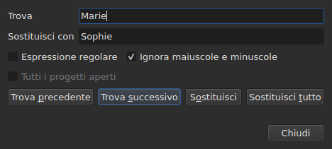
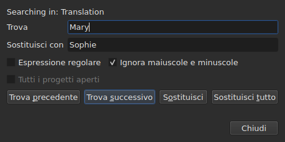

# Trova e sostituisci

<!-- machine-translated -->
> Questa pagina è una traduzione automatica e non è ancora stata rivista da un lettore della lingua.

`Modifica ▸ Trova e sostituisci…`, oppure `Ctrl+F`, apre la finestra di ricerca.




**La finestra non è modale**: resta aperta mentre si guarda la tabella,
si modifica una cella, si cerca di nuovo. `Close` la chiude; riaprendola
la si ritrova come la si era lasciata, modello e sostituzione compresi.

| Campo | Che cosa porta |
| :---- | :------------- |
| `Find` | il modello cercato |
| `Replace with` | ciò che lo sostituisce |
| `Regular expression` | il modello è un'espressione regolare anziché un testo semplice |
| `Ignore case` | «marie» trova «Marie» |
| `All open projects` | la ricerca percorre tutte le schede — [vedi sotto](#in-tutti-i-progetti-aperti) |

La voce è disattivata su un documento vuoto: non c'è nulla da cercare.

## I quattro gesti

| Pulsante | Che cosa fa |
| :------- | :---------- |
| `Find Previous` | trova la corrispondenza precedente, e la tabella vi si sposta |
| `Find Next` | trova la successiva — è il pulsante che `Enter` preme |
| `Replace` | sostituisce la corrispondenza trovata, poi trova la successiva |
| `Replace All` | sostituisce tutte quelle della destinazione |

Tutti e quattro sono disattivati finché `Find` è vuoto.

**La tabella si sposta sulla corrispondenza** selezionando la sua riga. Raggiunta
l'ultima, `Find Next` riparte dalla prima; `Find Previous` fa lo stesso
nell'altra direzione.

**`Replace` senza una corrispondenza trovata cerca prima**: la prima pressione
mostra ciò che sta per essere sostituito, la successiva lo sostituisce. È ciò che fa
Gaupol.

## Che cosa copre la ricerca

**La selezione, oppure tutto il documento se nulla è selezionato** — la regola del
menu `Tools`. Vedi [Le operazioni](operations.md#su-che-cosa-agiscono).

**La destinazione viene presa al primo gesto e conservata** finché la ricerca
prosegue: `Find Next` seleziona la riga di una corrispondenza, e quella
selezione non restringe la destinazione. **Selezionare da sé altre righe
cambia la destinazione** per il gesto successivo.

La ricerca copre il testo dei sottotitoli; né le posizioni né il numero
vengono cercati.

### In tutti i progetti aperti

La casella di controllo **`All open projects`** allarga l'ambito a ogni scheda. **Disattivata con
un solo progetto aperto** — non c'è nulla da allargare —, diventa attiva non appena si apre una
seconda scheda, e si deseleziona da sola quando ne resta una sola.

**Selezionata, la selezione non conta più**: ogni progetto viene cercato per intero,
nel **documento preso di mira** — quello della colonna corrente, il principale o la
traduzione, come per un solo progetto.

- **`Find Next` e `Find Previous` passano da una scheda all'altra, nell'ordine delle
  schede.** Prima il progetto mostrato; quando non ha più corrispondenze, il
  successivo, di cui la finestra mostra la scheda e di cui seleziona la riga.
- **Il giro finisce dove è iniziato**: quando la ricerca supera l'ultima
  scheda per tornare alla prima — o il contrario salendo —, la riga della
  finestra di dialogo lo dice, anziché ricominciare senza una parola:

  ```text
  Search wrapped around
  ```

  Il passo successivo è un passo ordinario, e la riga si cancella.
- **`Replace` sostituisce dove si trova la ricerca**, poi passa alla corrispondenza
  successiva, che può trovarsi in un'altra scheda.
- **`Replace All` percorre tutti i progetti**, e **crea una voce della cronologia
  per progetto toccato**: annullare in una scheda annulla solo ciò che quella scheda
  ha ricevuto. Il conteggio dice quanti progetti sono cambiati, non solo quante
  sostituzioni:

  ```text
  replaced 4 matches in 3 projects
  ```

  Un progetto in cui il modello è assente non viene toccato, e non ha nulla da annullare.
  **Nessuna scheda passa in primo piano**: ogni progetto riceve le sue sostituzioni
  dietro la sua scheda, che prende il suo asterisco, e la scheda da cui il gesto
  è partito resta mostrata, con il suo film.

### In quale testo

**Con una traduzione, la ricerca copre uno solo dei due testi: quello della
colonna della cella corrente** — la traduzione se la cella corrente è
nella colonna `Translation`, il testo principale ovunque altrove. È la
regola di tutte le operazioni sul testo, e non c'è alcuna impostazione in più:
vedi [Il testo su cui agiscono le operazioni](table.md#il-testo-su-cui-agiscono-le-operazioni).

**La finestra di dialogo dice in quale testo cerca**, su una riga sopra
`Find`, e lo cambia quando la colonna corrente cambia — anche quando è aperta:




| La cella corrente è in | La riga dice |
| :--------------------- | :----------- |
| la colonna `Translation` | `Searching in: Translation` |
| qualsiasi altra colonna | `Searching in: Main` |
| — il progetto non ha traduzione, o la colonna è rimossa | nulla: la riga non c'è |

**Sostituire scrive in quel testo, e solo in esso.** `Replace` e `Replace
All` sulla traduzione lasciano il testo principale com'era, e
viceversa; `Undo` restituisce ciò che hanno scritto. **I tag sono quelli del formato
del file di quel testo**: una traduzione in Advanced SSA viene letta con i suoi
`{\i1}`, anche quando il testo principale è un SubRip. `Replace with` viene scritto lì
con gli stessi tag.

**La tabella resta nella colonna in cui si trovava.** `Find Next` seleziona la riga
di una corrispondenza senza spostare la cella corrente da una colonna all'altra:
una ricerca iniziata nella traduzione prosegue nella traduzione.

**Cercare entrambi i testi insieme non esiste**: ogni corrispondenza
sarebbe una coppia (sottotitolo, testo), e la tabella che vi si sposta non avrebbe
un posto chiaro in cui andare. Si cerca in uno, poi si cambia colonna.

**Che cosa riparte da zero**:

| Gesto | Che cosa viene dimenticato |
| :---- | :------------------------- |
| cambiare `Find`, `Replace with` o un'opzione | la corrispondenza corrente, e la riga di stato |
| selezionare da sé altre righe | la destinazione e la corrispondenza |
| spostare la cella corrente da un testo all'altro — da `Text` a `Translation`, o il contrario | la corrispondenza: è un posto in un testo |
| aprire un altro file | la destinazione e la corrispondenza; la finestra di dialogo resta aperta, modello compreso |

## Il testo cercato è il testo visibile

**I tag non sono testo.** Cercare `<i>` non trova nulla, e cercare
`Bonjour` trova un `<i>Bon</i>jour` spezzato da un tag.

**La sostituzione viene fatta nel testo del file, senza rompere i tag**:

| Testo | Cercato → messo al suo posto | Che cosa viene scritto |
| :---- | :--------------------------- | :--------------------- |
| `<i>Bonjour</i>` | `Bonjour` → `Salut` | `<i>Salut</i>` |
| `<i>Bon</i>jour` | `Bonjour` → `Salut` | `<i>Salut</i>` |
| `<i>Bonjour</i> Marie` | `Bonjour Marie` → `Salut Sophie` | `<i>Salut Sophie</i>` |

Un tag che spezza una parola comprende l'intera parola, e qualsiasi stile che tocchi la
corrispondenza copre la sostituzione. **I tag che la corrispondenza non
tocca restano dove sono**, anche uno che spezza un'altra parola dello stesso
sottotitolo: sostituire `Marie` in `<i>Bon</i>jour Marie` dà
`<i>Bon</i>jour Sophie`. Una parola è fatta di lettere e cifre — uno spazio
non separabile o un virgolettato non ne fa parte. **`Replace with` viene letto nei tag del
testo preso di mira**: digitare lì `<b>Salut</b>` in un SubRip rende la parola in grassetto.

## Le due opzioni

| Opzione | Predefinito | Che cosa cambia |
| :------ | :---------- | :-------------- |
| `Regular expression` | non selezionata | `.` non cerca più un punto ma un carattere qualsiasi |
| `Ignore case` | selezionata | maiuscole e minuscole non contano, lettere accentate comprese: `élise` trova `Élise` |

Sono i valori predefiniti di Gaupol. **Entrambe vengono ricordate** da un'apertura
alla successiva e da una sessione alla successiva, nelle opzioni `search.regex` e
`search.ignore-case` del [file delle impostazioni](preferences.md#il-file).

### Un'espressione regolare

Il modello è letto da ICU. Come in Gaupol, `.` attraversa un a capo, e `^`
e `$` si applicano all'inizio e alla fine **di ogni riga** di un sottotitolo:
sostituire `^` con `- ` mette un trattino prima di ogni riga.

In `Replace with`, e solo per un'espressione regolare:

| Scritto | Che cosa mette |
| :------ | :------------- |
| da `$1` a `$9` | il gruppo di quel numero; un gruppo assente non mette nulla |
| `$0` | l'intera corrispondenza |
| `\n` | un a capo |
| `\$`, `\\` | un `$`, una barra rovesciata |
| `\` seguita da qualsiasi altro carattere | quel carattere: `\t` mette una `t` |

**`\1` non è un gruppo**, e mette un `1`. È la sintassi di Gaupol, che legge
le sue espressioni in Python; quella di qui è di ICU, che legge il modello.

## Che cosa dice la finestra di dialogo

Sotto i pulsanti, una riga dice ciò che la ricerca non ha potuto fare, o ciò che un
`Replace All` ha fatto:

| Situazione | Che cosa viene mostrato |
| :--------- | :---------------------- |
| nessuna corrispondenza nella destinazione | `"Sophie" not found` |
| un'espressione regolare che non si legge | `not a regular expression (U_REGEX_MISMATCHED_PAREN)` |
| `Replace All` ha sostituito | `replaced 3 matches` |
| `Replace All` ha trovato il modello, ma la sostituzione non cambia alcun testo | `nothing to change` |

**Una ricerca che non trova nulla non tocca nulla**: la selezione resta dov'era,
e nulla entra nella cronologia.

**`not found` e `nothing to change` non dicono la stessa cosa.** `not found`
dice che il modello non è da nessuna parte nella destinazione. `nothing to change` dice che
c'è, ma la sostituzione lascia ogni testo com'era — sostituire
`Marie` con `Marie`, per esempio. In entrambi i casi nulla entra nella
cronologia. Il numero di `replaced N matches` conta le corrispondenze dei
sottotitoli il cui testo è cambiato.

## Che cosa dice in proposito l'azione Annulla

| Gesto | Che cosa legge `Undo` |
| :---- | :-------------------- |
| `Replace` | `Undo: replacing` — una per sostituzione |
| `Replace All` | `Undo: replacing all` — **una sola voce**, qualunque sia il numero di corrispondenze |

Vedi [Annulla e ripeti](undo.md).
