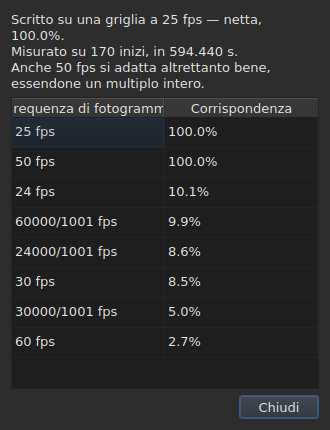

# La griglia dei fotogrammi

<!-- machine-translated -->
> Questa pagina è una traduzione automatica e non è ancora stata rivista da un lettore della lingua.

Un file di sottotitoli **non dichiara** la frequenza dei fotogrammi rispetto
alla quale sono state calcolate le sue posizioni: SubRip non ha intestazione, quella di
WebVTT è testo libero. La finestra la **deduce** dalle posizioni stesse,
all'apertura, e la mostra in due punti che non rispondono alla stessa
domanda.

| Elemento | Che cosa fornisce |
| :------ | :------------ |
| la barra di stato | **la risposta**, in modo permanente e senza che sia richiesta |
| `Strumenti ▸ Analisi della frequenza di fotogrammi…` | **il ragionamento**, quando lo si vuole vedere |

## Che cosa mostra la barra di stato

A destra, tra ciò che dice sulla
[codifica](files.md#la-codifica-nella-barra-di-stato) del file letto e ciò che
dice sul [video associato](video.md#che-cosa-mostra-la-barra-di-stato):

| Situazione | Che cosa viene scritto |
| :-------- | :-------------- |
| le posizioni sono su una griglia | `Grid: 24 fps` |
| solo alcune di esse | `Grid: 29.97 fps (partial)` |
| nessuna griglia nota si adatta | `No grid` |

**`No grid` non indica alcuna frequenza dei fotogrammi, ed è voluto.** L'insieme dei
candidati è chiuso — le otto frequenze che offre la finestra di conversione — e
indicare la meno sbagliata tra esse significherebbe dare una risposta errata dove
«non lo so» è la risposta giusta.

**`No grid` ha due cause, e non sono la stessa risposta.** O nessuna
griglia si adatta, oppure il file ha troppi pochi sottotitoli perché se ne possa dire
qualcosa — due inizi sembrano sempre perfettamente allineati, e questo non
prova nulla. La barra di stato dice la stessa cosa nei due casi;
**l'analisi li distingue**, e nel primo caso indica di quanto
il candidato migliore sbaglia.

La riga **si aggiorna dopo ogni operazione**. Allineare un file su un'altra
frequenza dei fotogrammi cambia la griglia, e la barra di stato non deve continuare ad
annunciare quella vecchia.

### Un documento contato in fotogrammi non ha una griglia, ha una frequenza dei fotogrammi

**MicroDVD è l'unico dei nove formati che conta in fotogrammi.** Ognuna delle sue righe
porta due numeri di fotogramma e nient'altro, e il file **non dice** a
quale frequenza dei fotogrammi leggerli. Nello stesso punto della barra di stato compare allora:

| Situazione | Che cosa viene scritto |
| :-------- | :-------------- |
| il documento è contato in fotogrammi | `Frames: 24000/1001 fps` |

**Questa non è la griglia, e qui la griglia sarebbe circolare.** Le posizioni
di un documento MicroDVD sono state calcolate *a partire dai* suoi fotogrammi proprio a quella
frequenza; dedurne una griglia restituirebbe quello stesso numero, cioè un dato
travestito da misura.

**Da dove proviene viene detto una sola volta**, dalla lettura, nell'
[elenco della diagnostica](files.md#la-diagnostica-di-una-lettura):
`counts in frames and states no rate; it was read at ("24000/1001")`. La riga della
barra di stato, invece, dice ciò che è, in modo permanente.

**Sbagliare la frequenza dei fotogrammi sposta l'intero file**, e la finestra
[`Convert Frame Rate…`](operations.md#convert-frame-rate) è il luogo in cui la si corregge:
si apre sulla frequenza di lettura e dice che è quella.

## Che cosa mostra l'analisi

`Strumenti ▸ Analisi della frequenza di fotogrammi…` **non modifica nulla.** Si apre su un riepilogo e
sulla classifica degli otto candidati con il loro punteggio.




Il riepilogo dà la risposta, poi ciò che la qualifica — ogni frase compare
solo se ha qualcosa da dire:

| Che cosa vi si può leggere | Quando |
| :--------------------- | :--- |
| su quanti inizi, e su quale durata | sempre |
| di quanto il file è sfasato rispetto alla sua griglia | le sue posizioni vi si trovano a meno di una costante |
| che un'altra frequenza dei fotogrammi si adatta altrettanto bene | è un multiplo intero di quella scelta |
| che la durata non permette di distinguere due frequenze dei fotogrammi | il file è troppo breve per separarle |
| quanti inizi escono dalla griglia, **e in quante serie** | il file è parziale |

**Il numero di serie è ciò che distingue due storie** che la sola
percentuale confonde. Molte serie di un solo inizio sono posizioni
corrette a mano, una per una. Poche serie lunghe sono una
sezione risincronizzata, oppure un file assemblato a partire da altri due.

**Viene mostrata la classifica completa, anziché una sola risposta.** Un file che
si adatta a 25 al cento per cento e a 50 al cento per cento dice qualcosa che un
verdetto da solo nasconderebbe.

## Quando la conversione era sbagliata

Un file che non cade su alcuna griglia è a volte un file che è stato **convertito con la frequenza dei fotogrammi
sbagliata**: si trova allora su una griglia ben reale, ma spostata di un rapporto che non è quello di
nessuna delle otto. Quando la deduzione restituisce `none` o `partial`, l'analisi cerca **tra le
cinquantasei coppie ordinate delle otto frequenze dei fotogrammi standard** — è l'insieme, chiuso — quella
la cui conversione riporta le posizioni su una griglia. Ogni rapporto viene applicato alle posizioni, e
**è la deduzione stessa a giudicare il risultato**: la fiducia è quella che essa direbbe, mai un
numero inventato. Due coppie che danno lo stesso rapporto, come da 30 a 25 e da 60 a 50, sono una sola
conversione.

La frase viene aggiunta al riepilogo:

```text
converting from 24 to 25 fps puts the positions on a 24 fps grid: 99.9%, against 11.8% as they are and 14.9% for the next best conversion
```

Indica la conversione, la griglia su cui cadrebbero le posizioni e quanto bene vi cadono,
**poi lo scarto rispetto alle posizioni così come sono e rispetto alla migliore delle altre
conversioni.** Un pulsante `Convert Frame Rate…` chiude l'analisi e apre [la finestra di
conversione](operations.md#convert-frame-rate) **compilata con la coppia trovata** — nulla viene applicato
finché la finestra non viene accettata, e basta annullare per tornare indietro. Il video, aperto accanto,
permette di giudicare sull'immagine se la risposta è quella giusta.

**Quando due coppie sono ugualmente buone, nessuna viene proposta, e la frase lo dice:**

```text
converting from 30 to 25 fps and converting from 25 to 24 fps fit equally well (99.7% and 99.6%), so none is proposed
```

È il caso ordinario più che l'eccezione: una griglia a 28,8 fotogrammi al secondo torna
su 24 come su 30, e un file i cui tempi sono tutti raddoppiati resta sulla griglia a 25.
Il gesto che ha una sola riparazione è convertire un file **già** alla frequenza dei fotogrammi di destinazione. In
caso di parità, decide il video: si apre `Convert Frame Rate…` manualmente su una delle due coppie.

**Non viene detto nulla** di un file già su una griglia, di un file troppo breve perché un verdetto
abbia valore, né di un file che nessuna conversione dell'insieme riporta su una griglia — una deriva, un
rapporto al di fuori delle otto frequenze dei fotogrammi, posizioni senza struttura.

## Che cosa la tabella non mostra

**Nessuna riga della tabella viene segnata a causa della griglia**, mai.

Appena si corregge a mano una posizione, questa smette di essere allineata. Una
segnalazione automatica indicherebbe quindi il lavoro dell'utente come
anomalia, su un file che si sta proprio correggendo. La deduzione
parla del **documento**, e l'analisi è l'unica eccezione — perché la si è
aperta apposta.

I segni della tabella, dal canto loro, riguardano ciò che non regge: una fine
prima del suo inizio, una sovrapposizione, un ordine interrotto. Vedi [La tabella](table.md).
