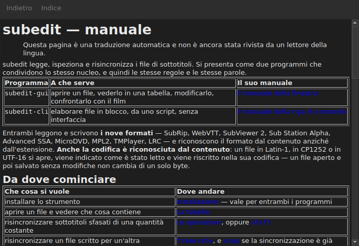

# Il manuale nella finestra

<!-- machine-translated -->
> Questa pagina è una traduzione automatica e non è ancora stata rivista da un lettore della lingua.

`Aiuto ▸ Manuale`, oppure `F1`, apre **questo stesso manuale** in una finestra propria.




## Che cosa apre, e perché non un indirizzo

**Il manuale installato accanto al programma**, non una pagina su Internet.

Un indirizzo descriverebbe la versione in sviluppo, non quella che si ha sotto mano.
Chi legge il manuale di una versione che non possiede è servito peggio di chi
non ha alcun manuale — ed è per questo che la finestra legge i file collocati
dall'installazione, sotto `<prefix>/share/subedit/manual`. Vedi
[Installazione](../subedit-cli/installation.md).

Si apre sulla [pagina iniziale](../index.md), quella che dice da dove cominciare.

## In quale lingua

**Nella lingua della finestra.** Il manuale si apre nella lingua che
l'interfaccia parla: quella scelta in `Modifica ▸ Preferenze…`, oppure quella
dell'ambiente in caso contrario — vedi
[La lingua dell'interfaccia](preferences.md#la-lingua-dellinterfaccia).

| La finestra parla | Il manuale si apre in |
| :---------------- | :------------------ |
| inglese | inglese |
| una lingua il cui manuale è installato — catalano, ceco, tedesco, spagnolo, finlandese, francese, galiziano, ebraico, ungherese, interlingue, islandese, italiano, olandese | quella lingua |
| una lingua il cui manuale non è installato | inglese |

**Pagina per pagina, non tutto o niente**: una pagina che la traduzione non ha
si apre in inglese, e ogni altra pagina resta nella lingua della finestra. Un
collegamento porta dall'una all'altra allo stesso modo.

Le traduzioni sono installate accanto al manuale inglese, ciascuna in una directory
che porta il nome della sua lingua: `<prefix>/share/subedit/manual/fr` per il francese. La
lingua è quella in cui la finestra si è avviata, quindi una lingua scelta nelle
preferenze si applica anche al manuale, al prossimo avvio.

## Navigare

| Che cosa si fa | Che cosa succede |
| :---------- | :----------- |
| clic su un collegamento del manuale | la pagina si apre nella stessa finestra |
| clic su un collegamento che punta a una sezione | la pagina si apre, e la finestra scorre fino a essa |
| clic su un collegamento che punta solo a una sezione | la finestra scorre fino a essa, senza cambiare pagina |
| `Back` | torna alla pagina precedente; disattivato sulla prima |
| `Contents` | torna alla pagina iniziale; disattivato quando ci si è già |

La finestra **non è modale**: resta aperta mentre si lavora, che è tutto
il senso di avere il manuale a portata di mano. Scegliere di nuovo la voce non crea
una seconda finestra, porta questa in primo piano.

## Che cosa non può aprire, e lo dice

Il manuale rimanda talvolta alla **tabella di marcia** o a una **decisione
di architettura**. Sono documenti del repository, non del pacchetto: non
vengono installati, e la finestra lo dice in parole chiare anziché lasciare il
clic senza effetto.

```
../../feuille-de-route.md is not part of the installed manual;
it lives in the project's repository.
```

Si possono leggere sul repository, il cui indirizzo è in `Aiuto ▸ Informazioni su subedit`.

## Quando la voce è disattivata

**`Aiuto ▸ Manuale` è disattivata quando non c'è alcun manuale accanto al programma.** Due
casi, e nessuno dei due è un difetto:

| Caso | Perché |
| :--- | :-- |
| il binario viene eseguito dal suo albero di compilazione | lì non è stato installato nulla, quindi non c'è nulla da leggere |
| l'installazione è parziale | il manuale è stato rimosso, o non è mai stato copiato |

Passando il puntatore sulla voce si vede quale dei due: «Nessun manuale è installato accanto a
questo programma».

Una pagina mancante mentre il manuale c'è — un file eliminato a mano — non
chiude la finestra: nomina il file che non ha potuto leggere e mantiene sullo schermo ciò che
stava mostrando.

## Dove si cerca il manuale

**Accanto all'eseguibile**, in `../share/subedit/manual` — la disposizione che ogni
installazione produce, qualunque sia il prefisso. È ciò che permette a un'installazione
sotto `~/.local` di trovare il suo manuale come a un pacchetto installato sotto `/usr`.
