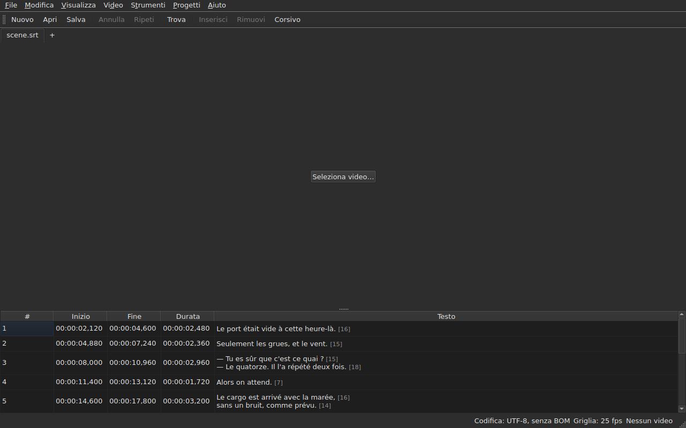

# subedit-gui — manuale

<!-- machine-translated -->
> Questa pagina è una traduzione automatica e non è ancora stata rivista da un lettore della lingua.

La finestra di subedit: si apre un file di sottotitoli e lo si vede in una tabella. Per
l'altro programma e per sapere da dove cominciare, vedi [il manuale](../index.md).

> **Stato attuale.** La finestra **apre più file, uno per scheda**, qualunque sia
> la loro codifica — con `Open…` oppure trascinandoli sopra di essa —, li **visualizza**,
> **ne modifica le celle**, **inserisce e rimuove righe**,
> **annulla**, **salva — scegliendo la codifica, i terminatori di riga e
> l'indicatore dell'ordine dei byte** — e **segnala i sottotitoli le cui posizioni
> non sono coerenti**. **Unisce e divide** le righe, **taglia,
> copia e incolla** i testi, e **trova e sostituisce** nel testo visibile
> senza rovinare i tag, in un progetto o in tutti. **Apre una traduzione
> accanto al file principale**, allineata per posizione o per numero, in una colonna in più,
> e la salva separatamente. Il menu `Tools` contiene sedici operazioni e due voci di ortografia —
> spostare, trasformare, convertire la frequenza dei fotogrammi, regolare le durate,
> **accodare un file, dividere il progetto in due**, mettere in
> corsivo, aggiungere trattini di dialogo, cambiare le maiuscole e minuscole in quattro modi,
> rimuovere le annotazioni per non udenti, **correggere i testi con un
> assistente a più pagine**, **controllare l'ortografia parola per parola**, allineare a una frequenza dei fotogrammi, riportare sulla
> griglia — e l'analisi della griglia, che non modifica nulla. Il menu `Projects`
> **salva e chiude tutto** con un solo gesto. **Associa un video
> al documento**, scelto o indovinato, e **lo riproduce nella finestra**, con la riga
> corrente disegnata sull'immagine; **imposta un inizio, una fine o un
> sottotitolo a partire dalla posizione nel film**, **avanza fotogramma per fotogramma** e **sposta un estremo di un fotogramma**. La barra di riproduzione **si sposta, regola il
> volume e la posizione**, la tabella **segue la riproduzione** senza annullare uno scorrimento manuale, le posizioni
> possono essere mostrate **in fotogrammi**, e il menu `Video` **sceglie la traccia audio**. Due rilevamenti
> **propongono senza mai applicare**: una traduzione sfasata di una quantità costante, che può essere **riaperta
> spostata**, e la conversione della frequenza dei fotogrammi che riporta un file su una griglia. **Ricorda la propria geometria, l'ordine, la larghezza e la presenza delle
> colonne, e le proprie impostazioni** da una
> sessione all'altra, e si presenta **chiara o scura** a scelta. `Aiuto ▸ Manuale`
> apre **questo manuale** in una finestra. Questo manuale descrive ciò che esiste, mai
> ciò che è previsto; ciò che verrà dopo è nella
> [tabella di marcia](../../../../feuille-de-route.md).

> **Le immagini di questo manuale sono generate, il testo no.** Gli esempi di
> `subedit-cli` sono generati eseguendo il comando; le schermate
> sono generate costruendo la finestra vera e fotografandola — `make
> manual` fa entrambe le cose. Un'immagine non può quindi descrivere un'interfaccia che
> non esiste più, e un'interfaccia che cambia si vede nel diff
> del repository. Ciò che resta senza rete di sicurezza è il testo che le circonda, la cui
> accuratezza dipende dalla revisione.

**Ogni schermata è mostrata due volte, con le due tavolozze che
l'applicazione imposta** — `Light` e `Dark`, quelle che
[le preferenze](preferences.md#il-tema) offrono. Su un desktop il cui
tema prevale, `System` dà l'una o l'altra secondo ciò che il desktop ha scelto.

## I menu

`File`, `Edit`, `View`, `Video`, `Tools`, `Projects`, `Help` — nell'ordine in
cui si usano: il documento, ciò che gli si fa, come lo si guarda, ciò che
lo accompagna, ciò che lo esamina, ciò che si applica a tutti i progetti aperti, ciò che
lo spiega.

`View` contiene un sottomenu, `Columns`, con una voce selezionabile per colonna tranne `Text`
— vedi [La tabella](table.md#nascondere-e-spostare-le-colonne) — e un'impostazione, `Positions in Frames`, che mostra
`Start` e `End` come numeri di fotogramma — vedi [Posizioni in fotogrammi](table.md#posizioni-in-fotogrammi).

`Projects` contiene due voci, `Save All` e `Close All` — vedi
[Il menu Progetti](files.md#il-menu-progetti).

`Edit` contiene cinque blocchi, ciascuno sotto un separatore: l'annullamento; gli
appunti — tagliare, copiare, incollare i testi; `Find and Replace…`;
inserire, rimuovere, unire e dividere le righe; infine
`Preferences…`. Annullare è ciò che si fa *a* una modifica, spostare un testo
non aggiunge né rimuove alcuna riga, le quattro del blocco successivo cambiano il numero di
righe, e impostare il tema non è affatto una modifica.

**I tasti sono nominati come li mostra il menu**, in inglese come il resto
dell'interfaccia: `Ins`, `Del`, `Ctrl+Shift+Z`. Un tasto che si preme e
che nessun menu nomina conserva il proprio nome inglese: `Enter`, `Esc`, `Shift`.

`Help` contiene due voci, nell'ordine in cui il menu le mostra. `Manual`, oppure
`F1`, apre questo manuale in una finestra — vedi
[Il manuale nella finestra](help.md). `About subedit` indica la versione, la
licenza e le librerie con cui la finestra funziona, con le loro versioni — vedi
[`--version`](invocation.md#--version).

## La barra degli strumenti

Sotto i menu, una barra contiene **i gesti più frequenti**, in gruppi.
Ogni pulsante porta una parola breve; il menu conserva la voce completa, e la
scorciatoia è la stessa.

| Pulsante | Voce di menu | Scorciatoia |
| :----- | :--------- | :------- |
| Nuovo | File ▸ Nuovo progetto | `Ctrl+N` |
| Apri | File ▸ Apri… | `Ctrl+O` |
| Salva | File ▸ Salva | `Ctrl+S` |
| Annulla | Modifica ▸ Annulla | `Ctrl+Z` |
| Ripeti | Modifica ▸ Ripeti | `Ctrl+Shift+Z` |
| Trova | Modifica ▸ Trova e sostituisci… | `Ctrl+F` |
| Inserisci | Modifica ▸ Inserisci sottotitoli… | `Ins` |
| Rimuovi | Modifica ▸ Rimuovi sottotitoli | `Del` |
| Corsivo | Strumenti ▸ Corsivo | `Ctrl+I` |

**Un pulsante disattivato lo è per lo stesso motivo della sua voce**: `Undo` senza
nulla da annullare, `Remove` senza alcuna riga scelta. Le voci della traduzione
e le operazioni del menu `Tools`, tranne `Italic`, restano nei loro
menu: si usano meno spesso, o non tutti le usano.

## Sezioni

| Sezione | Contenuto |
| :------ | :------- |
| [Installazione](../subedit-cli/installation.md) | compilare e installare — la pagina vale per entrambi i programmi |
| [Invocazione](invocation.md) | avviare la finestra, argomenti, codici di uscita |
| [Aprire e salvare](files.md) | i comandi, le schede, il menu `Projects`, il trascinamento di file, la traduzione e la sua riapertura spostata, la diagnostica, la codifica nella barra di stato, l'andata e ritorno, la chiusura |
| [La tabella](table.md) | che cosa mostra ogni colonna, nasconderle e spostarle, le posizioni in fotogrammi, la colonna della traduzione e il testo su cui agiscono le operazioni |
| [Modificare una cella](editing.md) | quali celle si possono modificare, e come |
| [Tagliare, copiare e incollare i testi](clipboard.md) | le tre voci, che cosa viaggia, le righe aggiunte, i tag tradotti |
| [Trova e sostituisci](find-and-replace.md) | la finestra di dialogo, i quattro gesti, le due opzioni, che cosa copre la ricerca, in tutti i progetti aperti |
| [Inserire, rimuovere, unire, dividere, ordinare e rendere disgiunte le righe](lines.md) | le voci, le loro scorciatoie, dove vanno le nuove righe |
| [Annulla e ripeti](undo.md) | la cronologia, le due azioni, l'indicatore di modifica |
| [La griglia dei fotogrammi](frame-grid.md) | la frequenza dei fotogrammi dedotta dalle posizioni, l'analisi, e la conversione che riporta un file su una griglia |
| [Le operazioni](operations.md) | spostare, trasformare, convertire, regolare le durate, accodare un file, dividere il progetto, mettere in corsivo, le maiuscole e minuscole, i trattini, rimuovere le annotazioni, allineare, riportare sulla griglia, e ciò che supera la fine del film |
| [Correggi i testi…](correct-texts.md) | l'assistente di correzione: la destinazione e le operazioni da eseguire, la pagina di ciascuna, l'avanzamento, la conferma |
| [Controlla l'ortografia…](check-spelling.md) | il controllo ortografico: le sue impostazioni, il percorso, la chiusura a metà, l'assenza di un dizionario |
| [Il video associato](video.md) | scegliere un video, la proposta automatica, la traccia audio, la barra di stato, `ffmpeg` |
| [Il lettore video](player.md) | la vista del video, la barra di riproduzione, riprodurre, spostarsi, il volume, la tabella che segue, la riga disegnata |
| [Sincronizzare a partire dal video](timing.md) | impostare l'inizio o la fine di un sottotitolo, inserire, selezionare a partire dalla posizione nel film, avanzare fotogramma per fotogramma, spostare un estremo |
| [Le preferenze](preferences.md) | il tema, il file delle impostazioni, le sue opzioni, e che cosa succede a un valore illeggibile |
| [Il manuale nella finestra](help.md) | `Aiuto ▸ Manuale`, che cosa apre e come navigarvi |
