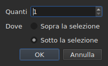

# Inserire, rimuovere, unire, dividere, ordinare e rendere disgiunte le righe

<!-- machine-translated -->
> Questa pagina è una traduzione automatica e non è ancora stata rivista da un lettore della lingua.

Otto voci del menu `Edit`, sotto un separatore che le distingue da
`Find and Replace…`. Quattro hanno in comune il fatto di cambiare il numero di righe, mentre
taglia, copia e incolla, più sopra, spostano testi; `Sort Subtitles` cambia
soltanto **l'ordine** delle righe, `Join Repeated Subtitles` ricompone in un unico
sottotitolo i pezzi consecutivi di uno stesso testo, e `Make Ranges Disjoint…`
li taglia di nuovo dove si sovrappongono.

| Voce | Scorciatoia | Che cosa fa |
| :--- | :---------- | :---------- |
| Inserisci sottotitoli… | `Ins` | apre una finestra di dialogo, poi aggiunge righe vuote |
| Rimuovi sottotitoli | `Del` | rimuove la selezione, senza chiedere nulla |
| Fondi sottotitoli | nessuna | fa una sola riga di un blocco di righe vicine |
| Dividi sottotitolo | nessuna | taglia una riga in due a metà della sua durata |
| Unisci sottotitoli ripetuti | nessuna | fa un unico sottotitolo dei pezzi consecutivi di uno stesso testo |
| Ordina sottotitoli | nessuna | rimette le righe nell'ordine del loro inizio, su tutto il progetto |
| Rendi disgiunti gli intervalli… | nessuna | taglia le righe che si sovrappongono perché nessun intervallo ne sovrapponga più un altro |
| Ripara sottotitoli… | nessuna | concatena le tre voci precedenti — unire le ripetizioni, ordinare, tagliare gli intervalli — in un solo passaggio |

Tutte e otto entrano nella cronologia: `Ctrl+Z` le annulla come il resto.

## Inserimento

| Campo | Che cosa contiene | Predefinito |
| :---- | :---------------- | :---------- |
| `How many` | un numero intero da 1 a 99.999 | `1` |
| `Where` | `Above the selection` oppure `Below the selection` | l'ultima scelta, `Below` al primo avvio |

`OK` aggiunge le righe, `Cancel` non aggiunge nulla.

### Dove vanno

**In corrispondenza dell'ultima selezionata**, non della prima. Selezionare le righe 1 e 3
e poi inserire sotto mette la nuova riga in posizione 4 — non in
posizione 2. È ciò che Gaupol fa da vent'anni, ed è ciò che la mano
si aspetta dopo aver scorso dall'alto verso il basso.

`Above the selection` la mette subito prima di quella stessa riga.

### Quanto durano

Una riga vuota non ha testo, ma ha delle posizioni. Si deducono
dallo spazio disponibile:

| Situazione | Inizio | Durata |
| :--------- | :----- | :----- |
| tra due sottotitoli | la fine del precedente | lo spazio fino al successivo, diviso in parti uguali |
| dopo l'ultimo | la fine dell'ultimo | tre secondi ciascuna |
| in testa a un file | l'origine | lo spazio fino al primo, diviso |
| in un file vuoto | l'origine | tre secondi ciascuna |

Quando il file si sovrappone nel punto scelto, **non c'è spazio da
dividere**: le righe ricevono una durata nulla, che la tabella mostra, anziché
una durata inventata che invaderebbe la riga vicina.

### Il documento vuoto

**Non serve alcuna selezione**, ed è l'unico modo per iniziare un
nuovo file: le righe vanno all'indice zero. La scelta del lato è allora disattivata
nella finestra di dialogo — non c'è una selezione rispetto alla quale collocarle.

Non appena il documento contiene una riga, la voce `Insert Subtitles…` **è disattivata finché
nulla è selezionato**: senza selezione, l'indice sarebbe tirato a indovinare.

### Dopo

Le righe aggiunte sono **selezionate**, e la tabella si sposta su di esse. Premere
`Ins` una seconda volta inserisce quindi dopo di esse, senza dover fare clic nel
frattempo.

### Il lato viene ricordato

`Above` o `Below` viene ricordato **da un inserimento al successivo, e da una sessione alla
successiva**: è l'opzione `edit.insert-placement` del
[file delle impostazioni](preferences.md#il-file). Non si inserisce una volta sola,
si inseriscono dieci righe di seguito, sempre dallo stesso lato.

## Rimozione

`Remove Subtitles`, oppure `Del`, rimuove le righe selezionate — compresa una
selezione discontinua, e ogni riga torna al suo posto se si annulla.

**Non viene chiesta alcuna conferma**, e non è una dimenticanza:
l'operazione si annulla con `Ctrl+Z`. Una finestra modale prima di un gesto annullabile
costerebbe un clic ogni volta per risparmiare un `Ctrl+Z` di tanto in tanto.

**La voce è disattivata quando nulla è selezionato.** Altrove nella finestra,
«nessuna selezione» significa «tutto il file» — è ciò che rende utilizzabile
uno spostamento senza selezionare quattromila righe. Qui, quella lettura
svuoterebbe un documento con un `Del` sfortunato, quindi non viene offerta.

Dopo la rimozione, **viene selezionata la riga che ha preso il posto della prima rimossa**
— oppure l'ultima rimasta, se la rimozione ha portato via la fine del
file. Premere `Del` più volte di seguito rimuove quindi le righe una
alla volta.

Un file svuotato del tutto lascia la finestra utilizzabile: `Insert Subtitles…`
torna attiva, dato che in un documento vuoto si inserisce senza selezione.

## Unione

`Merge Subtitles` fa **una sola riga** delle righe selezionate:

| Che cosa riceve la riga unita | Da dove viene |
| :---------------------------- | :------------ |
| il suo inizio | l'inizio della prima |
| la sua fine | la fine dell'ultima |
| il suo testo | i testi di tutte, in ordine, con un a capo tra due |
| la sua traduzione | le traduzioni, unite allo stesso modo |
| ciò che il formato porta in più — uno stile, un livello, delle coordinate | la prima |

**Un testo vuoto non lascia alcuna riga vuota**: unire `Un.`, una riga senza
testo e `Trois.` dà due righe di testo, non tre.

Le righe unite scompaiono, e la riga che le sostituisce prende il posto
della prima.

**La voce è disattivata** finché la selezione non è **un blocco di almeno
due righe vicine**. Una riga sola non ha nulla con cui unirsi; le righe
1 e 3 senza la 2 nemmeno, perché il risultato passerebbe sopra la 2 e
la coprirebbe.

Dopo l'unione, **la riga unita è selezionata**: `Split Subtitle` è
pronta a tagliarla di nuovo.

## Divisione

`Split Subtitle` taglia la riga selezionata **a metà della sua durata**, al
millisecondo:

| Metà | Inizio | Fine | Testo |
| :--- | :----- | :--- | :---- |
| la prima | l'inizio originale | la metà | **tutto** il testo, e la traduzione |
| la seconda | la metà | la fine originale | vuoto |

**Il testo non viene tagliato in corrispondenza del suo a capo.** Sarebbe giusto per un
sottotitolo di due righe e sbagliato per un sottotitolo di una riga o di tre;
tutto il testo resta nella prima metà, e ciò che deve passare
alla seconda lo si sposta da sé.

La prima metà conserva ciò che il formato portava oltre al testo; la seconda
nasce come una riga inserita, senza nulla.

**La voce è disattivata** finché la selezione non conta **esattamente una
riga**. Qui nessuna selezione non significa «tutto il file».

Dopo la divisione, **entrambe le metà sono selezionate** — è ciò che Gaupol
fa dopo qualsiasi inserimento, e `Merge Subtitles` è allora pronta ad annullare il
gesto.

## Ordinamento

`Sort Subtitles` rimette **tutto il progetto** nell'ordine degli inizi. Mai la
selezione: un ordine è una proprietà del documento, e ordinare metà di un
file non ha senso. L'ordinamento è **stabile**: due sottotitoli che
iniziano insieme conservano l'ordine in cui il file li dava.

**Durante l'ordinamento nella barra di stato corre una barra, e il cursore diventa una
clessidra**: su un file lungo la finestra resta per un po' senza rispondere — la
tabella si ricostruisce riga per riga —, e senza questo non si sa se qualcosa
è in corso. La barra non mostra alcuna frazione, l'ordinamento non ne comunica,
e scompare insieme a esso.

La barra di stato dice quante righe hanno cambiato posto — `3 subtitles moved`
— oppure, quando tutto era in ordine, `already in order`. **Un progetto già in ordine
non entra nella cronologia**: un'operazione che non cambia nulla non è
un'operazione da annullare. La voce è disattivata per un progetto di un solo sottotitolo.

Un file **con qualcosa da correggere all'apertura** lo propone da sé,
[in una sola casella](#allapertura-una-sola-casella): vedi sotto. I sottotitoli
fuori posto sono anche [conteggiati con la diagnostica](files.md#la-diagnostica-di-una-lettura),
così da trovarli senza scorrere la tabella.

Sulla riga di comando, [`sort`](../subedit-cli/sort.md) fa lo stesso sui
file, e `--sort` lo fa di passaggio su
[`convert`](../subedit-cli/convert.md#ordinare-in-scrittura),
[`append`](../subedit-cli/append.md#ordinare-il-risultato) e
[`split-file`](../subedit-cli/split-file.md#tagliare-in-ordine-temporale).

## Unire i sottotitoli ripetuti

`Join Repeated Subtitles` fa **un unico sottotitolo** dei sottotitoli che mostrano la
stessa cosa di seguito: un testo tagliato in pezzi consecutivi, come
lo lasciano alcuni strumenti di segmentazione. Agisce su **tutto il progetto**.

**Una ripetizione** ha lo stesso testo, la stessa traduzione e le stesse impostazioni di formato
(uno stile, una posizione, impostazioni di cue) di un'altra, **e inizia al più
tardi quando quella finisce**. Una serie di ripetizioni diventa quella che inizia
per prima, con la fine maggiore della serie; le altre scompaiono.
`Alpha [1, 2]`, `Alpha [2, 4]` e `Alpha [4, 6]` danno `Alpha [1, 6]`.

- **L'ordine del file non cambia nulla, e l'unione non lo cambia**: il sottotitolo conservato
  è quello che inizia per primo, ovunque si trovino gli altri.
- **Nulla viene unito per errore**: un altro testo, altre impostazioni, uno scarto
  tra due pezzi, un sottotitolo senza testo o la cui fine precede l'inizio
  restano separati.
- La barra di stato dice che cosa è stato fatto — `2 repeated subtitles joined`, oppure
  `no repeated subtitles`.

**Da fare prima di ordinare e tagliare**, che leggono meglio una serie pulita: un
testo in tre pezzi, più un altro testo su tutto l'intervallo, dati in
disordine, si ordina e si taglia in righe che passano da un pezzo all'altro; unito
prima, rientra nell'ordine e si fonde in modo pulito. La casella di apertura, più sotto, fa
tutte e tre le cose in questo ordine.

## Rendere disgiunti gli intervalli

`Make Ranges Disjoint…` taglia i sottotitoli che si sovrappongono in modo che **nessun
intervallo `[start, end]` ne sovrapponga più un altro**. Agisce su **tutto il
progetto**, mai sulla selezione: un gruppo di sottotitoli che si sovrappongono
viene tagliato dove si sovrappongono, e metà di un gruppo non ha senso.

**Nulla viene accorciato né allungato.** In ogni istante la finestra mostra gli
stessi testi di prima. Ciò che cambia è il modo in cui la linea temporale viene tagliata:
si taglia a ogni inizio e a ogni fine di un gruppo; un tratto coperto
da un solo sottotitolo resta quel sottotitolo; un tratto coperto da più sottotitoli
diventa **un** sottotitolo le cui righe sono le loro, **la più antica sulla riga 1**.
`A [0, 5]` e `B [3, 8]` danno `[0, 3] A`, `[3, 5] A / B`, `[5, 8] B`.

La finestra di dialogo chiede tre impostazioni, ricordate da una volta all'altra:

| Campo | Che cosa contiene | Predefinito |
| :---- | :---------------- | :---------- |
| `Shortest interval kept` | da 0 a 10.000 ms: un intervallo più breve viene assorbito da un vicino | `80 ms` (circa due fotogrammi) |
| `Most lines in a subtitle` | da 0 a 10; `No limit` a 0 | `2` |
| `Put a dash before each subtitle's text` | un trattino prima di ciò che ogni sottotitolo apporta a un sottotitolo unito | non selezionata |

`OK` taglia, `Cancel` non fa nulla. **Le righe scritte sono selezionate**
dopo, e la barra di stato dice che cosa è stato fatto: `2 subtitles split, 1 merged`.
Un secondo passaggio non cambia nulla e lo dice: `already disjoint`.

- **Una riga non viene mai duplicata.** Due sottotitoli con lo stesso testo danno una
  sola riga dove si sovrappongono, e due pezzi vicini che mostrano la
  stessa cosa formano un solo sottotitolo. Per il resto, il testo di un sottotitolo tagliato in più
  pezzi si ripete in ciascuno: è ciò che si trova sullo schermo in quell'istante.
- **Un intervallo molto breve viene assorbito da un vicino**: quello le cui righe
  contengono già le sue, altrimenti il più lungo, estende il proprio intervallo per coprirlo.
  Un sottotitolo intero più breve della soglia non viene mai assorbito.
- **Più righe del limite: finestre.** Tre righe su tre secondi
  diventano due metà, prima le prime due righe poi le ultime due;
  quattro righe, tre terzi, e così via. Nulla viene troncato.
- La traduzione segue gli stessi tagli; lo stile e la posizione del primo
  sottotitolo che copre il tratto vengono conservati.

**Ciò che non si è potuto fare per intero è detto in una casella da chiudere**, non nella
barra di stato: finestre, intervalli assorbiti, sottotitoli troppo brevi
lasciati interi, stili che differiscono, sottotitoli la cui fine precede il loro
inizio (lasciati dove sono).

**La voce viene rifiutata, con il motivo, quando i sottotitoli non sono
nell'ordine del loro inizio**: i gruppi sono serie di vicini, e il nucleo non
ordina mai da sé. Prima `Sort Subtitles` — oppure la casella di apertura, che
fa entrambe le cose in questo ordine.

### Tutto in una volta: `Repair Subtitles…`

`Repair Subtitles…` esegue le tre voci precedenti **una dopo l'altra**, nell'unico ordine che funziona: si
uniscono le ripetizioni, si mettono i sottotitoli nell'ordine del loro inizio, poi si rendono disgiunti gli intervalli. È la voce
per un file segmentato male, ordinato male e con sovrapposizioni, quando si sa di volerle tutte e tre. La finestra di dialogo chiede le
impostazioni di taglio (le stesse di `Make Ranges Disjoint…`, ricordate da una volta all'altra) e dice che prima unisce e
ordina. La barra di stato — o la casella da chiudere, quando qualcosa non si è potuto fare per intero — dà **un solo resoconto**
dei tre passaggi: `2 repeated subtitles joined; already in order; 2 subtitles split, 1 merged`. Ogni correzione è una voce
della cronologia a sé: `Ctrl+Z` le annulla una a una. Sulla riga di comando: [`repair`](../subedit-cli/repair.md).

### All'apertura, una sola casella

Un file che si apre con qualcosa che si sa correggere **lo propone in
una sola casella**, `Problems found in this file`, anziché aprirne una per
problema. Ogni problema trovato è una riga con la sua casella di controllo, selezionata:

- `Join the repeated subtitles` — alcuni sottotitoli ripetono un altro che
  toccano, con il loro numero;
- `Sort the subtitles` — i sottotitoli non sono nell'ordine del loro inizio,
  con il loro numero;
- `Make the ranges disjoint` — alcuni sottotitoli iniziano prima della fine del precedente,
  conteggiati **una volta che il file è in ordine**, perché è lì che vengono corretti.

**Ogni problema è conteggiato dove viene corretto**, su una copia a cui sono già state
applicate le correzioni che lo precedono: un testo tagliato in pezzi è la
causa di una parte del disordine, e unirlo per primo può non lasciarne alcuno — la casella
non propone allora l'ordinamento.

Un problema che non è stato trovato non ha riga. Deselezionare l'ordinamento **disattiva e
deseleziona** l'altra casella: gli intervalli si rendono disgiunti solo in ordine.
`Fix` applica ciò che è selezionato — l'unione, poi l'ordinamento, poi il taglio, con le
impostazioni dell'ultima `Make Ranges Disjoint…` — e ne dà **un solo resoconto**;
`Keep as is` non tocca nulla. **Nulla viene fatto senza un sì**, ogni correzione
è una voce della cronologia, e un file senza nulla da correggere non è oggetto
di alcuna domanda.

Sulla riga di comando, [`disjoint`](../subedit-cli/disjoint.md) fa lo stesso sui file, e `--disjoint`
lo fa di passaggio su [`convert`](../subedit-cli/convert.md#rendere-disgiunti-gli-intervalli),
[`append`](../subedit-cli/append.md#rendere-disgiunti-gli-intervalli) e
[`split-file`](../subedit-cli/split-file.md#rendere-disgiunti-gli-intervalli).

### Perché non le scorciatoie di Gaupol

Gaupol unisce con `M` e divide con `S`. Una lettera sola verrebbe catturata dalla
tabella prima di raggiungere una cella in modifica, e `Ctrl+S`
salva già: le due voci si raggiungono dal menu.

## Che cosa dice in proposito l'azione Annulla

**Una voce della cronologia per gesto.** Unire cinque righe si annulla con un solo
`Ctrl+Z`, e restituisce le cinque righe com'erano — posizioni, testi e
tutto ciò che il formato portava.

| Operazione | Che cosa legge `Undo` |
| :--------- | :-------------------- |
| un inserimento | `Undo: inserting` |
| una rimozione | `Undo: removing` |
| un'unione | `Undo: merging` |
| una divisione | `Undo: splitting` |
| un'unione di ripetizioni | `Undo: joining repeated subtitles` |
| un taglio degli intervalli | `Undo: making the ranges disjoint` |

Una correzione proposta all'apertura è una voce della cronologia per correzione: l'unione, l'ordinamento e poi il taglio si annullano uno dopo l'altro.

Vedi [Annulla e ripeti](undo.md).

## Scorciatoie mentre una cella è aperta

`Ins` e `Del` appartengono al campo di immissione finché un editor di cella
è aperto: il tasto di cancellazione cancella lì un carattere, non un
sottotitolo. Chiudere l'editor — `Enter` o `Esc` — restituisce loro il loro significato. Avviata
dal menu, `Remove Subtitles` conferma prima l'immissione, come gli altri
gesti di [Modificare una cella](editing.md).

Questo manuale nomina i tasti come li mostra il menu — vedi
[I menu](index.md#i-menu).
