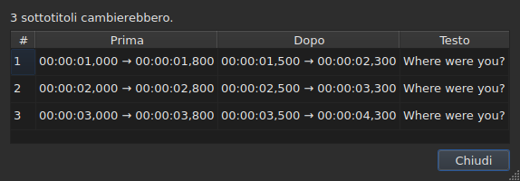
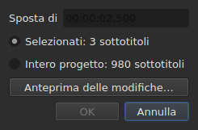
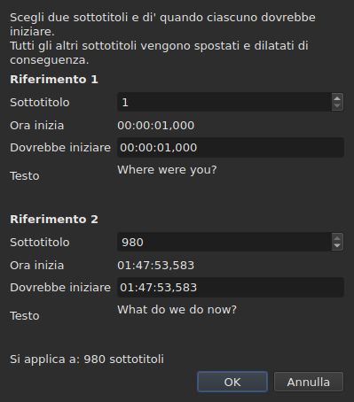
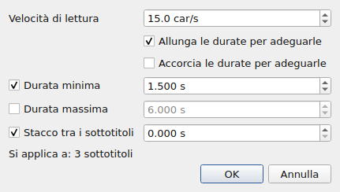
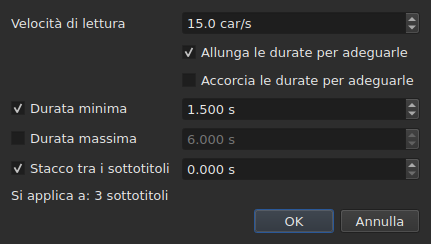
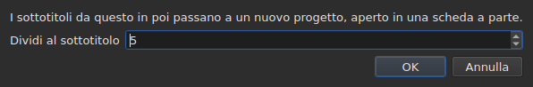

# Le operazioni

<!-- machine-translated -->
> Questa pagina è una traduzione automatica e non è ancora stata rivista da un lettore della lingua.

Il menu **Strumenti** contiene sedici operazioni, un'analisi e due voci di ortografia. Ciascuna delle
sedici si annulla con un `Ctrl+Z`; l'analisi non modifica nulla. Anche `Check Spelling…` si annulla, e `Spell-Check Settings…` non tocca alcun testo.

| Voce | Finestra di dialogo | Che cosa fa |
| :---- | :----- | :----------- |
| `Shift Positions…` | sì | sposta la destinazione di una durata |
| `Transform Positions…` | sì | corregge la destinazione a partire da due riferimenti |
| `Convert Frame Rate…` | sì | risincronizza la destinazione da una frequenza dei fotogrammi a un'altra |
| `Adjust Durations…` | sì | sposta le fini per rispettare una velocità di lettura, delle durate e un intervallo |
| `Append File…` | un selettore di file | accoda un file alla fine del progetto |
| `Split Project…` | sì | divide il progetto in due, il resto va in una nuova scheda |
| `Italic` | **no** | mette la destinazione in corsivo, o lo toglie |
| `Dialogue` | **no** | mette un trattino di dialogo all'inizio di ogni riga, o lo toglie |
| `Maiuscole e minuscole ▸ Iniziali maiuscole` | **no** | ogni parola prende la maiuscola |
| `Maiuscole e minuscole ▸ Maiuscola a inizio frase` | **no** | la prima lettera del testo, e solo quella |
| `Maiuscole e minuscole ▸ TUTTO MAIUSCOLO` | **no** | tutto in maiuscolo |
| `Maiuscole e minuscole ▸ tutto minuscolo` | **no** | tutto in minuscolo |
| `Remove Hearing-Impaired Mentions…` | sì, senza impostazioni | rimuove le annotazioni per non udenti |
| `Correct Texts…` | sì, un assistente a più pagine | propone correzioni — annotazioni, unione e divisione di parole, errori comuni, maiuscole, a capo — e le applica una volta accettate, vedi [Correggi i testi…](correct-texts.md) |
| `Check Spelling…` | sì, un percorso parola per parola | passa in rassegna le parole sconosciute al dizionario e applica ciò che è stato corretto, vedi [Controlla l'ortografia…](check-spelling.md) |
| `Spell-Check Settings…` | sì | sceglie la lingua, la destinazione e il documento del controllo, e la sottolineatura durante la digitazione, vedi [Controlla l'ortografia…](check-spelling.md#impostazioni-del-controllo-ortografico) |
| `Snap to Frame Rate…` | sì | rimette ogni marca temporale sul fotogramma più vicino |
| `Shift Whole File onto Grid (…)` | **no** | riporta l'intero file sulla sua griglia |
| `Frame Rate Analysis…` | sì, senza impostazioni | **non modifica nulla** — vedi [La griglia dei fotogrammi](frame-grid.md) |

**Ciò che un'operazione ha fatto viene detto in una finestra di informazione da
chiudere, tranne per `Italic`, `Case` e `Dialogue`**: queste tre non aprono alcuna
finestra di dialogo, e il loro rapporto — «nothing to change» compreso — viene mostrato
nella barra di stato, senza nulla da chiudere. Anche `Split Project…` dà il proprio
nella barra di stato: il suo risultato è già davanti agli occhi, nella nuova scheda. I messaggi sono citati nella
sezione di ciascuna operazione.

Inserire, rimuovere, unire e dividere le righe non sono qui ma nel
menu `Edit`, perché cambiano il numero di righe. Vedi
[Inserire, rimuovere, unire, dividere, ordinare e rendere disgiunte le righe](lines.md).

## Su che cosa agiscono

**Le righe selezionate, oppure l'intero file se non ce n'è nessuna.** È la stessa
regola per tutte, e le finestre di dialogo, quando ce n'è una, la ricordano in parole
chiare:

```
Applies to: 4 subtitles
```

Selezionare tutte le righe equivale a non selezionarne nessuna.

**Quando è selezionata solo una parte delle righe, la finestra di dialogo chiede
su che cosa agire.** Vengono mostrate due scelte, con il loro conteggio, e **la selezione
è quella spuntata**:

```
(•) Selected: 2 subtitles
( ) Whole project: 4 subtitles
```

Spuntare `Whole project` estende l'operazione all'intero file senza dover prima
cambiare la selezione. Quando non c'è nulla da scegliere — nulla di
selezionato, o tutto —, la riga `Applies to:` qui sopra resta da sola.

Le finestre di dialogo di `Shift Positions…`, `Transform Positions…`,
`Convert Frame Rate…`, `Adjust Durations…`, `Snap to Frame Rate…` e
`Remove Hearing-Impaired Mentions…` offrono questa scelta.

### Vedere prima di applicare

`Shift Positions…`, `Transform Positions…`, `Convert Frame Rate…`,
`Adjust Durations…` e `Snap to Frame Rate…` portano un pulsante **`Preview changes…`**.
Apre una piccola finestra che dice quanti sottotitoli l'operazione
cambierebbe **con ciò che è digitato in quel momento, sulla destinazione spuntata**, e
elenca i primi dodici: il loro numero, la loro posizione prima, la loro posizione
dopo, e la prima riga del loro testo. **Nulla viene applicato**: chiudere la
finestra riporta alla finestra di dialogo, dove si può cambiare un valore e guardare
di nuovo.




Si apre abbastanza grande da mostrare tutte le colonne, e può essere ridimensionata
a mano.

Se l'operazione non cambierebbe nulla, la finestra lo dice (`Nothing would change.`).
Finché ciò che è digitato non definisce un'operazione — una durata illeggibile, due
riferimenti sullo stesso sottotitolo —, l'anteprima è vuota per la stessa ragione per cui il
pulsante `OK` è disattivato. `Remove Hearing-Impaired Mentions…` non ha anteprima: ciò che
cambia è testo, e il rapporto che dà in seguito
lo dice.

**Con una traduzione, quale testo?** Le operazioni di posizione e di struttura
agiscono sull'intero sottotitolo — i suoi due testi lo seguono. Quelle che
riscrivono un testo — `Italic`, `Case`, `Dialogue`,
`Remove Hearing-Impaired Mentions…` — hanno per destinazione **il testo della colonna della cella corrente**: la
traduzione nella sua colonna, il testo principale altrove. L'altro resta intatto, e
la barra di stato dice quale è preso di mira. Vedi [La tabella](table.md#il-testo-su-cui-agiscono-le-operazioni).

**Un'eccezione, e la sua etichetta la porta con sé**: `Shift Whole File onto Grid`
ignora la selezione. Una griglia è una proprietà del documento, e metà di un
documento non ha una griglia propria; la voce lo dice quindi nel suo nome anziché
solo in questo manuale.

**Anche `Append File…` ignora la selezione**, per un'altra ragione: non
è una destinazione che riscrive, è una fine che spinge più in là. Vedi la sua
[sezione](#append-file). **Lo stesso vale per `Split Project…`**: divide dove gli
viene detto. Vedi [la sua](#split-project).

**`Correct Texts…` sceglie la propria destinazione nella sua pagina**, anziché seguire
la selezione corrente: la selezione, il progetto corrente o tutti i progetti
aperti. Vedi [Correggi i testi…](correct-texts.md). **`Check Spelling…` la sceglie in
`Spell-Check Settings…`**, e la ricorda: vedi [Controlla l'ortografia…](check-spelling.md).

**Le due operazioni sulla griglia non parlano della stessa cosa della griglia.**
Un'operazione agisce sulla selezione; l'analisi e la barra di stato parlano dell'
**intero documento**. Allineare cinque righe su centosettantasei cambia davvero quelle
cinque — la tabella lo mostra — senza che né l'una né l'altra si muova, il che
sembra un aggiornamento mancato. Non lo è: non hanno nulla da
dire. Vedi [`Snap to Frame Rate…`](#snap-to-frame-rate) e
[La griglia dei fotogrammi](frame-grid.md).

### Che cosa significa «nessuna selezione», voce per voce

La regola si applica al menu `Tools` e alla ricerca. Le voci del
menu `Edit` che toccano le righe o le svuotano la leggono diversamente — altrimenti uno
sfortunato `Del` o `Ctrl+X` svuoterebbe il documento.

| Voce | Senza selezione | Che cosa richiede |
| :---- | :------------------ | :--------------- |
| le operazioni del menu `Tools` | l'intero file | un documento non vuoto |
| `Shift Whole File onto Grid` | l'intero file, **sempre** | una griglia trovata |
| `Find and Replace…` | l'intero file | un documento non vuoto |
| `Cut Texts`, `Copy Texts`, `Paste Texts` | **disattivate** | almeno una riga selezionata |
| `Remove Subtitles` | **disattivata** | almeno una riga selezionata |
| `Merge Subtitles` | **disattivata** | un blocco di almeno due righe vicine |
| `Split Subtitle` | **disattivata** | esattamente una riga |
| `Insert Subtitles…` | disattivata, tranne su un documento vuoto | una riga rispetto a cui collocarli |

Ogni pagina ne dà il motivo: [gli appunti](clipboard.md#su-che-cosa-agiscono),
[le righe](lines.md), [la ricerca](find-and-replace.md#che-cosa-copre-la-ricerca).

Le voci sono **disattivate su un file vuoto**: non ci sarebbe nulla da
spostare. `Italic` ha una seconda condizione, che la sua sezione descrive: il
formato aperto deve poter scrivere uno stile. Le maiuscole e minuscole e i trattini non ne hanno — un
testo è un testo in tutti e nove i formati.

## `Shift Positions…`

Sposta la destinazione di una durata, in avanti o all'indietro. Entrambi i limiti di
ogni sottotitolo si spostano della stessa quantità: nessuno resta sullo schermo più a lungo o più a
breve di prima.

La durata si scrive **come una marca temporale, segno compreso** — `00:00:02,500` sposta in avanti,
`-0:01,250` sposta indietro. Le forme accettate sono quelle di una cella di posizione.




| Rifiuto | Perché |
| :------ | :-- |
| una durata illeggibile | il pulsante resta disattivato; nulla viene spostato a caso |
| uno spostamento di zero | non c'è alcuna operazione da registrare |
| un sottotitolo andrebbe prima dell'inizio del video | **nessun file può portare una tale posizione** |

Il terzo caso nomina il colpevole — «subtitle 1 would start before the origin» —
ed è quello da guardare per vedere di quanto ci si è sbagliati. Nulla
viene applicato.

## `Transform Positions…`

La correzione di un file sincronizzato su un altro montaggio. Si dice dove **due**
sottotitoli iniziano davvero, e tutto il resto segue, in proporzione.

La finestra di dialogo chiede due volte la stessa cosa: un numero di sottotitolo, e la
posizione in cui il suo inizio dovrebbe stare. Per ogni riferimento, mostra **che cosa quel
numero designa** — il suo testo (`Text`) e l'istante in cui inizia
**adesso** (`Now starts`), come semplici etichette — ed esse seguono il numero
man mano che lo si cambia. Il testo conserva **tre righe di spazio** qualunque cosa dica il
sottotitolo: uno più lungo, o un lungo indirizzo, scorre al suo interno, e
la finestra di dialogo mantiene la sua dimensione al cambiare del riferimento. **Va digitato un solo campo per riferimento:
`Should start`**, l'istante in cui questo sottotitolo deve iniziare. Non occorre cercare nella tabella quale sia la riga `980`.

`Should start` è **proposto al valore corrente**: finché non lo si
tocca, il riferimento dice «questo sottotitolo è già dove deve stare». Si cambia solo
ciò che si vuole cambiare. Il secondo riferimento è precompilato sull'ultimo
sottotitolo del file — due riferimenti lontani danno una correzione più sicura
di due vicini.




**Entrambi i riferimenti cadono esattamente dove sono stati chiesti.** Non è
un'approssimazione: il calcolo è fatto perché sia vero.

| Rifiuto | Perché |
| :------ | :-- |
| due riferimenti sullo stesso sottotitolo | non definiscono alcuna correzione |
| una posizione illeggibile | stessa ragione dello spostamento |

Un numero fuori dal file non si può digitare: il campo è limitato dal
numero di sottotitoli.

## `Convert Frame Rate…`

Risincronizza la destinazione quando le posizioni sono state calcolate rispetto a una
frequenza dei fotogrammi e devono esserlo rispetto a un'altra.

Entrambe le liste offrono le otto frequenze dei fotogrammi standard.

> **Sbagliare la frequenza dei fotogrammi di ingresso sposta l'intero file senza segnalare
> nulla.** È il peggior modo di fallire di questa operazione, ed è per questo che
> la finestra di dialogo dice da dove vengono i valori che propone anziché
> impostarli in silenzio.

### Le due fonti, e che cosa rispondono

La finestra di dialogo porta fino a due righe in più, ciascuna delle quali compare quando ha
qualcosa da dire:

| Riga | Che cosa dice | Che cosa precompila |
| :--- | :----------- | :---------------- |
| `The positions say` | la [griglia dei fotogrammi](frame-grid.md) dedotta dalle posizioni del file | `Timed against` |
| `The video declares` | la frequenza dei fotogrammi che il contenitore annuncia, per esempio `24000/1001` | `Should play at` |
| `The file was read at` | la frequenza dei fotogrammi a cui è stato letto un file **contato in fotogrammi** | `Timed against` |

**Ogni proposta va nel campo a cui risponde.** La griglia dice rispetto a che cosa il
file è stato *scritto* — è la lista in alto. Ciò che il contenitore annuncia è
la frequenza dei fotogrammi a cui il film *scorre*, e quindi quella a cui i sottotitoli
devono arrivare — è la lista in basso.

**Solo una griglia pulita precompila l'ingresso.** Una griglia parziale è un
indizio che la deduzione stessa qualifica come parziale, e questo campo decide un'
operazione sull'intero file. La [barra di stato](frame-grid.md) e l'analisi
portano quel caso; questa no.

**Un file contato in fotogrammi sostituisce la griglia anziché aggiungersi a essa.**
MicroDVD porta numeri di fotogramma, e le posizioni del documento sono state
calcolate a partire da essi alla frequenza dei fotogrammi di lettura: una griglia dedotta da quelle posizioni
non può che ritrovare quel numero. `The positions say` scompare quindi, e
`The file was read at` prende il suo posto — è la stessa scelta che fa
[la barra di stato](frame-grid.md#un-documento-contato-in-fotogrammi-non-ha-una-griglia-ha-una-frequenza-dei-fotogrammi).

**È così che si cambia la frequenza dei fotogrammi di un MicroDVD.** Impostando come
ingresso la frequenza dei fotogrammi letta e come uscita quella vera si ricalcola ogni posizione a partire dai
fotogrammi del file — senza rileggere nulla, e l'operazione si annulla come le
altre.

### Un disaccordo non è una contraddizione

Entrambe le righe possono essere mostrate insieme e annunciare numeri diversi.
**Non è un errore da arbitrare**: il film scorre a una frequenza dei fotogrammi, il
file è stato scritto su un'altra griglia. Un file a 24 per un film a 25 è
esattamente il caso che l'allineamento — `snap` sulla riga di comando — esiste per
gestire.

Nulla viene quindi scelto al posto dell'utente: entrambe le liste restano
modificabili, ed è voluto. Una fonte che si imponga impedisce il controllo incrociato.

Le righe non compaiono quando non c'è nulla da dire: nessun video
associato, nessun `ffprobe`, o nessuna griglia pulita. La finestra di dialogo è allora quella
descritta sopra, e **nessuna operazione si rifiuta per questo** — la
frequenza dei fotogrammi viene dall'utente. Vedi
[Il video associato](video.md#ffmpeg-non-è-obbligatorio).

Una frequenza dei fotogrammi che il film annuncia ma che non è una delle otto standard
viene **mostrata senza essere scelta**: sapere che il film scorre a una frequenza dei fotogrammi
insolita è l'informazione, e qui non c'è nulla a cui convertirla.

Convertire una frequenza dei fotogrammi in se stessa non cambia nulla: il pulsante resta disattivato.

## `Adjust Durations…`

Allunga o accorcia la durata dei sottotitoli della destinazione **spostandone la
fine, mai l'inizio**. Spostare l'inizio sposterebbe il sottotitolo, che è
il compito di [`Shift Positions…`](#shift-positions).





### I quattro vincoli

| Campo | Che cosa chiede | Valori | Predefinito |
| :---- | :--------------- | :----- | :------ |
| `Reading speed` | il tempo necessario per leggere il testo | da 1 a 99 caratteri al secondo, al decimo | 15 car/s |
| `Lengthen durations to match it` | allungare ciò che è troppo breve per essere letto | spuntato o no | spuntato |
| `Shorten durations to match it` | accorciare ciò che resta visualizzato più a lungo del necessario | spuntato o no | non spuntato |
| `Minimum duration` | una durata minima | da 0 a 99 s, al millisecondo | spuntato, 1,5 s |
| `Maximum duration` | una durata massima | da 0 a 99 s, al millisecondo | non spuntato, 6 s |
| `Gap between subtitles` | l'intervallo da lasciare prima del sottotitolo successivo | da 0 a 99 s, al millisecondo | spuntato, 0 s |

Sono i valori predefiniti di Gaupol.

**Un vincolo non spuntato è assente**: il suo campo è disattivato e non viene letto.
Un vincolo spuntato a zero vale zero — un intervallo di 0 s vieta a un
sottotitolo di sovrapporsi al successivo. La velocità di lettura viene letta solo se
`Lengthen` o `Shorten` è spuntato.

**Quando tutto è deselezionato, `OK` è disattivato**: non c'è nulla da chiedere.

La finestra di dialogo si riapre sui valori dell'ultima regolazione, **e li conserva da una
sessione all'altra** — come le due opzioni di ricerca. **Una casella deselezionata
conserva il suo valore**: deselezionare `Minimum duration` dopo aver impostato 2 s non riporta
1,5 s, e rispuntarla ritrova 2 s. Le nove impostazioni sono nel
[file delle impostazioni](preferences.md#il-file), sotto `duration-adjust.`.

**La riga di comando le condivide.** [`subedit-cli adjust`](../subedit-cli/adjust.md) legge le
stesse nove impostazioni per impostazione predefinita, quindi una velocità impostata qui è la velocità che usa, a meno che le sue opzioni
dicano altro; [`subedit-cli config`](../subedit-cli/config.md) le mostra e le cambia. Vedi
[Due blocchi, uno condiviso con la riga di comando](preferences.md#due-blocchi-uno-condiviso-con-la-riga-di-comando).

### In quale ordine, e quale prevale

Ogni sottotitolo della destinazione passa attraverso i quattro vincoli **in questo ordine**, e
ciascuno imposta a sua volta la fine:

| Posizione | Vincolo | Che cosa imposta |
| ---: | :--------- | :----------- |
| 1 | velocità di lettura | `end = start + length ÷ speed`, se il sottotitolo è troppo breve (`Lengthen`) o troppo lungo (`Shorten`) |
| 2 | durata minima | `end = start + minimum`, se la durata è più breve |
| 3 | durata massima | `end = start + maximum`, se la durata è più lunga |
| 4 | intervallo | `end = next start − gap`, se la fine è troppo vicina ad esso — mai prima dell'inizio |

**Prevale l'ultimo applicato.** L'intervallo viene per ultimo e può riportare una
durata sotto il minimo appena impostato: due sottotitoli sullo schermo nello stesso
momento sono un difetto che lo spettatore vede, un sottotitolo un po' breve non
lo è.

**La lunghezza del testo è contata senza tag**, in caratteri, a capo
compresi: `<i>été</i>` conta tre caratteri. La velocità di lettura parla di
ciò che lo spettatore legge.

**Il successivo è il sottotitolo successivo del file**, sia che sia nella destinazione o
no. **L'ultimo sottotitolo del file non ha successivo**: l'intervallo non lo
vincola.

### Ciò che nessuna fine può soddisfare viene detto

Una volta fatta la regolazione, la finestra dice quante fini si sono spostate, e **che cosa
non si è potuto rispettare** — un vincolo compare solo se è stato
sacrificato per almeno un sottotitolo:

```text
adjusted the durations of 12 subtitles; could not satisfy the reading speed in 9 subtitles, the minimum duration in 4 subtitles
```

Le tre menzioni possibili sono `the reading speed`, `the minimum duration` e
`the gap`. **La durata massima è sempre rispettata**: viene dopo la velocità
e il minimo, e solo l'intervallo la segue, che può solo accorciare. Un minimo
maggiore del massimo cede a quest'ultimo, ed è il minimo che viene contato. L'intervallo
viene sacrificato solo quando il successivo inizia prima dell'inizio del sottotitolo
stesso.

Il conteggio copre l'intera destinazione, **compresi i sottotitoli la cui fine non
si è spostata**: un sottotitolo già fissato rispetto al successivo e troppo breve per il
minimo viene contato. Quando nessuna fine si sposta, la finestra lo dice —
`no duration to adjust` — e nulla entra nella cronologia.

## `Append File…`

Accoda un file alla fine del progetto aperto. **Nulla viene inserito tra i
due**: il file scelto viene spostato della fine dell'ultimo sottotitolo del
progetto, esattamente come fa Gaupol.

**Disattivato su un documento vuoto**: non ci sarebbe una fine da cui spostare. Si apre
un selettore di file, senza codifica da scegliere — come `Open…`.

**Il file accodato passa per la conversione**, con le parole di `Save As…` e dell'
[incollare da un altro formato](clipboard.md#i-tag-di-un-altro-formato-vengono-tradotti):
i suoi tag vengono tradotti nel formato del progetto, e ciò che quel formato non può
scrivere viene detto:

```text
appended 12 subtitles; Advanced SSA into SubRip: 1 tag dropped
```

**Ciò che il file accodato portava non sopravvive intero.** Le sue posizioni
seguono, tag compresi; la sua intestazione, i suoi campi specifici del formato — nome
dello stile, margini — e ciò che un tag non può diventare nel formato del progetto
non seguono, e lo dicono. **Non ha traduzione**: una traduzione resta
specifica del documento che l'ha ricevuta, e il file accodato arriva da solo.

**Selezionato in seguito**, come le righe che un incolla ha scritto oltre
la fine. Quando nulla va perso, il conteggio viene mostrato nella barra di stato anziché
in una finestra da chiudere — la stessa regola dell'
[apertura di una traduzione](files.md#aprire-una-traduzione).

**Una sola voce della cronologia**, qualunque sia il numero di sottotitoli
accodati: `Ctrl+Z` li rimuove tutti insieme.

**Un file già aperto può essere accodato a se stesso**: nulla lo vieta, come
in Gaupol.

**Sulla riga di comando**, [`append`](../subedit-cli/append.md) fa la stessa cosa per più file
insieme, in un unico risultato.

## `Split Project…`

Divide il progetto in due: **l'esatto inverso di `Append File…`**. Una finestra
chiede da quale sottotitolo dividere — dal secondo all'ultimo, numerato
come nella tabella — e si apre sulla riga corrente.

**La tabella mostra dove si divide prima di dividere**: ogni numero che la
finestra assume seleziona la sua riga. `Cancel` restituisce la selezione precedente.




**Disattivato sotto i due sottotitoli**: una divisione vuole un sottotitolo da ogni
parte.

**Il resto viene copiato in un nuovo progetto, aperto in una nuova scheda, e
rimosso dal progetto originale.** Il nuovo progetto viene **spostato di meno la fine dell'
ultimo sottotitolo rimasto**: dividere e poi accodare restituisce il progetto di partenza.
I suoi due testi, principale e traduzione, seguono i loro sottotitoli, e
conserva il formato e la codifica dell'originale — **senza percorso**: nessun file
lo contiene ancora. La sua scheda si scrive quindi `untitled*` fin dalla nascita, e
chiuderlo senza salvare pone la domanda posta per tutto ciò che non è
scritto.

**La barra di stato dice quanti sottotitoli sono partiti**, senza finestra da
chiudere — la nuova scheda mostra già il risultato:

```text
split 12 subtitles into a new project
```

**Una sola voce della cronologia**, nel progetto originale:
`Undo: splitting the project` gli restituisce il suo resto. Il nuovo progetto ha una cronologia
propria, vuota; annullare non la tocca, e resta aperto.

**Rifiutato quando nessun file potrebbe scrivere il risultato.** Se le due
metà si sovrappongono alla divisione, lo spostamento porterebbe un sottotitolo prima dell'
inizio del video — una posizione negativa, che nessun formato scrive. La finestra
che rifiuta **nomina il sottotitolo** e suggerisce di dividere altrove:

```text
Cannot split at subtitle 3: subtitle 3 would fall before the start of the video. Cut somewhere else.
```

Arrivare esattamente all'inizio è permesso: zero è una posizione.

**Sulla riga di comando**, [`split-file`](../subedit-cli/split-file.md) divide un file nello stesso modo, in due
file con nome.

## `Snap to Frame Rate…`

Rimette **ogni marca temporale** — inizio e fine — sul fotogramma più vicino della
frequenza dei fotogrammi scelta. Una sola lista, ed è tutta la differenza con
la conversione: una conversione ha bisogno di due frequenze dei fotogrammi perché ridimensiona il
file dall'una all'altra; un allineamento ha solo bisogno della
griglia su cui atterrare.

| | `Convert Frame Rate…` | `Snap to Frame Rate…` |
| :--- | :-------------------- | :-------------------- |
| spostamento | proporzionale al tempo — **diversi secondi** su un lungometraggio | mezzo fotogramma al massimo, **ovunque** |
| per quale file | un file la cui **sincronizzazione è sbagliata** | un file la cui sincronizzazione è **giusta** e la cui griglia è sbagliata |

**Il caso d'uso**, spiegato: un film a 25 fotogrammi al secondo,
sottotitoli scritti su una griglia a 24, righe già più o meno al loro
posto entro pochi millisecondi. Non c'è nulla da risincronizzare — solo da
rimettere le marche temporali sui fotogrammi giusti.

La lista **si apre su ciò che il video dichiara**, e non su ciò che le
posizioni dicono: l'intento è raggiungere la griglia del film, e la
deduzione nomina quella che si sta lasciando. Senza un video o senza `ffprobe`, si apre
sulla frequenza dei fotogrammi del progetto.

Allineare un file sulla griglia che già occupa non lo cambia, e non è
un errore: l'operazione si applica, non sposta nulla, e si annulla come
qualsiasi altra.

**Allineare una parte del file lo dice, una volta fatto.** Compare un avviso
quando la selezione non copre tutto e il documento è ancora letto su un'altra
griglia:

```
5 of 176 subtitles aligned to 25 fps; the document is still read on a 24 fps grid
```

Collega il gesto al suo effetto, e spiega perché la barra di stato e
l'analisi non si sono mosse: parlano del documento, l'operazione ha agito su
cinque righe. Nulla viene impedito — allineare una parte di un file può essere
voluto.

**È quasi sempre involontario, ed è misurato.** Sugli otto file con griglia
del repository, allineare l'intero file porta la frequenza dei fotogrammi dedotta a quella
di destinazione e la sua concentrazione al 100 %; allineare cinque righe non sposta mai la
frequenza dei fotogrammi dedotta e **abbassa** la concentrazione in sette casi su otto — le
righe allineate hanno lasciato la griglia su cui vive il resto del file. L'ottavo è
da 50 a 25, dove la griglia di destinazione divide quella del file e dove le posizioni
erano già su di essa.

L'avviso non viene mostrato quando la selezione copre l'intero file, quando
non viene dedotta alcuna griglia, o quando il documento è ora letto sulla
frequenza dei fotogrammi richiesta — cioè quando l'allineamento ha fatto ciò che gli era stato chiesto.

## `Shift Whole File onto Grid`

Sposta **l'intero file** della quantità che rimette le sue posizioni sulla griglia
che avevano lasciato. Un file le cui posizioni sono su una griglia a meno di una
costante è stato spostato, e quella costante si può misurare.

**La voce di menu porta la quantità e l'ambito** —
`Shift Whole File onto Grid (+0.001 s)`. Non c'è finestra di dialogo:
l'operazione non prende opzioni, e una voce che sta per spostare un intero
file deve dire di quanto, e che lo farà per intero, prima di essere scelta.
È l'unica operazione del menu che ignora la selezione.

**È disattivata quando non è stata trovata alcuna griglia.** Non c'è allora nulla da
raggiungere, e una fase misurata sul rumore sposterebbe il file a caso.
«Nulla da raggiungere» e «raggiungere di zero» non dicono la stessa cosa: la
seconda resta offerta, perché un file già sulla sua griglia è un
caso normale.

**Non è `Snap to Frame Rate…`.** Questa voce sposta tutto della stessa quantità
e preserva le sincronizzazioni relative **esattamente**; l'allineamento sposta ogni
posizione in modo indipendente e assorbe di passaggio quelle che erano state corrette a
mano. Su un file pulito i due danno lo stesso risultato; su un file
parziale, no — e il [dettaglio dell'analisi](frame-grid.md) dice quale dei
due si ha davanti.

## `Italic`

Mette la destinazione in corsivo scrivendo i tag del **formato aperto**, o
li rimuove se è già in corsivo. Nessuna finestra di dialogo: l'operazione non ha impostazioni, e
si annulla con un `Ctrl+Z` come le altre.

| Azione | Scorciatoia | Dove |
| :----- | :------- | :---- |
| Corsivo | `Ctrl+I` | menu **Strumenti**, barra degli strumenti |

È l'unica operazione del menu `Tools` che ha un pulsante nella
[barra degli strumenti](index.md#la-barra-degli-strumenti).

### Che cosa scrive, formato per formato

Il testo di un sottotitolo è quello del suo file, tag compresi — vedi
[Modificare una cella](editing.md). Ogni formato ha i suoi, ed è ciò di cui
questa voce evita di doversi occupare:

| Formato | Che cosa viene scritto |
| :----- | :-------------- |
| SubRip, WebVTT, SubViewer 2 | `<i>text</i>` |
| Sub Station Alpha, Advanced SSA | `{\i1}text{\i0}` |
| MicroDVD | `{Y:i}text` — il tag arriva fino alla fine del sottotitolo, non c'è nulla da chiudere |
| MPL2 | `/` all'inizio di **ogni** riga, il marcatore valendo solo per la propria |
| TMPlayer, LRC | nulla: questi due formati non scrivono alcuno stile |

**La voce è disattivata per un TMPlayer e un LRC, non nascosta.** Una voce
assente non insegna nulla; una voce disattivata risponde a «perché non
posso?».

**Il formato letto è quello del testo preso di mira.** Con una traduzione, il testo principale
può essere in SubRip e la traduzione in Advanced SSA: `Italic` scrive `<i>` nel
primo e `{\i1}` nella seconda. La voce è ugualmente disattivata quando il
testo preso di mira è in un formato che non scrive alcuno stile, anche se l'altro lo fa.

### In quale direzione va

Una sola voce per entrambe le direzioni, ed è la destinazione a decidere:

- **basta un solo sottotitolo non in corsivo** perché l'intera destinazione passi in corsivo;
- la destinazione ne esce solo quando è **interamente** in corsivo.

È la regola di Gaupol, ed è l'unica che rende utilizzabile un solo pulsante:
una selezione mista passa come un unico blocco anziché essere invertita
riga per riga, e premere due volte la restituisce com'era.

Il rapporto dice che cosa è stato fatto, nella direzione in cui è stato fatto:

```
2 subtitles put in italics
2 subtitles taken out of italics
```

**Una riga vuota non guadagna mai tag** — un `<i></i>` attorno al nulla si
vedrebbe nella tabella. Una destinazione che contiene solo righe di questo tipo non cambia quindi nulla, e
lo dice: «nothing to change». Nessuna voce entra allora nella cronologia.

### Che cosa non tocca

**Gli altri tag restano esattamente dove sono**: un colore, un
carattere, un `{\pos(x,y)}` di Advanced SSA attraversano l'operazione senza muoversi.
Solo i tag di corsivo vengono impostati e rimossi.

Un tag che dice più cose insieme non viene tolto per intero:
`{\b1\i1}` diventa `{\b1}`, e `{Y:bi}` diventa `{Y:b}`. Il grassetto resta, e il
testo esce davvero dal corsivo.

## `Case` e `Dialogue`

Due trasformazioni del **testo visibile**, e i tag non vengono toccati: un
sottotitolo messo in minuscolo conserva il suo `<I>` com'è, e un trattino viene messo
prima del testo, non prima di un tag di apertura. **Nessun tag cambia
posto**: `<i>bon</i>jour` in maiuscolo dà `<i>BON</i>JOUR`, dove
[una sostituzione](find-and-replace.md#il-testo-cercato-è-il-testo-visibile) avrebbe
esteso il corsivo all'intera parola.

| Voce | Scorciatoia | Che cosa fa |
| :---- | :------- | :----------- |
| Maiuscole e minuscole ▸ Iniziali maiuscole | — | `bonjour marie` diventa `Bonjour Marie` |
| Maiuscole e minuscole ▸ Maiuscola a inizio frase | — | `BONJOUR MARIE` diventa `Bonjour marie` |
| Maiuscole e minuscole ▸ TUTTO MAIUSCOLO | — | tutto in maiuscolo |
| Maiuscole e minuscole ▸ tutto minuscolo | — | tutto in minuscolo |
| Dialogo | — | aggiunge o rimuove i trattini |

### Che cosa le maiuscole e minuscole non toccano

**Ciò che precede la prima lettera o la prima cifra viene lasciato com'è.**
Un trattino di dialogo, una virgoletta di apertura, una parentesi sopravvivono:
`- bonjour` messo con la maiuscola a inizio frase dà `- Bonjour`, e non `- bonjour` con un
trattino messo in maiuscolo, il che non avrebbe senso.

**La maiuscola a inizio frase rimette il resto in minuscolo.** `BONJOUR MARIE` diventa
`Bonjour marie`: è ciò che fa Gaupol, ed è ciò che permette di attenuare un
sottotitolo digitato in maiuscolo.

**Gli accenti e gli alfabeti non latini sono trattati correttamente.** `éléonore`
dà `ÉLÉONORE`, e un apostrofo non spezza una parola: `l'été` messo con le iniziali
maiuscole dà `L'été` e non `L'Été`. Una lettera che cambia lunghezza conserva i suoi
tag attorno: `fi <i>x</i>` in maiuscolo dà `FI <i>X</i>`.

**Le maiuscole e minuscole non dipendono dalla lingua del sistema.** Seguono le regole comuni
a tutte le lingue: `istanbul` in maiuscolo dà `ISTANBUL`, che la macchina
sia impostata sul francese o sul turco.

### In quale direzione va `Dialogue`

Una sola voce per entrambe le direzioni, ed è la destinazione a decidere:

- **basta una sola riga senza trattino** perché l'intera destinazione ne guadagni uno;
- la destinazione li perde solo quando **tutte** le sue righe ne hanno uno.

Premere due volte restituisce la destinazione com'era. È la regola di
[`Italic`](#italic), e l'unica che rende utilizzabile un solo pulsante.

**Vengono riconosciuti tre trattini** — il trattino della tastiera e i due
trattini del tipografo, `–` e `—` — ed è il trattino della tastiera che viene scritto.
Gli spazi in più dopo il trattino scompaiono. Una riga vuota non ne
guadagna.

### Che cosa dicono

```
2 subtitles recased
2 subtitles dashed
2 subtitles undashed
```

E quando nulla cambia — una destinazione già nelle maiuscole e minuscole richieste — «nothing to
change», senza mettere nulla nella cronologia.

## `Remove Hearing-Impaired Mentions…`

Rimuove le annotazioni destinate agli spettatori sordi o con problemi di udito — le
descrizioni dei suoni tra parentesi quadre. **Le parentesi tonde restano**: servono anche per
le battute sussurrate, ed è `Correct Texts…` a rimuoverle, con la sua casella `Sound in parentheses`.
**Nient'altro**: i testi di canzoni
tra cancelletti e il nome del parlante prima dei due punti vengono rimossi solo con
[`Correct Texts…`](correct-texts.md), pagina `Mentions`.

La finestra di dialogo non chiede nulla: l'operazione non ha impostazioni, e la finestra serve solo a
confermare e a ricordare su che cosa agisce.

**È la sola del menu `Tools` che fa sparire righe**, e la sola
dell'intero programma che le fa sparire senza che le sia stato chiesto. Un
sottotitolo che era *soltanto* un'annotazione non ha più testo una volta ripulito, e un
sottotitolo senza testo non ha motivo di esistere: viene rimosso dal file. Gli altri
vengono riscritti senza la loro annotazione.

**I tag del formato non contano come testo**: `<i>[SOUPIR]</i>` di un
SubRip e `{\i1}[SOUPIR]{\i0}` di un Advanced SSA vengono rimossi allo stesso modo.
Un `<i>` in un TMPlayer o in un LRC, che non scrivono alcun tag, è testo.

**Con la traduzione come destinazione, non rimuove alcuna riga.** Una traduzione che la
regola svuota — un testo che era soltanto un'annotazione — viene **svuotata** e il sottotitolo
resta: ha un testo principale, che l'operazione non aveva preso di mira, e rimuoverlo lo
distruggerebbe. Il rapporto la conta come ripulita:

```text
1 subtitle cleaned, 0 removed
```

I tag letti sono quelli del formato della traduzione, che può non essere quello
del file principale.

Il rapporto dice entrambe le cose:

```
1 subtitle cleaned, 1 removed
```

**Quando nulla corrisponde, non succede nulla** — e la finestra di dialogo lo dice: «no mention
to remove». Nessuna voce entra nella cronologia, perché un'operazione che
non cambia nulla non è un'operazione da annullare.

**Annullare rimette tutto a posto**, i sottotitoli rimossi come i testi
riscritti, ciascuno con il testo che aveva. Un sottotitolo che la regola ha svuotato
non viene mai riscritto prima di essere rimosso, proprio perché torni
intero.

> **La selezione va persa in questa occasione**: rimuovere righe cambia la
> struttura della tabella, che viene ricostruita. Tutte le altre operazioni del
> menu `Tools` la conservano, `Italic`, `Case` e `Dialogue` comprese. Le quattro
> voci di struttura del menu `Edit` — inserire, rimuovere, unire, dividere —
> cambiano anch'esse la struttura, e restituiscono una selezione al posto di quella
> che hanno tolto — vedi
> [Inserire, rimuovere, unire, dividere, ordinare e rendere disgiunte le righe](lines.md).

Un riferimento puramente numerico — «See [1] the note» — non è un'annotazione
e resta com'è.

## Oltre la fine del film

Quando un video è aperto, un'operazione che **spinge dei sottotitoli oltre la
fine del film** lo segnala, una volta finita:

```
shifting leaves 3 subtitles past the end of the video, by 4.200 s at most
```

La frase nomina l'operazione — `shifting`, `transforming`,
`converting the frame rate`, `adjusting durations`,
`aligning on the frame rate` —, quanti sottotitoli superano il limite, e di quanto
arriva il più lontano. `Shift Whole File onto Grid` è uno spostamento, e viene chiamata
`shifting`.

| Che cosa viene contato | Che cosa no |
| :-------------- | :---------- |
| ciò che l'operazione ha appena toccato, cioè la destinazione | un sottotitolo che nessuno ha spostato |
| un sottotitolo che finisce **dopo** la fine | un sottotitolo che finisce esattamente con essa |

**È un avviso, e nient'altro.** Nulla viene rifiutato, nulla viene
corretto: un sottotitolo che cade dopo i titoli di coda può essere
esattamente ciò che si voleva, e un rifiuto sbagliato costa più di un
avviso ignorato. L'operazione è nella cronologia, e `Undo`
la annulla come qualsiasi altra.

**Una sola finestra per operazione.** `Adjust Durations…` e `Align` hanno già
qualcosa da dire — ciò che una regolazione non ha potuto rispettare, ciò che un
allineamento parziale ha lasciato da parte. Quando spingono anche un sottotitolo oltre la fine,
la finestra porta entrambe le frasi, una sotto l'altra, quella dell'operazione
per prima:

```
adjusted the durations of 2 subtitles
adjusting durations leaves 1 subtitle past the end of the video, by 1.000 s at most
```

Il messaggio non compare se nessun video è aperto: la durata viene dal
lettore, e senza un film non c'è una fine da superare. Sono interessate solo le cinque operazioni
nominate sopra — `Adjust Durations…` compresa, che può
allungare una fine oltre il film. Tutte le altre no: quelle del menu
`Tools` che riscrivono un testo, e nel menu `Edit` l'inserimento,
l'unione, la divisione, l'incolla, la sostituzione e le celle modificate — una
fine digitata a mano oltre il film non viene segnalata.
