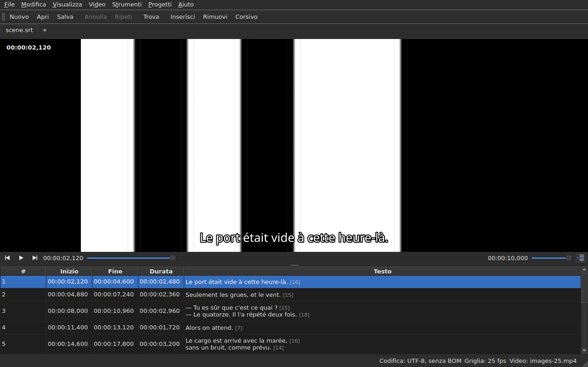

# Il lettore video

<!-- machine-translated -->
> Questa pagina è una traduzione automatica e non è ancora stata rivista da un lettore della lingua.

Il video associato si guarda **nella finestra**, con la riga corrente
disegnata sopra. È ciò che permette di verificare sul film il risultato
di uno spostamento, di una trasformazione o di una conversione della frequenza dei fotogrammi.

Vedi [Il video associato](video.md) per sapere come associare un film; questa
pagina descrive che cosa succede una volta fatto.

## La vista video

| Situazione | Che cosa mostra la finestra |
| :--------- | :-------------------------- |
| un video è associato e si apre | l'immagine occupa la parte alta, la tabella sotto |
| nessun video associato | nessuna immagine, la tabella occupa tutta la finestra |
| il video non si apre | nessuna immagine, un messaggio, e la finestra resta utilizzabile |

La divisione tra l'immagine e la tabella **si sposta con il mouse**. L'immagine non
scende sotto i 180 pixel di altezza. Ingrandire la finestra dà lo spazio guadagnato
alla tabella, non all'immagine: ciò che manca quando si modifica sono le righe.

Sotto l'immagine, **una barra di riproduzione**: dov'è il film, quanto dura,
riproduzione e pausa, e il volume. Vedi [La barra di riproduzione](#la-barra-di-riproduzione).

## Riprodurre e fermare

| Comando | Scorciatoia | Che cosa fa |
| :------ | :---------- | :---------- |
| Video ▸ Riproduci / Pausa | `Ctrl+P` | riproduce se la riproduzione è ferma, altrimenti la ferma |

Il comando è **disattivato finché nessun video è aperto**. Un video appena
associato si apre **fermo**: aprire un film non significa
guardarlo.

`Ctrl+P` dove Gaupol ha una semplice `P`: una scorciatoia di una sola lettera
a livello di finestra viene intercettata prima che il widget che ha il focus la veda,
quindi una `P` verrebbe inghiottita lungo la strada verso l'editor di una cella. Qui non
si stampa nulla, la combinazione è libera.

## La barra di riproduzione

Sotto l'immagine, da sinistra a destra — i tre pulsanti sono **icone**, quelle del tema del desktop quando le ha, quelle dello stile di Qt altrimenti:

| Elemento | Che cosa fa |
| :------- | :---------- |
| i due pulsanti di passo | spostano il film indietro, avanti **di un passo in fotogrammi** — vedi [Fotogramma per fotogramma](timing.md#fotogramma-per-fotogramma) |
| riproduci / pausa | riproduce o ferma, come `Ctrl+P` — il pulsante mostra **ciò che farà**: un triangolo quando è fermo, due barre durante la riproduzione; il suggerimento a comparsa lo dice a parole |
| la posizione | `HH:MM:SS,mmm`, scritta come la tabella scrive una posizione — **come numero di fotogramma** quando [`Visualizza ▸ Posizioni in fotogrammi`](table.md#posizioni-in-fotogrammi) è selezionato |
| lo slider | **legge e sposta**: si trascina la maniglia, si fa clic nella scanalatura, si usano le frecce |
| la durata | quella che il video dichiara, scritta come la posizione |
| il volume | da 0 a 100, vedi [Il volume](#il-volume) |
| seguimento della tabella | premuto finché la tabella segue la riproduzione, e la riporta alla riga in riproduzione quando lo si preme — vedi [La tabella segue la riproduzione](#la-tabella-segue-la-riproduzione) |

**Lo slider non trasmette una posizione a ogni pixel.** Trascinare la maniglia richiede decine di
posizioni al secondo, e ognuna costa un fotogramma decodificato: la prima posizione parte subito,
le successive attendono un ventesimo di secondo, e **l'ultima posizione richiesta è
sempre quella raggiunta** — al più tardi quando si rilascia la maniglia. L'immagine quindi non
resta indietro rispetto alla mano, e non inizia a disegnare un percorso che nessuno sta guardando.

**Lo slider si sposta da solo durante la riproduzione**, e questo non conta come gesto:
solo ciò che si fa sposta il film. Finché si tiene la maniglia, la riproduzione non la riprende.

## Il codice temporale

**La posizione è scritta sull'immagine**, in alto a sinistra, su uno sfondo traslucido che la rende
leggibile su qualsiasi scena. È disegnata dalla finestra, con il suo carattere, e non chiede
al lettore altro che la posizione che già fornisce; si aggiorna a ogni gesto,
senza attendere il giro successivo di seguimento.

## Spostarsi nel film

Nel menu **Video**, **i gesti di Gaupol**, con i loro nomi. Tutti sono **disattivati senza video**, come
la riproduzione; i tre che agiscono sulla selezione sono disattivati anche finché nulla è selezionato.

| Comando | Scorciatoia | Che cosa fa |
| :------ | :---------- | :---------- |
| Video ▸ Riproduci selezione | `Ctrl+Shift+P` | riproduce da **poco prima dell'inizio** della selezione **fino alla fine del suo ultimo sottotitolo**, e si ferma sull'immagine |
| Video ▸ Vai al precedente | `Ctrl+Left` | porta la riproduzione all'inizio dell'ultimo sottotitolo **terminato** prima della posizione |
| Video ▸ Vai al successivo | `Ctrl+Right` | porta la riproduzione all'inizio del primo sottotitolo che **inizia** dopo la posizione |
| Video ▸ Salta indietro | `Ctrl+Shift+Left` | torna indietro di un salto — trenta secondi in modo predefinito |
| Video ▸ Salta avanti | `Ctrl+Shift+Right` | avanza di un salto |
| Video ▸ Vai all'inizio della selezione | `Ctrl+Up` | porta la riproduzione all'inizio della selezione, **con l'anticipo prima** |
| Video ▸ Vai alla fine della selezione | `Ctrl+Down` | porta la riproduzione alla fine della selezione, **con l'anticipo prima** |

**Le scorciatoie sono quelle di Gaupol**, tranne una: `Play Selection` è `O` lì, e una
lettera nuda viene intercettata dalla finestra prima che la cella in modifica la veda — digitare una
`o` in un testo avvierebbe il film. `Ctrl+P` è la risposta della riproduzione, `Ctrl+Shift+P` quella
della selezione. Le frecce della tastiera restano all'editor di cella quando è
aperto: `Ctrl+Left` vi sposta il cursore di una parola, non la riproduzione.

- **Il salto** è di 30 secondi, e si può impostare da 1 secondo a un'ora — vedi
  [Le preferenze](preferences.md#il-lettore-video). Non supera né l'inizio del film né la sua fine.
- **L'anticipo** è di un secondo: si guarda un po' **prima** del sottotitolo, per vederlo arrivare.
  Si può impostare da 0 a 60 secondi, e la riproduzione non scende sotto lo zero.
- **Un sottotitolo vicino che non esiste** — nulla prima del primo sottotitolo, nulla dopo l'ultimo — non
  fa nulla, e non dice nulla: la riproduzione resta dov'è.
- **Ogni gesto si vede subito**: la barra, il codice temporale e la riga disegnata sono
  aggiornati quando termina, senza attendere il giro successivo.

## Il volume

Il volume è quello del **lettore**, da 0 a 100, e non quello del sistema. Si regola con lo slider della
barra, oppure con due gesti, nel sottomenu `Video ▸ Audio`, a passi di cinque:

| Comando | Scorciatoia | Che cosa fa |
| :------ | :---------- | :---------- |
| Video ▸ Audio ▸ Volume giù | `Ctrl+-` | abbassa il volume di cinque |
| Video ▸ Audio ▸ Volume su | `Ctrl++` o `Ctrl+=` | lo alza di cinque — la seconda per le tastiere in cui il più richiede il tasto Maiusc |

**Viene ricordato da una sessione alla successiva**, e dato a ogni video che si apre. Un valore fuori
da 0–100 nel file delle impostazioni non impedisce l'apertura: viene ignorato, e la finestra lo dice.
**La traccia audio, invece, non viene ricordata** — il numero di una traccia è quello del suo file; vedi
[La traccia audio](video.md#la-traccia-audio).

## Selezione e riproduzione

Entrambe funzionano nei due sensi.

| Che cosa si fa | Che cosa succede |
| :------------- | :--------------- |
| si seleziona una riga | la riproduzione si sposta **all'inizio di quel sottotitolo** |
| si estende la selezione verso il basso | nulla di più: conta la prima riga della selezione |
| la riproduzione avanza | la **riga corrente** segue il sottotitolo sullo schermo, **colorata**, e la tabella la **centra** — vedi [La tabella segue la riproduzione](#la-tabella-segue-la-riproduzione) |

La riga corrente e la selezione sono due cose distinte. La riproduzione
sposta la prima e **non tocca mai la seconda**: la selezione è ciò a cui
si applica un'operazione, e un film che scorre in un angolo non ha motivo di
riscrivere la destinazione dell'utente riga dopo riga.

La tinta segue questa stessa regola: è un indicatore, non una selezione. **Un'anomalia
ha la precedenza su di essa** — una riga che porta entrambe conserva il colore
del suo difetto, un difetto essendo lì per essere riparato mentre una riga mostrata lo è solo
per la durata di una battuta di dialogo. Vedi [La tabella](table.md).

### La tabella segue la riproduzione

**La tabella centra la riga in riproduzione** — al centro di ciò che mostra, non sul bordo dove basterebbe a
renderla visibile. Lo fa **quando la riga cambia**, non a ogni battito del seguimento: una battuta dura
secondi, e ricentrare ogni decimo di secondo sarebbe scorrere senza scopo.

**Uno scorrimento manuale sospende il seguimento.** La rotellina, la barra di scorrimento e un clic nella tabella
lo sospendono: la tabella resta dove la si è messa, mentre la riga corrente, la riga disegnata e la barra
continuano a seguire il film. Il pulsante di seguimento — **l'icona delle righe di una tabella, una contrassegnata da una freccia**, a destra della barra di
riproduzione; il suo suggerimento a comparsa dice «Segui la riproduzione» — **è premuto finché la tabella segue** e poi torna in su.

**Il seguimento riprende con un gesto del lettore**: riproduzione avviata, un salto, un passo, un indicatore impostato, un
inserimento alla posizione, o uno spostamento della barra — la tabella si centra allora subito sulla
riga in riproduzione, anche se era già la stessa. **Oppure su richiesta**: premere il pulsante lo ripristina, e
rilasciarlo lo sospende. Non c'è alcun timer: ciò che fa riprendere il seguimento è sempre un gesto.

Passare a un'altra scheda fa riprendere il seguimento sul film di quella scheda.

**Una modifica in corso non viene interrotta.** Finché un editor di cella
è aperto, la riga corrente resta dov'è; la riga disegnata sull'immagine,
da parte sua, continua a seguire, dato che non disturba nessuno.

## La riga disegnata

Ciò che viene mostrato sull'immagine proviene dal **documento aperto**, mai da un file:
**ciò che si vede sull'immagine è ciò che si è appena digitato**, senza passare dal
disco. Il testo compare centrato, in basso nell'immagine, e scompare tra due
sottotitoli.

**Con una traduzione, la riga è quella del testo preso di mira**: la traduzione quando
la cella corrente è nella colonna `Translation`, il testo principale
ovunque altrove. È la regola di tutte le operazioni sul testo — vedi [Il
testo su cui agiscono le operazioni](table.md#il-testo-su-cui-agiscono-le-operazioni) —
e **non c'è alcuna impostazione**: passare da una colonna all'altra cambia ciò che
l'immagine mostra, al più un decimo di secondo dopo. Senza traduzione, o
con la colonna rimossa, nulla cambia: è il testo principale.

Un sottotitolo a cui la traduzione non è ancora arrivata non mostra **nulla** finché
la colonna corrente è la traduzione: non è il testo principale a
prenderne il posto.

**I tag del formato vengono capiti, mai disegnati così come sono.** Il modello porta il
testo come lo scrive il file, ed è il tag pivot — quello della conversione di
formato — a leggerlo prima di darlo all'immagine:

| Nel file | Sull'immagine |
| :------- | :------------ |
| grassetto, corsivo, sottolineato | applicati: `<i>no</i>` viene mostrato come *no*, senza i suoi tag |
| colore | applicato |
| carattere, dimensione | rimossi, il testo resta |
| posizione, allineamento, parlante, qualsiasi cosa senza equivalente a schermo | rimossi, il testo resta |
| `{` e `}` nel testo | disegnati: «{laughs}» viene mostrato come «{laughs}» |

Un file Advanced SSA viene letto allo stesso modo: i suoi `{\i1}` si applicano, e il suo
`{\an8}` viene rimosso — la riga resta in basso nell'immagine. Ogni testo viene letto **nel formato
del proprio file**, la traduzione come il testo principale.

**Il file di sottotitoli vicino non viene caricato** dal lettore, anche se porta il nome del
film. Sarebbe quello in modifica, e l'immagine mostrerebbe allora lo stato del disco
mentre la tabella mostra qualcos'altro.

## Vedere un'anteprima di una modifica

**Non c'è nulla di speciale da fare**: si applica l'operazione, si guarda
il film, e si sceglie `Undo: shifting` — o l'operazione interessata — se il
risultato non va bene. Vedi [Annulla e ripeti](undo.md).

Non esiste una modalità di anteprima separata, ed è voluto: ciò che si
guarda è il documento com'è, non uno stato provvisorio invisibile.

## Quando l'immagine non compare

Due possibili messaggi, entrambi preceduti dal percorso del file:

| Messaggio | Che cosa è successo |
| :-------- | :------------------ |
| `<file>: <reason>` | il lettore ha rifiutato il file — formato sconosciuto, file mancante, directory |
| `<file>: no video player is available` | non è stato possibile costruire alcun lettore |

In entrambi i casi **il video resta associato** — serve proprio vedere di quale
file si tratta per sceglierne un altro — e **la finestra resta utilizzabile**:
il documento è aperto, le operazioni funzionano, e anche il salvataggio.

**L'immagine è disegnata nella finestra stessa**: `libmpv` riempie un buffer alla
dimensione della vista, in pixel reali, e la finestra lo dipinge. Nulla di ciò dipende dalla
piattaforma grafica — la stessa immagine sotto X11, sotto Wayland e senza display — e
segue il ridimensionamento: le proporzioni del film sono conservate, il resto della
vista è nero.

Il secondo messaggio compare quindi solo se la libreria `libmpv` rifiuta di avviarsi,
benché sia richiesta in fase di compilazione.

Il rendering passa dal processore, ma **la decodifica può essere eseguita sulla scheda grafica**:
è la scheda a decodificare, l'immagine viene copiata in memoria, poi disegnata come prima. Una macchina senza una
scheda utilizzabile decodifica sul processore, senza messaggio. Su un film 1080p in H.264, la riproduzione sta al passo con
il tempo reale con ampio margine. **Un film 4K in HEVC pesante può non reggere**: misurato su due
core, si decodifica a 0,6 volte il tempo reale senza la scheda, e avanzare di un fotogramma richiede lì diversi
secondi quando il fotogramma chiave è lontano. La scheda riduce quel tempo — da un terzo a due terzi a seconda del film
— senza eliminarlo. **Non cambia l'immagine mostrata**: un passo o uno spostamento arrivano sullo
stesso fotogramma con e senza. Per disattivarla, deselezionare `Decode on the graphics card` in
[`Preferences…`](preferences.md#il-lettore-video).

## Che cosa non c'è

**Impostare un indicatore, avanzare fotogramma per fotogramma e spostare un margine di un fotogramma** si trovano in
[Sincronizzare a partire dal video](timing.md), non qui. Ciò che non esiste, ed è inutile cercare:

- una forma d'onda;
- la riproduzione automatica all'apertura di un film;
- lo stile della riga disegnata (carattere, colore, posizione, sfondo): conserva quello della finestra;
- la decodifica hardware senza copia: vedi «Quando l'immagine non compare» più sopra.

Questo manuale descrive ciò che esiste: ciò che verrà, e in quale ordine, si trova nella
[tabella di marcia](../../../../feuille-de-route.md).
