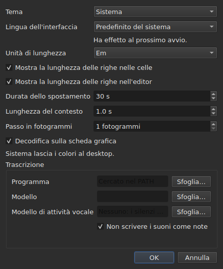

# Le preferenze

<!-- machine-translated -->
> Questa pagina è una traduzione automatica e non è ancora stata rivista da un lettore della lingua.

La finestra ricorda ciò che si imposta con il mouse — **dove si trovava**, **se
era ingrandita**, **la larghezza delle sue colonne**, **la posizione della
maniglia** tra il film e la tabella — e **dove si lavora**, in modo che
`Open…` si apra nel posto giusto. Nulla di tutto ciò si imposta con una finestra di dialogo:
si sposta, si trascina, e viene ricordato.

**Sei preferenze hanno una finestra di dialogo propria**, `Modifica ▸ Preferenze…`, ed è questo il
criterio: una preferenza che ha già un gesto non ha bisogno di un campo. Il
tema non ne ha, né l'unità delle lunghezze di riga, né le due caselle che
le mostrano, né il salto e l'anticipo del lettore. Vedi [Il tema](#il-tema),
[Le lunghezze di riga](#le-lunghezze-di-riga) e [Il lettore video](#il-lettore-video).

**La lingua dell'interfaccia è nella stessa finestra di dialogo, ed è quella che aspetta**: si applica al
prossimo avvio, non subito. Vedi [La lingua dell'interfaccia](#la-lingua-dellinterfaccia).

**Il volume non ne ha**: la barra sotto l'immagine e due gesti lo impostano, e viene ricordato.

**Un'altra si imposta dove viene usata**: il lato in cui `Insert Subtitles…` colloca le sue
righe è un campo di quella finestra di dialogo, e l'ultima scelta viene ricordata. Vedi
[Inserire, rimuovere, unire, dividere, ordinare e rendere disgiunte le righe](lines.md#il-lato-viene-ricordato).

**Lo stesso vale per le due opzioni di ricerca**: `Regular expression` e
`Ignore case` restano spuntate o no da un'apertura della finestra di dialogo alla
successiva, e da una sessione all'altra. Vedi
[Trova e sostituisci](find-and-replace.md#le-due-opzioni).

**Lo stesso vale per le impostazioni di `Adjust Durations…`**: la velocità di lettura, le sue due
direzioni, e le tre durate con le loro caselle — ciascuna conserva il proprio valore, spuntata
o no. Vedi [`Adjust Durations…`](operations.md#adjust-durations).

**E l'ultima codifica scelta in `Save As…`**, con il suo indicatore dell'ordine
dei byte. Vedi [il file](#il-file).

**E ciò che l'assistente `Correct Texts…` e `Spell-Check Settings…` impostano**: le
operazioni da eseguire spuntate e il loro codice, le caselle dei modelli, le impostazioni dell'a capo, la lingua,
la destinazione del controllo e la sottolineatura durante la digitazione. Vedi [Correggi i testi…](correct-texts.md) e
[Controlla l'ortografia…](check-spelling.md#impostazioni-del-controllo-ortografico). **La destinazione e il
documento di `Correct Texts…` non vengono ricordati.**

**Ciò che non viene ricordato:** l'ultimo file aperto — vedi
[La directory ricordata](#la-directory-ricordata).

## Il lettore video

Quattro campi. **Seek length** e **Context length** sono di Gaupol e ne hanno i valori; **Frame step** e **Decode on the graphics card** sono propri di subedit:

| Campo | Che cosa imposta | Predefinito | Limiti |
| :---- | :----------- | ------: | :----- |
| `Seek length` | il salto di `Seek Backward` e `Seek Forward` | 30 s | da 1 s a un'ora |
| `Context length` | l'anticipo prima della selezione, per `Seek Selection Start`, `Seek Selection End` e `Play Selection` | 1 s | da 0 a 60 s, al decimo |
| `Frame step` | il passo, **in fotogrammi**, di `Step Backward` e `Step Forward`, e dello spostamento di un estremo | 1 fotogramma | da 1 a 1000 fotogrammi |
| `Decode on the graphics card` | lascia che la scheda grafica decodifichi il film quando la macchina ne ha una; senza scheda, nulla cambia | spuntato | spuntato o no |

Si applicano **subito**, senza attendere un riavvio, e vengono ricordati da una sessione all'altra
sotto `video.seek-length` (in secondi), `video.context-length-ms` (in millisecondi) `video.step-frames` (in fotogrammi) e `video.hardware-decoding` (`true` o `false`).
**Un valore fuori dai limiti, o che non è un numero**, non impedisce alla finestra di aprirsi: viene
ignorato, il valore predefinito resta, e la finestra lo dice all'apertura. **Il passo in fotogrammi non è mai in millisecondi**: un passo di N fotogrammi è sempre di N fotogrammi, qualunque sia la frequenza dei fotogrammi del film — vedi [Sincronizzare a partire dal video](timing.md#fotogramma-per-fotogramma). Il volume viene ricordato in `video.volume`,
da 0 a 100, con la stessa tolleranza.

## Il file

```
~/.config/subedit/settings.conf
```

Più esattamente `$XDG_CONFIG_HOME/subedit/settings.conf` quando quella variabile
è impostata. Viene scritto **alla chiusura della finestra**, e letto alla sua apertura.
Un programma interrotto — ucciso, o fermato da un crash — non scrive nulla, e la
sessione successiva trova ciò che la precedente aveva lasciato.

Il file è di testo, e può essere modificato a mano. È una proprietà e non
un effetto collaterale: è ciò che rende correggibile un'impostazione quando l'interfaccia
che la imposta è proprio quella che non funziona.

### Due blocchi, uno condiviso con la riga di comando

Il file è scritto in **due blocchi**, ciascuno sotto un commento di intestazione:

| Blocco | Chiavi | Letto da |
| :---- | :--- | :------ |
| `# Operation settings: shared by the window and the command line` | le chiavi `duration-adjust.*` e `correction.*` | la finestra **e** `subedit-cli` |
| `# Display preferences: the window's own` | ogni altra chiave — geometria, colonne, tema, lingua dell'interfaccia, ricerca, controllo ortografico, editor, video, ultima directory, codifica di scrittura | solo la finestra |

**`subedit-cli` legge per impostazione predefinita il blocco delle operazioni**: ciò che `Adjust Durations…` e
`Correct Texts…` ricordano qui è anche ciò da cui partono [`subedit-cli adjust`](../subedit-cli/adjust.md)
e una parte di [`subedit-cli correct`](../subedit-cli/correct.md), a meno che un'opzione della
riga di comando dica altro. **Non legge mai le preferenze di visualizzazione.** Il suo comando
[`config`](../subedit-cli/config.md) elenca le chiavi delle operazioni, ne mostra i valori e
li cambia — `subedit-cli config set duration-adjust.speed 12` — e la finestra vede la modifica
alla sua apertura successiva. **Una modifica fatta mentre la finestra è aperta non sopravvive alla sua chiusura**: la
finestra riscrive l'intero file con ciò che contiene. `--no-config` fa ignorare il
file a una riga di comando. Vedi
[Il file delle impostazioni](../subedit-cli/invocation.md#il-file-delle-impostazioni).

Il lettore prende le chiavi in qualsiasi ordine, con o senza le intestazioni: un file scritto prima che
i due blocchi esistessero viene letto senza modifiche, e riscritto in due blocchi alla chiusura
successiva.

| Opzione | Che cosa contiene | Predefinito |
| :----- | :------------ | :------ |
| `window.geometry` | `x,y,width,height`, in pixel; larghezza e altezza non nulle | la finestra si dimensiona da sé |
| `window.maximised` | `true` o `false` | `false` |
| `table.columns` | quattro larghezze in pixel, separate da virgole — `#`, `Start`, `End`, `Duration`, anche se nascoste | la tabella si dimensiona da sé |
| `table.order` | le sei colonne, **ciascuna una volta**, nell'ordine in cui la tabella le mostra: `number`, `start`, `end`, `duration`, `text`, `translation` | `number,start,end,duration,text,translation` |
| `table.hidden` | le colonne rimosse, tra `number`, `start`, `end` e `duration`; vuoto, nessuna | nessuna |
| `window.table-share` | la quota di altezza data alla tabella, in percentuale, da 1 a 99 | la finestra ripartisce come ha sempre fatto |
| `file.directory` | un percorso di directory **assoluto** | nessuno: `Open…` apre dove il programma è stato avviato |
| `general.theme` | `system`, `light` o `dark` | `system` |
| `interface.language` | `system`, oppure il nome di una lingua come il suo catalogo è chiamato: due o tre lettere minuscole, poi facoltativamente `_` e due maiuscole — `fr`, `pt_BR`; `en` per l'inglese | `system` |
| `edit.insert-placement` | `above` o `below` | `below` |
| `file.write-encoding` | il nome di una codifica che ICU può scrivere, e il cui convertitore non scrive un indicatore proprio | nessuno |
| `file.write-bom` | `true` o `false` | `false` |
| `search.regex` | `true` o `false` — il modello è un'espressione regolare | `false` |
| `search.ignore-case` | `true` o `false` — le maiuscole e minuscole vengono ignorate | `true` |
| `duration-adjust.speed` | la velocità di lettura, in caratteri al secondo, strettamente positiva; un numero decimale è scritto il più breve possibile (`15`, `12.5`) | `15` |
| `duration-adjust.lengthen` | `true` o `false` — allungare ciò che è troppo breve per essere letto | `true` |
| `duration-adjust.shorten` | `true` o `false` — accorciare ciò che resta visualizzato più a lungo del necessario | `false` |
| `duration-adjust.minimum-enabled` | `true` o `false` — la durata minima è richiesta | `true` |
| `duration-adjust.minimum-ms` | la durata minima, in millisecondi, intera e non negativa | `1500` |
| `duration-adjust.maximum-enabled` | `true` o `false` — la durata massima è richiesta | `false` |
| `duration-adjust.maximum-ms` | la durata massima, in millisecondi, intera e non negativa | `6000` |
| `duration-adjust.gap-enabled` | `true` o `false` — l'intervallo con il sottotitolo successivo è richiesto | `true` |
| `duration-adjust.gap-ms` | l'intervallo, in millisecondi, intero e non negativo | `0` |
| `correction.mentions.enabled`, `correction.common-errors.enabled`, `correction.capitalization.enabled`, `correction.line-break.enabled` | `true` o `false` — l'operazione è spuntata nella prima pagina di `Correct Texts…` | `false`, `true`, `true`, `false` |
| `correction.mentions.code`, `correction.common-errors.code`, `correction.capitalization.code`, `correction.line-break.code` | il codice dei modelli dell'operazione: `Zyyy`, oppure `Script[-language[-COUNTRY]]` — `Latn-en-US`; non vuoto | `Zyyy` |
| `correction.human`, `correction.ocr` | `true` o `false` — le classi di errori comuni | `true`, `true` |
| `correction.sound-in-brackets`, `correction.sound-in-parentheses` | `true` o `false` — le due caselle della pagina `Mentions` | `false`, `false` |
| `correction.line-break.max-length` | la lunghezza massima di una riga, decimale; la finestra di dialogo la limita da 1 a 1000 | `24` |
| `correction.line-break.max-lines` | il numero massimo di righe, intero; la finestra di dialogo lo limita da 1 a 100 | `3` |
| `correction.line-break.in-ems` | `true`: la lunghezza è misurata in *em*; `false`: in caratteri | `true` |
| `correction.line-break.skip-on-length`, `correction.line-break.skip-on-lines` | `true` o `false` — le due condizioni di salto sono richieste | `true`, `true` |
| `correction.line-break.skip-max-length`, `correction.line-break.skip-max-lines` | le due soglie di salto, nell'unità scelta | `24`, `3` |
| `correction.join-split.enabled` | `true` o `false` — l'operazione `Join or Split Words` è spuntata | `false` |
| `correction.join-split.join`, `correction.join-split.split` | `true` o `false` — unire, dividere | `true`, `false` |
| `correction.join-split.language` | un codice di locale — `fr`, `en_US`, `sr@Latn` —; vuoto: la lingua del sistema | vuoto |
| `correction.remove-blank` | `true` o `false` — `Remove all blank subtitles` | `true` |
| `transcription.engine` | il nome del motore: lettere minuscole, cifre, `.`, `-` e `_` | `whisper.cpp` |
| `transcription.executable`, `transcription.model`, `transcription.vad-model` | un percorso assoluto; vuoto: il motore viene cercato nel `PATH`, e nessun modello è impostato, e i silenzi non vengono saltati | vuoto |
| `transcription.language` | due lettere minuscole, un codice ISO 639-1; vuoto: la lingua viene rilevata | vuoto |
| `transcription.suppress-notes` | `true` o `false` — `Do not write sounds as notes` | `true` |
| `transcription.merge-gap-ms` | i pezzi di una stessa frase più vicini di questo valore vengono uniti, in millisecondi, intero e non negativo | `400` |
| `transcription.max-duration-ms` | la durata massima di un sottotitolo trascritto sullo schermo, in millisecondi, da 1 a 3600000 | `7000` |
| `transcription.max-characters` | il numero massimo di caratteri di un sottotitolo trascritto, da 1 a 1000 | `84` |
| `correction.activations` | le caselle dei modelli che l'utente ha cambiato, `<type>:<code>:<name>:<0\|1>`, separate da virgole; **una virgola o una barra rovesciata in un nome si scrive preceduta da una barra rovesciata** (`\,` e `\\`), e una voce illeggibile perde solo la propria impostazione — viene segnalata, le altre vengono conservate | vuoto |
| `spell-check.language` | un codice di locale, come `fr_FR`; vuoto: la lingua del sistema | vuoto |
| `spell-check.target` | `selection`, `current-project` o `all-projects` | `current-project` |
| `spell-check.document` | `main` o `translation` | `main` |
| `spell-check.inline` | `true` o `false` — sottolinea le parole sconosciute durante la digitazione nell'editor di una cella | `false` |
| `editor.length-unit` | `em` o `characters` — l'unità delle lunghezze di riga mostrate dalla tabella e dall'editor | `em` |
| `editor.show-lengths-cell` | `true` o `false` — ogni riga di una cella di testo è seguita dalla sua lunghezza | `true` |
| `editor.show-lengths-edit` | `true` o `false` — l'editor di una cella mostra la lunghezza di ogni riga in un margine | `true` |

**Il file accetta più della finestra di dialogo.** Il lettore prende qualsiasi velocità strettamente
positiva e qualsiasi durata non negativa; la finestra di dialogo di `Adjust
Durations…`, da parte sua, limita la velocità da 1 a 99 caratteri al secondo e ogni
durata da 0 a 99 s. Un valore del file fuori da questi limiti viene riportato al
limite quando la finestra di dialogo si apre, e il file lo conserva così una volta che la
finestra di dialogo è accettata e la finestra chiusa. Una finestra di dialogo annullata non cambia nulla in ciò che
viene ricordato.

**`file.write-encoding` ricorda l'ultima codifica scelta in `Save As…`, e
non si impone mai a un file.** Un documento aperto porta la propria codifica,
ed è quella che la finestra propone: riscriverlo in un'altra perché
un'impostazione di tre settimane fa lo dice farebbe perdere ciò che la lettura aveva conservato.
Ciò che questa impostazione ricorda serve al documento che non ha un file — quello
appena creato.

**È un «no» voluto e non una dimenticanza.** Chi consegna sempre nella
stessa codifica e apre file ereditati in un'altra la sceglie di nuovo per
ogni file; la finestra gliela propone, e la garanzia dell'andata e ritorno vale
per tutti.

**`file.write-bom` porta l'indicatore della stessa codifica**, e servono davvero due
righe: il nome di una codifica non dice se è preceduta dal suo indicatore, così come
`--encoding` non dice ciò che dice `--bom`. Entrambe vengono lette insieme, in
qualsiasi ordine, e un `file.write-bom` senza codifica ricordata non imposta nulla.

**Una quota e non delle altezze per la maniglia**, ed è ciò che la rende
utile: tre altezze in pixel non significano più nulla non appena la finestra
si apre a un'altra dimensione, e una finestra si apre spesso a un'altra dimensione.
La quota si riproduce ovunque. Viene **riportata a ciò che la finestra accetta** se
è troppo piccola — la striscia del film ha un'altezza minima.

**Quattro larghezze per sei colonne**, e non è una dimenticanza: sono quelle
di `#`, `Start`, `End` e `Duration`, in quest'ordine qualunque sia quello della
tabella, e **una colonna nascosta conserva la propria** — la ritrova quando
viene mostrata di nuovo. L'ultima colonna mostrata prende ciò che le altre lasciano, e darle
una larghezza non servirebbe a nulla; quelle del testo e della traduzione non vengono quindi
ricordate.

## Che cosa succede quando il file non dice ciò che ci si aspetta

Una configurazione è una comodità. **Il suo fallimento costa la comodità e nient'altro**:
la finestra si apre in ogni caso.

| Caso | Che cosa succede |
| :--- | :----------- |
| il file non esiste | tutti i valori predefiniti, e non viene detto nulla — è il primo avvio |
| il file esiste e non può essere letto | tutti i valori predefiniti, e il motivo viene scritto sul flusso degli errori |
| un'opzione è assente | il suo valore predefinito |
| una chiave è sconosciuta | ignorata, senza una parola, e assente dal file riscritto |
| un valore non può essere letto | si conserva il suo valore predefinito, e l'opzione viene nominata sul flusso degli errori |

```console
$ subedit-gui film.srt
subedit-gui: /home/vous/.config/subedit/settings.conf: window.geometry: "plus tard" cannot be read, keeping the default
```

**Il messaggio va sul flusso degli errori e da nessun'altra parte.** Una finestra
modale all'avvio per una preferenza illeggibile fermerebbe l'utente per
un difetto che non gli impedisce nulla, e prima che abbia chiesto qualcosa.

## Le opzioni commentate

Il file riscritto contiene **tutte** le opzioni note, e quelle lasciate al
loro valore predefinito sono scritte come commenti:

```
#window.geometry = 0,0,1280,800
#window.maximised = false
#table.columns = 60,110,110,110
#table.order = number,start,end,duration,text,translation
#table.hidden = start,end
```

Non è un'affettazione. Senza di essa, un'opzione mai toccata resterebbe
congelata al valore del giorno in cui è stata scritta, e **un valore predefinito
migliorato non raggiungerebbe mai nessuno**. Con essa, cambiare un valore predefinito cambia il
comportamento di tutti coloro che non l'hanno sovrascritto — che è esattamente
ciò che un valore predefinito deve fare.

Per sovrascrivere un'opzione: rimuovere il `#` e cambiare il valore. Per tornare
al valore predefinito: eliminare la riga, o commentarla di nuovo.

La geometria, le larghezze e le colonne rimosse mostrano una **forma** e
non un valore in vigore: il valore predefinito della geometria e quello delle larghezze sono
«ciò che la finestra sceglie», che non si scrive in numeri, e quello di
`table.hidden` è «nessuna», che non si può leggere. Lo dice anche l'intestazione del
file. `table.order`, da parte sua, mostra l'ordine predefinito.

## La directory ricordata

`Open…` si apre sulla directory dell'**ultimo file aperto o salvato**,
e non su quella di una finestra che si è annullata: conta dove si
lavora, non dove si è guardato.

**L'ultimo file, da parte sua, non viene ricordato.** Ricordarlo significherebbe
riaprire all'avvio un documento che nessuno ha chiesto. Ricordare una directory
*indirizza* una finestra di dialogo; ricordare un file ne aprirebbe uno.

## Il tema

`Modifica ▸ Preferenze…` si apre con il tema, una preferenza senza gesto, sopra le
[lunghezze di riga](#le-lunghezze-di-riga).

| Valore | Che cosa fa |
| :---- | :----------- |
| `System` | **nulla** — i colori restano quelli del desktop |
| `Light` | imposta una tavolozza chiara |
| `Dark` | imposta una tavolozza scura |

Il tema scelto si applica **immediatamente**, senza riavviare.

**«System» non fa nulla, e non è una mancanza.** La versione di Qt su
cui subedit è compilato non ha modo di chiedere al desktop se vuole essere
chiaro o scuro, né di essere avvisata quando cambia idea. Anziché
inventare una lettura che non sappiamo fare, lo strumento distribuisce i due temi
che si possono chiedere e lascia decidere al toolkit per il terzo —
che è ciò che fa Gaupol nelle stesse condizioni.

Su un desktop il cui tema è già scuro, `System` dà quindi una finestra
scura; su un desktop chiaro, una finestra chiara. `Light` e `Dark` lo
sovrascrivono, qualunque sia il desktop.

**Le colorazioni delle anomalie restano leggibili in entrambe le tavolozze** — vedi
[La tabella](table.md#le-anomalie). Non è un'ipotesi: il contrasto
del testo su ciascuna delle colorazioni è verificato da un test, su entrambi gli sfondi.

## Trascrizione

Il gruppo **`Transcription`** della finestra di dialogo contiene i due dati sulla macchina di cui
[`Transcribe Audio…`](video.md#trascrivere-laudio) ha bisogno: **il programma** del motore (whisper.cpp,
`whisper-cli`) e **il modello** che legge. Ognuno ha un pulsante `Browse…`. Se resta vuoto, il programma viene cercato
nel `PATH`; il modello non ha un valore predefinito.

Sotto i campi, **la finestra dice che cosa c'è**: se il motore è stato trovato e dove, se `ffmpeg`
è stato trovato, e il modello — non impostato, non trovato, non è un modello, solo per l'inglese o multilingue. Quando manca
qualcosa, aggiunge il rimando a
[Installare gli strumenti di trascrizione](../subedit-cli/install-transcription.md), che dice dove trovare
ciascuno. I due campi sono le impostazioni `transcription.executable` e `transcription.model`.

Un terzo campo, **“Modello di attività vocale”**, con un proprio pulsante `Browse…`, indica un modello che salta i silenzi prima che il motore decodifichi (un modello Silero per whisper.cpp). Con uno, il primo sottotitolo inizia dove inizia il parlato e gli altri lo seguono, invece di finestre intere contate da 0. Se resta vuoto, i silenzi non vengono saltati. È l'impostazione `transcription.vad-model`, e il modello va procurato da te, come il modello vocale: vedi [Installare gli strumenti di trascrizione](../subedit-cli/install-transcription.md).

Una casella, **“Non scrivere i suoni come note”**, è l'impostazione `transcription.suppress-notes` (selezionata per impostazione predefinita): al motore è ordinato di non scrivere i suoni
come note, per esempio `(phone ringing)`. Deselezionala per conservarli, per sottotitoli per non udenti. La finestra di `Transcribe Audio…` offre la stessa casella per la singola trascrizione.

## La lingua dell'interfaccia

`Modifica ▸ Preferenze…` sceglie la lingua della finestra, sotto il tema.

| Campo | Valori | Predefinito |
| :---- | :----- | :------ |
| `Interface language` | `System default`; `English`; poi ogni lingua installata con il programma, con il proprio nome — `Français` | `System default` |

**Ha effetto al prossimo avvio**, e la finestra di dialogo lo dice sotto il campo: la finestra viene
tradotta mentre viene costruita, e una finestra in esecuzione conserva la lingua in cui si è avviata. La scelta
viene conservata nel file delle impostazioni, sotto `interface.language`, e letta alla successiva apertura della finestra.

| Scelta | La finestra si avvia in |
| :----- | :------------------- |
| `System default` | la lingua dell'ambiente, come prima di qualsiasi scelta — `LANGUAGE`, `LC_ALL`, `LC_MESSAGES`, `LANG`; vedi [Lingua](invocation.md#lingua) |
| `English` | inglese, qualunque cosa dica l'ambiente |
| una lingua installata | quella lingua, **qualunque cosa dica l'ambiente**, `LC_ALL=C` compresa: una scelta fatta qui è esplicita |

La lista contiene le lingue il cui catalogo è installato sotto `<prefix>/share/subedit/locale`;
l'inglese c'è sempre, dato che è la lingua in cui il programma è scritto. Una lingua è mostrata
con il proprio nome, che nessun catalogo traduce, in modo che chi legge trovi quella che legge.

**Un valore che il programma non può onorare costa solo la scelta:**

| Che cosa dice il file | Che cosa succede |
| :----------------- | :----------- |
| il nome di una lingua senza catalogo installato — un file portato da un'altra macchina | la finestra segue l'ambiente, senza una parola; `Preferences…` mostra quella lingua, con il suo nome o il suo codice, e la conserva a meno che ne venga scelta un'altra |
| qualcosa che non è il nome di una lingua — `French`, `fr_FR.UTF-8` | `system`, il valore predefinito, e l'opzione viene nominata sul flusso degli errori, come ogni valore illeggibile |

```console
$ subedit-gui film.srt
subedit-gui: /home/vous/.config/subedit/settings.conf: interface.language: "French" cannot be read, keeping the default
```

**La riga di comando non la legge mai**: `subedit-cli` sceglie la propria lingua dal solo ambiente,
e `subedit-cli config set interface.language fr` viene rifiutato in quanto preferenza di visualizzazione.

## Le lunghezze di riga




`Modifica ▸ Preferenze…` imposta anche **ciò che la tabella e l'editor mostrano della
lunghezza delle righe** — il righello e il margine di Gaupol.

| Campo | Che cosa fa | Predefinito |
| :---- | :----------- | :------ |
| `Length unit` | l'unità delle lunghezze: `Ems` o `Characters` | `Ems` |
| `Show line lengths in cells` | ogni riga di una cella di testo è seguita dalla sua lunghezza | spuntato |
| `Show line lengths in the editor` | l'editor di una cella mostra la lunghezza di ogni riga in un margine a destra | spuntato |

**`Length unit` è disattivato quando nessuna delle due caselle è spuntata**: senza
lunghezza da mostrare, l'unità non imposta nulla. La scelta si applica **subito** alla
tabella, e gli editor che si aprono in seguito la seguono. I tre valori vengono
ricordati da una sessione all'altra: `editor.length-unit`, `editor.show-lengths-cell`
e `editor.show-lengths-edit`, nella tabella [del file](#il-file). Vedi
[La lunghezza delle righe](table.md#la-lunghezza-delle-righe) e
[nell'editor](editing.md#la-lunghezza-delle-righe).

**Non è il limite dell'assistente.** L'unità di `Correct Texts…` — la
lunghezza a cui manda a capo le righe — è un'impostazione separata, nel suo
assistente: si possono leggere gli em nella tabella e mandare a capo in caratteri.

## Che cosa non si può impostare

**Nove impostazioni ricordate si scelgono in una finestra di dialogo** — senza contare quelle
dell'assistente di correzione e del controllo ortografico, che hanno ciascuno
le proprie —, e ciascuna in quella in cui viene usata: il tema e le tre impostazioni delle lunghezze di riga, qui; il lato di un inserimento, nella finestra di dialogo dell'inserimento;
le due opzioni di ricerca, nella finestra di dialogo della ricerca; la codifica e
l'indicatore dell'ordine dei byte, in `Save As…`; la velocità di lettura, le durate
e l'intervallo della regolazione delle durate, nella sua finestra di dialogo. Non ce n'è
altra: non si può impostare nulla per la diagnostica, il volume del lettore,
né il formato di salvataggio predefinito — quello viene dal file aperto.

E **nessun numero che appartiene a un documento viene conservato da una sessione
all'altra**: un valore di spostamento, due riferimenti di trasformazione sono veri per un solo
file e falsi per il successivo. Le finestre di dialogo li richiedono di nuovo a ogni avvio,
volutamente. Le impostazioni di `Adjust Durations…` sono un'eccezione nello stesso modo delle
due opzioni di ricerca: una velocità di lettura, una durata minima o
un intervallo sono scelte di metodo più che misure di un file, e
persistono da una sessione all'altra per questo motivo.

Questo manuale descrive ciò che esiste: ciò che verrà è nella
[tabella di marcia](../../../../feuille-de-route.md).
