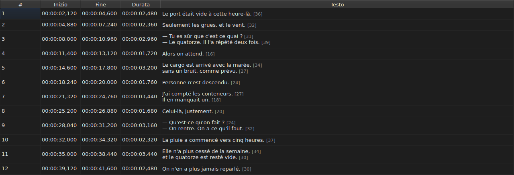
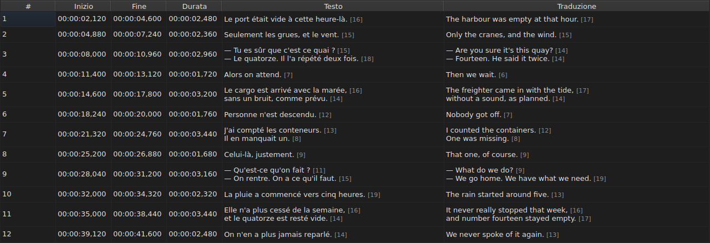
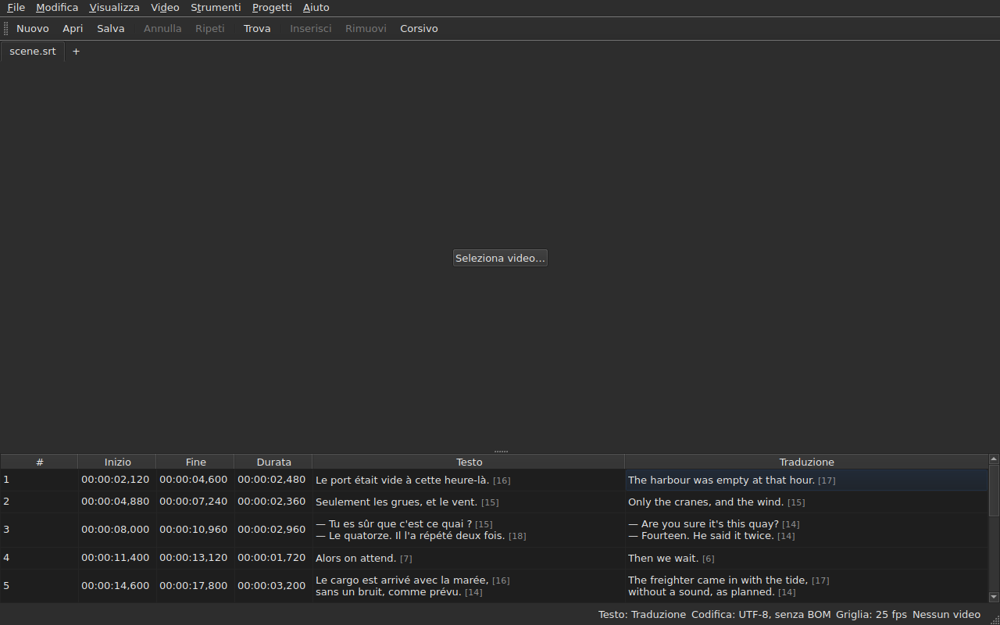

# La tabella

<!-- machine-translated -->
> Questa pagina è una traduzione automatica e non è ancora stata rivista da un lettore della lingua.

La finestra mostra i sottotitoli del file aperto, uno per riga, in cinque
colonne — sei quando il progetto porta una traduzione.

**Questo manuale cita le intestazioni della finestra così come le mostra la finestra
in inglese**, come fa per la riga di comando; la finestra in italiano e le sue schermate
le mostrano in italiano.

| Colonna | Che cosa mostra |
| :------ | :-------------- |
| `#` | il rango del sottotitolo, a partire da 1 |
| `Start` | la posizione in cui compare, `HH:MM:SS,mmm` |
| `End` | la posizione in cui scompare |
| `Duration` | `End − Start` |
| `Text` | il testo del sottotitolo |
| `Translation` | la traduzione del sottotitolo — **assente finché il progetto non ne ha una** |


## La lunghezza delle righe




**Ogni riga di una cella di testo è seguita dalla sua lunghezza**, `[N]`, più piccola
e più pallida — nella colonna `Text` come nella colonna `Translation`.
È ciò che fa Gaupol.

| Che cosa conta | Che cosa fa la tabella |
| :------------- | :--------------------- |
| **i tag** | non contano: `<i>Bonjour</i>` fa `[7]`, come `Bonjour` |
| **l'arrotondamento** | per difetto: una riga di 12,9 em viene mostrata `[12]` |
| **una riga vuota** | non ha lunghezza; nemmeno un testo vuoto |
| **l'unità** | *em* in modo predefinito, oppure caratteri — `Modifica ▸ Preferenze…` |
| **una riga troppo lunga per la colonna** | viene tagliata con `…` **prima** del numero, che resta visibile |

**L'*em* è quello di Gaupol, non quello della tipografia**: l'alfabeto minuscolo
vale 0,55 em per lettera, con il carattere della tabella. Una lunghezza in *em* dipende
quindi dal carattere; una lunghezza in caratteri conta i punti di codice, un
accento per uno.

**La tabella non segnala una riga troppo lunga.** Mostra il numero, e spetta
all'occhio confrontarlo con il limite che ci si è fissati — come in Gaupol. Non è
il limite dell'assistente `Correct Texts…`, che ha una propria impostazione.

**Per non vederle:** deselezionare `Show line lengths in cells` in
`Modifica ▸ Preferenze…`. Vedi [Le lunghezze di riga](preferences.md#le-lunghezze-di-riga).

## Nascondere e spostare le colonne

**`Visualizza ▸ Colonne`** porta una voce selezionabile per colonna, **tranne `Text`**:
senza il testo principale, non resterebbe nulla da modificare.

| Voce | Colonna |
| :--- | :------ |
| `Visualizza ▸ Colonne ▸ N.` | `#` |
| `Visualizza ▸ Colonne ▸ Inizio` | `Start` |
| `Visualizza ▸ Colonne ▸ Fine` | `End` |
| `Visualizza ▸ Colonne ▸ Durata` | `Duration` |
| `Visualizza ▸ Colonne ▸ Traduzione` | `Translation` — vedi [La colonna della traduzione](#la-colonna-della-traduzione) |

Deselezionare una voce rimuove la sua colonna, selezionarla di nuovo la rimette, con la larghezza
che aveva. **L'impostazione vale per tutta la finestra**, tutte le schede
comprese: c'è una sola tabella, il cui progetto cambia con la scheda.

**La cella corrente lascia la colonna che viene rimossa**: passa in `Text`,
sulla stessa riga, e la selezione non si sposta. Una cella corrente in una
colonna che nessuno vede sarebbe una cella che un tasto premuto modificherebbe
alla cieca.

**Le colonne si spostano trascinando la loro intestazione**, una qualsiasi, `Text`
compresa. L'ultima colonna mostrata prende lo spazio che le altre lasciano.

**L'ordine e le colonne rimosse vengono ricordati da una sessione alla successiva**, con
le larghezze, nel [file delle impostazioni](preferences.md) — `table.order`
e `table.hidden`. La colonna della traduzione non c'è: segue una regola
propria, e ritorna a ogni traduzione aperta.

**Il numero non è un dato del file** ma il rango della riga. Un
inserimento o una rimozione rinumera quindi tutto ciò che segue, senza che nulla
venga riscritto.

**Il separatore decimale segue il formato del file**: una virgola per SubRip,
un punto per gli altri otto. SubRip è l'unico dei nove a scrivere una virgola.

**È il separatore a seguire, non tutta l'ortografia.** La tabella scrive sempre
le ore e sempre tre decimali; un file WebVTT omette le
ore sotto un'ora, SubViewer 2 e i due Sub Station Alpha contano in
centesimi, MPL2 in decimi, TMPlayer in secondi, MicroDVD in fotogrammi. Una
colonna la cui larghezza seguisse il formato sarebbe più faticosa da leggere di una
colonna che semplicemente non è l'ortografia esatta del file.

Ciò che la tabella garantisce è quindi **il valore e il separatore**, non il numero
di decimali. Ciò che un formato di destinazione arrotonderebbe viene detto al momento del
salvataggio — vedi
[Che cosa un formato non conserverà](files.md#che-cosa-un-formato-non-conserverà-detto-prima-di-scrivere).

**La durata (`Duration`) è calcolata**, mai memorizzata: digitarla sposta la
fine. Un sottotitolo la cui fine precede l'inizio
mostra una durata negativa anziché zero: è un'anomalia del
file, e nasconderla renderebbe impossibile trovarla.

**L'inizio, la fine, la durata, il testo e la traduzione si modificano sul posto**; il
numero no. Vedi [Modificare una cella](editing.md).

**La selezione designa ciò su cui agisce un'operazione** — vedi
[Le operazioni](operations.md).

**L'altezza di una riga segue il sottotitolo che porta**: un sottotitolo di
due righe ne occupa due, uno di tre ne occupa tre. Il testo è mostrato per
intero, come verrà scritto.

**Ciò che resta tagliato è una riga troppo lunga per la sua colonna**, e termina allora
con dei puntini di sospensione. Allargare la colonna `Text`, o la finestra, la mostra
per intero; lo stesso vale aprendo la cella. Le righe del testo non vanno mai
a capo da sole: solo un vero a capo crea una riga, così che l'altezza
di una riga della tabella non cambia quando si trascina il bordo di una colonna.

## Posizioni in fotogrammi

**`Visualizza ▸ Posizioni in fotogrammi`** — una voce selezionabile, un'unica impostazione per la finestra — mostra le
colonne `Start` e `End` **come numeri di fotogramma** anziché come indicazioni di tempo, e **accetta un numero di fotogramma come input**. Le
intestazioni lo dicono: `Start (frames)` e `End (frames)`.

| Che cosa cambia | Che cosa non cambia |
| :-------------- | :------------------ |
| ciò che `Start` e `End` scrivono, e ciò che accettano | la colonna `Duration`, che resta un tempo |
| le intestazioni di quelle due colonne | il documento: nulla viene modificato, la cronologia non ha nuove voci, e **ciò che il file scrive è ciò che scriveva** |

**La frequenza dei fotogrammi che conta i fotogrammi** è, in quest'ordine:

1. **quella del file**, quando è contato in fotogrammi — MicroDVD, che porta numeri e non una
   frequenza dei fotogrammi: **la finestra mostra allora le cifre del suo file**, qualunque sia il video;
2. **quella che dichiara il video associato**;
3. **la griglia che le posizioni disegnano**, quando ne disegnano una.

Il suggerimento a comparsa della voce dice quale è stata scelta: *Le posizioni sono numeri di fotogramma, contati a 25 fps, la frequenza
dichiarata dal video*. **Se non c'è nessuna delle tre, la voce è disattivata e il suo suggerimento a comparsa ne spiega il motivo**: il file non
è contato in fotogrammi, il video non dichiara alcuna frequenza dei fotogrammi, e le posizioni non cadono su alcuna griglia.

- **Un numero è il numero del fotogramma in cui cade la posizione**, arrotondato al fotogramma più vicino. **Digitato,
  dà l'istante in cui quel fotogramma inizia**, arrotondato **una sola volta** a partire dal rapporto esatto
  ([ADR 0013](../../../../adr/0013-mise-a-l-echelle-exacte-des-positions.md)): il fotogramma 37 a 23,976 fotogrammi al secondo
  inizia a 1.543,04 ms, cioè `00:00:01,543`.
- **Sono accettati solo numeri interi** — con il segno meno, dato che un inizio può precedere il film. Un
  indicatore di tempo digitato in modalità fotogrammi, o un numero che non lo è, lascia la cella com'era.
- **La barra di riproduzione segue la stessa impostazione**: la posizione e la durata ai due lati dello slider
  sono scritte come numeri di fotogramma come `Start` e `End`, nello stesso istante — vedi
  [La barra di riproduzione](player.md#la-barra-di-riproduzione). L'orologio disegnato in alto sull'immagine resta un
  indicatore di tempo.
- **Questa impostazione non viene ricordata** da una sessione alla successiva: è un'impostazione della finestra, non di un
  documento, e si riattiva con un solo gesto.

## Le anomalie

Un sottotitolo le cui posizioni non stanno insieme è **colorato sulle sue
colonne di tempo**, e passarci sopra con il mouse dice che cosa non va.

| Tinta | Che cosa segnala | Che cosa fare |
| :---- | :--------------- | :------------ |
| rosso | `ends before it starts` | correggere la sua fine, o il suo inizio |
| blu | `starts before the previous one starts` | rimetterlo al suo posto nell'ordine |
| ambra | `starts before the previous one ends` | regolare la sua sincronizzazione |


Solo le colonne `Start`, `End` e `Duration` sono colorate: un'anomalia
riguarda solo il tempo, e colorare il testo suggerirebbe che c'entri
qualcosa.

**Un sottotitolo ne può portare più d'una**, e il suggerimento a comparsa le nomina tutte. La
tinta è quella della prima da riparare: un sottotitolo rotto in sé
è rotto qualunque cosa facciano i suoi vicini; un sottotitolo fuori posto viene rimesso a posto,
e la sua sovrapposizione se ne va con lui.

> Non è un caso che il disordine vinca quasi sempre sulla
> sovrapposizione: iniziare prima che il precedente inizi è iniziare
> prima che finisca — a meno che il precedente non sia a sua volta rotto.

**Il contrassegno viene ricalcolato dopo ogni cambio di posizione**, che provenga
da una cella modificata, da un'operazione o da un annullamento. Dice com'è il
file ora, non com'era all'apertura.

Non si appoggia ad alcuna griglia dei fotogrammi: non appena una posizione viene corretta a
mano, ne esce, e un contrassegno basato su di essa segnalerebbe il lavoro
dell'utente.

## La colonna della traduzione

Un sottotitolo porta **due testi e un'unica coppia di posizioni**: la
traduzione non ha una sincronizzazione propria, è legata a quella del sottotitolo.
La tabella la mostra in una sesta colonna, `Translation`, a destra di `Text`.




**La colonna c'è solo se il progetto ha una traduzione.** Senza, la tabella
mantiene le sue cinque colonne, e la finestra si comporta come se la traduzione
non esistesse — nulla viene disattivato né aggiunto. `File ▸ Apri traduzione…` ne apre
una: vedi [Aprire una traduzione](files.md#aprire-una-traduzione).

**Una voce del menu `View` la mostra o la rimuove**:

| Voce | Che cosa fa |
| :--- | :---------- |
| `Visualizza ▸ Colonne ▸ Traduzione` | selezionata: la colonna è mostrata; deselezionata: è rimossa |

La voce è **disattivata quando il progetto non ha traduzione** — non c'è nulla da
mostrare — e selezionata all'avvio. **La scelta di rimuoverla è
dell'utente**: vale da un file al successivo, finché non viene selezionata
di nuovo. Rimuovere la colonna non rimuove la traduzione: resta nel
progetto, e ritorna con la voce. Aprire un file che non ne porta nessuna rimuove la
colonna.

**Nelle celle della traduzione si digita come in quelle del testo** — vedi
[Modificare una cella](editing.md).

### Il testo su cui agiscono le operazioni

Con due testi in una riga, le operazioni sul testo devono sapere quale
riscrivere. **È quello della colonna della cella corrente**: la
traduzione se la cella corrente è nella colonna `Translation`, il testo
principale ovunque altrove — in una colonna di tempo come in `Text`.

| Operazione | Che cosa ha come bersaglio |
| :--------- | :------------------------- |
| `Italic`, `Case`, `Dialogue`, `Remove Hearing-Impaired Mentions…` | il testo della colonna corrente |
| `Cut Texts`, `Copy Texts`, `Paste Texts` | il testo della colonna corrente |
| `Find and Replace…` | il testo della colonna corrente — vedi [Trova e sostituisci](find-and-replace.md#in-quale-testo) |
| le operazioni sulle posizioni, inserimento, rimozione, unione, divisione | **entrambi i testi**: un sottotitolo è un tutto |

**La barra di stato lo dice quando ci sono due testi**, a sinistra delle altre
indicazioni:

```text
Text: Translation
```

oppure `Text: Main` per il testo principale. Resta in silenzio quando la colonna non è
mostrata: c'è allora un solo testo, e non serve dirlo.




**La riga disegnata sull'immagine segue la stessa regola**: è il testo della
colonna corrente. Vedi [Il lettore video](player.md#la-riga-disegnata).

**Nulla viene disattivato.** Le operazioni sul testo restano disponibili qualunque sia
la colonna corrente, e senza colonna della traduzione hanno come bersaglio il testo
principale, come prima.

## Aggiungere e rimuovere righe

`Modifica ▸ Inserisci sottotitoli…` e `Modifica ▸ Rimuovi sottotitoli` aggiungono e rimuovono
righe, `Modifica ▸ Fondi sottotitoli` e `Modifica ▸ Dividi sottotitolo` le uniscono e le
dividono; la tabella si rinumera da sola. Vedi
[Inserire, rimuovere, unire e dividere le righe](lines.md).

## Che cosa la tabella non fa

**L'ordinamento per colonna non esiste.** L'ordine mostrato è quello del file, ed
è l'unico che abbia senso per i sottotitoli: il rango di una riga *è*
il suo posto nel tempo.
