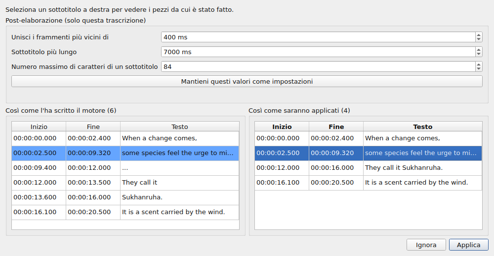
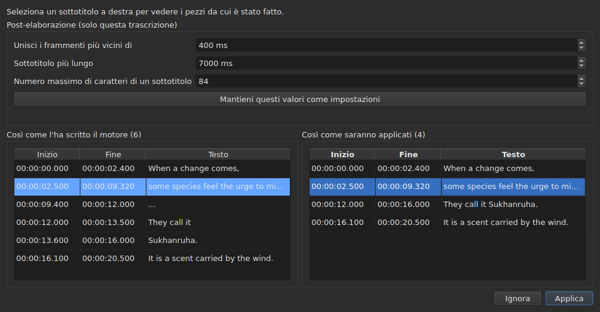

# Il video associato

<!-- machine-translated -->
> Questa pagina è una traduzione automatica e non è ancora stata rivista da un lettore della lingua.

Il menu **Video** porta anzitutto tre comandi, e poi i gesti che guidano il film
— vedi [Il lettore video](player.md#spostarsi-nel-film).

| Comando | Scorciatoia | Che cosa fa |
| :------ | :------- | :----------- |
| Seleziona video… | nessuna | sceglie il file video a cui il documento è associato |
| Trascrivi audio… | nessuna | trascrive l'audio del film in sottotitoli che sostituiscono quelli del progetto — vedi [Trascrivere l'audio](#trascrivere-laudio) |
| Riproduci / Pausa | `Ctrl+P` | riproduce o ferma il video — vedi [Il lettore video](player.md#riprodurre-e-fermare) |

Il video associato è **una proprietà del documento aperto**, non un'impostazione
dell'applicazione: aprire un altro file di sottotitoli ricomincia da zero. Non
viene scritto in alcun file e scompare con la finestra.

## La traccia audio

Un film può avere più tracce sonore — la versione originale, un doppiaggio, un commento. Il
sottomenu **`Video ▸ Audio ▸ Lingua`** le elenca, **una voce per traccia**, e **segna quella in riproduzione**:

| Che cosa fornisce il file | Che cosa dice la voce |
| :------------------ | :------------------ |
| una lingua e un titolo | `1: fra — Original` |
| una lingua soltanto | `2: eng` |
| un titolo soltanto | `3: Commentary` |
| nessuno dei due | `1` |

Il numero è **la posizione della traccia nel film**, una per una, nell'ordine del file: due tracce
possono dire `eng`, e un file che non dice nulla delle proprie etichette ha comunque una prima e una seconda traccia.

**Scegliere una voce riproduce quella traccia.** Il segno è la risposta del lettore, non il clic: indica
la traccia in riproduzione.

- **Il sottomenu è disattivato** se non c'è alcun video o alcuna traccia audio. Con una sola traccia, resta attivo e
  la mostra, spuntata: indica la lingua del film. I due gesti del volume, che gli stanno accanto, restano
  attivi in ogni caso: vedi [Il volume](player.md#il-volume).
- **La traccia non viene ricordata** da un video al successivo, né da una sessione alla successiva: il numero di una traccia è
  quello del suo file, e riportarlo sul film seguente sceglierebbe qualunque traccia porti quel numero.
  Tornare a una scheda riapre il suo film sulla traccia che il lettore sceglie da sé.
- Nessuna scorciatoia: la lingua si cambia di rado, e il menu basta.

## Scegliere un video

La finestra di dialogo si apre sulla directory del file di sottotitoli e filtra sulle
estensioni video riconosciute:

    .avi .flv .m2ts .mkv .mov .mp4 .ogg .ogv .vob .webm

Offre anche di mostrare tutti i file. Annullare la finestra di dialogo non cambia
nulla.

Il file scelto viene **aperto subito**: l'immagine compare nella finestra,
in pausa sul suo primo istante. Vedi [Il lettore video](player.md).

**Trascinare un file video sulla finestra fa la stessa cosa** — vedi
[Trascinare file sulla finestra](files.md#trascinare-file-sulla-finestra).

**Il video è quello del progetto della scheda corrente.** Ogni scheda conserva
il proprio; cambiare scheda cambia il film. **Tornare a una scheda riprende il suo
film dal punto in cui lo si era lasciato**, in pausa, come ogni apertura. Un altro film
scelto per quel progetto nel frattempo, invece, riparte dall'inizio.

## La proposta automatica

Quando si apre un file di sottotitoli, **se non è stato scelto alcun video**,
la finestra ne cerca uno nella stessa directory: un file video il cui nome
senza estensione è un prefisso del nostro, fino a un punto.

| File di sottotitoli | Video trovato | Perché |
| :------------ | :---------- | :-- |
| `film.fr.srt` | `film.mkv` | `film` è un prefisso di `film.fr` |
| `film.en.forced.srt` | `film.mkv` | allo stesso modo, qualunque sia il numero di segmenti |
| `film.fr.srt` | `film.fr.mkv` anziché `film.mkv` | vince il nome più lungo |
| `film.fr.srt` | nessuno, se ci sono `film.mkv` **e** `film.mp4` | due candidati non si distinguono |
| `film.fr.srt` | nessuno, se c'è solo `fil.mkv` | `fil` non termina su un punto |

**Una proposta non è una scelta.** Si lascia sostituire da un'altra
proposta — aprendo un altro file, salvando con un altro nome. Una scelta
esplicita, invece, non viene mai sovrascritta: una volta usato `Select Video…`, la
proposta automatica non torna più dietro di essa.

È ciò che rende accettabile l'ipotesi: si può correggere, e la correzione resta.

## Che cosa mostra la barra di stato

A destra della barra di stato, una riga dice a che cosa è associato il documento. È
l'ultima di tre: la [codifica](files.md#la-codifica-nella-barra-di-stato)
del file letto viene per prima, poi la [griglia dei fotogrammi](frame-grid.md) dedotta dalle
posizioni.

| Situazione | Che cosa viene scritto |
| :-------- | :-------------- |
| un video è associato | `Video: film.mkv` |
| … e `ffprobe` ne fornisce la frequenza dei fotogrammi | `Video: film.mkv, 24000/1001 fps` |
| nessuno | `No video` |

**La frequenza dei fotogrammi accompagna il film anziché stargli accanto.** Sono un unico fatto — a che cosa
è associato questo documento — e una terza indicazione la metterebbe sullo stesso piano della
[griglia dedotta dalle posizioni](frame-grid.md), che è un'altra cosa.

**Il nome del file, mai il suo percorso.** Un percorso di duecento caratteri
spingerebbe fuori tutto il resto dalla barra; il percorso completo è quello che
la finestra di dialogo mostrava.

## Trascrivere l'audio

**`Transcribe Audio…`** scrive il parlato del film come sottotitoli. È disattivato finché non è aperto un film: è
l'audio del **film del progetto**, mai un file che si sceglierebbe — per trascrivere un
file audio, usa [`transcribe`](../subedit-cli/transcribe.md) da riga di comando.

La finestra di dialogo chiede quattro cose e dice se può partire:

- **la traccia audio**, elencata come la elenca il menu [`Audio`](#la-traccia-audio), con la lingua
  e il titolo dichiarati dal file;
- **la lingua**, scelta in un **elenco**: prima una voce che la rileva, “Rileva dai primi 30 secondi di suono”, poi le lingue che
  il motore offre per il modello, con il loro nome nella lingua della finestra seguito dal codice — “francese (fr)”. L'elenco è quello del
  motore: un centinaio con un modello multilingue; con un modello solo per l'inglese ha la sola voce, l'inglese, e non si può
  cambiare, e una riga dice che il film uscirà in inglese qualunque lingua parli. L'elenco parte dalla lingua della traccia
  scelta quando il file ne dichiara una e il motore la offre, segue la traccia finché non ne hai scelta una, e
  **una riga sotto dice da dove viene**. Quando il file non dichiara alcuna lingua per la traccia, la riga lo dice, e avverte:
  il modello la rileverà allora dai primi trenta secondi di suono, e **un film che si apre con musica o silenzio può essere scambiato per
  un'altra lingua e il suo parlato tradotto in quella**. Scegli la lingua se la conosci;
- **i suoni scritti come note**: una casella, “Non scrivere i suoni come note”, selezionata per impostazione predefinita. Al motore è allora ordinato di non scrivere i suoni come
  note, come `(phone ringing)` o `[MUSIC PLAYING]`; dove non ha parlato da scrivere scrive `...`, e i pezzi che non hanno né lettere né cifre
  vengono scartati dalla post-elaborazione. Deseleziona la casella per conservare le note, per sottotitoli per non udenti. La casella è grigia, con il motivo,
  per un motore a cui non lo si può dire. È l'impostazione `transcription.suppress-notes`, che anche le [preferenze](preferences.md#trascrizione)
  contengono;
- **la parte del film**, da un tempo a un altro — vedi [Provare prima una parte](#provare-prima-una-parte). Con entrambi i campi
  vuoti si trascrive l'intero film.

**Dice anche che cosa manca.** Tre righe dicono se il motore, `ffmpeg` e il modello ci sono, e
dove; quando uno non c'è, `OK` resta disattivato, e la finestra lo dice con il rimando a
[Installare gli strumenti di trascrizione](../subedit-cli/install-transcription.md). Un pulsante `Preferences…` apre
le [preferenze](preferences.md#trascrizione), dove si impostano il programma e il modello — sono fatti
sulla macchina, non scelte da rifare a ogni trascrizione — e la finestra ricontrolla quando si chiudono.

La lingua viene conservata per la volta successiva. Il motore stesso e i limiti dei sottotitoli sono
[impostazioni](preferences.md) (`transcription.*`).

**Quando il progetto contiene già dei sottotitoli, la finestra chiede prima di sostituirli**, e dice
quanti ne vanno persi. Chiede prima del lavoro, in modo che rifiutare non costi nulla. Quando il progetto è vuoto non c'è
nulla da chiedere.

Il lavoro si svolge **in background**, con una finestra e un pulsante `Cancel`; la finestra principale resta utilizzabile. **La finestra
dice a che punto è il lavoro**, in modo che tu sappia che è vivo e quanto tempo richiederà:

- **la fase**: prima “Estrazione dell'audio…” — la finestra è allora occupata, senza cifre, perché l'estrazione non dice nulla
  del suo avanzamento —, poi “Trascrizione dell'audio…”, con una barra;
- **il tempo rimanente**, “circa 38 min rimanenti”: assente all'inizio, mostrato quando il motore ha riferito abbastanza avanzamento per estrapolare, e
  calcolato sulla sua velocità dall'inizio fino all'ultimo minuto; ha una precisione di qualche minuto, non è una promessa;
- **il tempo trascorso**, “trascorso: 0:05:12”, che avanza anche quando nient'altro si muove;
- **la posizione**, “0:12:30 di 0:50:00”: fino a dove nel film è arrivato il motore, non appena ha prodotto il suo primo testo, mostrata **subito sopra l'ultimo testo** a cui corrisponde;
- **l'ultimo testo** ottenuto, in modo che tu possa vedere che il lavoro ha senso.

Su un film lungo con un modello grande su processore, i primi minuti possono essere lunghi: il motore sta caricando il modello e
lavorando sulle sue prime finestre di trenta secondi. La posizione e l'ultimo testo si muovono prima del percento proprio del
motore, che arriva solo a passi del 5 % del film.

### L'anteprima

**Nulla sostituisce i sottotitoli del progetto finché non li hai visti.** Quando il lavoro termina — e anche quando lo annulli, o fallisce
dopo aver prodotto qualcosa — una finestra mostra il risultato in due tabelle affiancate, ciascuna con **il proprio inizio e la propria fine**:

- **a sinistra, “Così come l'ha scritto il motore”**: tutto ciò che il motore ha restituito, come l'ha tagliato, senza alcuna post-elaborazione — ciò che
  scriverebbe [`--raw`](../subedit-cli/transcribe.md) —, segnaposto (`...`) compresi;
- **a destra, “Così come saranno applicati”**: i sottotitoli dopo la post-elaborazione, esattamente ciò che entrerà nel progetto. Avviene in tre passi, ciascuno su tutta la trascrizione prima che inizi il successivo: i pezzi senza lettere né cifre (`...`) vengono scartati; i pezzi vicini di una stessa frase vengono uniti; quelli troppo lunghi vengono tagliati — **prima a una fine di frase (`. ? ! …`), poi a una virgola, un punto e virgola o due punti, e a metà frase solo quando non c'è punteggiatura dove tagliare**. Un taglio che lascerebbe un sottotitolo troppo piccolo per essere letto (pochi caratteri, una frazione di secondo) viene evitato quando ne esiste un altro. Un sottotitolo che inizia un pezzo ne conserva l'inizio, e quello che lo termina ne conserva la fine: i tempi delle parole servono solo per i tagli all'interno di un pezzo.

Sopra le tabelle, **“Post-elaborazione (solo questa trascrizione)”** contiene i tre limiti della post-elaborazione: “Unisci i frammenti più vicini di”, “Sottotitolo più lungo” e “Numero massimo di caratteri di un sottotitolo” — le impostazioni `transcription.merge-gap-ms`, `transcription.max-duration-ms` e `transcription.max-characters`. **Cambiarne una rifà subito la tabella di destra**, senza passare dal motore, e il sottotitolo che avevi selezionato resta selezionato. I valori inseriti valgono solo per **questa trascrizione**: che tu la applichi o la ignori, le impostazioni dell'applicazione restano com'erano. **“Mantieni questi valori come impostazioni”** affida i tre valori alle impostazioni dell'applicazione — quelle delle [preferenze](preferences.md#trascrizione), salvate con esse —, e la finestra lo dice; chiudere la finestra non lo fa da solo.

Le due non si allineano riga per riga, ed è per questo che ciascuna ha i propri tempi. **Selezionare un sottotitolo a destra evidenzia, a sinistra, i pezzi da cui
è stato fatto**, e scorre il lato sinistro fino a loro; un sottotitolo alla volta, e solo in questa direzione. Nessuna delle due tabelle si può modificare: ciò che nessuna impostazione sistema si modifica dopo, nella tabella del progetto, come qualsiasi sottotitolo.

Due pulsanti la chiudono. **“Applica”** sostituisce i sottotitoli del progetto **in una sola operazione**: un solo `Undo` restituisce ciò che c'era, testi di
traduzione compresi. **“Ignora”** scarta il risultato, che va perso. “Applica” è disattivato quando non c'è
nulla da applicare.

**Quando il lavoro è stato interrotto**, la finestra lo dice — “Risultato parziale: il lavoro si è fermato a …” — e offre ciò che era stato ottenuto fino a lì, da applicare
o da ignorare, in modo che una lunga esecuzione fermata tardi non perda il suo lavoro senza averlo chiesto. Quei pezzi non hanno parole con tempo (il motore le scrive alla
fine), e la post-elaborazione taglia ai limiti propri dei pezzi. Un fallimento viene detto prima in una finestra, come ogni fallimento; un annullamento non dice nulla di simile.

### Provare prima una parte

Un intervallo permette di **giudicare un modello o una lingua su due minuti prima di impegnarsi su due ore**. I campi “Parte del film” accettano un inizio e una fine, ciascuno scritto `HH:MM:SS`, come dicono i campi (`2:00` e un numero di secondi, `90`,
sono letti anch'essi); ne è ammesso uno solo (da lì alla fine, o dall'inizio fino a lì). `OK` resta disattivato finché un campo non
è un tempo o la fine non viene dopo l'inizio, e una riga sotto i campi dice quale.

- **I sottotitoli mantengono il tempo del film**: ciò che è detto a 2:10 si trova a `0:02:10` nel risultato.
- **Passa dall'anteprima come ogni trascrizione**, e sostituisce i sottotitoli del progetto una volta applicata; un solo `Undo` li restituisce.
  Per provare un intervallo senza toccare il tuo lavoro, ignora l'anteprima, oppure salva prima.

**Ciò che serve non è fornito**: un motore (whisper.cpp), un modello e `ffmpeg` per estrarre l'audio.
Vedi [Installare gli strumenti di trascrizione](../subedit-cli/install-transcription.md).

## Quando non c'è alcun film

La finestra mostra un pulsante **`Select Video…`** dove andrebbe l'immagine, anziché
niente del tutto. È lo stesso comando di quello del menu `Video`, a
portata di mouse: un'assenza su cui non si può agire si distingue a fatica da un
guasto.

Il pulsante scompare non appena un film è aperto, e l'immagine occupa **tutto** il suo
spazio: l'altezza che la tabella lascia sopra di essa — quella che
[`window.table-share`](preferences.md) ha ricordato da una sessione alla successiva —, e
mai meno dell'altezza minima dell'immagine, che la tabella cede se serve.
Quando il film se ne va, il pulsante riprende lo stesso posto.

## `ffmpeg` non è obbligatorio

`subedit-gui` interroga `ffprobe` — fornito con `ffmpeg` — per una cosa sola:
**la frequenza dei fotogrammi che il contenitore dichiara**. Viene letta una volta
per film, al momento dell'associazione.

| Con `ffprobe` | Senza |
| :------------- | :------ |
| la barra di stato scrive la frequenza dei fotogrammi accanto al nome del film | scrive solo il nome |
| la finestra di conversione propone la frequenza dei fotogrammi del film nel campo in basso | non propone nulla, e si apre come prima |
| la finestra di allineamento si apre su di essa | si apre sulla frequenza dei fotogrammi del progetto |

**Nient'altro ne dipende, e nessuna operazione rifiuta.** Il lettore, dal canto suo,
non ha affatto bisogno di `ffprobe`: si appoggia a `libmpv`, che è una
dipendenza di compilazione. La durata del film, quella usata per segnalare ciò che
supera la fine, proviene dal lettore e non da `ffprobe`.

**La trascrizione è l'unica cosa che ha bisogno di `ffmpeg`**: estrae l'audio del film. Vedi
[Installare gli strumenti di trascrizione](../subedit-cli/install-transcription.md).

Non è quindi una modalità degradata ma **il funzionamento normale** di una macchina
che non ha mai installato `ffmpeg`: il dato viene dall'utente, e `ffprobe`
lo propone quando c'è.

Una frequenza dei fotogrammi letta è un **razionale esatto** — `24000/1001`, non `23.976`.
È il motivo per cui `ffprobe` viene mantenuto per questa risposta: il
lettore conosce la stessa cosa come numero in virgola mobile, e una frequenza dei fotogrammi approssimata
risincronizzerebbe l'intero file con un leggero errore.
